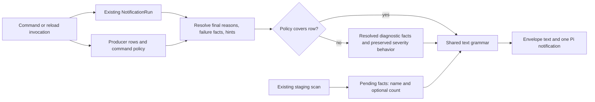

# Phase 2: Row Policies - Research

> Current disposition: the user approved the original 25 synthetic replacements
> on 2026-10-01, then explicitly approved three additional summary-owner
> replacements (original baseline lines 2633, 2634, 2640) with "yes".
> CONTEXT.md D-07 now authorizes exactly 28 replacements: severity, arity,
> the other 2,633 occurrences, metadata, and every catalog byte stay unchanged.
> Execution measured 69 actual render calls in 12 owner files, rather than
> the planning estimate of 70; all 69 calls are migrated. Historical research
> observations and the original 25-entry appendix below remain as evidence.

**Researched:** 2026-10-01
**Domain:** Internal TypeScript notification policy and text formatting
**Confidence:** MEDIUM — direct source observations; one acceptance conflict needs disposition

<user_constraints>
## User Constraints (from CONTEXT.md)

<!-- DATA_7c14fa92_START -->
### Preserved contracts

- **D-01:** Extend the policy already attached to each `CommandContext`, as
  phase 1 D-12 requires. Keep a total map keyed by status and its `satisfies`
  exhaustiveness check. The policies contain data, with no string-returning
  callback or function hidden inside a policy entry.
- **D-02:** Preserve all known differences: marker-free `partially-installed`
  list rows; content reasons on list `available` and `remote` rows; no reasons
  on reconcile-applied `uninstalled` rows; both `disabled` row forms; and
  pending rows independent of the soft-dependency snapshot. Each difference
  needs an owner test that checks both policy data and complete rendered text.
- **D-03:** Delete the render callbacks, central `renderPluginRow` switch,
  and `dispatchRow` string fallback by the end of the phase. Migrate the
  direct render-arm tests to policy and formatter assertions. Recount the
  current call sites before planning; the roadmap's 70 calls in 12 files is
  an inventory to verify, not permission to leave newly found callers behind.
- **D-04:** Preserve defensive missing-policy behavior in the resolved model.
  Keep the existing failed-row text and severity behavior, including the
  frozen-row handling. Removing the callback fallback must not erase that
  behavior or introduce a new exception path.
- **D-05:** Pending retained-workflow advisories carry only the observed facts
  `{name, envelopeCount?}`. Keep the existing single scan per invocation,
  empty-result behavior, order, and absence semantics. The text formatter
  owns the sentence and indent. Do not introduce a generic advisory framework
  for unrelated raw surfaces in this phase.
- **D-06:** Keep phase 1's shared `NotificationRun`, resolved reasons and
  failures, and internal readonly TypeScript model. No new probe occurs in
  rendering. Internal policy data is not the future public JSON schema.
- **D-07:** The phase closes with `npm run check` passing and the committed
  corpus unchanged. Use phase 1's accepted current baseline: 2,661 corpus
  entries and the catalog at upstream commit `e40d3dda` (206 states, 26,848
  bytes). Do not recapture or bless a changed baseline to pass the refactor.

### Agent's Discretion

The user declined all proposed discussion areas and said:
"none, apply your best judgement, stay consistent with the rest of the codebase".

The agent owns policy readability, handling of unexpected runtime rows, and
the internal advisory representation within the contracts above. Prefer
explicit status entries matching existing tables. Share small data constants
only where actual repetition justifies them. Exact field names, module
boundaries, migration order, and test organization remain planner decisions.
Do not add abstractions, optional behavior, or compatibility adapters without
a current consumer. Keep commits and verification steps small enough to review.

### Deferred Ideas (OUT OF SCOPE)

None. Discussion stayed within phase scope.
<!-- DATA_7c14fa92_END -->
</user_constraints>

## Summary

Extend the existing command marker map into a total map of row-policy data, with explicit switches for marker inclusion and content-reason inclusion. Resolve these switches before formatting. Keep glyphs, scope-bracket elision, version display, indentation, and status-token formatting in the text layer, as the preceding context requires. Replace the central status switch with a total formatting-data table and a shared formatter. Do not replace each callback with a function stored under another key. [VERIFIED: .planning/phases/01-presentation-model/01-CONTEXT.md:125-156; extensions/pi-claude-marketplace/shared/notification-resolve.ts:371-410]

The production change has a small conceptual scope but a broad test migration: 18 command contexts in 15 messaging modules, one central default policy, and 70 direct render calls in 12 messaging test files. Shared emitter tests also inject callbacks and must migrate. The retained-workflow scan already returns the required facts; stop turning those facts into strings in the pending orchestrator. [VERIFIED: source census of orchestrators/*.messaging.ts and tests/**/*.ts, 2026-10-01; extensions/pi-claude-marketplace/orchestrators/plugin/workflows-staging-gc.ts:215-233; extensions/pi-claude-marketplace/orchestrators/reconcile/pending.ts:153-168]

**Planning issue:** the frozen corpus includes synthetic output from the callback test doubles this phase removes. Eleven entries in the context-owner corpus contain the literal `controlled`; the dispatcher owner also captures nonstandard callback row text. A production formatter cannot automatically preserve these test-only formats. Resolve this conflict with D-07 before scheduling the migration; do not silently regenerate the baseline, keep a callback adapter, or add production formatting modes only to satisfy tests. [VERIFIED: tests/shared/notify-context.test.ts:166-181,208-225,264-315; tests/shared/notification-dispatch.test.ts:5717-5757,5760-5796; .planning/phases/01-presentation-model/notify-corpus/baseline.jsonl:2642-2661]

**Primary recommendation:** use explicit policy entries and one text grammar, preserving existing model and envelope behavior; make the synthetic-corpus disposition an explicit prerequisite.

## Architectural Responsibility Map

This is a local extension pipeline. The owners below follow the current source flow, not web-application tiers. [VERIFIED: extensions/pi-claude-marketplace/shared/notify-context.ts:137-182; extensions/pi-claude-marketplace/shared/notification-dispatch.ts:315-333,387-408]

| Capability | Primary tier | Secondary tier | Responsibility |
|---|---|---|---|
| Select command-specific row policy | Orchestrator messaging | Shared policy types | Declare complete status maps as data. |
| Resolve reasons and defensive failure facts | Shared model resolver | Invocation snapshot | Apply policy once; preserve serialized failure and hint facts. |
| Format row tokens and trailers | Shared text grammar | Existing text helpers | Consume resolved data; retain complete output bytes. |
| Scan retained staging | Existing filesystem scanner | Pending orchestrator | Obtain observations once per invocation. |
| Format retained-workflow advisory | Shared text formatter | Dispatcher | Compose sentence and indentation from observations. |
| Send the notification | Pi boundary | Shared dispatcher | Preserve severity, argument count, ordering, tally, and reload behavior. |

## Project Constraints (from AGENTS.md)

These directives apply to the plan and its execution. Source: the current AGENTS.md and the instructions supplied with this task. [VERIFIED: AGENTS.md]

- Read each file before editing it and trace callers before changing a function. Start through the existing GSD workflow. Use CodeGraph first where its index exists.
- Keep changes surgical, match existing style, remove only orphans created by this work, and avoid abstractions or options without a current consumer.
- Use the project's TypeScript style, comments, unit-testing, and unit-testing-review skills. Comments describe current behavior; durable requirement IDs are allowed, process-history comments are not.
- Keep strict TypeScript, readonly model interfaces, discriminated unions, and exhaustive const tables. Preserve the resolver's existing `installable: true | false` contract.
- All user-visible messages go through `ctx.ui.notify(message, severity)`; command/bridge code must not write directly to stdout/stderr. Preserve the existing one sanctioned load-time warning.
- Preserve atomic writes, retry-safe operations, containment, the existing network restrictions, and recovery through reload. This refactor adds no filesystem mutation, network access, probe, telemetry, localization, or scope.
- Required runtime remains `Node >= 20.19.0`. Keep the two scopes `user` and `project`. Do not add an upstream divergence; the compatibility skill finds no new upstream contract in this phase.
- Keep `npm run check` green, including Fallow, correspondence, direct-coverage controls, unit/integration checks, and type-member checks.
- Never commit to main, rebase, rewrite history, or skip hooks. Feature branches follow `features/<name>`. Conventional Commit and PR titles are 5–72 characters, with body lines no wider than 80; omit GSD phase/milestone mentions.
- Before a commit: run the Fallow audit gate and pre-commit; fix failures and rerun. Worktree commits use `SKIP=trufflehog`. Before deleting an export/file, trace it with Fallow; before a refactor, use symbol-impact; before editing a module, check applicable architecture boundaries.
- GSD window descriptions carry the milestone prefix; do not hand-edit the windows record. Every execution SUMMARY includes a Threat Flags section.
- PR work uses the prescribed plain-English and humanizer skills, offers the paired version bump and changelog update, and uses squash merge. Milestone audit/close precedes a milestone-shipping merge.

This research writes only its assigned document and does not commit, as instructed by the orchestrator.

<phase_requirements>
## Phase Requirements

<!-- DATA_06fba531_START -->
| ID | Description from REQUIREMENTS.md | Research support |
|---|---|---|
| PMOD-02 | Per-verb rendering differences are expressed as model data (row policies) instead of the `CommandContext` render callbacks in orchestrators' `*.messaging.ts`; every known per-command divergence is preserved. | Policy census, divergence matrix, resolver/formatter split, defensive model, and owner-test migration. |
| PMOD-05 | The `pending` retained-workflow-staging advisory is structured model data (`{name, envelopeCount?}`), and the text strategy composes its sentence. | Reuse scan observations, preserve optionality/order, change both carriers and catalog fixture inputs. |
<!-- DATA_06fba531_END -->

[VERIFIED: .planning/REQUIREMENTS.md:33-46]
</phase_requirements>

## Standard Stack

Use the installed project toolchain; this phase needs no package installation or upgrade. The recorded dependency declarations are `"typescript": "^6.0.3"`, `"strong-mock": "^9.2.2"`, `"fallow": "^3.27.0"`, and `"node": ">=20.19.0"`. These are repository declarations, not recommendations for newly discovered packages. [VERIFIED: package.json:25-34]

| Component | Observed version | Use |
|---|---|---|
| Node and its built-in test runner | v26.10.0 | Existing test execution and TypeScript loading. |
| TypeScript | 6.0.3 | Const tables, readonly interfaces, Record, satisfies. |
| Fallow | 3.27.0 | Existing dead-code, complexity, duplication, and boundary gates. |
| pre-commit | 4.5.1 | Required pre-commit gate. |

Versions above were observed with `node --version`, `node_modules/.bin/tsc --version`, `node_modules/.bin/fallow --version`, and `pre-commit --version`. [VERIFIED: environment probes, 2026-10-01]

Official TypeScript documentation confirms that satisfies checks assignability while retaining the expression's inferred type and can require exactly the keys of a union-backed Record. Keep the existing const/satisfies pattern; do not widen policy keys to arbitrary strings at declarations. [CITED: https://www.typescriptlang.org/docs/handbook/release-notes/typescript-4-9.html]

**Package Legitimacy Audit:** not applicable; no external packages are installed by the recommended plan. No latest-version or registry claim is made.

## Architecture Patterns

### System Architecture Diagram



The diagram is the recommended target. Existing entrypoint run sharing, resolution, and emission provide its integration points. [VERIFIED: extensions/pi-claude-marketplace/shared/notification-dispatch.ts:277-333,387-408]

### Recommended module ownership

Keep policy and resolved contracts within shared modules, command maps in their existing messaging modules, and pending observations in the current orchestrator. Avoid importing the scanner's orchestrator-owned type into shared code: declare the small presentation shape in the notification model and rely on structural compatibility, or move the existing shape only if its scanner consumer needs the shared declaration. The existing scanner shape is exactly `readonly name: string;` and `readonly envelopeCount?: number;`. [VERIFIED: extensions/pi-claude-marketplace/orchestrators/plugin/workflows-staging-gc.ts:215-229]

Recommended core edits:

| Current module | Work to plan |
|---|---|
| shared/notify-context.ts | Replace render and boolean marker members with the extended policy map; preserve generic producer narrowing and the four wrappers; delete RenderFn, dispatchRow, and hasRenderArmFor. |
| shared/notification-resolve.ts | Consume policy data; apply content suppression and marker derivation here; record a missing-policy fact; preserve current input-severity write and frozen-row handling. |
| shared/notification-grammar.ts | Replace the central row switch and command row callbacks with data-driven formatting; retain the existing version, scope, reasons, hint, description, and failure primitives where they still have consumers. |
| shared/notification-dispatch.ts | Pass policies into resolution; remove render callbacks from context emitters; use the same block formatter for central/context paths; format pending facts before folding the advisory block. |
| shared/notification-types.ts | Add the specific retained-workflow facts carrier to the two relevant message shapes. |
| orchestrators/reconcile/pending.ts | Forward scan facts directly; preserve one scan, omitted empty field, and both output arms. |
| All messaging modules and their paired tests | Replace complete maps and assertions together. |

The current signatures and call flow establish these owners. [VERIFIED: extensions/pi-claude-marketplace/shared/notify-context.ts:43-75,137-182; extensions/pi-claude-marketplace/shared/notification-resolve.ts:371-391; extensions/pi-claude-marketplace/shared/notification-dispatch.ts:387-472; extensions/pi-claude-marketplace/shared/notification-types.ts:607-623,730-741]

### Policy design

Use two explicit semantic switches initially: marker inclusion and content-reason inclusion. A policy's purpose is to determine the final reasons before the formatter sees them. Do not put glyphs, preformatted versions, arbitrary row templates, or string-returning functions into command policy entries. A small formatter-owned layout table can select fixed glyph, scope treatment, version form, and token form; it must be exhaustive over the status union. This follows the locked separation of raw versions/model facts from text formatting. [VERIFIED: .planning/phases/01-presentation-model/01-CONTEXT.md:125-156]

For the command contract, preserve both checks: every declared status has policy data, and every accepted producer row belongs to those statuses. Removing the Msg generic because no callback uses it must not weaken the `Msg extends PluginNotificationMessage & { status: Status }` constraint on wrappers. The current `WithPlugins` conditional distributes over marketplace variants; preserve that behavior. [VERIFIED: extensions/pi-claude-marketplace/shared/notify-context.ts:137-157; extensions/pi-claude-marketplace/shared/notification-types.ts:602-604]

Avoid retaining an unused generic solely for appearance; use the smallest contract that still checks producer rows and total maps. Keep explicit entries at command declarations; share only small genuinely repeated data constants. This is a design recommendation under delegated discretion.

### Current production census

The full-source/AST census found 18 contexts across 15 modules. The entries below quote their current context identifiers; an empty map remains a legitimate total map over never. [VERIFIED: current full-source AST reads, 2026-10-01; tests/architecture/soft-dep-marker-policy.test.ts:78-98]

| Messaging module below orchestrators/ | Context identifiers, verbatim |
|---|---|
| import/execute.messaging.ts | `IMPORT_CONTEXT` |
| marketplace/add.messaging.ts | `ADD_CONTEXT` |
| marketplace/autoupdate.messaging.ts | `AUTOUPDATE_CONTEXT`, `NOAUTOUPDATE_CONTEXT` |
| marketplace/list.messaging.ts | `LIST_CONTEXT` |
| marketplace/remove.messaging.ts | `REMOVE_CONTEXT` |
| marketplace/update.messaging.ts | `UPDATE_CONTEXT` |
| plugin/enable-disable.messaging.ts | `ENABLE_CONTEXT`, `DISABLE_CONTEXT` |
| plugin/fetch.messaging.ts | `FETCH_CONTEXT` |
| plugin/info.messaging.ts | `PLUGIN_INFO_CONTEXT` |
| plugin/install.messaging.ts | `INSTALL_CONTEXT` |
| plugin/list.messaging.ts | `LIST_CONTEXT` |
| plugin/reinstall.messaging.ts | `REINSTALL_CONTEXT` |
| plugin/uninstall.messaging.ts | `UNINSTALL_CONTEXT` |
| plugin/update.messaging.ts | `UPDATE_CONTEXT` |
| reconcile/reconcile.messaging.ts | `PENDING_CONTEXT`, `RECONCILE_APPLIED_CONTEXT` |

The central map currently declares these status keys verbatim:

<!-- DATA_3046fae8_START -->
```text
installed, updated, reinstalled, partially-installed, uninstalled, disabled,
available, remote, unavailable, partially-available, upgradable,
partially-upgradable, failed, skipped, manual recovery,
will install, will uninstall, will enable, will disable
```
<!-- DATA_3046fae8_END -->

[VERIFIED: extensions/pi-claude-marketplace/shared/notification-resolve.ts:301-321]

### Per-surface differences to preserve

The quoted status names below are the source keys above. Reasons are preserved in producer order; allowed companion markers follow them in the current agents/mcp/workflows order. Do not introduce sorting or deduplication. [VERIFIED: extensions/pi-claude-marketplace/shared/notification-resolve.ts:397-409]

| Surface and row | Policy/formatter requirement | Owner |
|---|---|---|
| Plugin list, `partially-installed` | Content reasons on, markers off even when a test supplies dependencies. | list.messaging plus resolver |
| Install/enable/update/reconcile, `partially-installed` | Content reasons and markers on. | Each messaging owner plus resolver |
| Plugin list, `available` and `remote` | Content reasons on; marker switch off. | list.messaging |
| Fetch/central, `available` and `remote` | Content reasons off; marker switch off. | fetch.messaging and central formatter/resolver |
| Reconcile applied, `uninstalled` | Both reason switches off. | reconcile.messaging |
| Ordinary uninstall/marketplace remove/central, `uninstalled` | Content reasons on, markers off. | uninstall.messaging, remove.messaging, central |
| All `disabled` forms | Markers off; preserve actual reasons and resolved hint. Bare toggles and disabled installs have distinct producer facts. | enable-disable.messaging, install.messaging, list.messaging, reconcile.messaging |
| Pending transition rows | No version or reasons; marker switch off. Partial install changes its token. | reconcile.messaging |

Evidence: explicit `"partially-installed": false` in the list policy; list calls pass `p.reasons` for available/remote; applied uninstall calls `composeReasons(undefined)`; pending token selection is `p.partial === true ? "(will partially install)" : "(will install)"`. [VERIFIED: extensions/pi-claude-marketplace/orchestrators/plugin/list.messaging.ts:101-165; extensions/pi-claude-marketplace/orchestrators/reconcile/reconcile.messaging.ts:86-104,176-210; extensions/pi-claude-marketplace/shared/notification-grammar.ts:639-654,905-920]

The two disabled helper routes currently produce the same token order. Their meaningful distinctions are reasons/hints and stamps, not a license to create two new status values. Current complete assertions include `"◍ alpha [project] v1.2.3 (disabled)"` and `"◍ helper v4.0.0 (disabled) {installs disabled, malformed skill}"`. [VERIFIED: tests/orchestrators/plugin/enable-disable.messaging.test.ts:36-64; tests/orchestrators/plugin/install.messaging.test.ts:143-160]

### Defensive missing-policy behavior

Move the diagnostic decision into the resolved model and its sentence into the text formatter. Keep the existing wording exactly, even though the old function is removed:

<!-- DATA_5baf3c90_START -->
```typescript
return `${"name" in row ? row.name : "?"} (failed) {internal: no render arm for "${row.status}"}`;
```
<!-- DATA_5baf3c90_END -->

[VERIFIED: extensions/pi-claude-marketplace/shared/notify-context.ts:354-365]

Preserve all of the following:

- A writable missing-policy input row is stamped `severity: "error"` before the envelope reduces original inputs.
- A frozen input rejects that write; the resolver catches it, keeps the existing severity, and continues to notification.
- An unnamed input stays unnamed in the resolved copy; only the diagnostic formatter substitutes `"?"`.
- Missing rows retain their position beside valid rows and preserve existing description/hint/failure trailers.
- A valid policy with both switches false is present, not missing. Test presence separately from its switch values.

The first three are explicit existing behavior, including `Object.freeze({ status: "unknown", severity: "info" })`; the owner tests assert the unchanged object and copied reasons. [VERIFIED: extensions/pi-claude-marketplace/shared/notification-resolve.ts:379-388,422-489; tests/shared/notification-resolve.test.ts:720-755; tests/shared/notify-context.test.ts:533-625]

Prefer an optional diagnostic fact on the resolved row over an exception or preformatted fallback string. Use own-property lookup for a policy table so an unexpected prototype-name status cannot be mistaken for policy data. Add one targeted malformed-row test for that lookup if implemented. This is a defensive implementation recommendation under D-04; do not claim the old inherited-property behavior was safe.

Do not recompute envelope severity from the new resolved array as part of this change: that would change frozen-object behavior and can change getter-backed message read order. Existing dispatch intentionally resolves ordinary rows before the envelope, while standalone dispatch composes its body before the envelope. [VERIFIED: extensions/pi-claude-marketplace/shared/notification-dispatch.ts:225-268,315-333; .planning/STATE.md: Decisions]

### Pending facts, not advisory sentences

The scan result already has the required structure. It conditionally spreads the count and sorts observations by directory name. The pending orchestrator currently calls the scan once outside the scope loop and converts empty lines to absence. Retain the same timing, order, and absent-count behavior while removing its formatter call. [VERIFIED: extensions/pi-claude-marketplace/orchestrators/plugin/workflows-staging-gc.ts:215-233,281-295; extensions/pi-claude-marketplace/orchestrators/reconcile/pending.ts:153-168,249-267]

Add a specifically named optional retained-workflow collection to the cascade and pending-empty message shapes; exact member spelling is a planner choice. Preserve unrelated existing text advisories for marketplace-add until their own phase. That path still uses `composeLeftoverRemovalAdvisories(cause.removalLeak)`, so globally changing `advisories?: readonly string[]` to retained-workflow facts would break a current consumer. [VERIFIED: extensions/pi-claude-marketplace/orchestrators/marketplace/add.ts:503-512; extensions/pi-claude-marketplace/shared/notification-types.ts:607-623,730-741]

The existing pure `composeRetainedWorkflowsAdvisories` can stay in the shared text-composition module and be called from the formatting path. Moving it to another file is unnecessary unless it simplifies ownership. It already owns the complete sentence and four-space indent. Both carriers must use that one formatting site, with the block after row content and before tally/reload text. [VERIFIED: extensions/pi-claude-marketplace/shared/notification-summary.ts:408-417; extensions/pi-claude-marketplace/shared/notification-dispatch.ts:249-253,356-367,399-406]

Change the two pending catalog fixture inputs from text lines to facts without changing catalog expected bytes. Preserve the standalone empty headline. Do not confuse omission of a count with zero; the scanner intentionally omits an unobserved count. [VERIFIED: tests/architecture/catalog-uat/fixtures/plugin-pending.ts:10-31,76-90; extensions/pi-claude-marketplace/orchestrators/plugin/workflows-staging-gc.ts:221-228]

## Don't Hand-Roll

| Problem | Use existing implementation | Reason |
|---|---|---|
| Companion state | NotificationRun snapshot | Avoid a second probe and severity/marker disagreement. |
| Reasons and failure detail | Resolver reason composition, serialized failure, hints | Preserve order, rollback entries, leaks, and optionality. |
| Staging discovery | scanRetainedWorkflowsStaging | Retains containment, age, read-failure, and directory-order behavior. |
| Text tokens | renderVersion, composeVersionArrow, renderScopeBracket, composeReasons | Avoid subtly different SHA/version/scope output. |
| Output regression | Existing catalog and notify-corpus tool | Preserve exact text, severity, argument count, and multiplicity. |

[VERIFIED: extensions/pi-claude-marketplace/shared/notification-resolve.ts:371-410,497-511; extensions/pi-claude-marketplace/shared/notification-grammar.ts:478-503,525-544; extensions/pi-claude-marketplace/orchestrators/plugin/workflows-staging-gc.ts:231-295; scripts/notify-corpus.mjs:9-27]

## Runtime State Inventory

This is a source-level refactor of transient presentation objects. No persisted schema or resource name is changed by the recommended plan. The inventory is bounded to the traced notification/scanner flow; it does not claim to have inspected the user's external services. [VERIFIED: extensions/pi-claude-marketplace/shared/notify-context.ts:137-182; extensions/pi-claude-marketplace/shared/notification-resolve.ts:371-391; extensions/pi-claude-marketplace/orchestrators/reconcile/pending.ts:249-267]

| Category | Items found | Required action |
|---|---|---|
| Stored data | Existing retained staging trees are read by the scanner. | No migration. Preserve the scanner and forward its facts. |
| Live service configuration | None in the traced local notification flow. | No service patch. |
| OS-registered state | None in the traced flow. | No registration changes. |
| Secrets/environment variables | No name changes in this phase's contracts. | No secret/env migration; credential-redaction work stays deferred. |
| Build artifacts/installed packages | Source modules are loaded by the existing extension runtime; no package or output-format version change is proposed. | Normal reload only; no generated artifact migration. |

## Common Pitfalls

1. **Collapsing command differences into one default.** A shared default without explicit overrides loses list reasons or adds reconcile removal reasons. Keep total command entries and literal owner assertions. [VERIFIED: list.messaging.ts:101-165 and reconcile/reconcile.messaging.ts:176-184 under extensions/pi-claude-marketplace/orchestrators]

2. **Treating false as missing.** Policies that suppress both reason classes are valid. Use presence checking independently of flags. Current marker logic explicitly compares with `=== true`; the missing-arm test is a separate predicate. [VERIFIED: extensions/pi-claude-marketplace/shared/notification-resolve.ts:379-388]

3. **Changing fallback severity or diagnostic spelling.** The frozen-input exception is observable and tested. Do not improve its behavior while deleting the old dispatch function. [VERIFIED: tests/shared/notification-resolve.test.ts:720-755; extensions/pi-claude-marketplace/shared/notify-context.ts:354-365]

4. **Overlooking tests outside the 70-call census.** Shared dispatcher/context tests, grammar callback tests, marker architecture gates, type pins, and catalog fixture inputs also encode old seams. [VERIFIED: tests/shared/notify-context.test.ts:40-100,166-181; tests/shared/notification-dispatch.test.ts:5717-5849; tests/shared/notification-grammar.test.ts:362-456; tests/architecture/soft-dep-marker-policy.test.ts:78-98,264-373]

5. **Repeating the staging scan per scope.** Keep it outside the loop; the scan locations are scope independent. Forward empty as absence, and leave unknown counts absent. [VERIFIED: extensions/pi-claude-marketplace/orchestrators/reconcile/pending.ts:137-168,249-267]

6. **Deleting the wrong renderPluginRow.** CodeGraph also finds a same-named function in the tools handler. The required deletion is the central notification-grammar function; the tool payload rendering is a different surface. [VERIFIED: CodeGraph exploration 2026-10-01; extensions/pi-claude-marketplace/shared/notification-grammar.ts:860-949]

7. **Using catalog prose as current implementation.** The frozen document still describes render-time markers and historical kind-based reload behavior, while the current resolver and stamps implement the accepted newer design. Preserve the catalog bytes; use current source and locked context for architecture. [VERIFIED: docs/output-catalog.md:69-80; extensions/pi-claude-marketplace/shared/notification-resolve.ts:371-410; extensions/pi-claude-marketplace/shared/notification-summary.ts:449-499]

## Code Examples

### Preserve the facts' absence semantics

The scanner already produces exactly the facts needed; this is existing source, not a proposed public schema:

<!-- DATA_670cfea9_START -->
```typescript
retained.push({
  name,
  ...(displaced.count !== undefined && { envelopeCount: displaced.count }),
});
```
<!-- DATA_670cfea9_END -->

[VERIFIED: extensions/pi-claude-marketplace/orchestrators/plugin/workflows-staging-gc.ts:286-289]

### Retain complete text assertions

These existing independent expected strings cover count grammar and absence:

<!-- DATA_08d96af3_START -->
```typescript
assert.deepStrictEqual(lines, [
  "    retained workflow staging: alpha (1 envelope) under the workflows staging directory",
  "    retained workflow staging: beta (3 envelopes) under the workflows staging directory",
  "    retained workflow staging: gamma under the workflows staging directory",
]);
```
<!-- DATA_08d96af3_END -->

[VERIFIED: tests/shared/notification-summary.test.ts:634-647]

### Test total policies at the declaration boundary

Use the current contract's const/satisfies idiom for the replacement map. Add compile-negative examples in the owning test for a missing status and a function where policy data is required. Assert meaningful complete policy values; do not retain Object.keys assertions merely to restate compiler-enforced totality. The project skills require type-only assertions for type contracts and independent complete output expectations for runtime behavior. [VERIFIED: skills/typescript-unit-testing/SKILL.md; skills/typescript-unit-testing-review/SKILL.md; extensions/pi-claude-marketplace/shared/notify-context.ts:49-75]

## Validation Architecture

The workflow explicitly enables validation. [VERIFIED: .planning/config.json — `"nyquist_validation": true`]

### Framework and exact commands

| Property | Value |
|---|---|
| Framework | Existing node:test and node:assert/strict; strict notification interaction mocks follow the existing project skill. |
| Configuration | Existing package scripts and TypeScript configuration; no new test runner. |
| Quick model/context check | `node --test tests/shared/notification-resolve.test.ts tests/shared/notify-context.test.ts` |
| Quick grammar/dispatch check | `node --test tests/shared/notification-grammar.test.ts tests/shared/notification-dispatch.test.ts` |
| Pending check | `node --test tests/orchestrators/reconcile/pending.test.ts tests/orchestrators/reconcile/reconcile.messaging.test.ts tests/shared/notification-summary.test.ts` |
| Architecture/catalog check | `node --test tests/architecture/soft-dep-marker-policy.test.ts tests/architecture/workflows-marker-coverage.test.ts tests/architecture/catalog-uat/catalog-contract.test.ts` |
| Direct pair coverage | `npm run test:coverage:direct -- extensions/pi-claude-marketplace/shared/notification-resolve.ts` (repeat for each changed source owner) |
| Full gate | `npm run check` |
| Frozen wire corpus | `node scripts/notify-corpus.mjs check` |
| Accepted catalog base | `git diff --exit-code e40d3dda -- docs/output-catalog.md` |

Commands follow the current package scripts and project testing skill. [VERIFIED: package.json:77-103; skills/typescript-unit-testing-review/SKILL.md; scripts/notify-corpus.mjs:387-430]

The four-file probe run (resolver, context wrapper, reconcile messaging, catalog contract) exited zero in approximately two seconds. Its runner reported four successful file-level entries, not individual test-case totals. The accepted-base catalog diff also exited zero. Full npm check and full corpus were not rerun for this research-only change. [VERIFIED: /tmp/row-policies-focused-tests.log; research shell probe, 2026-10-01]

### Phase requirements to owner tests

| Requirement | Behavior | Test type | Owner/test action |
|---|---|---|---|
| PMOD-02 | Total policy with no functions and producer narrowing | Compile contracts | notify-context owner; preserve negative producer-status tests. |
| PMOD-02 | Every command policy value | Unit/data | All 15 messaging owners plus the marker architecture census. |
| PMOD-02 | Final reasons, ordering, marker suppression, missing policy | Unit | notification-resolve owner; compare full resolved rows and input mutation. |
| PMOD-02 | Glyphs, scope, versions, partial pending, trailers | Unit | notification-grammar owner; compare complete output. |
| PMOD-02 | Severity, arity, tally, reload, row order | Unit/integration | notify-context and notification-dispatch owners; replace callback expectations with semantic outputs. |
| PMOD-02 | Marker derivation remains at one site | Architecture | Preserve workflows-marker-coverage and its planted control. |
| PMOD-05 | One scan; empty/cascade carrier; order and omission | Unit using existing temp filesystem | pending owner plus existing scanner owner. |
| PMOD-05 | Sentence, indent, singular/plural/absent count | Unit/catalog | notification-summary owner and pending catalog fixtures. |
| Both | No frozen production-output regression | Regression | Catalog and wire corpus; resolve synthetic test emissions first. |

Existing owner infrastructure covers these concerns; each changed source module still needs its mirrored direct test file and full direct pair coverage. Do not add a new module without its owner. [VERIFIED: skills/typescript-unit-testing/SKILL.md; skills/typescript-unit-testing-review/SKILL.md]

### Direct render-call migration census

The fresh search includes both dot and bracket access: `rg -n '\.render(?:\.|\[)' tests --glob '*.ts'`. It confirms the stated 70 direct calls; it does not count Object.keys checks, type pins, shared callback fixtures, or callback arguments to grammar helpers. [VERIFIED: source census, 2026-10-01]

| Messaging test below tests/orchestrators/ | Calls |
|---|---:|
| import/execute.messaging.test.ts | 6 |
| marketplace/autoupdate.messaging.test.ts | 2 |
| marketplace/remove.messaging.test.ts | 4 |
| marketplace/update.messaging.test.ts | 4 |
| plugin/enable-disable.messaging.test.ts | 8 |
| plugin/fetch.messaging.test.ts | 6 |
| plugin/info.messaging.test.ts | 3 |
| plugin/install.messaging.test.ts | 6 |
| plugin/list.messaging.test.ts | 10 |
| plugin/uninstall.messaging.test.ts | 2 |
| plugin/update.messaging.test.ts | 6 |
| reconcile/reconcile.messaging.test.ts | 12 |
| **Total** | **70** |

Also migrate reinstall/add/marketplace-list context shape checks even though those owners have no direct row-call entries. Preserve the marker-policy independent table, source-context discovery, and both planted context controls. Change its read side to project marker flags from the new policy data while keeping literal expected booleans independent. [VERIFIED: tests/architecture/soft-dep-marker-policy.test.ts:78-98,246-373]

### Sampling rate and Wave 0

- Per implementation task: the touched source's owner tests, direct pair coverage, and typecheck.
- Per wave: the shared presentation and marker suites; catalog checks after any formatting change.
- Phase gate: full npm check, accepted catalog diff, and frozen corpus, with the synthetic-fixture issue explicitly resolved first.
- No runner installation or new harness is required.
- Wave 0: settle corpus handling; record old/new seam ownership; add meaningful compile-negative policy contracts.
- Keep tests for all named D-02 divergences. For pending snapshot independence, compare full rendered output under opposing supplied snapshots; do not add a probe.

These are recommended validation tasks, grounded in existing test ownership and the phase's acceptance criteria. [VERIFIED: .planning/ROADMAP.md:106-118; skills/typescript-unit-testing-review/SKILL.md]

### Frozen baseline specifics

The accepted catalog assertions are `const EXPECTED_STATE_COUNT = 206;` and `const EXPECTED_UTF8_BYTES = 26_848;`. Metadata records `"entries": 2661`, `"argcOne": 1397`, and `"argcTwo": 1264`. Do not use the superseded catalog base. [VERIFIED: tests/architecture/catalog-uat/catalog-contract.test.ts:39-40; .planning/phases/01-presentation-model/notify-corpus/meta.json:1-8]

The corpus compares per-file multisets of message/severity/argument-count triples. Added entries are reported separately, while missing baseline entries fail. A phase criterion requiring an empty diff is stricter than merely seeing an exit-zero check; inspect extras as well. Do not relocate emission-producing tests across files without accounting for this. [VERIFIED: scripts/notify-corpus.mjs:9-27,84-86,136-180,387-407]

## Environment Availability

| Dependency | Availability | Observed version | Fallback |
|---|---|---|---|
| Node | Available | v26.10.0 | None needed. |
| npm | Available | 11.19.1 | None needed. |
| Local TypeScript | Available | 6.0.3 | Use the existing npm script. |
| Local Fallow | Available; executable not on ordinary PATH | 3.27.0 | npm scripts or node_modules/.bin/fallow. |
| pre-commit | Available | 4.5.1 | None needed. |
| CodeGraph | Available | Exploration succeeded | Focused source reads after exploration. |
| Graphify context | Disabled by project configuration | N/A | No graphify context used. |

[VERIFIED: environment probes and graphify status, 2026-10-01]

No runtime service or package installation is required. The earlier phase verification documents sandbox-only full-suite failures followed by a successful permission-enabled continuation; do not mistake a similar execution-environment failure for evidence of a code regression. Record actual failed output and rerun only affected gates when justified. [VERIFIED: .planning/phases/01-presentation-model/01-VERIFICATION.md: Behavioral Spot-Checks]

## Security Domain

The configuration does not disable security enforcement, so include a bounded threat model in plans. Relevant concerns are preserving failure visibility and handling untrusted plugin/staging strings through the existing boundaries; this is not an authentication or cryptography feature. [VERIFIED: .planning/config.json; extensions/pi-claude-marketplace/shared/notification-resolve.ts:422-431; extensions/pi-claude-marketplace/orchestrators/plugin/workflows-staging-gc.ts:215-228,264-278]

Use ASVS 5.0 category names explicitly; the generic template's older numbering does not match that version. Official source lists V2 Validation and Business Logic, V5 File Handling, V6 Authentication, V7 Session Management, V8 Authorization, V11 Cryptography, V14 Data Protection, and V16 Security Logging and Error Handling. [CITED: https://github.com/OWASP/ASVS/tree/v5.0.0/5.0/en]

| ASVS 5.0 category | Applies to this work | Planned control |
|---|---|---|
| V2 Validation and Business Logic | Yes, bounded internal data boundary | Closed total policy maps; safe absent-policy handling. |
| V5 File Handling | Preserve existing control | Keep scan containment and read-only behavior. |
| V6 Authentication / V7 Session Management / V8 Authorization | No new mechanism | Leave existing mechanisms untouched. |
| V11 Cryptography | No | No crypto added. |
| V14 Data Protection | Preserve existing control | Pass staging basenames and optional counts; do not expose absolute scan paths. |
| V16 Security Logging and Error Handling | Yes | Preserve the diagnostic, failure serialization, and frozen-input catch. |

Applicability is a design assessment of the traced phase boundary, not a claim of ASVS compliance.

| Threat | STRIDE category | Mitigation to retain/test |
|---|---|---|
| Missing policy suppresses notification or lowers writable-row error | Tampering / denial of service | Resolved diagnostic plus existing severity-floor behavior. |
| Prototype property mistaken for row policy | Tampering | Own-key lookup; no execution from policy data. |
| Refactor exposes staging absolute paths | Information disclosure | Carry only scanner name/count facts. |
| Formatter reads filesystem or probes host state | Information disclosure / inconsistent output | Keep scan at producer and one invocation snapshot upstream. |

These are phase-specific threat assessments based on the cited resolver and scanner boundaries; no new sanitization or credential-redaction scope is introduced.

## State of the Art

| Existing shape | Recommended target | Scope |
|---|---|---|
| Render callbacks plus marker booleans | Total semantic row policies plus one text grammar | This phase |
| Pending orchestrator passes formatted strings | Pending passes observed retained-tree facts | This phase |
| Serialized errors and invocation snapshot | Preserve both | Established previous-phase contract |

This is an internal migration table, not an ecosystem trend claim. [VERIFIED: .planning/phases/02-row-policies/02-CONTEXT.md: Implementation Decisions]

## Assumptions Log

No training-derived technical claim is needed. Proposed field names and module organization are recommendations within the user's delegated discretion, not claims about an existing API. The unresolved corpus conflict is evidenced below rather than assumed away.

## Open Questions

1. **How should callback-only synthetic corpus entries be treated while deleting callbacks?**
   - Observed: eleven notify-context entries include `controlled available` or `controlled disabled`; dispatcher tests also emit `controlled installed alpha` and rows without normal glyphs. [VERIFIED: tests/shared/notify-context.test.ts:166-181; tests/shared/notification-dispatch.test.ts:5717-5757,5760-5796; baseline.jsonl records read in this session]
   - Constraint: D-03 removes callbacks and adapters; D-07 freezes the committed corpus; delegated discretion forbids test-only flexibility.
   - Recommendation: obtain a specific disposition from the orchestrator/user before implementation of the affected shared tests. The narrow option is an explicitly reviewed treatment of obsolete synthetic seam emissions while retaining all production-output entries, but that is a change to the locked acceptance contract and is **not authorized by this research**.
   - Do not emit stored baseline literals through a raw notify helper to manufacture a green corpus; that would make the regression test vacuous.
2. **No other product decision remains.** Exact policy/member names and coherent migration batches are delegated. Keep the advisory change separate from later raw-output/schema work. [VERIFIED: .planning/phases/02-row-policies/02-CONTEXT.md: Agent's Discretion]

## Suggested Planning Sequence

1. Resolve the synthetic-corpus acceptance conflict and record the disposition.
2. Define the extended policy and formatter data contracts, preserving producer narrowing and runtime fallback semantics.
3. Migrate shared resolve/format/dispatch seams together with their direct owners; ensure every intermediate committed state typechecks.
4. Migrate command contexts and all corresponding tests in coherent batches; preserve the architecture census throughout.
5. Thread pending facts through both carriers and update only catalog fixture inputs.
6. Remove retired helpers/imports after caller tracing; complete full gates and confirm accepted baselines.

Steps 2–4 are strongly coupled by the current signatures. Prefer one coherent shared-contract change with mechanical context/test edits over optional production adapters solely to split commits. This is a planning recommendation supported by the four context wrapper calls and three dispatcher entrypoints. [VERIFIED: extensions/pi-claude-marketplace/shared/notify-context.ts:175-182,220-227,262-269,302-310; extensions/pi-claude-marketplace/shared/notification-dispatch.ts:417-472]

## Sources

### Direct repository evidence

- Current AGENTS.md and the five applied TypeScript/compatibility skills.
- Phase 2 context, requirements, roadmap, state; Phase 1 context and verification.
- Current shared notification context, resolver, grammar, summary, dispatcher, types.
- All command messaging maps, pending orchestrator, staging scanner.
- Corresponding owner tests, marker architecture gates, catalog fixtures, and corpus implementation/baseline.

### Official documentation

- [TypeScript 4.9 satisfies documentation](https://www.typescriptlang.org/docs/handbook/release-notes/typescript-4-9.html): exhaustive object checks without widening inference.
- [OWASP ASVS 5.0 source index](https://github.com/OWASP/ASVS/tree/v5.0.0/5.0/en): applicable category names.

The research-plan seam selected jina for both external questions; that tool was unavailable, so official pages were read through the web fallback. Confidence classification for verified websearch returned MEDIUM. The classifier does not recognize the local codebase provider and returned LOW for it; local VERIFIED tags here denote direct source observations, not a provider-derived HIGH rating. Curated cache writes hit a read-only home filesystem; the two digests were successfully cached through the same seam under the temporary working directory with source=web. No repository cache or baseline was changed. [VERIFIED: research-plan, classify-confidence, and research-store command results, 2026-10-01]

## Metadata

| Area | Confidence | Reason |
|---|---|---|
| Stack | MEDIUM | Existing package declarations and installed-version probes; no dependency change. |
| Architecture | MEDIUM | Source/caller census and locked decisions agree; migration feasibility depends on corpus disposition. |
| Pitfalls | MEDIUM | Exact existing tests demonstrate fallback, ordering, suppression, and synthetic-output constraints. |

**Research date:** 2026-10-01
**Valid until:** source or context changes; refresh the census before execution.
**Commit:** intentionally not made; the orchestrator owns commits.

## Appendix: Exact Synthetic Corpus Entries Requiring Disposition

A complete current census finds **25 affected occurrences**: 19 from the context owner (11 controlled-row entries and eight marker-string entries), and six from the dispatcher owner. Every other corpus occurrence remains outside this proposed disposition. Line numbers identify the immutable committed baseline; duplicate entries deliberately remain separate occurrences. [VERIFIED: .planning/phases/01-presentation-model/notify-corpus/baseline.jsonl:2487-2661; tests/shared/notification-dispatch.test.ts:5717-5849,5878-5915,6003-6097; tests/shared/notify-context.test.ts]

### Minimal resolution options

1. **Keep the baseline immutable and add an explicit migration ledger:** enumerate exactly these old triples with file and multiplicity, replacement triples from independent full-text assertions, and the unchanged behavior each migrated test proves. A corpus comparison can apply only approved substitutions, refusing unmatched substitutions, unexpected duplicates, and all other missing entries. This preserves the committed capture but changes literal empty-diff acceptance; the orchestrator must record that disposition. No substitution may weaken severity, arity, markers, fallback wording, tally, or reload assertions.
2. **Approve a reviewed baseline patch for these 25 occurrences:** migrate these tests to real policies, inspect exact old/new triples, and change only those entries. This is simpler tooling but explicitly changes D-07. A full recapture or blanket acceptance is unjustified.

The first option is preferred if retaining the historical corpus file is the stronger requirement. Neither option has been applied. Keeping callbacks, inventing template options, or replaying literals merely to satisfy capture is rejected.

<!-- DATA_d9ec28a1_START -->
```jsonl
{"line":2487,"file":"tests/shared/notification-dispatch.test.ts","message":"Some operations need attention.\n\n● official [user] (skipped) {not found}\n  alpha (skipped)","severity":"warning","argc":2}
{"line":2599,"file":"tests/shared/notification-dispatch.test.ts","message":"● official [user]\n  alpha (available)\n\nPlugin list: 1 success","severity":null,"argc":1}
{"line":2600,"file":"tests/shared/notification-dispatch.test.ts","message":"● official [user]\n  alpha (available)\n\nPlugin update: nothing to update","severity":null,"argc":1}
{"line":2601,"file":"tests/shared/notification-dispatch.test.ts","message":"● official [user]\n  alpha (installed)\n  beta (reinstalled)","severity":null,"argc":1}
{"line":2602,"file":"tests/shared/notification-dispatch.test.ts","message":"● official [user]\n  controlled installed alpha\n\nPlugin install: 1 success\n\n/reload to pick up changes","severity":null,"argc":1}
{"line":2603,"file":"tests/shared/notification-dispatch.test.ts","message":"● official [user]\n  first (installed)\n  second (available)\n\n/reload to pick up changes","severity":null,"argc":1}
{"line":2642,"file":"tests/shared/notify-context.test.ts","message":"A plugin operation has failed.\n\n● official [user]\n  orphan (failed) {internal: no render arm for \"disabled\"}\n  controlled available neighbor [user]","severity":"error","argc":2}
{"line":2644,"file":"tests/shared/notify-context.test.ts","message":"● official [project]\n  controlled available alpha [project]","severity":null,"argc":1}
{"line":2645,"file":"tests/shared/notify-context.test.ts","message":"● official [project]\n  controlled available alpha [project]\n\nPlugin update: 1 updated","severity":null,"argc":1}
{"line":2646,"file":"tests/shared/notify-context.test.ts","message":"● official [project]\n  controlled available alpha [project]\n\nPlugin update: 37 updated","severity":null,"argc":1}
{"line":2647,"file":"tests/shared/notify-context.test.ts","message":"● official [user]\n  ? (failed) {internal: no render arm for \"unknown\"}\n  controlled available neighbor [user]","severity":null,"argc":1}
{"line":2648,"file":"tests/shared/notify-context.test.ts","message":"● official [user]\n  alpha {requires pi-subagents}","severity":null,"argc":1}
{"line":2649,"file":"tests/shared/notify-context.test.ts","message":"● official [user]\n  alpha {requires pi-subagents}","severity":null,"argc":1}
{"line":2650,"file":"tests/shared/notify-context.test.ts","message":"● official [user]\n  alpha {requires pi-subagents}\n\nPlugin inspect: 1 success","severity":null,"argc":1}
{"line":2651,"file":"tests/shared/notify-context.test.ts","message":"● official [user]\n  alpha {requires pi-subagents}\n\nPlugin update: nothing to update","severity":null,"argc":1}
{"line":2652,"file":"tests/shared/notify-context.test.ts","message":"● official [user]\n  alpha {}","severity":null,"argc":1}
{"line":2653,"file":"tests/shared/notify-context.test.ts","message":"● official [user]\n  alpha {}","severity":null,"argc":1}
{"line":2654,"file":"tests/shared/notify-context.test.ts","message":"● official [user]\n  alpha {}\n\nPlugin inspect: 1 success","severity":null,"argc":1}
{"line":2655,"file":"tests/shared/notify-context.test.ts","message":"● official [user]\n  alpha {}\n\nPlugin update: nothing to update","severity":null,"argc":1}
{"line":2656,"file":"tests/shared/notify-context.test.ts","message":"● official [user]\n  controlled available alpha [user]","severity":null,"argc":1}
{"line":2657,"file":"tests/shared/notify-context.test.ts","message":"● official [user]\n  controlled available alpha [user]\n  controlled available beta [user]\n\n● community [project]\n  controlled disabled gamma [project]\n\nPlugin inspect: 3 successes","severity":null,"argc":1}
{"line":2658,"file":"tests/shared/notify-context.test.ts","message":"● official [user]\n  controlled available alpha [user]\n\nPlugin inspect: 1 success","severity":null,"argc":1}
{"line":2659,"file":"tests/shared/notify-context.test.ts","message":"● official [user]\n  controlled available alpha [user]\n\nPlugin reconcile: 1 success","severity":null,"argc":1}
{"line":2660,"file":"tests/shared/notify-context.test.ts","message":"● official [user]\n  controlled available alpha [user]\n\nfirst advisory\nsecond advisory\n\nPlugin inspect: 1 success","severity":null,"argc":1}
{"line":2661,"file":"tests/shared/notify-context.test.ts","message":"● official [user]\n  controlled disabled alpha [user]\n\nPlugin update: nothing to update","severity":null,"argc":1}
```
<!-- DATA_d9ec28a1_END -->
