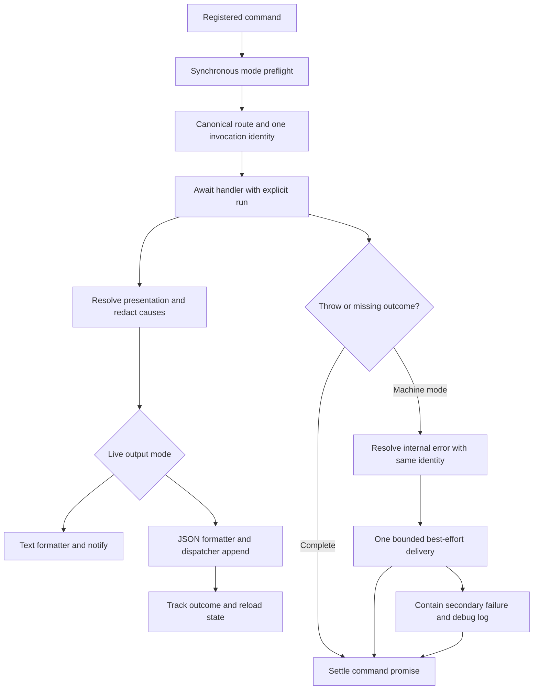

# Phase 6: Command-Run Contract - Research

**Researched:** 2026-10-09
**Domain:** Existing command lifecycle, notification metadata, and failure delivery.
**Confidence:** LOW for uninspected command coverage; implementation-seam observations below are source-verified.
**Scope:** Bounded recovery research. No dependency changes, web research, implementation, tests, or commits were performed. Parent owns the commit. [VERIFIED: research session actions]

<user_constraints>
## User Constraints (from CONTEXT.md)

The following approved decisions and discretion are copied verbatim. They are requirements, not findings about implemented behavior. [VERIFIED: .planning/phases/06-command-run-contract/06-CONTEXT.md]

<!-- DATA_f63d901a_START -->
## Implementation Decisions

The user selected each recommendation in the interactive discussion and
approved writing this context and continuing planning.

### Command identity

- **D-01:** Use canonical command names only. `ls` becomes `plugin list`.
  `marketplace rm` becomes `marketplace remove`. Do not add an alias field.
- **D-02:** Invalid commands use their recognized parent as the command ID.
  An unknown top-level verb uses `plugin`. A missing or unknown marketplace
  verb uses `marketplace`. The `usage-error` describes the mistake.
- **D-03:** Delegated work retains the outer command identity and the same
  invocation ID. Installation work inside `enable` remains `plugin enable`.
  Bare `/claude:plugin` uses `plugin browse`.
- **D-04:** `help marketplace` and `marketplace help` both use
  `marketplace help`.

### Explicit command outcomes

- **D-05:** A successful empty result uses the appropriate typed outcome.
  Do not manufacture a generic success acknowledgment on normal return.
  In JSON/RPC, a handler that returns without an outcome emits `internal-error`
  for the missing result.
- **D-06:** Device-flow prompts and diagnostics alone do not count as an
  outcome. A run that emits only those and returns normally also emits
  `internal-error` for the missing result. Help and usage errors are valid
  explicit responses. Planning must classify the existing result kinds and
  keep legitimate empty results valid.

### Failure after partial output

- **D-07:** Keep earlier entries and append `internal-error` for an unexpected
  throw, using the same invocation ID. The error payload preserves any reload
  requirement already reported by this run. Earlier `needsReload: true`
  therefore makes the subsequent error's `needsReload` true. This does not
  claim that completed changes were rolled back.
- **D-08:** If `appendEntry` fails, make one attempt to emit `internal-error`.
  If that delivery also fails, contain it, stop emitting, and use the existing
  opt-in debug logger. Let the command return. Do not retry the operation or
  roll back completed changes. Payload delivery cannot be guaranteed when the
  sink fails. This is an explicit user-accepted limit on the delivery contract.
  Do not recurse through the error-reporting path or add another output sink.

### Carried constraints

- **D-09:** Every payload carries `severity`, `needsReload`, and origin.
  Origin distinguishes command, load, and hook output. Command origin carries
  the machine command ID. Mint one invocation ID with an injectable generator
  per command run. Different runs receive different IDs. Load and hook output
  remain separate from command outcomes, even when their timing overlaps.
- **D-10:** Emit all command payloads before the command promise settles.
  Resolve and redact failure causes before formatting. Keep both strategies
  as format-only peers, preserve text bytes and argument counts, and retain
  Phase 5's emit-time mode selection and lifecycle containment.

### the agent's Discretion

Internal type names, file placement within existing architecture boundaries,
generator implementation, and task decomposition follow project conventions.
Do not add unused transitional fields or exports. Use the existing schema and
cause-chain serialization mechanisms. No additional product behavior was
delegated during discussion.

## Deferred Ideas

None. Phase 7 documentation must describe the accepted sink-failure delivery
limit and avoid implying that an internal error undoes earlier changes.
<!-- DATA_f63d901a_END -->
</user_constraints>

## Summary

Extend the existing explicit run and keep delivery in the dispatcher. The run currently contains only `readonly softDeps: SoftDepStatus;` and `readonly entrySink: NotificationEntrySink;`; the registered callback checks mode and directly returns the router promise. These are the narrow seams for identity, outcome accounting, and awaited completion. [VERIFIED: extensions/pi-claude-marketplace/shared/notification-run.ts:26-38] [VERIFIED: extensions/pi-claude-marketplace/edge/register.ts:135-143]

Recommendation: attach immutable origin/correlation metadata at the owning root, resolve command identity alongside routing, and maintain command-only outcome/reload/delivery state. Wrap command execution and finalization at the root. Keep formatters free of lifecycle decisions. This follows D-01 through D-10 and the existing dispatcher, whose machine branch is `run.entrySink.appendEntry("claude-plugin", toWirePayload(presentation));`. [VERIFIED: .planning/phases/06-command-run-contract/06-CONTEXT.md] [VERIFIED: extensions/pi-claude-marketplace/shared/notification-dispatch.ts:380-405]

The two critical implementation hazards are treating any output as an outcome and letting error delivery enter ordinary handler recovery. Plan explicit state transitions and tests for both. This is a recommendation grounded in D-05 through D-08; individual handlers' catches and asynchronous work have not been exhaustively inspected. [VERIFIED: .planning/phases/06-command-run-contract/06-CONTEXT.md] [ASSUMED: A1]

## Architectural Responsibility Map

Recommended assignments preserve the observed edge-to-shared boundary and format-only strategy. [VERIFIED: extensions/pi-claude-marketplace/edge/register.ts:25-35] [VERIFIED: extensions/pi-claude-marketplace/shared/notification-json.ts:27-38]

| Capability | Primary owner | Secondary owner | Recommendation |
|---|---|---|---|
| Canonical command selection | Edge router | Registration | Couple identity selection to routing; avoid a second independent parser. |
| Invocation lifetime | Command registration | Shared run | Create correlation once; await routing and finalization. |
| Origin and outcome state | Shared run | Command/load/hook roots | Keep roots explicit; never infer origin from current global activity. |
| Typed error resolution | Shared resolve/errors | Command boundary | Serialize/redact before either formatter sees the cause. |
| Machine delivery | Shared dispatcher | JSON formatter | Account for outcome/reload and contain sink failure at this seam. |
| Wire contract | Shared schema | Generator and owner tests | Require metadata consistently across all payload kinds. |

<phase_requirements>
## Phase Requirements

Descriptions are from the active requirements. [VERIFIED: .planning/REQUIREMENTS.md:60-73] [VERIFIED: .planning/REQUIREMENTS.md:88-93]

| ID | Required behavior | Research support |
|---|---|---|
| WIRE-02 | Every payload carries required severity, needsReload, and origin; command origin includes a machine command ID. | Extend both structured and raw envelope schemas; stamp metadata from the root-owned run. |
| WIRE-07 | Command-origin payloads share one invocationId minted by an injectable generator. | Generate once at command entry; retain the same run through delegation. |
| JOUT-03 | Emit all command payloads before the handler promise settles. | Await routing, missing-outcome check, and best-effort failure delivery. Inspect detached work at changed owners. |
| JOUT-04 | Unexpected command throws become typed, redacted internal-error in json/rpc; text behavior stays unchanged. | Machine-only boundary, existing cause serializer, monotonic reload state, bounded delivery recovery. |

Exact required tokens: `severity`, `needsReload`, `origin`, `command`, `load`, `hook`, `invocationId`, `json`, `rpc`, `internal-error`, `tui`, `print`. These are requirement values, not an assertion that the new schema already implements them. [VERIFIED: .planning/REQUIREMENTS.md:60-73] [VERIFIED: .planning/REQUIREMENTS.md:88-93]
</phase_requirements>

## Project Constraints (from AGENTS.md)

These directives are binding project policy; the recovery instruction limits this pass to research and delegates committing to the parent. [VERIFIED: AGENTS.md] [VERIFIED: user recovery instruction]

- Read before editing; trace callers before changing a function. Use CodeGraph first when indexed. Use the specified Fallow commands for impact analysis, boundaries, deletions, diff review, audits, and other matching tasks.
- Work inside the authorized GSD workflow. Keep changes surgical and conform to existing conventions.
- Never commit on the main branch; use permitted branch names. Use Conventional Commits with titles between 5 and 72 characters and body lines at most 80. Do not mention GSD phases/milestones in titles.
- Before commits, run the prescribed pre-commit fixers/linters and repeat after fixer changes; then let the foreground commit hook run checks. Do not skip hooks, amend a failed commit, rebase, or rewrite history.
- PR descriptions use the plain-English and humanizer skills. Offer version changes in both version files and update the lockfile/changelog before a PR. Merge PRs by squash; audit and close a shipping milestone before merging.
- Prefix window descriptions with milestone identity; do not hand-edit the windows ledger. Every plan summary includes Threat Flags.
- Read TypeScript style/comments rules for source edits and both test-writing/review rules for test edits.
- Preserve upstream parity except recorded decisions or Pi capability gaps. This phase's approved context classifies its plumbing as Pi-specific.
- Preserve the runtime floor, strict types, resolver discrimination, Pi peer floor, atomic disk mutations, reload-only recovery, safe retries, network restrictions, containment, and independent marketplace/install scopes.
- Preserve the full quality gate and direct coverage for every source/test pair; do not add unused transitional members or suppressions.
- Keep user output at the established notification boundary. Do not add direct process output, telemetry, localization infrastructure, or a third scope.
- Follow local-verification: task feedback uses owner tests; commit hooks are not GSD gates. Combined-tree wave, phase, merge, and handoff gates require the full check. Reuse only a same-session result with provably unchanged inputs.

Existing policy text about notify-only output predates the approved machine sink; follow active requirements and D-08/D-10 for this phase, and leave the policy wording update to Phase 7. [VERIFIED: AGENTS.md] [VERIFIED: .planning/REQUIREMENTS.md:81-87] [VERIFIED: .planning/ROADMAP.md:258-263]

## Standard Stack

Use the existing stack; install nothing. These are manifest declarations, not registry currency or installed-version claims. [VERIFIED: package.json:16-36]

| Component | Existing declaration | Use |
|---|---|---|
| Runtime | `"node": "^22.22.2 || ^24.15.0 || >=26.0.0"` | Existing TypeScript execution and test runner. |
| TypeScript | `"typescript": "^6.0.3"` | Discriminated metadata and exhaustive outcome classification. |
| Schema | `"typebox": "^1.3.34"` | Extend the existing wire schema. |
| Pi development peer | `"@earendil-works/pi-coding-agent": "^0.87.1"` | Existing notification entry capability. |

The manifest's development Pi version differs from the older prose in AGENTS; the peer floor remains `"@earendil-works/pi-coding-agent": ">=0.86.1"`. No dependency update is needed for this phase. [VERIFIED: package.json:17-18] [VERIFIED: package.json:58-62]

Package legitimacy audit: not applicable; no new package recommendation or install. Environment probe returned Node `v26.11.0` and npm `11.20.0`; no services are required for this research. [VERIFIED: node --version and npm --version, research session]

## Architecture Patterns

### Flow to implement

Recommended flow, derived from the approved lifecycle contract and current root/dispatch seam. [VERIFIED: .planning/phases/06-command-run-contract/06-CONTEXT.md] [VERIFIED: extensions/pi-claude-marketplace/edge/register.ts:135-143]



### 1. Preserve synchronous preflight; await inside the command lifetime

The current registered callback is not async. Owner tests explicitly use `assert.throws` for unsupported modes and for a throwing mode getter, before routing or inventory reads. Preserve that outer synchronous check; put the awaited command wrapper after it. Merely making the whole callback async changes this tested behavior. [VERIFIED: extensions/pi-claude-marketplace/edge/register.ts:140-143] [VERIFIED: tests/edge/register.test.ts:468-522]

Keep the same run when a handler delegates. Select identity once before command output, including router-generated usage errors. The router currently routes `case "list": case "ls":` to the same handler, `case "remove": case "rm":` to marketplace removal, and bare input to browse. Both help spellings require the explicit D-04 identity rule. [VERIFIED: extensions/pi-claude-marketplace/edge/router.ts:165-213] [VERIFIED: extensions/pi-claude-marketplace/edge/router.ts:235-271]

### 2. Require origin from each root

Load preparation opens its own run before reconcile; hook settle and async rewake also open separate runs. Require explicit root metadata at those call sites and keep their existing containment. Do not use a global current-command variable or derive diagnostic origin from its kind. [VERIFIED: extensions/pi-claude-marketplace/index.ts:84-110] [VERIFIED: extensions/pi-claude-marketplace/bridges/hooks/settle.ts:154-158] [VERIFIED: extensions/pi-claude-marketplace/bridges/hooks/async-rewake/registry.ts:435-445]

Recommendation: use a discriminated metadata shape that requires command identity/correlation for command origins and omits them for other origins. The exact nesting and command field name remain implementation discretion; this report does not invent an already-existing schema. [VERIFIED: .planning/phases/06-command-run-contract/06-CONTEXT.md]

### 3. Classify outcome semantics explicitly

The following kinds were read directly in schema and formatter source. Classification is the recommended implementation of D-05/D-06, not a claim that accounting already exists. Count only command-origin outcomes; do not count load/hook emissions even during a command. [VERIFIED: extensions/pi-claude-marketplace/shared/notification-json.ts:58-171] [VERIFIED: .planning/phases/06-command-run-contract/06-CONTEXT.md]

| Exact existing kind values | Recommended treatment |
|---|---|
| `"cascade"`, `"marketplace-info"`, `"plugin-info"`, `"marketplace-info-cascade"`, `"plugin-info-cascade"`, `"marketplace-not-added"` | Explicit command result when emitted by a command run. |
| `"reconcile-pending-empty"`, `"prune-empty"` | Valid explicit empty outcomes; never require nonempty rows. |
| `"prune-committed-warning"` | Preserve as explicit result of committed work with warning; inspect its producer if changing its accounting. |
| `"usage-error"`, `"usage-info"` | Explicit command responses, as D-06 requires. |
| `"diagnostic"`, `"device-flow-prompt"` | Non-outcomes; alone they must trigger missing-outcome failure on normal machine return. |
| `"reconcile-applied-cascade"`, `"reconcile-aborted"`, `"plugin-path-skipped"` | Load surfaces; do not satisfy command completion. |
| `"async-rewake-summary"`, `"stop-override-cap"` | Hook surfaces; do not satisfy command completion. |

The exact values above are present in the schema definitions and formatter cases. Empty cascade arrays are permitted; info-cascade blocks have `minItems: 1`. Do not turn an empty info fan-out into a schema-invalid result. [VERIFIED: extensions/pi-claude-marketplace/shared/notification-wire.ts:275-299] [VERIFIED: extensions/pi-claude-marketplace/shared/notification-wire.ts:403-555] [VERIFIED: extensions/pi-claude-marketplace/shared/notification-json.ts:58-171]

Use an exhaustive classifier or closed enrollment table with real readers. Maintain outcome state independently of entry count and severity. Do not manufacture a generic successful response.

### 4. Preserve prior reload state in the resolved error

Ordinary raw JSON currently uses `needsReload: false`; structured kinds read the resolved envelope. An internal error cannot blindly use that raw default because D-07 requires prior reload truth to survive. Track reload truth monotonically on the command run and stamp the resolved error before formatting. Keep previously emitted entries unchanged. [VERIFIED: extensions/pi-claude-marketplace/shared/notification-json.ts:141-148] [VERIFIED: .planning/phases/06-command-run-contract/06-CONTEXT.md]

Recommendation: record known reload need before attempting delivery, and mark a delivered outcome after append succeeds. Preserve known reload need if the failing append represented completed work. D-07 explicitly covers earlier reported reload; extending this to an attempted but failed delivery is a conservative implementation recommendation, not an additional locked product decision. [ASSUMED: A2]

### 5. Bound recovery at the delivery seam

A root-only catch may be insufficient if an inner handler catches delivery failures and emits again. Inspect the catches of the concrete commands used for failure tests before finalizing the design. Use command-local delivery state so the first sink failure gets one error attempt, the error reporter cannot recurse, and later emissions stop after terminal delivery failure. Never retry command work or add rollback for a sink fault. [ASSUMED: A1] [VERIFIED: .planning/phases/06-command-run-contract/06-CONTEXT.md]

Reuse the opt-in logger. Its actual gate is `process.env.PI_CLAUDE_MARKETPLACE_DEBUG === "1"`; it calls `console.error` directly. The function has no internal containment, so the terminal recovery path must not assume logging cannot throw. Avoid raw error interpolation in this new path; use already-redacted detail. [VERIFIED: extensions/pi-claude-marketplace/shared/debug-log.ts:22-26]

## Don't Hand-Roll

| Problem | Use instead |
|---|---|
| Cause traversal/redaction | Existing cause-chain serializer in resolve. |
| Schema and payload validation contract | Existing typebox union, generated document, and owner capture assertions. |
| Alternate output/error sink | Existing dispatcher and opt-in debug logger only. |
| Alias vocabulary | Existing router tokenization plus approved canonical identity rules. |
| Invocation correlation | One injected generator per command entry; never regenerate per emission. |

These recommendations follow D-01/D-08/D-09/D-10 and the existing serializer/schema seams. [VERIFIED: .planning/phases/06-command-run-contract/06-CONTEXT.md] [VERIFIED: extensions/pi-claude-marketplace/shared/errors.ts:140-182] [VERIFIED: extensions/pi-claude-marketplace/shared/notification-wire.ts:562-581]

## Common Pitfalls

- **Error loses reload truth:** the existing raw formatter's constant false would violate D-07 for the new error kind. Resolve the final error's reload field upstream. [VERIFIED: extensions/pi-claude-marketplace/shared/notification-json.ts:141-148]
- **Schema accepts formatter drift:** both raw and structured envelope definitions need metadata. Keep strict objects: the existing schemas use `additionalProperties: false`. Update source, formatter, captures, and generated document together. [VERIFIED: extensions/pi-claude-marketplace/shared/notification-wire.ts:264-299] [VERIFIED: extensions/pi-claude-marketplace/shared/notification-wire.ts:479-518]
- **Nullish throw loses cause detail:** the serializer explicitly returns `undefined` for `undefined` or `null`. Decide a fixed redacted fallback in resolve for an actual nullish throw; do not serialize arbitrary thrown objects with JSON. [VERIFIED: extensions/pi-claude-marketplace/shared/errors.ts:146-181]
- **Existing tests simulate several routes on one run:** a router test intentionally invokes unknown/list/unknown/unknown with the same run. Keep this distinct from production invocation identity; update that test's purpose or arrange independent command runs where necessary. [VERIFIED: tests/edge/router.test.ts:54-78]
- **Premature completeness claim:** awaiting the router covers only promises it returns; unawaited command work has not been inventoried in this bounded pass. Require a focused call-chain inspection plus ordering tests. [ASSUMED: A3]

## Code Examples

Existing narrow seams to extend, quoted verbatim; these are current code, not a proposed final implementation. [VERIFIED: extensions/pi-claude-marketplace/edge/register.ts:140-143] [VERIFIED: extensions/pi-claude-marketplace/shared/errors.ts:170-181]

```typescript
handler: (args, ctx) => {
  requireNotificationMode(ctx.mode);
  return routeClaudePlugin(args, handlers, ctx, openNotificationRun(pi));
},
```

```typescript
const links = [...causeChain(err)];
return {
  causeChain: links.map((link) => redactCredentials(linkMessage(link))),
  truncated: hasOnwardCause(links.at(-1)),
};
```

Retain the serializer's existing bound, `export const CAUSE_CHAIN_MAX_DEPTH = 5;`, rather than adding another walker. [VERIFIED: extensions/pi-claude-marketplace/shared/errors.ts:43-71]

## Validation Architecture

Validation is enabled: `"nyquist_validation": true`. No tests were executed by this research pass. [VERIFIED: .planning/config.json:19-22] [VERIFIED: research session actions]

The existing owners use `node:test` and `node:assert/strict`. Task feedback should invoke the changed owner suites directly; runtime estimates below are unmeasured. The full gate remains `npm run check`, for the executor/parent at required combined-tree gates, not this researcher. [VERIFIED: tests/shared/notification-run.test.ts:1-4] [VERIFIED: skills/local-verification/SKILL.md]

| Requirement | Concrete test plan | Suggested task command |
|---|---|---|
| WIRE-02 | Required metadata in every schema kind; command/load/hook discrimination; canonical alias/parent/help identities; delegation retains outer command. | `node --test tests/edge/router.test.ts tests/shared/notification-wire.test.ts tests/shared/notification-json.test.ts` |
| WIRE-07 | Deterministic injected IDs; one generator call per command; two overlapping commands differ; load/hook overlap cannot borrow command identity. | `node --test tests/shared/notification-run.test.ts tests/edge/register.test.ts` |
| JOUT-03 | Deferred handler emits before resolve; capture is complete after awaiting root; missing-outcome error is included before settlement; no later command emission. | `node --test tests/edge/register.test.ts tests/shared/notification-dispatch.test.ts` |
| JOUT-04 | Unexpected throw before/after output, redacted chain, nullish throw, prior reload, prompt-only and diagnostic-only returns, empty typed result, sink fails once, sink fails twice, unchanged text exception behavior. | `node --test tests/edge/register.test.ts tests/shared/notification-dispatch.test.ts tests/shared/notification-resolve.test.ts` |

Commands are proposed execution checks, not claims that new cases already exist or complete within 30 seconds. The source-owning run/register/dispatch/router suites were read; remaining owners must be inspected when planning their edits. [VERIFIED: tests/shared/notification-run.test.ts:20-81] [VERIFIED: tests/edge/register.test.ts:424-522] [VERIFIED: tests/shared/notification-dispatch.test.ts:59-178] [ASSUMED: A4]

Wave 0 work: extend existing fixtures/run seeds and deterministic generator injection; preserve capture validation failures and UI-access traps; add the matrix above without new test framework. Read test-writing and review skills before doing so. [VERIFIED: tests/shared/notification-dispatch.test.ts:59-99] [VERIFIED: AGENTS.md]

After schema edits, run `npm run schema:generate`. The generator computes `const schemaPath = path.join(projectRoot, WIRE_SCHEMA_PATH);` and writes `writeFileSync(schemaPath, text, "utf8");`; the constant is `"schema/claude-plugin.schema.json"`. The source and generated file must travel together. [VERIFIED: package.json:89-89] [VERIFIED: scripts/generate-wire-schema.mjs:19-24] [VERIFIED: scripts/wire-schema.mjs:17-18]

Text validation must preserve bytes, notify argument counts, and the existing corpus/catalog constraints. Keep emit-time mode switching: the dispatch owner test explicitly alternates `["json", "rpc", "json", "rpc"]` on one run. [VERIFIED: .planning/ROADMAP.md:27-40] [VERIFIED: tests/shared/notification-dispatch.test.ts:103-178]

## Security Domain

Scope: credential disclosure in failure payloads, runaway failure reporting, and cross-run attribution. Reuse bounded redaction and test that terminal delivery failure cannot trigger recursion or alternate user output. Existing serialization maps every cause message through redaction; this does not prove every arbitrary absolute path is removed. Inspect the established disclosure tests before designing the new error payload. [VERIFIED: extensions/pi-claude-marketplace/shared/errors.ts:163-181] [VERIFIED: .planning/REQUIREMENTS.md:74-75]

ASVS applicability is a planning aid only, not a verified compliance claim. This local extension phase adds no authentication, session, authorization, or cryptographic feature; error-output validation is relevant. No ASVS edition/category numbering was externally checked because this task prohibits web detours. Planner should use the project's chosen edition if control IDs are required. [ASSUMED: A5]

| Control area | Proposed applicability | Concrete local check |
|---|---|---|
| Authentication / sessions / access control | No new mechanism in scope | Preserve existing behavior. |
| Validation and output handling | Relevant | Strict schema, redaction, no live Error/stack leakage. |
| Cryptography | No new mechanism in scope | Do not treat correlation IDs as credentials. |
| Error handling | Relevant | Bounded fallback and opt-in logging. |

## Runtime State Inventory

This is an in-memory contract extension, not a rename or data migration. No persisted-state migration is recommended. The following scope conclusions are provisional, since external state was intentionally not audited. [ASSUMED: A6]

| Category | Observation / planner action |
|---|---|
| Stored data | Existing session entries may retain older payloads; no rewrite requested. Do not invent a migration. |
| Live service config | No changes identified in the inspected seams; no external service audit performed. |
| OS registrations | No changes identified in the inspected seams; no OS-registration audit performed. |
| Secrets/env vars | Reuse existing debug gate; no new variable or secret recommended. |
| Build artifacts | Regenerate committed wire schema; do not change dependencies or installed packages. |

## Assumptions Log and Open Questions

| ID | Uncertainty | Planner action |
|---|---|---|
| A1 | Some command catches might swallow append failures and continue emission. | Inspect catches on concrete fault-test paths; keep recovery ownership and terminal state explicit. |
| A2 | Reload state from a failed append may represent completed work despite not being delivered. | Define update ordering; at minimum preserve all previously reported true values as D-07 requires. |
| A3 | Command-producing work may escape the returned promise. | Trace relevant command callbacks; do not claim all-command timing verified by a root-only test. |
| A4 | Suggested owner commands' duration and unread owner coverage are unverified. | Inspect those owners and split focused feedback if needed; no claim of existing complete coverage. |
| A5 | ASVS applicability is inferred, with no edition checked. | Use local controls above; verify edition only if adding numbered compliance claims. |
| A6 | Runtime state outside inspected source was not audited. | Keep scope to in-memory runs and generated schema; reassess only if the plan introduces migration. |

Additional implementation details to settle during planning: metadata nesting/command field name; generator injection owner; whether fallback must bypass a handler's broad catch; handling a generator or inventory failure before the run is fully constructed; terminal behavior if the live mode getter becomes unusable during failure reporting. Preserve current synchronous preflight and Phase 5 lifecycle containment. These are explicit gaps, not reopened D-01 through D-10 decisions. [VERIFIED: .planning/phases/06-command-run-contract/06-CONTEXT.md] [VERIFIED: tests/edge/register.test.ts:468-522]

## Sources and Confidence

Primary evidence is the current checked-out source and owner tests cited beside each finding, plus approved context, requirements, AGENTS, and local-verification. CodeGraph was used first to scout the five requested modules, followed by direct line-numbered reads. No upstream/library research was necessary and no registry currency is asserted. [VERIFIED: research session actions]

The confidence seam returned `"confidence": "LOW"` for `--provider codebase --verified`; it does not assign this internal-source provider a higher tier. This report therefore does not substitute a curated-provider score for local research. Verified tags denote directly read source evidence, not test execution or exhaustive command coverage. Graphify reported disabled; no graphify relationships were used. [VERIFIED: gsd-tools classify-confidence and graphify status outputs, research session]

**Planning recommendation:** separate metadata/schema/root enrollment from command outcome/failure lifecycle, but ensure each task introduces fields with real readers and preserves compilable source/test pairs. Reserve focused fault tests and unchanged-text verification as acceptance evidence; let the parent run and record the required combined-tree gate. [VERIFIED: .planning/ROADMAP.md:27-40] [VERIFIED: skills/local-verification/SKILL.md]
