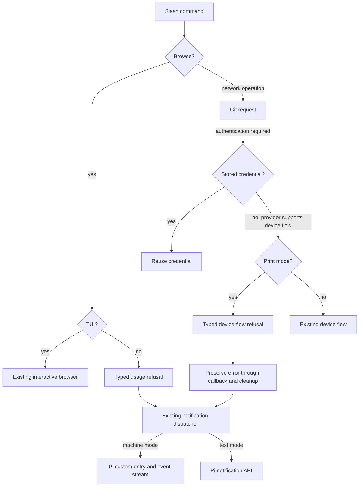

# Phase 7: Mode Refusals, Real-Pi Verification, and Docs - Research

**Researched:** 2026-10-09
**Domain:** Pi command output, authentication refusal, runtime verification, and schema documentation
**Confidence:** LOW for unexecuted acceptance claims; inspected source findings are identified individually below.

<user_constraints>
## User Constraints (from CONTEXT.md)

The following decisions, discretion area, and deferred ideas are copied verbatim from the phase context. [VERIFIED: .planning/phases/07-mode-refusals-real-pi-verification-and-docs/07-CONTEXT.md]

### Refusal messages

- **D-01:** Browse refusals name the actual current mode and the replacement
  command: "Browse is unavailable in json mode. Use /claude:plugin list
  instead." Substitute rpc or print for json as appropriate. No list fallback;
  tui behavior stays unchanged.
- **D-02:** Use brief device-flow refusal wording: "Device-flow authentication
  is unavailable in print mode. Retry with --mode json or interactive Pi."
  Preserve the requirement for a typed error and fail before device-flow
  polling. Stored credentials and operations that do not need device flow
  must continue to work.
- **D-03:** Include existing usage help with JSON and RPC browse refusals.
  The user corrected their initial refusal-only choice: "usage help can always
  appear in json", then explicitly chose matching RPC behavior. This is about
  refusal help, not adding help to every successful payload. Keep text refusal
  focused on its error and remedy.

### Documentation layout

- **D-04:** Put instructions and reference material in `docs/json-output.md`.
  Add only a short README link, not a README quick-start example.
- **D-05:** Begin the guide with a runnable command and extracted result,
  then explain the format. Put limitations in a later dedicated section.
- **D-06:** Document common envelope fields once, followed by the fields for
  each payload kind. Cover every kind and field, version compatibility, and
  maximum severity over command-origin entries.

### Script examples

- **D-07:** Use small task-based examples for extracting plugin rows,
  calculating command severity, and detecting reload needs, rather than one
  large script. Use jq as required by JDOC-01.
- **D-08:** The exit-status example fails on errors and displays warnings
  without failing. This is the example's policy, not a change to wire severity
  or Pi's process exit behavior.
- **D-09:** If no command outcome arrives, fail with "No command outcome
  received". Silence does not prove success; prompts or diagnostics alone
  cannot satisfy the outcome check.
- **D-10:** Show earlier results together with a final error to explain partial
  failure. Completed changes remain and `needsReload` can still be true.

### Carried constraints

- **D-11:** Real-Pi testing uses the required headless command with stdin
  closed, schema-valid claude-plugin stdout entries, entry_appended at the
  peer floor, and proof that startup entries are not streamed. Keep the Pi
  peer floor at 0.86.1 and use isolated fixtures without operator credentials.
- **D-12:** Document all JDOC-02 limitations and Phase 6's accepted delivery
  limit: one direct recovery attempt on append failure, no operation retry,
  no rollback promise, and possible missing output if the sink stays broken.
  Keep per-command correlation separate from tracking or telemetry.
- **D-13:** Amend AGENTS.md IL-2 to match PROJECT.md D8; close MRO-01 and
  correct its two false claims. After the final strict corpus re-diff is empty,
  delete the three scripts/notify-corpus*.mjs files and remove references
  outside .planning/. Only the two sanctioned output-catalog prose corrections
  are allowed: resolver owns soft-dependency markers; dispatch text strategy
  renders device-flow values. Preserve fenced blocks and count/byte locks.

### the agent's Discretion

Use existing schema, notification, authentication, and e2e mechanisms.
Choose internal names, test fixtures, task boundaries, and document section
names within the agreed behavior. Do not add dependencies, new product
features, output sinks, or unrelated documentation work without need.

### Deferred Ideas

None. Discussion stayed within phase scope.
</user_constraints>

## Summary

Implement the browse refusal at the existing handler branch, and implement the device-flow refusal at the lazy authentication callback. Reuse the existing typed usage-error payload for machine browse refusals. Preserve the stored-credential lookup before device-flow admission. These are small changes, but the authentication callback currently catches every error and converts it to cancellation; a new typed error must deliberately survive that boundary. [VERIFIED: extensions/pi-claude-marketplace/edge/handlers/plugin/browse.ts:131-143; extensions/pi-claude-marketplace/shared/notification-dispatch.ts:243-265; extensions/pi-claude-marketplace/platform/git-auth-callbacks.ts:170-219]

Treat runtime verification and corpus closeout as explicit plan dependencies. The inspected runtime is `"version": "0.87.1"`; this is expected, and a separate package fixture targeting 0.86.1 should prove the peer floor without downgrading the main installation. The one isolated runtime attempt produced an OS error and no output, so it supplies no successful execution evidence. The strict corpus requirement also conflicts with adding new in-process text notifications to the captured suites. Neither issue prevents writing an implementation plan, but both need concrete acceptance tasks before phase completion. [VERIFIED: node_modules/@earendil-works/pi-coding-agent/package.json:2-10; isolated probe output reproduced below; scripts/notify-corpus.hook.mjs:24-47] [CITED: user instruction, 2026-10-09]

**Primary recommendation:** Plan refusal changes, a separately targeted peer-floor runtime test, and executable guide examples first; make corpus reconciliation an explicit decision before the final strict comparison and script deletion. Do not treat an auth implementation choice as a research blocker. [CITED: Phase 7 D-01 through D-13; user instruction, 2026-10-09]

## Architectural Responsibility Map

| Capability | Primary owner | Secondary owner | Planning direction and evidence |
| --- | --- | --- | --- |
| Browse admission | Command handler | Notification dispatcher | Replace the non-TUI list delegation before marketplace loading. [VERIFIED: extensions/pi-claude-marketplace/edge/handlers/plugin/browse.ts:131-149] |
| Device-flow admission | Host-auth orchestrator | Git auth callback boundary | Check live mode only when device flow is actually needed; preserve stored-credential reuse. [VERIFIED: extensions/pi-claude-marketplace/orchestrators/auth-host.ts:169-204; extensions/pi-claude-marketplace/platform/git-auth-callbacks.ts:188-218] |
| Typed refusal propagation | Shared error type and platform callback | Calling orchestrators | Carry the refusal through cancellation/wrapping boundaries; preserve cleanup. [VERIFIED: extensions/pi-claude-marketplace/platform/git-auth-callbacks.ts:209-218; extensions/pi-claude-marketplace/orchestrators/marketplace/add.ts:536-579] |
| Machine transport | Notification dispatcher | Pi session runtime | Keep the sole append sink; Pi owns stdout framing. [VERIFIED: extensions/pi-claude-marketplace/shared/notification-dispatch.ts:160-162; node_modules/@earendil-works/pi-coding-agent/dist/core/agent-session.js:2415-2420] |
| Stream validation | E2E test process | Existing schema compiler | Parse real stdout and validate payload data. [VERIFIED: tests/edge/json-capture.ts:3-34] |
| Documentation and preservation | Guide and architecture tests | Existing corpus tool | Validate examples and frozen text independently; delete tooling last. [CITED: Phase 7 D-04 through D-13] |

<phase_requirements>
## Phase Requirements

Descriptions below reproduce the six mapped requirements. Source: [VERIFIED: .planning/REQUIREMENTS.md:121-162].

| ID | Description | Research support |
| --- | --- | --- |
| MODE-03 | `browse` outside `tui` emits an error-severity payload that names `list`, replacing the `list` fallback. | Handler seam, reusable usage-error payload, registration tests for explicit and implicit browse. |
| MODE-04 | In `print` mode, an operation that needs device-flow authentication fails fast with a typed error pointing at `--mode json` or `tui`, instead of polling until the code expires. | Lazy auth guard, stored-credential ordering, narrow error propagation choices. |
| TENB-03 | A real-Pi e2e test runs `pi -p --mode json --no-session --offline "/claude:plugin list"` and asserts a schema-valid `claude-plugin` entry on stdout, pinning `entry_appended` at the peer floor and pinning that startup-emitted entries are not streamed. | Isolated harness recipe, exact failed probe, separate 0.86.1 target, positive startup-emission control. |
| JDOC-01 | A schema reference documents kinds, fields, the compatibility policy (additive changes -- new optional field, kind, or closed-set member -- do not bump `schemaVersion`; removals, renames, type or meaning changes do), and the verdict rule (maximum severity over command-origin entries), with a `jq` example. | Existing schema and drift test, consumer example test matrix. |
| JDOC-02 | The documented limitations: print mode is silent (scripts use `--mode json`); Pi exits 0 regardless; startup (`session_start` / `resources_discover`) entries are not streamed in `json`/`rpc` (RPC clients can use `get_entries`); RPC front-ends no longer receive notify text and must render `claude-plugin` entries, the device-flow prompt at minimum; a slash-command-only run writes no session file until an assistant message exists. | Installed runtime subscription/persistence evidence; qualify process failures separately from command verdicts. |
| JDOC-03 | AGENTS.md's IL-2 output-channel line is amended to match PROJECT.md (D8), and backlog MRO-01 is closed with its two wrong claims corrected. | Exact policy and backlog passages located below. |
</phase_requirements>

## Project Constraints (from AGENTS.md)

These are planning constraints, not additional work authorized for this research-only dispatch. The user requires only this research file, with no commits, product edits, dependency installs, or broad checks. [CITED: user instructions, 2026-10-09]

- Read before editing, trace callers before changing functions, keep changes surgical, state assumptions, and use verifiable success criteria. Use CodeGraph first for indexed source discovery. [VERIFIED: AGENTS.md:7; AGENTS.md:148-155] [CITED: user-supplied AGENTS instructions]
- Work through GSD. Never commit to main, rebase, rewrite history, or skip hooks. Use the allowed branch conventions, Conventional Commit titles of 5–72 characters, body lines of at most 80 characters, and no milestone/phase mentions in titles. Run the prescribed pre-commit fixers before a foreground commit; fix and recommit after a failed hook rather than amending. [VERIFIED: AGENTS.md:11-20; AGENTS.md:113-123]
- PR descriptions use the simple-English and humanizer skills. Merge with squash; audit and close a shipping milestone on its branch before merging. Offer the prescribed version/changelog update before creating a PR. These actions are outside this dispatch. [VERIFIED: AGENTS.md:18-20; AGENTS.md:44-46]
- Prefix window descriptions with the milestone, do not hand-edit the windows record, and include a threat-flags section in every plan summary. [VERIFIED: AGENTS.md:24-30]
- Read the TypeScript style/comment skills before source changes and testing/write/review skills before test changes. Follow source/test pairing and complete direct coverage. [VERIFIED: AGENTS.md:35-42; AGENTS.md:66]
- Use owner tests for implementation feedback. Commit hooks are not GSD gates; combined-tree gates use `npm run check`, with separate e2e coverage. Reuse results only for demonstrably unchanged inputs as defined by the local-verification skill. [VERIFIED: AGENTS.md:42; skills/local-verification/SKILL.md]
- Preserve upstream parity unless a recorded decision or Pi capability gap permits divergence. This phase's context already scopes the decisions to Pi-specific behavior. [VERIFIED: AGENTS.md:58] [CITED: Phase 7 context, Phase Boundary]
- Preserve the runtime constraint `^22.22.2 || ^24.15.0 || >=26.0.0`, strict TypeScript, and resolver discriminator `installable: true | false`. Preserve peer floor `>=0.86.1`. [VERIFIED: AGENTS.md:59-61]
- Keep disk mutations atomic, recovery possible through `/reload`, operations retry-safe, and existing network restrictions intact. In particular, list/info/uninstall/marketplace removal/path-source operations stay offline. [VERIFIED: AGENTS.md:62-64]
- Keep containment within the declared scope roots and owning clone; do not change the two-scope model. Preserve English-only output and no telemetry. [VERIFIED: AGENTS.md:65-70]
- Direct stdout/stderr writes remain forbidden in command/bridge code. Amend IL-2 only as authorized to describe the existing machine-mode append sink; preserve the sanctioned legacy migration warning. [VERIFIED: AGENTS.md:67; .planning/PROJECT.md:925]
- Observe the Fallow task map when implementation reaches its triggers: guard changed files, trace consumers/deletions, audit before commits/PRs, and use the specified review, dependency, ownership, coverage, duplication, and security commands when those tasks apply. Do not run a broad audit merely to write this report. [VERIFIED: AGENTS.md, Fallow task map] [CITED: bounded research instruction]

## Standard Stack

Keep the existing stack. No external package installation is proposed; registry freshness and package-legitimacy checks are therefore outside this bounded report. Package versions below describe inspected installations, not a claim that they are the latest available. [CITED: Phase 7 discretion; user no-install instruction]

| Component | Observed version or contract | Use |
| --- | --- | --- |
| Pi runtime | `"version": "0.87.1"`; bin `"pi": "dist/bundle/cli.js"` | Current-install smoke coverage. [VERIFIED: node_modules/@earendil-works/pi-coding-agent/package.json:2-10] |
| Pi peer-floor target | 0.86.1 | Separate fixture/package target; not executed in this research. [CITED: Phase 7 D-11; user clarification] |
| Existing schema library | `"name": "typebox"`, `"version": "1.3.34"` | Compile the existing schema for tests. [VERIFIED: node_modules/typebox/package.json:2-4; tests/edge/json-capture.ts:3-9] |
| Node test runner | Observed Node `v26.11.1` | Existing native TypeScript test commands. [VERIFIED: session `node --version`; package.json, scripts] |
| jq | Observed `jq-1.8.1` | Guide filters and exit-policy checks. [VERIFIED: session `jq --version`] |

## Architecture Patterns

### Data flow

This diagram is a proposed task decomposition grounded in the inspected handler/auth/dispatcher flow. [VERIFIED: extensions/pi-claude-marketplace/edge/handlers/plugin/browse.ts:131-149; extensions/pi-claude-marketplace/platform/git-auth-callbacks.ts:170-218; extensions/pi-claude-marketplace/shared/notification-dispatch.ts:125-162]



### Browse: reuse the typed refusal surface

The exact current branch is `if (ctx.mode !== "tui") { await handlers.list("", ctx, run); return; }`. Argument rejection precedes it. Keep that ordering and the interactive branch. The reusable helper emits `kind: "usage-error"` with `message` and `usage`; the dispatcher counts that kind as a command outcome. [VERIFIED: extensions/pi-claude-marketplace/edge/handlers/plugin/browse.ts:131-143; extensions/pi-claude-marketplace/shared/notification-dispatch.ts:57-81,251-264]

Use that helper with the D-01 message and existing `USAGE = "Usage: /claude:plugin browse"` for JSON/RPC. No new wire kind is necessary. Update the owner test that currently expects list delegation and registration cases for explicit browse and empty arguments. Those registration cases currently expect a cascade for `"browse"`, `""`, and `" \t "`. [VERIFIED: extensions/pi-claude-marketplace/edge/handlers/plugin/browse.ts:39; tests/edge/handlers/plugin/browse.test.ts:149-165; tests/edge/register.test.ts:1304-1312]

For print, preserve the same typed mechanism but decide how to omit help without weakening other usage errors. The current renderer unconditionally returns `` `${surface.message}\n\n${surface.usage}` ``. A narrowly tested empty-usage rendering branch is one implementation option; it retains the required wire string field. Do not change ordinary usage-error bytes or make the schema field optional merely to remove a text suffix. This is a proposed implementation detail, not verified behavior. [VERIFIED: extensions/pi-claude-marketplace/shared/notification-grammar.ts:1139-1143; extensions/pi-claude-marketplace/shared/notification-wire.ts:501-508] [ASSUMED: A1]

### Authentication: guard lazily and preserve the typed failure

`buildAuthForHost` returns a stored-credential bundle for an unregistered provider. For a registered provider it creates a lazy callback, checks the per-host memo, then calls `initiateDeviceFlow`. Separately, the Git callback calls `credentialOps.fill` and returns a credential before invoking that lazy callback. Put the print check after the memo reuse and before device-flow initiation. Do not reject merely because an auth bundle is constructed. [VERIFIED: extensions/pi-claude-marketplace/orchestrators/auth-host.ts:169-204; extensions/pi-claude-marketplace/platform/git-auth-callbacks.ts:188-201]

Guarding before initiation is stronger than guarding the prompt callback: initiation requests a code, invokes the prompt callback, and then enters the poll loop. The desired refusal should perform neither a code request nor a poll. [VERIFIED: extensions/pi-claude-marketplace/domain/github-auth.ts:402-425]

The existing `UnsupportedModeError` represents an unknown notification mode: its constructor uses `` `Unsupported notification mode: ${mode}` ``. It does not describe a supported print mode whose device flow is unavailable. Prefer a separate shared typed error with the exact D-02 message; a name such as `DeviceFlowUnavailableError` is proposed, not an existing symbol. [VERIFIED: extensions/pi-claude-marketplace/shared/errors.ts:3-11] [ASSUMED: A2]

Two implementable propagation choices:

1. **Recommended:** Add a narrow typed-error rethrow in the Git auth callback's catch; retain cancellation for all unrelated errors. Then verify that each affected orchestrator either preserves that error in its cause chain or rethrows it after cleanup. The inspected callback currently logs and returns `{ cancel: true }` for everything. [VERIFIED: extensions/pi-claude-marketplace/platform/git-auth-callbacks.ts:209-218] [ASSUMED: A2]
2. **Alternative:** Carry a typed refusal through an explicit auth-result/error channel and translate it at the Git operation boundary. This changes more interfaces and is justified only if the actual Git adapter does not preserve the narrow thrown error. Do not convert the refusal to a generic failure string and call that typed propagation. [ASSUMED: A3]

The callback catch is not the only test boundary. `clone` and `fetch` pass these callbacks to the Git library. Marketplace-add failure handling can rethrow an unclassified error in standalone mode or retain an error in a failed outcome in orchestrated mode. The command boundary rethrows text-mode failures but serializes machine failures. Test at least one real callback-to-operation path and the final remedy text; an auth-host-only test cannot prove the complete route. Preserve staging cleanup and existing credential redaction. [VERIFIED: extensions/pi-claude-marketplace/platform/git.ts:362-404; extensions/pi-claude-marketplace/orchestrators/marketplace/add.ts:536-579,644-669; extensions/pi-claude-marketplace/shared/notification-dispatch.ts:145-155]

Required cases: stored credential succeeds in print; memoized auth is reusable; public/offline operations do not trigger the guard; registered-provider credential miss in print raises the typed refusal before request/poll; JSON/RPC/TUI retain device flow; unrelated callback errors still cancel; host mismatch still refuses credential disclosure. These are proposed acceptance tests derived from the existing branches and D-02. [VERIFIED: extensions/pi-claude-marketplace/platform/git-auth-callbacks.ts:170-218; extensions/pi-claude-marketplace/orchestrators/auth-host.ts:179-201] [CITED: Phase 7 D-02]

### Real Pi: target the floor independently

Reuse the repository resolver for the normal installed-runtime leg. It reads the package's declared bin and version, rather than choosing a global executable. The current smoke helper launches `--help`, mixes stdout/stderr, inherits the ambient environment, and has a 30-second timeout. Its upstream-fixture helper performs a network fetch. Do not reuse that network fixture for a headless list test. [VERIFIED: tests/pi-runtime.ts:25-88; tests/e2e/_helpers.ts:103-128,173-211]

Add a separate runtime target for an isolated 0.86.1 package fixture, preserving the main installation. The fixture must report and assert the actual loaded package version, resolve that package's declared bin, and run the production extension. It must include whatever runtime dependencies its package requires. This research did not provision or execute that target; do not infer floor compatibility from 0.87.1 source or from the peer range. [CITED: user clarification; Phase 7 D-11]

Use a fresh temporary home/project, an allowlisted environment, explicit production extension loading, no ambient extensions, offline mode, no session persistence, and an empty/closed stdin. Keep stdout and stderr separate and impose a finite timeout and buffer limit. The actual reason for EOF is visible in installed source: stdin is resumed and resolves only on `"end"`; the main function awaits it before preparing the message. [VERIFIED: node_modules/@earendil-works/pi-coding-agent/dist/main.js:51-66,706-715]

For each stdout line, parse JSON, select `type: "entry_appended"` whose entry has `type: "custom"` and `customType: "claude-plugin"`, and validate `entry.data`. Pi constructs the custom entry with `type`, `customType`, and `data`, then emits `{ type: "entry_appended", entry }`. The in-process capture helper calls this data `payload`; that is not the stdout wrapper field. [VERIFIED: node_modules/@earendil-works/pi-coding-agent/dist/core/session-manager.js:901-911; node_modules/@earendil-works/pi-coding-agent/dist/core/agent-session.js:2415-2420; extensions/pi-claude-marketplace/shared/notification-dispatch.ts:160-162]

The startup test needs a positive control: a test-only extension should append distinct entries during both startup hooks and later expose evidence that those entries exist in session memory. Assert that the startup markers are absent from streamed events while the later command event is present. An empty stream alone proves nothing. For RPC, retrieval through `"get_entries"` can supply the positive control; do not close RPC stdin before sending its protocol messages. Installed JSON and RPC modes bind extensions before subscribing, and RPC implements that retrieval command. Exact fixture wiring remains an implementation task. [VERIFIED: node_modules/@earendil-works/pi-coding-agent/dist/modes/print-mode.js:51-88; node_modules/@earendil-works/pi-coding-agent/dist/modes/rpc/rpc-mode.js:254-270,505-515] [ASSUMED: A4]

## Exact Isolated Probe and Result

This is the exact probe command issued from the repository root. It creates only a temporary fixture and removes it in `finally`. No operator credentials are inherited: the child environment contains only PATH and fixture-specific settings. The temporary paths are created in the command itself. The probe used the current install, not the peer-floor target. [VERIFIED: session probe command and output]

```bash
node --input-type=module -e 'import {mkdtempSync,mkdirSync,rmSync} from "node:fs"; import {tmpdir} from "node:os"; import path from "node:path"; import {spawnSync} from "node:child_process"; import {resolvePiRuntime} from "./tests/pi-runtime.ts"; import {Compile} from "typebox/compile"; import {NOTIFICATION_PAYLOAD_SCHEMA} from "./extensions/pi-claude-marketplace/shared/notification-wire.ts"; const root=mkdtempSync(path.join(tmpdir(),"phase7-research-")); try { const home=path.join(root,"home");const cwd=path.join(root,"project");mkdirSync(home);mkdirSync(cwd);const runtime=resolvePiRuntime(process.cwd());const r=spawnSync(process.execPath,[runtime.cliPath,"-p","--mode","json","--no-session","--offline","--no-extensions","--extension",path.resolve("extensions/pi-claude-marketplace/index.ts"),"/claude:plugin list"],{cwd,env:{PATH:process.env.PATH,HOME:home,PI_CODING_AGENT_DIR:path.join(home,".pi","agent"),PI_CODING_AGENT_SESSION_DIR:path.join(root,"sessions"),PI_OFFLINE:"1"},input:"",encoding:"utf8",timeout:20000,maxBuffer:1048576});const lines=(r.stdout??"").trim().split("\n").filter(Boolean);const events=lines.map(line=>JSON.parse(line));const entries=events.filter(e=>e.type==="entry_appended"&&e.entry?.customType==="claude-plugin");const validator=Compile(NOTIFICATION_PAYLOAD_SCHEMA);console.log(JSON.stringify({runtime:runtime.version,status:r.status,signal:r.signal,error:r.error?.message,stderr:r.stderr,stdoutLines:lines.length,entries:entries.map(e=>({valid:validator.Check(e.entry.data),entry:e}))},null,2));}finally{rmSync(root,{recursive:true,force:true});}'
```

Observed output, verbatim:

```json
{
  "runtime": "0.87.1",
  "status": 0,
  "signal": null,
  "error": "spawnSync /home/linuxbrew/.linuxbrew/Cellar/node/26.11.1/bin/node EPERM",
  "stderr": "",
  "stdoutLines": 0,
  "entries": []
}
```

The nonempty spawn error makes this inconclusive despite `"status": 0`. It is not an automatic-approval rejection and not evidence that Pi is incompatible. The parent can rerun the exact command with sandbox escalation, then separately rerun against the exact floor fixture. For the committed test, fail on a spawn error, timeout, signal, nonzero exit, malformed JSON, zero matching entries, or any invalid payload; the research probe only reports these facts. [VERIFIED: session probe output] [CITED: user request for rerunnable evidence]

## Frozen Corpus Conflict and Safe Final Deletion

### Concrete evidence

The baseline metadata says `"entries": 3149`, `"files": 77`, and `"nodeVersion": "v26.10.0"`. The corpus tool selects `const suiteScripts = ["test", "test:integration"]`. It records every intercepted production notify call while the process entry point ends in `".test.ts"`, before forwarding to the test's notification fake. Therefore even a silent/no-op fake does not hide a new text emission from capture. [VERIFIED: .planning/phases/01-presentation-model/notify-corpus/meta.json:2-7; scripts/notify-corpus.mjs:38-39; scripts/notify-corpus.hook.mjs:24-50]

The browse owner's current baseline has exactly these three entries at lines 488–490; the message, severity, and argument count are quoted verbatim below. [VERIFIED: .planning/phases/01-presentation-model/notify-corpus/baseline.jsonl:488-490]

```jsonl
{"file":"tests/edge/handlers/plugin/browse.test.ts","message":"(no marketplaces)","severity":null,"argc":1}
{"file":"tests/edge/handlers/plugin/browse.test.ts","message":"A plugin operation has failed.\n\n\u25cf (browse) [user]\n  \u2298 (browse) (failed)\n    cause: state.json at <TMPPATH> is not valid JSON: Unexpected token 'i', \"invalid json\" is not valid JSON -> Unexpected token 'i', \"invalid json\" is not valid JSON","severity":"error","argc":2}
{"file":"tests/edge/handlers/plugin/browse.test.ts","message":"browse takes no arguments.\n\nUsage: /claude:plugin browse","severity":"error","argc":2}
```

The existing non-TUI owner case uses `"json"` and a mocked list handler. Registration cases for browse also use `"json"` and `"rpc"`. Replacing those machine-only expectations does not by itself establish a text-corpus loss. The concrete additive conflict is a new print-refusal test that reaches the production text dispatcher: it adds a new message to the per-file multiset while the closeout rule demands zero extras. This is a source-based deduction, not a freshly executed corpus diff. [VERIFIED: tests/edge/handlers/plugin/browse.test.ts:149-165; tests/edge/register.test.ts:1304-1312; scripts/notify-corpus.mjs:173-184; scripts/notify-corpus.hook.mjs:39-47] [CITED: Phase 7 D-13]

Do not accept the tool's exit code alone. Its pass predicate is `return result.missing.length === 0 && !shrunk;`; extra entries are printed and counted but do not fail it. The successful marker must explicitly report `3149 baseline entries present, 0 extra.` for the locked strict gate. [VERIFIED: scripts/notify-corpus.mjs:274-292,387-407]

### Planning disposition

Resolve the strict freeze versus newly required text coverage before scheduling closeout. A narrowly approved baseline-policy amendment could distinguish intentional new refusal coverage from regression, but the current context does not authorize it. Alternatively, the parent may approve a documented test-scope/lifecycle arrangement that preserves the frozen capture and still provides meaningful print coverage. Neither is a decision this report makes. Do not silently recapture, remove assertions, suppress the recorder, switch test modes merely to hide output, or count a pre-change run as final verification. [CITED: Phase 7 D-13; user request for concrete conflict evidence] [ASSUMED: A5]

The catalog's actual current locks are `const EXPECTED_STATE_COUNT = 260;` and `const EXPECTED_UTF8_BYTES = 39_143;`. Older research and the Phase 1 context carry earlier counts; use the current owner definitions. The byte check concerns documented fixture output, not the total Markdown file size. [VERIFIED: tests/architecture/catalog-uat/catalog-contract.test.ts:21-22,266-277]

### Delete last

1. Finish all behavior changes, tests, guide examples, and the two authorized catalog prose corrections; settle the corpus policy conflict explicitly. [CITED: Phase 7 D-13]
2. Run the final comparison while the tool still exists. Under the unchanged rule require all 3149 entries, no missing entries, zero extras, and passing constituent tests. Retain concrete output in the phase verification evidence. Do not execute the baseline-writing verb. [VERIFIED: scripts/notify-corpus.mjs:357-369,387-407] [CITED: Phase 7 D-13]
3. Verify the frozen fenced blocks and the two current count locks. Correct every relevant marker-ownership statement within the sanctioned prose topic, including the located occurrences at catalog lines 628, 643, and 3216, and the device-flow attribution at lines 4088–4090. No unrelated catalog edits. [VERIFIED: docs/output-catalog.md:628,643,3216,4088-4090] [CITED: Phase 7 D-13]
4. Only then delete the three existing corpus scripts together and remove references outside planning records. Their exact names are `scripts/notify-corpus.mjs`, `scripts/notify-corpus.hook.mjs`, and `scripts/notify-corpus.negative.mjs`; the scripts reference one another through the hook URL and negative-control imports. The scoped search in this session found references only in those three files outside excluded planning/tooling directories; this is not a complete all-tracked-files final audit. [VERIFIED: scripts/notify-corpus.mjs:30-37; scripts/notify-corpus.hook.mjs:1-7; scripts/notify-corpus.negative.mjs:9-14]
5. Perform the final tracked-reference check and required combined-tree gate after deletion. The local-verification skill explicitly warns that deletion-only commits can skip the hook's build checks. [VERIFIED: skills/local-verification/SKILL.md, Committing and Planning and GSD gates]

## Schema Guide and Example Validation

Use the existing schema as the field inventory. Its generator writes the path declared as `WIRE_SCHEMA_PATH = "schema/claude-plugin.schema.json"`; its architecture test compares the committed document with a fresh build. Do not introduce a second schema or production validation. The current schema module explicitly describes test-only validation and `additionalProperties: false` on objects. [VERIFIED: scripts/wire-schema.mjs:17-18; scripts/generate-wire-schema.mjs:19-23; tests/architecture/wire-schema.test.ts:47-74; extensions/pi-claude-marketplace/shared/notification-wire.ts:13-25]

The owner test enumerates 19 payload kinds, quoted verbatim here for the guide coverage checklist: `"cascade"`, `"reconcile-applied-cascade"`, `"marketplace-info"`, `"plugin-info"`, `"marketplace-info-cascade"`, `"plugin-info-cascade"`, `"marketplace-not-added"`, `"reconcile-pending-empty"`, `"prune-empty"`, `"prune-committed-warning"`, `"usage-error"`, `"usage-info"`, `"diagnostic"`, `"device-flow-prompt"`, `"async-rewake-summary"`, `"stop-override-cap"`, `"reconcile-aborted"`, `"plugin-path-skipped"`, `"internal-error"`. [VERIFIED: tests/architecture/wire-schema.test.ts:76-119]

Document common fields once, then required/optional body fields per kind and nested object. Include marketplace/plugin rows, info component branches, causes, rollback details, retained workflows, tally, and origins. For exact definitions, use the inspected schema ranges rather than paraphrased old research. Relevant literal definitions include `schemaVersion: Type.Literal(1)`, `kind: Type.Literal("command")`, `commandId`, `invocationId`, and the other origins `"load"` / `"hook"`. Severity is exactly `"info" | "warning" | "error"`. [VERIFIED: extensions/pi-claude-marketplace/shared/notification-wire.ts:183-284,323-486,494-608; extensions/pi-claude-marketplace/shared/notification-types.ts:325]

Consumer examples must filter by command origin and invocation, calculate maximum severity over all matching command entries, and separately prove that at least one outcome arrived. The outcome classifier includes the normal result/usage kinds and `"internal-error"`; it explicitly excludes `"diagnostic"` and `"device-flow-prompt"`. Do not invent a terminal-completion field or treat the final line alone as the verdict. Preserve earlier results and OR together reload needs. [VERIFIED: extensions/pi-claude-marketplace/shared/notification-dispatch.ts:57-81; extensions/pi-claude-marketplace/shared/notification-run.ts:30-38] [CITED: Phase 7 D-06 through D-10]

Use the guide's actual jq snippets as test inputs, with fixtures for: successful empty results; populated rows; warning-only outcomes; an error outcome; earlier success plus final error and reload needed; mixed origins and invocations; unrelated Pi events; no entries; prompt-only output; diagnostic-only output; malformed input; and additive unknown fields/kinds. The warning policy must display the warning and exit successfully. Missing outcomes must fail with the exact D-09 message. Treat unknown future kinds conservatively instead of silently certifying an outcome. These are proposed example acceptance tests, not tests executed in this research. [CITED: Phase 7 D-06 through D-10] [ASSUMED: A6]

The official jq manual documents slurping a stream with `-s` and status-sensitive execution with `-e`. An empty result and a false/null result have different exit behavior, so test empty input explicitly rather than assuming a filter that emits nothing fails correctly. [CITED: https://jqlang.org/manual/]

### Limitations and policy corrections

- Explain print silence, machine-mode usage, startup streaming loss, RPC rendering responsibilities, and retrieval through `get_entries`. Do not add a timer workaround or duplicate notify output. [CITED: Phase 7 D-11/D-12; .planning/REQUIREMENTS.md:153-159] [VERIFIED: node_modules/@earendil-works/pi-coding-agent/dist/modes/rpc/rpc-mode.js:505-515]
- Explain that plugin error severity is not Pi's process verdict. Avoid interpreting “Pi exits 0 regardless” as a promise that every CLI/runtime failure exits zero: installed print-mode source returns 1 for a caught runtime error. Keep this distinction explicit without changing the locked example policy. [VERIFIED: node_modules/@earendil-works/pi-coding-agent/dist/modes/print-mode.js:17,110-132] [CITED: Phase 7 D-08]
- Explain session persistence accurately: the no-session test disables persistence outright; separately, the normal persistence path waits for an assistant message before its initial flush. A no-session-only test cannot prove the latter rule. [VERIFIED: node_modules/@earendil-works/pi-coding-agent/dist/core/session-manager.js:785-807] [CITED: .planning/REQUIREMENTS.md:158-159]
- Include the accepted one-attempt delivery recovery, no operation retry, no rollback guarantee, and possible missing output. Correlation is not telemetry. [CITED: Phase 7 D-12; Phase 6 D-07 through D-10]
- Bring AGENTS IL-2 into agreement with PROJECT's appended rule: “in `json`/`rpc` modes the JSON strategy emits through `pi.appendEntry`; direct stdout/stderr writes stay forbidden”. [VERIFIED: .planning/PROJECT.md:925; AGENTS.md:67]
- Close MRO-01 and correct its claims that JSON/RPC both receive the same human notify string and that structured output should be emitted alongside notify. The stale passages are at backlog lines 1075–1077 and 1086–1090. Keep this correction bounded. [VERIFIED: .planning/BACKLOG.md:1075-1090] [CITED: JDOC-03]

## Code Examples

Reuse the existing validator pattern, quoted from the capture helper: `const PAYLOAD_VALIDATOR = Compile(NOTIFICATION_PAYLOAD_SCHEMA);` and `PAYLOAD_VALIDATOR.Check(JSON.parse(JSON.stringify(payload)))`. Apply it to the real event's data, after validating the outer shape. [VERIFIED: tests/edge/json-capture.ts:9,29-34]

```typescript
const validator = Compile(NOTIFICATION_PAYLOAD_SCHEMA);
assert.ok(validator.Check(event.entry.data));
```

The variable `event` and its narrowing are proposed test code, not an existing helper. The verified wire wrapper definitions are `type: "custom"`, `customType`, `data`, and `{ type: "entry_appended", entry }`; the dispatch custom type is `"claude-plugin"`. [VERIFIED: node_modules/@earendil-works/pi-coding-agent/dist/core/session-manager.js:901-911; node_modules/@earendil-works/pi-coding-agent/dist/core/agent-session.js:2415-2420; extensions/pi-claude-marketplace/shared/notification-dispatch.ts:160-162]

For the guide's simple extraction example, this is a proposed filter, not a complete verdict script. Its field and token vocabulary comes from those wrapper definitions and `marketplaces: Type.Array(MARKETPLACE_BLOCK)`, `plugins: Type.Array(PLUGIN_ROW)`, and `kind: Type.Literal("cascade")`. [VERIFIED: extensions/pi-claude-marketplace/shared/notification-wire.ts:227-235,290-298]

```jq
select(.type == "entry_appended" and .entry.customType == "claude-plugin")
| .entry.data
| select(.origin.kind == "command" and .kind == "cascade")
| .marketplaces[].plugins[]
```

Add invocation selection when consuming more than one command, and validate the final documented snippets against the cases above. An empty inventory legitimately extracts no rows; that is why extraction and outcome detection must be separate examples. [CITED: Phase 7 D-07/D-09] [VERIFIED: extensions/pi-claude-marketplace/shared/notification-wire.ts:264-298]

## Don't Hand-Roll

| Problem | Use instead | Evidence |
| --- | --- | --- |
| Machine browse refusal | Existing usage-error helper and schema | [VERIFIED: extensions/pi-claude-marketplace/shared/notification-dispatch.ts:251-264] |
| Output framing | Pi append-entry event transport | [VERIFIED: extensions/pi-claude-marketplace/shared/notification-dispatch.ts:160-162] |
| Payload validator | Existing compiled TypeBox schema | [VERIFIED: tests/edge/json-capture.ts:3-9] |
| Runtime executable discovery | Installed package bin/version resolver, extended only for a deliberate floor target | [VERIFIED: tests/pi-runtime.ts:63-88] |
| Credential lookup or device-flow polling | Existing host-auth and credential callbacks | [VERIFIED: extensions/pi-claude-marketplace/orchestrators/auth-host.ts:169-204] |
| Startup delivery recovery | Document the gap and RPC retrieval; no timer replay mechanism | [CITED: Phase 7 D-11/D-12] |

## Common Pitfalls

- **Refusing too early:** checking print while constructing an auth bundle blocks operations that can use stored credentials. Guard only the lazy flow. [VERIFIED: extensions/pi-claude-marketplace/platform/git-auth-callbacks.ts:188-201]
- **Swallowing the typed error:** the catch-all currently converts it to cancellation. Add a narrow propagation test rather than changing every auth failure. [VERIFIED: extensions/pi-claude-marketplace/platform/git-auth-callbacks.ts:209-218]
- **Hanging before command execution:** a piped stdin left open prevents the main function from proceeding. Explicitly close it. [VERIFIED: node_modules/@earendil-works/pi-coding-agent/dist/main.js:51-66,706-715]
- **False runtime pass:** help output, zero exit status, or zero captured entries is insufficient. The observed EPERM result demonstrates why the harness must inspect process errors too. [VERIFIED: tests/e2e/_helpers.ts:188-204; session probe output]
- **False floor proof:** testing installed 0.87.1 does not execute 0.86.1. Assert the separate fixture's version. [VERIFIED: node_modules/@earendil-works/pi-coding-agent/package.json:3] [CITED: user clarification]
- **False strict-corpus pass:** tool success permits extras; inspect the strict count or the actual multiset. [VERIFIED: scripts/notify-corpus.mjs:274-292,403-407]
- **False script success:** prompts/diagnostics do not establish an outcome, and prior successes do not erase a later error. [VERIFIED: extensions/pi-claude-marketplace/shared/notification-dispatch.ts:57-81] [CITED: Phase 7 D-09/D-10]

## Runtime State Inventory

This is a bounded inventory for retiring test tooling, not a product data migration. No operator stores or external services were inspected. The canonical retirement concern is the final verification dependency on the scripts, not a renamed production key. [CITED: Phase 7 D-13; bounded research instruction]

| Category | Evidence and action |
| --- | --- |
| Stored data | Retain the frozen baseline and metadata in planning records. The tool composes `".planning/phases/01-presentation-model/notify-corpus"`, `"baseline.jsonl"`, and `"meta.json"`, then writes through its capture/baseline routines. No product data migration is proposed. [VERIFIED: scripts/notify-corpus.mjs:32-37,258-259,357-369] |
| Live service config | Not audited; no service configuration change is in the authorized retirement scope. Do not assert global absence. [CITED: Phase 7 D-13] |
| OS registrations | Not audited; no registration change is in scope. [CITED: Phase 7 D-13] |
| Secrets/environment | The preload reads `NOTIFY_CORPUS_OUT`; capture supplies it only to its child process. Remove tooling, not operator credentials. [VERIFIED: scripts/notify-corpus.hook.mjs:29-35; scripts/notify-corpus.mjs:228-237] |
| Build artifacts/packages | No package uninstall is proposed. Temporary capture directories are cleaned in `finally`; the independently packaged peer-floor test target needs its own fixture cleanup. [VERIFIED: scripts/notify-corpus.mjs:228-264,387-410] [CITED: Phase 7 D-11] |

## Environment Availability

| Dependency | Observed availability | Execution implication |
| --- | --- | --- |
| Node | `v26.11.1` | Available; baseline used the same major. [VERIFIED: session version probe; .planning/phases/01-presentation-model/notify-corpus/meta.json:2] |
| npm | `11.20.0` | Available; no installs performed. [VERIFIED: session version probe] |
| jq | `jq-1.8.1` | Available for future example checks. [VERIFIED: session version probe] |
| Main Pi install | `"version": "0.87.1"` | Sources inspected; subprocess attempt inconclusive. [VERIFIED: node_modules/@earendil-works/pi-coding-agent/package.json:3; session probe output] |
| Exact peer-floor fixture | Not provisioned or checked in this research | Plan an isolated 0.86.1 package target; do not downgrade the main install. [CITED: user clarification] |
| Subprocess execution | Probe returned EPERM | Parent can rerun with escalation. This is an environment observation, not a Pi defect. [VERIFIED: session probe output] |

## Validation Architecture

Validation is enabled by project config. Commands here are for implementation and phase gates; no broad check was run for this research. Proposed new test filenames below are planning suggestions, not claims that files exist. [VERIFIED: .planning/config.json, workflow.nyquist_validation] [CITED: user bounded-research instruction]

### Test Framework

| Property | Value |
| --- | --- |
| Framework | Existing Node built-in test runner, observed runtime v26.11.1. [VERIFIED: package.json, test scripts; session version probe] |
| Configuration | Package scripts select owner, integration, architecture, and e2e suites. [VERIFIED: package.json, scripts] |
| Fast feedback | Run the affected owner test directly with `node --test`; do not run a full suite per edit. [VERIFIED: skills/local-verification/SKILL.md] |
| Full GSD gate | `npm run check`; e2e is separate. [VERIFIED: AGENTS.md:42; skills/local-verification/SKILL.md] |
| CI e2e | Existing CI runs `npm run test:e2e` after dependency installation. Add an explicit exact-floor target to this coverage rather than silently relying on the main lockfile version. [VERIFIED: .github/workflows/ci.yml:133-153] [CITED: TENB-03; user clarification] |

### Phase Requirements → Test Map

Commands name inspected existing tests unless marked proposed. These are planned validations; their durations and success have not been measured in this research. Use a short timeout for focused cases and a finite subprocess timeout for runtime tests. [CITED: bounded research scope]

| Requirement | Behavior to prove | Test / automated command | Coverage status |
| --- | --- | --- | --- |
| MODE-03 | All non-TUI refusals, exact messages/help, no list call, unchanged argument/TUI behavior | `node --test tests/edge/handlers/plugin/browse.test.ts` | Existing owner; replace fallback test and add refusal cases. [VERIFIED: tests/edge/handlers/plugin/browse.test.ts:126-193] |
| MODE-03 | Registered explicit/implicit browse retains command identity and emits an outcome | `node --test --test-name-pattern='registered' tests/edge/register.test.ts` | Existing machine registration cases require new expectations. [VERIFIED: tests/edge/register.test.ts:1304-1312] |
| MODE-04 | Lazy guard, no request/poll, stored credentials and memo remain usable | `node --test tests/orchestrators/auth-host.test.ts` | Existing owner; new cases needed. [VERIFIED: tests/orchestrators/auth-host.test.ts:1266-1334] |
| MODE-04 | Narrow typed rethrow, unrelated failures still cancel, host isolation preserved | `node --test tests/platform/git-auth-callbacks.test.ts` | Owner identified by CodeGraph; implementation must add the refusal case. [VERIFIED: CodeGraph buildAuthCallbacks caller/test map] |
| MODE-04 | Error remedy survives actual callback/operation/cleanup path | `node --test tests/integration/auth-e2e.test.ts` | Existing integration location identified by CodeGraph; new regression needed, not an auth-host fake-only assertion. [VERIFIED: CodeGraph initiateDeviceFlow/buildAuthCallbacks test map] |
| TENB-03 | Actual list command emits schema-valid entries; startup positive control; closed stdin | Proposed `node --test tests/e2e/pi-json-output.test.ts` | New test and isolated target required. Current help smoke is insufficient. [VERIFIED: tests/e2e/pi-runtime-smoke.test.ts; tests/e2e/_helpers.ts:173-204] |
| JDOC-01 | Existing source/schema remain synchronized | `node --test tests/architecture/wire-schema.test.ts` | Existing drift and 19-kind tests. [VERIFIED: tests/architecture/wire-schema.test.ts:47-119] |
| JDOC-01/02 | Actual guide examples pass the outcome/severity/reload matrix | Proposed `node --test tests/architecture/json-output-docs.test.ts` | New test; extract guide snippets rather than copy filters into the test. [CITED: Phase 7 D-06 through D-10] |
| JDOC-02 | Startup gap and no-session behavior; no initial persistence before assistant messages | Runtime test plus a separate persistence-enabled slash-only case | New assertions; do not infer both rules from no-session alone. [VERIFIED: node_modules/@earendil-works/pi-coding-agent/dist/core/session-manager.js:785-807] |
| JDOC-03 | Correct output policy, closed backlog, only authorized prose changes | Focused diff review and guide-link check | Manual content review plus automated link/example checks where useful. [CITED: Phase 7 D-04/D-13] |
| Closeout criterion 6 | Frozen catalog and strict corpus, then tool/reference removal | `node --test tests/architecture/catalog-uat/catalog-contract.test.ts`; `node scripts/notify-corpus.mjs check` plus explicit zero-extra assertion before deletion | Existing tools; policy conflict must be resolved first. [VERIFIED: tests/architecture/catalog-uat/catalog-contract.test.ts:266-277; scripts/notify-corpus.mjs:387-407] |

### Sampling and Wave 0 Gaps

- Per implementation task: affected owner tests; before commits, follow the prescribed fixer/hook sequence rather than duplicating static checks. Per combined-tree wave and phase gate: `npm run check`. Run focused e2e separately, including the exact-floor leg. [VERIFIED: skills/local-verification/SKILL.md]
- Add the isolated headless runner with explicit runtime target, process-error assertions, EOF, separate streams, and teardown. Add the startup positive-control fixture and exact-floor version assertion. [CITED: TENB-03; Phase 7 D-11; user clarification]
- Add tests for the guide's executable snippets and field/kind coverage. A recursive inventory of schema properties/requiredness can support review without inventing another schema. The precise documentation-test design is proposed. [VERIFIED: tests/architecture/wire-schema.test.ts:47-119] [ASSUMED: A6]
- Resolve the strict corpus conflict before adding final text-capture expectations or deleting tooling. No missing dependency installation is authorized by this report. [CITED: Phase 7 D-13; user instructions]

## Security Domain

Security work is limited to the auth/output/fixture surfaces in this phase. The external ASVS project page was consulted, but individual versioned control identifiers were not verified; this report does not assert ASVS compliance or copy obsolete category numbers from a generic template. [CITED: https://owasp.org/projects/asvs]

| Relevant control area | Applies here | Standard control / test |
| --- | --- | --- |
| Authentication | Yes | Stored-credential reuse, device-flow admission, host-bound credential lookup; no operator auth in fixtures. [VERIFIED: extensions/pi-claude-marketplace/platform/git-auth-callbacks.ts:170-201] |
| Session management | Pi entry persistence only | Test startup visibility and persistence timing; do not introduce a new session mechanism. [VERIFIED: node_modules/@earendil-works/pi-coding-agent/dist/core/session-manager.js:785-807,901-911] |
| Access control | Existing host and filesystem boundaries | Preserve the HTTPS/host check and staging cleanup. [VERIFIED: extensions/pi-claude-marketplace/platform/git-auth-callbacks.ts:176-185; extensions/pi-claude-marketplace/orchestrators/marketplace/add.ts:644-669] |
| Input/output validation | Yes | Validate stream structure and payload schema; keep untrusted text as data. [VERIFIED: tests/edge/json-capture.ts:29-34] |
| Cryptography | No new cryptographic implementation proposed | Reuse existing credential/device-flow mechanisms. [CITED: Phase 7 discretion] |

Threats to cover are credential disclosure through error propagation, ambient secrets entering runtime fixtures, false success from missing outcomes, and loss of cleanup when introducing a typed rethrow. These are planning threat hypotheses, not findings of an exploit. Use narrowly scoped failure tests and the existing redaction/credential boundaries. [ASSUMED: A7] [VERIFIED: extensions/pi-claude-marketplace/shared/notification-command-error.ts:30-43; extensions/pi-claude-marketplace/platform/git-auth-callbacks.ts:209-218]

## Assumptions Log

Only source observations are marked verified. The following proposed choices need confirmation through implementation tests or an explicit policy decision; none prevents drafting the plan. [CITED: user instruction]

| ID | Proposed or unresolved claim | Risk / required disposition |
| --- | --- | --- |
| A1 | Empty-usage text rendering is a sufficient bounded way to keep print refusal focused. | Confirm existing callers and byte preservation before choosing the exact implementation. |
| A2 | A new shared typed error with a narrow callback rethrow is the smallest correct solution. | Test actual adapter propagation, cleanup, and final remedy; name is provisional. |
| A3 | An explicit auth refusal result channel is a viable fallback. | Use only if the narrow thrown-error path fails; larger interface change. |
| A4 | A test-only startup emitter plus later memory inspection proves the streaming gap. | Implement both positive and negative assertions at the actual peer floor. |
| A5 | A narrowly approved corpus policy/scope arrangement can reconcile new print coverage with closeout. | Explicit decision required; current zero-extra rule remains binding until changed. |
| A6 | Guide-snippet extraction and schema field inventory provide durable documentation validation. | Prove actual examples and review unknown-kind handling; avoid brittle prose tests. |
| A7 | The listed auth/output threats are the relevant new phase risks. | Confirm in plan threat models; preserve existing security gates. |

## Open Questions and Planning Gates

1. **How will the exact-floor package fixture be provisioned and selected?** Use a separate 0.86.1 target, assert its version, and execute the production extension. No main-install downgrade is required. Provisioning was outside this research. [CITED: user clarification]
2. **Will the isolated runtime probe succeed with appropriate subprocess permissions?** The only observed result is the reproduced EPERM. Rerun with escalation; do not treat this as a Pi compatibility failure or successful runtime evidence. [VERIFIED: session probe output]
3. **How will new print coverage coexist with 3149 entries and zero extras?** The capture semantics demonstrate the additive conflict. Resolve explicitly before final corpus work; do not silently change the baseline. [VERIFIED: scripts/notify-corpus.hook.mjs:39-47; scripts/notify-corpus.mjs:274-292] [CITED: Phase 7 D-13]
4. **Which typed-auth propagation implementation passes end to end?** Start with the narrow rethrow, retain the explicit-result alternative, and test the final operation boundary. This is normal implementable work, not a research blocker. [VERIFIED: extensions/pi-claude-marketplace/platform/git-auth-callbacks.ts:209-218] [CITED: user instruction]

## Sources and Metadata

- Primary evidence: CodeGraph source/caller inspection, followed by bounded source reads at the cited locations; installed Pi 0.87.1 implementation; current schema, owner tests, corpus tool and baseline; phase context, requirements, roadmap, and project policies. Source paths in citations are inspection locators. Proposed artifact paths are marked proposed; they do not claim existing files or created runtime state. [VERIFIED: source inspections recorded throughout]
- External references: [jq manual](https://jqlang.org/manual/) for consumer command semantics; [OWASP ASVS](https://owasp.org/projects/asvs) for the security review framework. No remote Pi source was substituted for the required peer-floor execution. [CITED: the linked official pages]
- Research-plan seam returned cache hits for the two official-document questions. Confidence classification for `--provider local --verified` and `--provider webfetch --verified` returned `LOW`; this report therefore does not elevate unexecuted runtime conclusions to high confidence. Package legitimacy checks were not applicable because no package installation is recommended in this dispatch. [VERIFIED: session research-plan/classify-confidence outputs] [CITED: user no-install instruction]
- Source findings: concrete and recheckable. Runtime acceptance: unproven. Exact-floor behavior: unproven. Corpus conflict: deduced from explicit capture/pass logic; no new full-suite diff was run. [VERIFIED: source and probe evidence above]
- Research date: 2026-10-09. Recheck source after implementation changes and before deletion; this report is not a passing phase gate. No commits or product edits are part of this dispatch. [CITED: user scope]

## Parent follow-up: isolated runtime probe

On 2026-10-09 (America/New_York), the parent reran the exact isolated probe
above with sandbox escalation. It exited 0, with no spawn error, no signal,
empty stderr, and two stdout lines. One was an `entry_appended` custom
`claude-plugin` entry whose data passed the compiled schema: `kind: cascade`,
command origin `plugin list`, fresh invocation ID, `severity: info`,
`needsReload: false`, and an empty marketplaces array.

This resolves the current-install subprocess uncertainty for Pi 0.87.1.
It does not establish peer-floor 0.86.1 or startup-stream behavior. Those
remain required implementation tests. The earlier EPERM was a sandbox
restriction, not an automatic approval rejection or a Pi compatibility defect.

## Parent follow-up: corpus decision resolved

The user approved option 1: allow only samples from the new Phase 7 refusals,
preserve all 3,149 existing samples, record every addition, and keep catalog
examples unchanged. CONTEXT.md D-14 is the canonical scoped exception.
Earlier unresolved-policy statements are historical; planning can proceed.

## Package Legitimacy Audit

Planning addendum for the independently provisioned peer-floor fixture only.
The existing product dependency is unchanged. Registry metadata was checked
with network access on 2026-10-10 UTC, including the exact 0.86.1 version.

| Package | Registry | Age | Downloads | Source Repo | Verdict | Disposition |
| --- | --- | --- | --- | --- | --- | --- |
| @earendil-works/pi-coding-agent@0.86.1 | npm | Published 2026-09-20; package created 2026-05-07 | 4,366,827/week at audit | https://github.com/earendil-works/pi, packages/coding-agent | [SUS] | Age-only signal; retain exact-version human authorization from D-11 and the current planning instruction in 07-03-02 before provisioning |

The default package-legitimacy CLI examined the latest release. Its compiled
checkPackages seam was then called with version 0.86.1; the only remaining
reason was too-new. Existence, repository, downloads, and absence of
postinstall were verified; no suspicious execution script was reported.
No package was classified SLOP. This records the signal without relabeling it.

Exact registry tarball:
https://registry.npmjs.org/@earendil-works/pi-coding-agent/-/pi-coding-agent-0.86.1.tgz

Exact integrity:
`sha512-vZBuNfJnruxZyemZ3O05V0S/Ylze08ahFTIQ1Mik++gVdOevPl89gt/Uv0U97BPAJaj9cj6Vf9rcIgKtUrd0BA==`

The already downloaded tarball independently matched that SHA-512. This is
artifact identity evidence, not a successful peer-floor runtime test.
