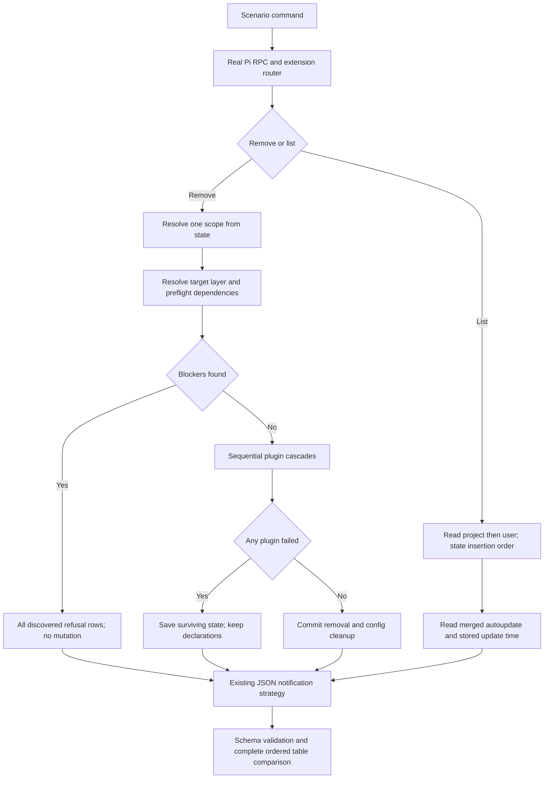

# Phase 4: Marketplace Remove and List - Research

**Researched:** 2026-10-18
**Domain:** Real-Pi Cucumber coverage of marketplace removal and listing
**Confidence:** MEDIUM — official web evidence classified by the research seam; implementation findings directly inspected.

<user_constraints>
## User Constraints (from CONTEXT.md)

Copied verbatim from the phase context, including the correction to the cascade decision. [VERIFIED: .planning/phases/04-marketplace-remove-and-list/04-CONTEXT.md:16-37,106-109]

<!-- DATA_49c1a7d2_START -->
### Locked Decisions

### Unscoped removal

- **D-01 (user; explicit upstream divergence):** When the same marketplace name exists in project and user scopes, `marketplace remove <name>` without `--scope` removes only the project-scope copy. The result contains only the project-scoped `removed` row; it adds no warning or unchanged row for the user copy. Claude Code 2.1.296 currently documents the unscoped form as removing the declaration from every scope, so planning must record this project-first behavior in `PROJECT.md` under a stable project decision ID before implementing or pinning it.
- **D-02 (user):** When only the user scope contains the name, an unscoped remove removes that sole user-scope match. Project-first is precedence for an ambiguous cross-scope match, not an implicit project-only default.
- **D-03 (user):** Resolve scope before resolving layer. If the project scope contains the name only in its local layer and the user scope contains it in its base layer, an unscoped flagless remove selects project scope and fails as `marketplace in local layer only`; it never falls through to the user scope.

### Cascade failure behavior

- **D-04 (user; corrected after code inspection):** Preserve the shipped MR-3 partial-result contract. Each plugin cascade remains individually fail-clean, but the marketplace command continues across plugins: successful removals persist, failed plugins remain installed and recorded, and any plugin failure keeps the marketplace record and its declaration. This supersedes the discussion's initial command-wide rollback choice, which was made before the existing binding continuation contract was surfaced.
- **D-05 (user):** A refusal discovered before mutation reports every discovered blocker, emits no `uninstalled` rows, changes nothing, and needs no reload.
- **D-06 (user):** Preserve the exact existing partial payload. Successful `uninstalled` rows come first and carry `needsReload: true`; failed rows follow and carry `needsReload: false`. The command requests reload exactly when at least one plugin was actually removed. Do not add new rollback-detail fields or a reload hint for a failure-only result in this phase.

### Result ordering

- **D-07 (user):** `marketplace list` groups every project row before every user row. Within each scope it preserves marketplace state-record insertion order; it does not alphabetize or reorder by timestamp.
- **D-08 (user):** Successful remove rows preserve cascade execution order. Failed preflight or cascade rows preserve discovery order. In a partial result, preserve the existing grouping from D-06: all successful rows precede all failed rows.

### Agent's Discretion

- Exact Gherkin step wording, fixture names, helper boundaries, and plan split, within the repository's Cucumber rules.
- Whether a behavior already covered by the current layer scenarios needs a new scenario or only reuse as setup, provided every Phase 4 requirement remains independently observable.
- Test mechanics for last-updated time, using the existing `{scenario time}` contract rather than weakening the assertion.

### Deferred Ideas (OUT OF SCOPE)

None — discussion stayed within phase scope.
<!-- DATA_49c1a7d2_END -->
</user_constraints>

## Summary

Plan primarily behavioral coverage and the missing project decision record. Scope selection, layer refusal, per-plugin continuation, list ordering, and both aliases already have production implementations. The focused existing remove/list baseline passes: 20 scenarios, 225 steps, Node v26.11.1; see Environment Availability for the sandbox qualification. Do not schedule a production rewrite without a discriminating scenario that exposes a defect. [VERIFIED: extensions/pi-claude-marketplace/orchestrators/marketplace/shared.ts:677-695,724-765; extensions/pi-claude-marketplace/orchestrators/marketplace/remove.ts:603-639,909-938; extensions/pi-claude-marketplace/orchestrators/marketplace/list.ts:70-132; extensions/pi-claude-marketplace/edge/router.ts:251-259; focused baseline command, 2026-10-18]

Record a proposed new decision **D-MF-05** for the already-approved unscoped project-first removal before pinning that behavior. This is a proposed identifier, not an existing decision. Current PROJECT.md carries D-MF-01 through D-MF-04; D-MF-04 already licenses independently owned per-scope marketplace records and clones. Current upstream removes declarations across all scopes when scope is omitted. [VERIFIED: .planning/PROJECT.md:1253-1256; .planning/phases/04-marketplace-remove-and-list/04-CONTEXT.md:18-20] [CITED: https://code.claude.com/docs/en/plugins/cli-reference#plugin-marketplace-remove]

**Primary recommendation:** extend the existing remove/list features using existing publication, command-result, config, and session steps; add deterministic integration coverage for partial failures, preserving the existing transaction and notification model. This follows the carried test-placement rule: a behavior real Pi cannot reach belongs in an integration test, rather than only a paired unit test. [VERIFIED: .planning/phases/03.2-marketplace-layer-partition/03.2-CONTEXT.md:43-50; features/step_definitions/command.steps.ts:101-180; features/step_definitions/session.steps.ts:18-35]

## Architectural Responsibility Map

This is a local command extension; its owners are the command edge, orchestration, filesystem persistence, and behavioral harness. There is no web client/server split to introduce. [VERIFIED: extensions/pi-claude-marketplace/edge/router.ts:251-259; extensions/pi-claude-marketplace/orchestrators/marketplace/remove.ts:840-938; features/lib/pi-commands.ts:60-94]

| Capability | Primary tier | Secondary tier | Planning rule and evidence |
|---|---|---|---|
| Command and aliases | Command edge | Orchestrator | Reuse routing; aliases already share handlers. [VERIFIED: extensions/pi-claude-marketplace/edge/router.ts:251-259] |
| Scope before layer selection | Orchestrator | State/config readers | Preserve project-first state lookup before layer verdict. [VERIFIED: extensions/pi-claude-marketplace/orchestrators/marketplace/shared.ts:677-695; extensions/pi-claude-marketplace/orchestrators/marketplace/remove.ts:884-907] |
| Cascade continuation and persistence | Orchestrator | Bridge operations and locked state | Sequential per-plugin operations, then save resulting state. [VERIFIED: extensions/pi-claude-marketplace/orchestrators/marketplace/remove.ts:415-463,909-938] |
| List ordering and details | Orchestrator | Merged config/state | Preserve outer scope order and record insertion order. [VERIFIED: extensions/pi-claude-marketplace/orchestrators/marketplace/list.ts:70-132] |
| Complete observable assertions | Behavioral harness | JSON notification schema and real Pi | Assert every payload and every row without sorting or dropping fields. [VERIFIED: features/lib/pi-commands.ts:60-94; features/lib/field-rows.ts:73-96; features/step_definitions/command.steps.ts:116-180] |

## Project Constraints (from AGENTS.md)

The following directives apply to planning and execution. The supplied task instructions also require explicit assumptions, minimal changes, preserving unrelated work, and concrete verification. [VERIFIED: AGENTS.md:1-160; user-supplied AGENTS.md instructions]

- Read files before editing; trace callers before changing functions; research before edits; use CodeGraph first for indexed-code discovery. Follow the task-specific Fallow commands when their triggering action applies.
- Never commit to main, rebase, rewrite history, or bypass hooks. Use the permitted branch families and Conventional Commit messages without GSD phase identifiers. Before a commit, run the committing skill's pre-commit pass and Fallow audit. PR descriptions use simple-english and humanizer; merge by squash only. Audit and close a shipping milestone on its PR branch first.
- Stay within the active GSD workflow. Prefix broken-window descriptions with the milestone; do not hand-edit WINDOWS.md. Every eventual plan SUMMARY includes Threat Flags, even when none.
- Commit checks are incremental. Combined-tree wave, phase, merge, and final handoff gates run `npm run check`. Reuse only same-session evidence with unchanged inputs. A passing commit hook is not a phase verdict.
- At PR creation, offer the package/Sonar version bump and lockfile update; record changes concisely in CHANGELOG. These are later workflow steps, not reasons to introduce release edits in this research.
- Preserve upstream parity except licensed decisions or Pi gaps. Preserve atomic disk mutations, reload-based recovery, safe retries, filesystem containment, offline remove/list/path operations, and the existing quality bar.
- Retain strict TypeScript and the resolver's discriminated installability. Use the mode-selected notification transport only; no command/bridge direct stdout or stderr writes. No telemetry or localization infrastructure.
- Preserve exactly two scopes and independently scoped marketplace/plugin records. Follow the current scope/base-layer/local-layer/config terminology.
- Runtime constraint, quoted verbatim: `^22.22.2 || ^24.15.0 || >=26.0.0`; API peer floor: `>=1.0.0`. [VERIFIED: package.json:18-19,37-38,60-62]

The Cucumber skill additionally requires plans to name scenario titles and files; complete row/envelope assertions; lowercase Given/When/Then steps; no And/But; three or more total Outline variants; source tags on Examples only; world-owned resources; and real-Pi/local-boundary execution. New TypeScript helpers follow the TypeScript style skill; production modules retain mirrored owner tests with 100% direct coverage. [VERIFIED: .agents/skills/cucumber/rules/layout.md:5-56; .agents/skills/cucumber/rules/features.md:28-107; .agents/skills/cucumber/rules/steps.md:39-76; .agents/skills/cucumber/rules/world-and-stand-ins.md:7-25; .agents/skills/typescript-unit-tests/rules/pairing-and-design.md:7-55]

<phase_requirements>
## Phase Requirements

Descriptions below preserve the requirements; supporting recommendations specify the discriminating witness. [VERIFIED: .planning/REQUIREMENTS.md:81-102]

| ID | Description | Research support / planned witness |
|---|---|---|
| RM-01 | Removing a marketplace with no installed plugins drops it, with no reload needed (dir, url) | One source-kind Outline, local directory/file rows active and both remote kinds staged; removed row, no child rows, no reload, target declaration gone. |
| RM-02 | Removing a marketplace uninstalls every plugin installed from it, one `uninstalled` row each, and needs a reload | Install at least three plugins in deliberately nonalphabetical order; assert every child and remaining unrelated records. |
| RM-03 | After that cascade, a new session offers none of the plugin's skills and `plugin list` no longer lists it | Separate session-skills and plugin-list persistence scenarios, using clean removal as Given setup. |
| RM-04 | A removed marketplace stays removed in a new session | Preserve existing local-layer persistence proof; add base-layer clean-remove persistence with config and marketplace-list observation. |
| RM-05 | Removing a name the requested scope lacks fails as `marketplace not added`, or `marketplace not added to <scope> scope` when the other scope holds it | Explicit user/project misses with neither scope holding it, and with only the other scope holding it; assert complete standalone payload. |
| RM-06 | Removing a name neither scope holds, without `--scope`, fails as `marketplace not added` with no scope | Assert scope field absence, not a blank synthesized scope or a failed cascade block. |
| RM-07 | `rm` behaves as `remove` | Alias scenario asserts complete removal result and persistent effect, not merely command acceptance. |
| RM-08 | Without `--scope`, a name held by both scopes is removed from the project scope only | Record D-MF-05 first; assert only project result and retained user declaration. Also cover sole-user fallback and project-local refusal before user-base fallback. |
| LS-01 | With nothing added, the list is empty | Existing list.feature scenario is a complete seed; retain it. |
| LS-02 | The list shows every marketplace of both scopes, project first, each with its autoupdate state and last-updated time | Populate both scopes in nonalphabetical order, with mixed autoupdate values and exact scenario-time tokens; compare the entire ordered inventory. |
| LS-03 | `--scope` narrows the list to one scope | Separate user and project scenarios against populated opposite scope; also useful to prove an empty selected scope stays empty. |
| LS-04 | `ls` behaves as `list` | Populated alias result with complete details/order; avoid an empty-only alias test. |

The requirement wording describes ordinary clean full removal. Retained layers and retained dependencies are established exceptions and already have explicit scenarios; do not rewrite those exceptions to make a broad interpretation of RM-01/RM-02 true. Remote no-request requirements RM-09 and LS-05 belong to later stand-in work, outside the assigned requirement set. [VERIFIED: features/marketplace/remove.feature:78-112,247-305; .planning/REQUIREMENTS.md:91-102]
</phase_requirements>

## Standard Stack

Use the installed project stack, with no dependency additions or upgrades. The declared versions quoted below are source values; installed versions were also observed with `npm ls --depth=0 @cucumber/cucumber @earendil-works/pi-coding-agent typescript`. [VERIFIED: package.json:17-35; environment probe, 2026-10-18]

| Existing component | Declared version, verbatim | Installed | Purpose |
|---|---|---|---|
| Cucumber runner | `"@cucumber/cucumber": "^13.3.0"` | 13.3.0 | Execute real-Pi scenarios. [VERIFIED: package.json:18; npm ls probe] |
| Pi runtime | `"@earendil-works/pi-coding-agent": "^1.0.0"` | 1.0.0 | Existing subprocess harness. [VERIFIED: package.json:19; npm ls probe; features/lib/pi-process.ts:16-18,100-103] |
| TypeScript | `"typescript": "^6.0.3"` | 6.0.3 | Existing strict compilation. [VERIFIED: package.json:34; npm ls probe] |
| Node assertions / runner | `node:assert/strict`, `node:test` | Node v26.11.1 | Existing integration/owner cases. [VERIFIED: tests/integration/marketplace-layer-remove.test.ts:10-13; node --version probe] |

**Installation:** none. Registry latest-version/publish-date checks were attempted for the runner and Pi, but both returned `EAI_AGAIN` while resolving registry.npmjs.org. This is no observation of current registry versions or publication dates. Do not describe installed versions as latest. No package legitimacy audit is required because the phase installs no external package. [VERIFIED: npm view probes, 2026-10-18]

Official Gherkin documents Outline substitution and tagged Examples. Repository conventions intentionally narrow that general syntax. Context7 tools and the ctx7 CLI were unavailable, so the research-plan's docs request fell back to official web documentation. [CITED: https://cucumber.io/docs/gherkin/reference/] [CITED: https://cucumber.io/docs/cucumber/api/] [VERIFIED: research provider/tool availability probes, 2026-10-18]

## Evidence Ledger

Observed 2026-10-18. The research seam returned **MEDIUM** for `classify-confidence --provider websearch --verified`; external claims below retain that tier. Code/binary observations are direct evidence, not a claim that a registry package passed a legitimacy gate. [VERIFIED: research seam execution, 2026-10-18]

| Compatibility question | Upstream evidence / confidence | Unresolved points | Project constraint and disposition |
|---|---|---|---|
| What does unscoped removal select? | Claude Code 2.1.296 `claude plugin marketplace remove --help`: “Omit to remove it from every scope.” Official command reference agrees. MEDIUM from the seam, corroborated locally. [VERIFIED: installed Claude Code 2.1.296 help, 2026-10-18] [CITED: https://code.claude.com/docs/en/plugins/cli-reference#plugin-marketplace-remove] | None for the documented default. | D-01 explicitly selects project before user; record the approved divergence as proposed D-MF-05 before implementation. [VERIFIED: 04-CONTEXT.md:18-20] |
| Does removing a marketplace uninstall plugins? | Current command reference qualifies the cascade to removing the final scope declaration. The management guide states the broad cascade behavior. [CITED: https://code.claude.com/docs/en/plugins/cli-reference#plugin-marketplace-remove] [CITED: https://code.claude.com/docs/en/plugins/install#manage-marketplaces] | Broad guide omits the final-declaration qualification; prefer the detailed command reference. Exact failure continuation is not established by these pages. | D-MF-04 owns independent per-scope records/clones; preserve per-scope behavior and existing dependency/layer exceptions. [VERIFIED: .planning/PROJECT.md:1256; 04-CONTEXT.md:24-26] |
| Which aliases are established? | Installed help says `remove|rm`; official reference confirms rm. Installed marketplace-list help advertises list; no upstream position about marketplace ls is established here. [VERIFIED: installed Claude Code 2.1.296 help, 2026-10-18] [CITED: https://code.claude.com/docs/en/plugins/cli-reference#plugin-marketplace-remove] | Do not infer unsupported behavior from help omission. | Existing project router explicitly includes `case "remove":`, `case "rm":`, `case "list":`, `case "ls":`; pin both aliases without changing them. [VERIFIED: extensions/pi-claude-marketplace/edge/router.ts:251-259] |
| Is row order or partial JSON output an upstream contract? | No upstream position known for this extension's JSON schema, project-first insertion order, or per-plugin partial grouping. The upstream list uses its own source-oriented records. [CITED: https://code.claude.com/docs/en/plugins/cli-reference#plugin-marketplace-list] | Exact upstream failure recovery not probed. | These are locked extension contracts D-04 through D-08; test the existing format, not upstream's different JSON. [VERIFIED: 04-CONTEXT.md:24-31; docs/output-catalog.md:3731-3748] |

The former plugin-marketplaces page now documents marketplace creation and routes command behavior to the links above. This research followed the current official index; the earlier context URL should not be treated as a fresh citation for removal semantics. [CITED: https://code.claude.com/docs/llms.txt] [CITED: https://code.claude.com/docs/en/plugin-marketplaces]

## Architecture Patterns

### System architecture diagram

The flow below follows the existing public driver, scope resolver, layer planner, cascade and result reader. [VERIFIED: features/lib/pi-commands.ts:60-94; extensions/pi-claude-marketplace/orchestrators/marketplace/shared.ts:724-765; extensions/pi-claude-marketplace/orchestrators/marketplace/remove.ts:884-938; extensions/pi-claude-marketplace/orchestrators/marketplace/list.ts:70-151]



### Component responsibilities and change surface

These are edit targets, not proposed runtime filesystem paths. Existing feature/support contracts determine the organization. [VERIFIED: .agents/skills/cucumber/rules/layout.md:5-56]

| Target | Recommendation |
|---|---|
| PROJECT.md decision table and managed project constraints | Record approved project-first divergence before behavioral pinning; carry the stable ID into the assembled project guidance as appropriate. |
| Existing marketplace remove feature | Add missing ordinary lifecycle, scope, alias, ordering, and multiple-blocker scenarios; preserve layer/dependency cases. |
| Existing marketplace list feature | Retain empty-list seed; add full ordered inventory, both filters, and populated alias. |
| Existing publishing / command / session / config steps | Reuse; no new verb module is necessary merely because a feature grows. |
| Integration marketplace-removal tests | Add complete JSON partial-cascade and failure-only assertions through existing cascade injection, with real persistence/notification composition. |
| Production marketplace orchestration | No planned change unless a newly discriminating test identifies a mismatch. |

Existing no-plugin remove cases are single-source layer cases; the main source-kind clean-removal Outline still needs adding. Existing list.feature has only the empty case. Existing removal cases already prove local deletion persistence, retained other-layer declaration, layer-only cascade, dependency retention, and cross-scope isolation. [VERIFIED: features/marketplace/remove.feature:7-413; features/marketplace/list.feature:1-12]

### Recommended scenario groups

The titles below are proposed plan titles; their behavioral obligations come from the phase requirements and locked context. [VERIFIED: .planning/REQUIREMENTS.md:83-100; 04-CONTEXT.md:18-37]

1. **Removing an empty marketplace needs no reload** — source-kind Outline; optionally include scope as a second column to cover both scopes without a second behavior.
2. **An unscoped remove selects the project copy**, **An unscoped remove selects the only user copy**, and **An unscoped remove refuses the project local layer before considering user scope** — distinct precedence proofs, complete result plus unaffected declarations.
3. **Removing a marketplace absent from the requested scope reports that scope**, **Removing a marketplace held only by the other scope names the missed scope**, and **An unscoped remove of an unknown marketplace has no scope** — exercise both explicit-scope directions.
4. **The rm alias removes the marketplace** — observable effect and full payload.
5. **Removing a marketplace uninstalls every plugin in installation order** — install nonalphabetical names in order; include an unrelated marketplace as a survival witness.
6. **A removed marketplace stays absent in a new session**, **A new session offers none of the removed plugins' skills**, and **A new session lists none of the removed plugins** — separate clean-persistence observations.
7. **A refused remove reports every blocking plugin without removing any** — two nonalphabetical target plugins held by staying plugins, plus an otherwise removable target. Assert both refusal rows, unchanged declarations, and the full surviving skill set.
8. **The list groups project before user and keeps insertion order**, **The list shows effective autoupdate and update times**, **The project filter omits user marketplaces**, **The user filter omits project marketplaces**, **The ls alias lists the populated inventory**. These may share compact setup, but every result must remain complete.

Use existing source values verbatim: `"dir" | "file" | "url" | "github"`; local rows are untagged, remote Examples use `@url` and `@github`. The fixture dispatch positively throws for the remote kinds today. Do not activate their tags in this phase. [VERIFIED: features/lib/published-marketplace.ts:22-25,119-129; .agents/skills/cucumber/rules/features.md:61-99]

### Partial failures: integration coverage, not a new production switch

The existing injected-cascade integration case proves a failing dependency holder leaves its dependency installed and compares the filesystem footprint. The owner case proves success/failure/success continuation and exact partial state. Extend the integration layer to assert complete JSON composition with two interleaved failures and multiple successes; choose names that would change order under sorting. Also cover a failure-only result with no reload. [VERIFIED: tests/integration/marketplace-layer-remove.test.ts:347-385; tests/orchestrators/marketplace/remove.test.ts:1245-1380; extensions/pi-claude-marketplace/orchestrators/marketplace/remove.ts:370-399,415-463]

A portable real-Pi mechanism for deterministic mid-cascade failure has not been demonstrated here. The current publication fixture writes skill plugins only. Use the established integration seam for the locked partial semantics; do not introduce production environment failpoints or permission-dependent fixture corruption just to manufacture the branch. [VERIFIED: features/lib/path-marketplace.ts:64-80; tests/integration/marketplace-layer-remove.test.ts:354-371] [ASSUMED: A1 — integration is the simplest deterministic placement for these failure cases; executor may demonstrate a faithful public-input scenario instead.]

## Don't Hand-Roll

| Problem | Use | Reason / evidence |
|---|---|---|
| Result projection, order and field completeness | Existing command result steps and field-row projection | Extra columns are retained and cause equality to fail; record order is retained. [VERIFIED: features/lib/field-rows.ts:73-96; features/step_definitions/command.steps.ts:116-180] |
| Timestamp normalization | Existing scenario token | Exact ISO and closed time-window check already exist. Verbatim token: `"{scenario time}"`. [VERIFIED: features/lib/run-tokens.ts:20-29,42-47] |
| Source fixtures | Existing publication dispatch | One source-kind seam; do not add alternate source switches in remove/list steps. [VERIFIED: features/lib/published-marketplace.ts:112-129] |
| Cascade rollback/continuation | Existing remove implementation | Command-wide rollback contradicts D-04. [VERIFIED: 04-CONTEXT.md:24; extensions/pi-claude-marketplace/orchestrators/marketplace/remove.ts:909-938] |
| Failure injection | Existing injected cascade in integration tests | No production testing mode or extra exports. [VERIFIED: tests/integration/marketplace-layer-remove.test.ts:354-371; .agents/skills/typescript-unit-tests/rules/pairing-and-design.md:32-55] |

## Common Pitfalls

### Partial success does not erase desired declarations

When any plugin fails, the existing implementation saves the surviving state and deliberately writes no config. Thus successful removals are persisted immediately, but a later session can reconcile retained desired declarations. Do not require partial successes to remain absent after reload: RM-03/RM-04 should use clean removal. Quote: `// MR-7: a failed plugin keeps the record and writes no config.` [VERIFIED: extensions/pi-claude-marketplace/orchestrators/marketplace/remove.ts:924-938; tests/orchestrators/marketplace/remove.test.ts:1277,1330-1331]

### Internal reload stamps are not JSON child fields

The internal partial messages explicitly stamp `status: "uninstalled"`, `severity: "info"`, `needsReload: true` and `status: "failed"`, `severity: "error"`, `needsReload: false`. JSON children use the closed PLUGIN_ROW schema; the envelope owns `needsReload: Type.Boolean()`. Assert the wire envelope and existing child fields; do not add row-level fields or change the schema. [VERIFIED: extensions/pi-claude-marketplace/orchestrators/marketplace/remove.ts:370-395; extensions/pi-claude-marketplace/shared/notification-wire.ts:281-299,358-364]

### Missing marketplace is a standalone result

The resolver emits `kind: "marketplace-not-added"`; explicit misses include `scope: opts.scope`, and only an elsewhere-present match adds `presentInOtherScope: true`. Bare absence omits scope. Read the complete emitted payload when authoring tables; do not invent a cascade row or turn a missing field into an empty field. [VERIFIED: extensions/pi-claude-marketplace/orchestrators/marketplace/shared.ts:724-760]

### Ordering tests need counterexamples

Use several entries per scope, nonalphabetical insertion order, and a project name that would sort after a user name. Avoid integer-like names that have JavaScript object-key ordering semantics. Use multiple success and failure entries for partial grouping. The list currently loops `["project", "user"]` and then `Object.values(state.marketplaces)`; partial output spreads successful rows before failed rows. [VERIFIED: extensions/pi-claude-marketplace/orchestrators/marketplace/list.ts:76-92; extensions/pi-claude-marketplace/orchestrators/marketplace/remove.ts:379-395] [ASSUMED: A2 — avoid integer-like synthetic fixture names to keep the witness focused on the product's ordinary name ordering.]

### Timestamp checks must not become existence checks

Quote: `new Date(at).toISOString() === value && at >= startedAt && at <= Date.now()`. Preserve this exact window contract. For list expectations, assert the token on every newly added marketplace and mix effective autoupdate values through public commands. No fake timer or sleep is needed. [VERIFIED: features/lib/run-tokens.ts:25-29; extensions/pi-claude-marketplace/orchestrators/marketplace/list.ts:108-124]

### A no-plugin list result differs from an empty inventory

The list emits statusless marketplace blocks and optional details; the completely empty inventory has no tally in the existing seed. Reuse existing complete examples instead of adding a status column to list rows. [VERIFIED: extensions/pi-claude-marketplace/orchestrators/marketplace/list.ts:112-127; features/marketplace/list.feature:6-12; features/marketplace/remove.feature:101-112]

## Code Examples

Use the existing empty-list scenario as the envelope and empty-array baseline. Verbatim repository example, including every discrete value below. [VERIFIED: features/marketplace/list.feature:6-12]

<!-- DATA_f3c7e021_START -->
```gherkin
  Scenario: The list is empty when no marketplace is added
    When the user runs "/claude:plugin marketplace list"
    Then the result has these fields:
      | kind         | cascade |
      | severity     | info    |
      | needs reload | false   |
    Then the result lists no marketplaces
```
<!-- DATA_f3c7e021_END -->

For populated results use the existing exact header:
`| name  | scope   | details autoupdate | details last updated at |`
and value row:
`| tools | project | false              | {scenario time}         |`.
These are verbatim existing values, not a proposed schema. [VERIFIED: features/marketplace/remove.feature:110-112]

Fixture paths come from the writer: `path.join(root, ".claude-plugin", "marketplace.json")`, with `mkdir(path.join(root, ".claude-plugin"), { recursive: true })` and `writeFile(manifestPath(root), manifestText(name, plugins))`. Reuse the published source returned by the fixture rather than constructing a second path convention. [VERIFIED: features/lib/path-marketplace.ts:60-62,95-103; features/lib/published-marketplace.ts:119-126]

## State of the Art

| Previously recorded evidence | Current verified approach | Planning effect |
|---|---|---|
| Context's broad upstream cascade description | Current CLI reference qualifies cascade to the last declared scope. [CITED: https://code.claude.com/docs/en/plugins/cli-reference#plugin-marketplace-remove] | Keep D-MF-04 explicit; do not change the approved project-first behavior. |
| Earlier layer wording in historical requirements | Current context requires base/local layer and config terminology. [VERIFIED: .planning/phases/03.4-scope-and-layer-terminology/03.4-CONTEXT.md:9-13,20-24] | Do not copy old reason spelling into new tables. |
| Initial discussion's command-wide rollback idea | D-04 explicitly supersedes it with shipped continuation. [VERIFIED: 04-CONTEXT.md:24] | Preserve partial progress, state, ordering and reload semantics. |

## Assumptions Log

| ID | Claim requiring confirmation if locked | Risk if wrong |
|---|---|---|
| A1 | Deterministic partial-cascade failures are best placed in integration tests through the existing injection seam. | A faithful real-Pi fixture may exist; executor can prove it and use it without adding production hooks. The already-approved integration placement rule prevents a planning blocker. |
| A2 | Ordinary nonnumeric marketplace/plugin fixture names keep insertion-order tests focused. | Numeric-key edge cases could demand separate behavior research; no such requirement is assigned here. |

These are implementation recommendations, not new product decisions. No external package, compliance requirement, or new runtime policy depends on an assumption. [VERIFIED: phase scope in 04-CONTEXT.md:7-9,33-37]

## Open Questions (RESOLVED)

- **RESOLVED — stable decision ID:** Plan 04-01 task 1 records the approved project-first removal divergence as D-MF-05 in `.planning/PROJECT.md` before behavioral pinning. Project-first selection and partial continuation remain locked.
- **RESOLVED — registry currency:** Registry currency is irrelevant to this phase because no dependency is installed or upgraded. Keep the installed, lock-resolved stack; the failed DNS lookup does not require a planning decision.
- **RESOLVED — partial-failure placement:** Plan 04-04 uses the existing integration cascade seam and schema-validating JSON notification boundary. A portable real-Pi partial-failure fixture is not required, and no production failpoint or new capture helper is added.
- **RESOLVED — full verification:** `npm run check` is an execution gate on the combined tree after each wave and at phase completion, as the plans and 04-VALIDATION.md require. Research did not run that gate; its focused baseline is not a full-tree verdict.

Sources: [VERIFIED: 04-CONTEXT.md:18-37; .planning/PROJECT.md:1253-1256; registry and verification commands, 2026-10-18; .agents/skills/local-verification/rules/gates.md:5-9]

## Environment Availability

| Dependency | Observed availability | Version/result | Fallback |
|---|---|---|---|
| Node / npm | Available | v26.11.1 / 11.20.0 | None needed. |
| Git | Available | 2.55.0 | No remote operations needed for active local source rows. |
| Existing Pi and Cucumber | Installed and exercised | Pi 1.0.0, Cucumber 13.3.0 | Execute outside the restrictive sandbox when startup is blocked. |
| Fallow | Local binary available | 3.31.0 | Use the repository-local executable. |
| Feature gate | Passed | `npm run check:features`, exit 0 | Includes excluded Examples. |
| Context7 / ctx7 | No tool / executable available | No observation | Official web documentation used. |
| Registry | Lookup failed | `EAI_AGAIN registry.npmjs.org` | Installed lock-resolved dependencies; no upgrade. |
| URL/GitHub stand-ins | Explicitly unimplemented source branches | `case "url": case "github": throw noStandIn(kind)` | Keep tagged Examples excluded. |

Evidence: [VERIFIED: command probes and npm ls, 2026-10-18; features/lib/published-marketplace.ts:119-129]

Focused baseline command:
`npm run test:cucumber -- features/marketplace/remove.feature features/marketplace/list.feature`

Initial restricted-sandbox output was:
<!-- DATA_a12d7c50_START -->
```text
Error: Pi exited (0):
20 scenarios (20 failed)
225 steps (20 passed, 185 skipped, 20 failed)
```
<!-- DATA_a12d7c50_END -->

The same command with approved unrestricted execution passed:
<!-- DATA_b6e310c8_START -->
```text
Random order using seed: 454045
16 hooks (16 passed)
20 scenarios (20 passed)
225 steps (225 passed)
0m 3.317s (0m 15.208s executing your code)
```
<!-- DATA_b6e310c8_END -->

Both runs used Node v26.11.1 on the unchanged source tree; the restricted failure happened before scenario behavior. Treat it as an execution-environment limitation, not a product regression. [VERIFIED: baseline executions, 2026-10-18]

## Validation Architecture

Nyquist validation is enabled; the project workflow's test command is `"test_command": "npm run check"`. [VERIFIED: .planning/config.json:17-20]

| Property | Plan setting |
|---|---|
| Framework | Existing Cucumber 13.3.0, Node test runner for injection/integration cases. |
| Config | Existing cucumber config; preserve random order, eight workers, and remote-kind exclusions. |
| Fast feature feedback | `npm run test:cucumber -- features/marketplace/remove.feature features/marketplace/list.feature` |
| Static behavioral contract | `npm run check:features` |
| Integration feedback | `node --test tests/integration/marketplace-layer-remove.test.ts`, plus the actual new integration file if separately justified. |
| Full gate | `npm run check` |

Command authority: [VERIFIED: package.json:85-112; .agents/skills/local-verification/rules/commands.md:5-19; cucumber.json:1-9]

### Phase Requirements → Test Map

Proposed scenario groups above define the missing cases; the entire focused run was under 30 seconds in this environment. No phase requirement needs a manual-only test. [VERIFIED: focused baseline execution, 2026-10-18; .planning/REQUIREMENTS.md:83-100]

| Requirement | Test type | Automated command | Coverage state |
|---|---|---|---|
| RM-01 | Real-Pi behavioral Outline | Focused remove/list command above | New ordinary clean-removal Outline; existing layer cases retained. |
| RM-02 | Real-Pi behavioral | Same | Add complete ordinary cascade and nonalphabetical order witness. |
| RM-03 | Real-Pi behavioral | Same | Add clean-cascade new-session skill and list proofs. |
| RM-04 | Real-Pi behavioral | Same | Existing local persistence; add ordinary base persistence. |
| RM-05 | Real-Pi behavioral | Same | Add explicit-scope absence matrix. |
| RM-06 | Real-Pi behavioral | Same | Add bare absence with omitted scope. |
| RM-07 | Real-Pi behavioral | Same | Add rm effect/result proof. |
| RM-08 | Real-Pi behavioral | Same | Add precedence, sole-user fallback, and layer refusal. |
| LS-01 | Real-Pi behavioral | Same | Existing complete empty-list seed. |
| LS-02 | Real-Pi behavioral | Same | Add both-scope ordering/details witness. |
| LS-03 | Real-Pi behavioral | Same | Add both selected scopes. |
| LS-04 | Real-Pi behavioral | Same | Add populated ls witness. |
| D-04/D-06/D-08 | Integration | Integration owner command above or actual new file | Add exact JSON partial/failure-only observations; preserve existing owner coverage. |
| D-05/D-08 | Real-Pi behavioral | Focused remove/list command above | Add multiple-blocker preflight ordering and no-mutation proof. |

Coverage inventory: [VERIFIED: features/marketplace/remove.feature:7-413; features/marketplace/list.feature:6-12; tests/integration/marketplace-layer-remove.test.ts:347-414; tests/orchestrators/marketplace/remove.test.ts:1245-1380]

### Sampling and Wave 0 gaps

- Per task: focused scenarios and feature gate; touched integration/owner tests as appropriate.
- Per wave merge and phase gate: full `npm run check` on the combined tree.
- Framework, source-kind parameter, full-result projection, timestamp tokens, and session/no-skill assertions already exist; no infrastructure-install Wave 0 is needed.
- New failure coverage may need a JSON notification capture helper local to its integration file. Reuse existing seams; do not change the production wire schema or create unused Cucumber step modules.

[VERIFIED: .agents/skills/local-verification/rules/gates.md:5-9; features/step_definitions/command.steps.ts:116-180; features/lib/run-tokens.ts:20-47; features/step_definitions/session.steps.ts:18-35; tests/integration/marketplace-layer-remove.test.ts:354-371]

## Security Domain

Security enforcement is not explicitly disabled in config. Apply a proportional filesystem/command analysis; this phase introduces test coverage, not a web authentication surface. OWASP identifies stable ASVS 5.0.0; use its actual category numbering rather than the older template's V2 Authentication/V5 Input Validation labels. [VERIFIED: .planning/config.json] [CITED: https://owasp.org/projects/asvs]

| ASVS 5.0 category | Applies here | Control / planning implication |
|---|---|---|
| V2 Validation and Business Logic | Yes, by analogy to command validation and consistent mutation | Preserve scope-before-layer selection, fail-closed preflight, and complete error assertions. [CITED: https://raw.githubusercontent.com/OWASP/ASVS/v5.0.0/5.0/en/0x11-V2-Validation-and-Business-Logic.md] [VERIFIED: extensions/pi-claude-marketplace/orchestrators/marketplace/remove.ts:884-907] |
| V5 File Handling | Yes | Keep fixture mutation under the sandbox and preserve production containment/atomic persistence. [CITED: https://raw.githubusercontent.com/OWASP/ASVS/v5.0.0/5.0/en/0x14-V5-File-Handling.md] [VERIFIED: AGENTS.md:51-66; .agents/skills/cucumber/rules/world-and-stand-ins.md:7-25] |
| Authentication/session/cryptography controls | No new surface introduced by the proposed coverage work | Do not add credentials, crypto, or application-session infrastructure; Pi test sessions are local runtime reloads. [VERIFIED: features/lib/pi-commands.ts:97-116; phase scope in 04-CONTEXT.md:7-9] |

| Threat pattern | STRIDE classification | Required test/design guard |
|---|---|---|
| Remove affects the wrong scope/layer | Tampering | Retained other-scope/layer config and skills assertions; no fallback after selected-layer refusal. |
| Short-circuit after first failure, or false whole-command rollback | Tampering / denial of service | Interleaved successes and failures, complete ordered output, persisted survivor state, failure-only no-reload case. |
| Test fixture mutates real user files or contacts public hosts | Tampering / information disclosure | Existing sandbox world and local fixture writer; keep remote Examples excluded until their stand-ins exist. |
| Partial assertions conceal lost rows | Repudiation / test-integrity risk | Preserve exact whole-envelope/whole-row comparison and schema checks. |

These are threat-model recommendations grounded in existing boundaries, not claims of ASVS certification. [VERIFIED: .agents/skills/cucumber/rules/world-and-stand-ins.md:7-25; features/lib/pi-commands.ts:66-94; extensions/pi-claude-marketplace/orchestrators/marketplace/remove.ts:909-938; 04-CONTEXT.md:18-31]

## Sources

### Direct project and runtime evidence

- Phase context, requirements, roadmap, state, PROJECT.md decision table and current AGENTS.md.
- Marketplace scope selection, remove/list orchestrators, router, notification wire schema.
- Existing remove/list features, command/session/plugin steps, fixture publication, result projection and time tokens.
- Marketplace layer-removal integration cases and remove owner cases.
- Claude Code 2.1.296 help; Node/npm/Git and installed package probes; focused Cucumber and feature-gate executions.

Each material finding above includes its source and line range; runtime observations name the command and date. Source snippets read through CodeGraph were current on-disk, line-numbered source; raw reads filled gaps. Graphify reported disabled, so no graphify semantic claims are used. [VERIFIED: research-session tool outputs, 2026-10-18]

### Official web documentation (MEDIUM per seam)

- https://code.claude.com/docs/llms.txt — current documentation routing.
- https://code.claude.com/docs/en/plugins/cli-reference — remove scopes, alias, final-declaration cascade, list surface.
- https://code.claude.com/docs/en/plugins/install — marketplace management and cascade.
- https://cucumber.io/docs/gherkin/reference/ and https://cucumber.io/docs/cucumber/api/ — Outline and tagged Examples.
- https://owasp.org/projects/asvs — stable ASVS version.
- Official OWASP v5.0.0 tagged chapters linked in Security Domain.

### Low-confidence findings

Only A1/A2 above; no package installation relies on them.

## Metadata

**Confidence breakdown:** implementation and existing coverage are directly inspected; external documentation confidence is MEDIUM as returned by the classifier; partial real-Pi fixture feasibility remains LOW under A1. The overall MEDIUM tier reflects that unresolved mechanics question and unobserved registry currency, without weakening locked decisions.

**Research date:** 2026-10-18
**Recheck:** at implementation if source/context changes; recheck upstream help/docs before changing any upstream-visible behavior.
**Runtime state inventory:** not applicable; this phase adds coverage and a decision record, with no rename/refactor/migration planned.
