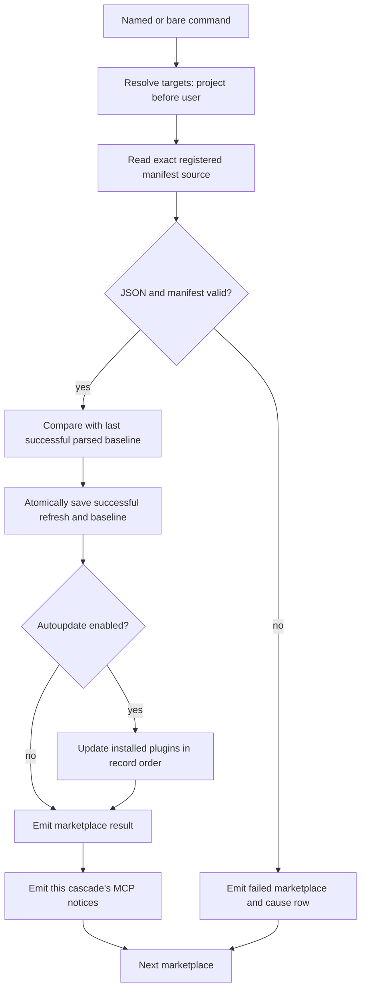

# Phase 6: Marketplace Update and C-10 Fix - Research

**Researched:** 2026-10-18
**Domain:** Real-Pi marketplace-update behavioral coverage, local source identity, and manifest change detection
**Confidence:** MEDIUM overall; direct observations and source quotations are identified separately below.

<user_constraints>
## User Constraints (from CONTEXT.md)

The following decisions, discretion, and deferred scope are copied verbatim from the phase context. [VERIFIED: .planning/phases/06-marketplace-update-and-c-10-fix/06-CONTEXT.md:21-85,211-219]

### C-10 file identity

- **D-01 (user; upstream parity):** A file-based marketplace keeps the exact
  resolved manifest file as its authoritative source. `info` shows that exact
  file path for every file source, including a conventional
  `.claude-plugin/marketplace.json`; directory sources continue to show their
  directory. This follows Claude Code's distinct `file` and `directory` source
  types.
- **D-02 (user):** Do not copy a local file-source manifest into a managed or
  conventional layout. Every update rereads the exact file originally added.
  If that source no longer exists, report `source missing`, keep the marketplace
  registered, and do not search for or fall back to another manifest.
- **D-03 (user):** Prove C-10 with a real-Pi behavioral regression scenario and
  the repository's normal paired unit tests at 100% direct coverage. The
  behavioral scenario must update the external manifest in place and observe
  the refreshed contents.

### Change detection

- **D-04 (user):** Compare the old and refreshed manifests as parsed JSON.
  Whitespace and object-key order do not count as changes.
- **D-05 (user):** Tolerated but currently unrecognized fields remain part of
  the comparison. Adding, removing, or changing one reports `updated`.
- **D-06 (user):** Array order remains significant. Reordering plugin entries
  or another array reports `updated` because array order can affect visible
  behavior.
- **D-07 (user):** Invalid refreshed JSON or an invalid refreshed manifest
  fails that update, keeps the marketplace registration, and causes no plugin
  or autoupdate changes. A later update rereads the source and can succeed once
  it is fixed.

### Autoupdate cascade

- **D-08 (user):** Process installed plugins in installed-record order. A
  plugin failure does not stop later plugins; emit one result for every
  attempted installed plugin.
- **D-09 (user):** A plugin that is installed but absent from the refreshed
  manifest stays installed and enabled. Emit a skipped `not in manifest`
  warning. A newly offered plugin is not auto-installed.
- **D-10 (user):** When the marketplace refresh succeeds, its primary result
  remains `updated` even if a plugin autoupdate fails. Report plugin failures in
  their own rows instead of replacing the marketplace result with an aggregate
  failure.

### Bare update sequencing

- **D-11 (user):** Process all project marketplaces before all user
  marketplaces. Within each scope, preserve saved marketplace-record insertion
  order.
- **D-12 (user):** A failed marketplace refresh does not stop the bare update.
  Continue through every remaining marketplace and emit one primary result per
  marketplace.
- **D-13 (user):** Emit each `mcp-config-notices` payload immediately after the
  marketplace/plugin cascade that produced it and before the next marketplace
  result. Targeted tests measured and confirmed this current order on
  2026-10-18.

### Agent's Discretion

- The structural comparison implementation, provided it ignores object-key
  order, preserves array order, and includes tolerated unknown fields.
- Exact Gherkin wording, fixture names, step boundaries, and plan split within
  the repository's Cucumber rules.
- The focused paired unit-test cases needed around the behavioral regression,
  provided changed source-test pairs retain 100% direct coverage.

## Deferred Ideas

- Activating `@url` and `@github` behavioral rows remains in Phases 9 and 10.

### Reviewed Todos (not folded)

- `.planning/todos/pending/2026-10-13-cucumber-rules-trial.md` §3: porting the
  Cucumber skills and gates to `acolomba/blueprint-typescript` concerns another
  repository and does not belong in Phase 6.
</user_constraints>

## Summary

Plan three connected corrections, not only the advertised file-path fix. A real-Pi probe reproduced C-10: an existing external manifest was rewritten from 55 to 71 bytes, but update failed while opening a reconstructed conventional manifest. Info reported the grandparent directory instead of the file. A separate directory-source probe changed its manifest from 115 to 154 bytes before the command; update incorrectly reported `skipped` with `up-to-date`. The pre/post reads both see the already-edited file, so replacing the string comparison alone cannot satisfy UPD-02. [VERIFIED: Research Measurements below; extensions/pi-claude-marketplace/orchestrators/marketplace/update.ts:391-452]

Use the existing Node deep comparator for the comparison itself. Keep a durable last-successful manifest baseline so local changes can be detected across sessions, initialize it when adding a marketplace, and advance it only after successful validation within the state transaction. Preserve the exact manifest path independently of the plugin-resolution root. These are implementation recommendations addressing the measured failures, not new user-facing scope. The existing state schema currently stores `manifestPath: Type.String()`, `marketplaceRoot: Type.String()`, and `lastUpdatedAt: Type.Optional(Type.String())`, but no content baseline. [VERIFIED: extensions/pi-claude-marketplace/persistence/state-io.ts:303-320]

The actual bare-update emission order was measured through real Pi: first project cascade, its MCP notice, second project cascade, then user cascade. Preserve that behavior. Extend the generic multi-result row assertion narrowly because it currently rejects every non-cascade payload; the envelope assertion already compares all emitted payloads. [VERIFIED: Research Measurements below; features/step_definitions/command.steps.ts:158-180]

**Primary recommendation:** Start with the failing external-file behavioral scenario, then implement source identity and persistent semantic change detection, followed by cascade/failure/sequencing coverage.

## Architectural Responsibility Map

| Capability | Primary tier | Secondary tier | Planning guidance |
|---|---|---|---|
| User commands and notifications | Pi extension orchestration | Existing notification renderer | Keep command result composition in the current update orchestration. |
| Manifest reading and validation | Domain filesystem boundary | Manifest cache | Keep a single validated read seam and preserve comparison data. |
| Last-successful comparison baseline | Persistence | Add/update orchestration | Store alongside the marketplace record and commit with successful refresh. |
| Installed-plugin updates | Plugin orchestration | Bridges and transaction layer | Reuse injected plugin update operations outside the marketplace lock. |
| Behavioral proof | Cucumber driver | Real Pi RPC process and local fixtures | Observe public payloads, config, list/info, and new-session skills. |

The ownership recommendations follow the current call flow: refresh runs under `withLockedStateTransaction`, `await tx.save()` precedes the plugin cascade, and the driver returns every validated payload in emission order. [VERIFIED: extensions/pi-claude-marketplace/orchestrators/marketplace/update.ts:482-519,724-747; features/lib/pi-commands.ts:59-81]

## Project Constraints (from AGENTS.md)

The planner must carry these actionable project directives forward. [VERIFIED: AGENTS.md:7-60,90-100,126-160]

- Read before editing; trace callers before modifying a function; research first. Keep changes surgical and use the existing style.
- Stay on a feature/agent branch; never commit to main, rebase, rewrite history, or skip hooks. Apply the committing skill and Conventional Commits; do not put phase/milestone identifiers in commit subjects.
- Before each commit or PR, run Fallow's audit against the relevant base. Use its guard before changing files, exact-consumer analysis before refactors, and the applicable trace/ownership/duplication/security commands when that work arises. Use CodeGraph before locating or understanding indexed code; do not initialize an absent index.
- Stay within the GSD workflow. Prefix WINDOWS descriptions with the milestone; do not hand-edit WINDOWS or overload its phase field. Include Threat Flags in every eventual summary.
- Run focused owner checks during tasks. Commit checks are incremental. Every combined-tree wave, phase, merge, and final handoff gate runs `npm run check`; same-input evidence may be reused only under the local-verification skill's rules.
- Preserve upstream parity unless an identified project decision or Pi capability gap licenses divergence. Keep exactly `user` and `project` scopes; base/local are config layers, not extra scopes.
- Preserve the runtime constraint `^22.22.2 || ^24.15.0 || >=26.0.0`, strict TypeScript, the resolver's `installable: true | false` discrimination, and Pi's `>=1.0.0` peer floor.
- Keep writes atomic, operations retryable, and recovery possible through `/reload`. Keep the last valid state after an invalid refresh.
- Keep path-source operations offline. Preserve the existing exceptions for git cache misses, constrained dependency tag lookup, and project creation of a user-only git marketplace; do not activate remote behavioral rows here.
- Preserve containment: writes remain within the managed scope locations listed by AGENTS, and plugin roots remain within their owning root. The exact external manifest is a read source, not a new write target.
- Keep 100% direct function/line/branch coverage for each changed production pair. Do not add a second test module for a source or weaken coverage.
- Preserve the single selected output transport: `ctx.ui.notify` for text modes and the JSON strategy via `pi.appendEntry` for machine modes. No direct stdout/stderr writes in command/bridge code. No telemetry or localization work.
- If later creating a PR, offer the required version bump and record the changelog; apply simple-English Plain mode and humanizer to its description. Milestone audit/close must precede merging, and PR merges use squash.

Source literals above are quoted verbatim from AGENTS. Detailed build scheduling and test ownership are also defined in the loaded local-verification and unit-test skills. [VERIFIED: AGENTS.md:49-60; .agents/skills/local-verification/SKILL.md:8-18; .agents/skills/typescript-unit-tests/rules/pairing-and-design.md:10-17]

<phase_requirements>
## Phase Requirements

Descriptions below reproduce the requirement text; research support names the implementation or coverage needed. [VERIFIED: .planning/REQUIREMENTS.md:42,115-128]

| ID | Description | Research support |
|---|---|---|
| UPD-01 | Updating a marketplace whose manifest did not change skips it as `up-to-date` (dir, url, gh) | Semantic baseline, no-op Outline; remote rows stay excluded. |
| UPD-02 | Updating a marketplace whose manifest changed reports it `updated`, with no plugin rows when autoupdate is off (dir, url, gh) | Measured local baseline defect; semantic comparison cases. |
| UPD-03 | With autoupdate off, installed plugins keep their version after a marketplace update | Compare installed version and new-session skill description. |
| UPD-04 | With autoupdate on, the update moves installed plugins to the offered version, and a new session offers the new version | Reuse publication helper and session observation. |
| UPD-05 | With autoupdate on and nothing changed, the marketplace is skipped as `up-to-date` | No-op result collapses unchanged plugin rows. |
| UPD-06 | A plugin newly offered by the refreshed manifest is not installed | Installed list and skill inventory exclude the new offer. |
| UPD-07 | A bare `update` refreshes every marketplace of both scopes, one result per marketplace, project first | Measured ordered cascades and adjacent notices; failure continuation. |
| UPD-08 | A bare `update` with nothing added reports no marketplaces | Existing empty-result assertion. |
| UPD-09 | Updating a name the scope lacks fails as `marketplace not added`, with and without `--scope` | Missing-name variants including other-scope-only record. |
| UPD-10 | A path marketplace whose manifest became invalid fails with an `invalid manifest` row | Malformed and schema-invalid fixtures, retained registration, repair/retry. |
| UPD-13 | With autoupdate on, an installed plugin the refreshed manifest dropped is skipped as `not in manifest`, with warning severity | Removed entry remains installed/enabled; full cascade row assertion. |
| UPD-14 | A path marketplace whose directory vanished fails as `source missing` | Remove only scenario-owned fixture; assert complete failure payload. |
| FIX-01 | `marketplace update` of a marketplace added from a `marketplace.json` outside `.claude-plugin/` re-reads the manifest the user added instead of failing as `source missing`, and `info` shows the right path (C-10) | Recorded real-Pi red probe; add durable Cucumber regression before production edit. |
</phase_requirements>

## Standard Stack

Keep the installed stack; this phase needs no new package or upgrade. Names and versions here are existing local manifest facts, not package-legitimacy claims or latest-version recommendations. [VERIFIED: package.json:17-35]

| Component | Existing version | Purpose and evidence |
|---|---|---|
| Node.js | Observed `v26.11.1` | Native TypeScript execution, node:test, node:assert/strict, node:util; shell version probe. |
| `@cucumber/cucumber` | `13.3.0` | Real-Pi behavioral runner. Verbatim package values: `"name": "@cucumber/cucumber"`, `"version": "13.3.0"`. [VERIFIED: node_modules/@cucumber/cucumber/package.json:2-13] |
| `@earendil-works/pi-coding-agent` | `1.0.0` | Existing repository-local Pi runtime. Verbatim: `"name": "@earendil-works/pi-coding-agent"`, `"version": "1.0.0"`. [VERIFIED: node_modules/@earendil-works/pi-coding-agent/package.json:2-10] |
| `typescript` | `6.0.3` | Existing strict type checker. Verbatim: `"name": "typescript"`, `"version": "6.0.3"`. [VERIFIED: node_modules/typescript/package.json:2-5] |
| Existing TypeBox validator and atomic state writer | Keep lockfile versions | Reuse current validation and persistence; no dependency change. [VERIFIED: extensions/pi-claude-marketplace/domain/manifest.ts:124-134; extensions/pi-claude-marketplace/persistence/state-io.ts:29-36] |

**Installation:** none. Registry probes for the three existing packages failed with `EAI_AGAIN registry.npmjs.org`; current registry versions and publish dates were not observed. Do not describe the installed versions as the registry latest. This does not block a phase that retains its lockfile. [VERIFIED: 2026-10-18 npm view command results]

### Package Legitimacy Audit

Not applicable: no external package installation is recommended. No package is being approved based only on registry existence. If the plan adds a package, run the legitimacy protocol before adding that install task.

## Research Measurements

### Probe environment and reproducibility

At commit `63da89ad223c421fe75217e97d994f90db188ab7`, the disposable probe used the existing `PiProcess`, `runCommandPayloads`, and `writeMarketplace` helpers, a fresh temporary tree, a new session, and the real extension. It stopped Pi and removed only its own fixture tree in finally. The existing harness starts the local CLI with an allowlisted environment and offline mode. [VERIFIED: tests/e2e/_rpc.ts:167-185,349-360; /tmp/phase6-probe.mjs:1-46]

The sandboxed probe and the existing Cucumber update feature both failed before the first command with `Error: Pi exited (0):`. The same probe ran successfully with the tool's approved sandbox escalation. This is an execution-environment distinction; do not interpret the startup failure as a product regression or weaken assertions to hide it. [VERIFIED: 2026-10-18 executions of `timeout 55s node /tmp/phase6-probe.mjs` and `npm run test:cucumber -- features/marketplace/update.feature --parallel 1`]

The temporary script is a reproduction aid for this session. The durable evidence is recorded here; execution must still add and run the actual repository Cucumber regression before fixing production.

### C-10 observed red

Procedure: add an external JSON manifest by file path in project scope; rewrite its description in place with a different byte count; update by name; inspect info. The external file changed from 55 to 71 bytes. Relevant literal output follows, with only the generated sandbox prefix replaced by `{sandbox}`. [VERIFIED: real-Pi probe, 2026-10-18]

<!-- DATA_J7mQ4c2P_START -->
```text
update marketplace row: status="failed"
plugin row: reasons=["source missing"]
causeChain=["Failed to update marketplace \"external\".",
"ENOENT: no such file or directory, open '{sandbox}/.claude-plugin/marketplace.json'"]
info source={"sourceKind":"path","absPath":"{sandbox}"}
info description="after with longer text"
```
<!-- DATA_J7mQ4c2P_END -->

The assertion-enabled rerun, `timeout 55s node /tmp/phase6-probe.mjs --red`, exited 1 with this output. [VERIFIED: real-Pi regression assertion, 2026-10-18]

<!-- DATA_p8V3nM5x_START -->
```text
AssertionError [ERR_ASSERTION]: external manifest update must succeed
+ actual - expected

+ 'failed'
- 'updated'
```
<!-- DATA_p8V3nM5x_END -->

Info already rereads the exact record manifest to get its description; that alone is not proof that update succeeded. The eventual scenario must assert the successful update result and the refreshed external content, and separately pin the exact info path. [VERIFIED: extensions/pi-claude-marketplace/orchestrators/marketplace/info.ts:78-92; probe above]

### Additional local-change defect

Procedure: add a directory marketplace; append a new description to its manifest before invoking update. The file grew from 115 to 154 bytes. The result was exactly `status: "skipped"`, `reasons: ["up-to-date"]`, `plugins: []`, with `severity: "info"` and `needsReload: false`. [VERIFIED: real-Pi probe, 2026-10-18]

The code obtains `const preKey = await manifestContentKey(record);`, validates the same local file, obtains `const postKey = await manifestContentKey(record);`, then uses `const changed = preKey !== postKey;`. Both reads see the new source. A valid historical baseline cannot be recovered from this pair of reads or from the timestamp. [VERIFIED: extensions/pi-claude-marketplace/orchestrators/marketplace/update.ts:391-452]

### Bare-update emission order with an actual MCP rewrite

Setup: project marketplaces were added in deliberately reverse-lexical order, zeta then alpha; a third marketplace was added to user scope. A plugin installed from zeta was republished from 1.0.0 to 22.0.0 with a local MCP declaration. Autoupdate was enabled, and the project adapter config held a comment. The MCP command was deliberately nonexistent and never started; the probe only exercised configuration staging. Actual payload order and fields: [VERIFIED: real-Pi probe, 2026-10-18]

| Index | Kind | Marketplace | Severity | Needs reload | Significant fields |
|---|---|---|---|---|---|
| 1 | `cascade` | zeta / project | `info` | `true` | marketplace `updated`; plugin `updated`, `from: "1.0.0"`, `to: "22.0.0"`, `reasons: ["requires pi-mcp-adapter"]`; tally success count 2 |
| 2 | `mcp-config-notices` | — | `warning` | `false` | `notices: [{"kind":"comments-dropped","scope":"project","file":"mcp-adapter.json"}]` |
| 3 | `cascade` | alpha / project | `info` | `false` | `skipped`, `reasons: ["up-to-date"]`; tally success count 1 |
| 4 | `cascade` | user-market / user | `info` | `false` | `skipped`, `reasons: ["up-to-date"]`; tally success count 1 |

All three cascades carried `tally.label: "Marketplace update"`, zero tally failures, and zero tally warnings. The warning was its own notice payload. The source's older prose comments call the benign no-op a warning, but measured wire output is info; copy the wire contract, not those stale comments. [VERIFIED: real-Pi probe; extensions/pi-claude-marketplace/orchestrators/marketplace/update.ts:749-758]

The focused existing AFILE-04 owner cases also passed: `node --test --test-name-pattern 'AFILE-04' tests/orchestrators/marketplace/update.test.ts` exited 0. Those cases cover notice-after-cascade and no notice for a no-op. [VERIFIED: tests/orchestrators/marketplace/update.test.ts:2491-2620; command result]

## Architecture Patterns



This is the recommended corrected flow. The current lock/cascade and iteration boundaries already support it. Preserve the present special handling for invalid GitHub-base configuration rather than widening this phase's continuation policy to unrelated remote configuration errors. [VERIFIED: extensions/pi-claude-marketplace/orchestrators/marketplace/update.ts:261-305,482-519,533-538,677-684,838-848]

### Component responsibilities and suggested plan boundaries

| Target | Recommended work |
|---|---|
| Existing marketplace update feature and a new marketplace/update step vertical | Named/no-op/change, cascade, failures, and bare-order coverage. |
| A separate file-source feature if it holds file-only behaviors | External-file identity, missing authoritative file with decoy conventional manifest, exact info path. Follow the Cucumber single-kind file rule. |
| Existing marketplace publishing topic and published/path fixture libraries | Authoritative external file placement and in-place size-changing rewrites; safe fixture removal; MCP fixture setup. |
| Existing command step module | Permit the known rowless MCP notice in the multi-cascade row comparison while retaining full envelope comparison and rejection of unknown row-bearing kinds. |
| Existing marketplace update and info source/test pairs | Exact-path reading, info projection, semantic baseline comparison, failure preservation, and ordered emission tests. |
| Existing marketplace add and state-io source/test pairs | Initialize and persist the additive successful-manifest baseline; compatibility with older records. |
| Existing domain manifest source/test pair, only if needed | Preserve raw parsed comparison data when dependency normalization would otherwise discard fields. |

These are proposed edit targets. Existing behavior and declarations were read in the sources cited throughout this document; new module names or new state-member names remain planner choices, not claims about files or fields already present.

### Pattern 1: source identity and resolution root are separate

Path add currently writes both `manifestPath` and `marketplaceRoot`; for a file, it sets `manifestPath = onDiskPath` and `marketplaceRoot = path.dirname(path.dirname(manifestPath))`. Update reconstructs the manifest with `path.join(marketplaceRoot, ".claude-plugin", "marketplace.json")`. Fix local refresh to validate the recorded manifest directly. Keep plugin-relative root semantics separately tested; changing every root to the manifest directory would break conventional layouts. [VERIFIED: extensions/pi-claude-marketplace/orchestrators/marketplace/add.ts:1202-1239; extensions/pi-claude-marketplace/orchestrators/marketplace/update.ts:864-877]

Info currently uses `source = { sourceKind: "path", absPath: record.marketplaceRoot };`. Project the resolved source identity instead for file sources, including conventional files. Distinguish file versus directory from the recorded source identity or an explicit persisted distinction, not a filename suffix or a search for another manifest. Resolve relative/tilde identity using the same add semantics. Preserve directory-source info. Update the existing conventional-file info expectation as part of D-01. [VERIFIED: extensions/pi-claude-marketplace/orchestrators/marketplace/info.ts:78-80; features/marketplace/info.feature:31-34; extensions/pi-claude-marketplace/orchestrators/marketplace/add.ts:1193-1212,1244-1249]

### Pattern 2: baseline and comparator solve different problems

Recommendation: add one optional persisted comparison snapshot to the marketplace record, initialized from the successfully added manifest and updated only by a successful marketplace refresh. Prefer an immutable serialized parsed snapshot with structural comparison after parsing; it avoids aliasing the cache's read-only objects and survives session resets. Do not make info/list reads advance the baseline. Do not copy the external source into a managed marketplace layout. A comparison snapshot is state metadata and must never become the read source for resolution.

For existing records without a baseline, preserve a pre-refresh comparison for git sources where fetch actually changes the clone. For local sources, the old value is unknowable: the recommended compatibility rule is to classify the first successful refresh as changed and establish the baseline, then classify later refreshes normally. Make this explicit in the plan and its paired tests; it is a proposed implementation policy, not a preexisting locked decision.

Successful refresh currently calls `await tx.save()` before cascading; exceptions skip that save and cascade. Put baseline advancement in that same success path. Include repair-after-invalid, failed-save, restart/new-session, and absent-baseline cases in owner coverage. [VERIFIED: extensions/pi-claude-marketplace/orchestrators/marketplace/update.ts:489-519,680-713,745-747]

### Pattern 3: compare whole parsed values with the Node built-in

Use two-argument `isDeepStrictEqual` from `node:util`. Official docs delegate to strict deep equality, whose object properties are unordered. A runtime probe produced `reorderedKeys: true`, `reorderedArray: false`, `unknownChanged: false`. Use the two-argument form so the implementation does not depend on the newer prototype-skip option. [CITED: https://nodejs.org/api/util.html#utilisdeepstrictequalval1-val2-options] [CITED: https://nodejs.org/api/assert.html#assertdeepstrictequalactual-expected-message] [VERIFIED: real-Pi probe's Node comparator experiment, 2026-10-18]

Do not replace manifest validation with a clean/parse operation that strips extras. The current loader checks the parsed value and returns it, but first normalizes invalid dependency entries into stubs. That normalization can discard entry fields. If the comparison must cover such tolerated entries, retain the original parsed comparison value at the existing single read seam while leaving resolver normalization unchanged. Test unknown fields at the top level and in nested entries, not only a known description field. [VERIFIED: extensions/pi-claude-marketplace/domain/manifest.ts:54-94,106-134]

### Pattern 4: explicit observable setup and complete results

Keep source kind on the world, dispatch fixture operations in the library, and keep update-specific actions under the update vertical. Shared publication steps belong in the publishing topic. If moving a verb step into shared publication, make the move its own commit. Outlines need at least three rows across all Examples blocks; local rows run and remote rows bind only. A single-kind behavior belongs in its own feature. [VERIFIED: .agents/skills/cucumber/rules/layout.md; .agents/skills/cucumber/rules/features.md]

For every update, compare complete envelope fields and all marketplace/plugin rows. Compare the MCP notice's complete notices array in the envelope table. The current generic row step requires `result.kind !== "cascade"` to fail; allow only the explicitly understood rowless notice there, never filter arbitrary kinds or ignore extra payloads. [VERIFIED: features/step_definitions/command.steps.ts:90-98,158-180; features/lib/field-rows.ts:34-52]

## Don't Hand-Roll

| Problem | Use | Avoid |
|---|---|---|
| Structural JSON equality | Node's two-argument deep strict comparator | Recursive key sorting, custom deep equality, or a new dependency |
| Real-Pi lifecycle and wire validation | Existing Pi process and command driver | Another RPC harness or text-output parsing |
| Atomic successful state commit | Existing locked state transaction | Parallel baseline sidecar writes outside the transaction |
| Notification severity, reload, notices | Existing composers and dispatchers | New aggregate failure rules or sorting emitted payloads |
| Manifest read/validation | Existing domain boundary | Reading source JSON directly from an orchestrator |

These reuse recommendations are grounded in the existing driver, transaction, validation, and notification seams described above. [VERIFIED: features/lib/pi-commands.ts:59-81; extensions/pi-claude-marketplace/orchestrators/marketplace/update.ts:489-519,827-848; extensions/pi-claude-marketplace/domain/manifest.ts:96-106]

## Runtime State Inventory

Included because the recommended baseline introduces additive persisted state, although there is no rename.

| Category | Items found / scope of inspection | Required action |
|---|---|---|
| Stored data | Existing marketplace records have `manifestPath`, `marketplaceRoot`, optional `lastUpdatedAt`, and `plugins`. [VERIFIED: extensions/pi-claude-marketplace/persistence/state-io.ts:303-320] | Add an optional baseline; test legacy absence. Do not rewrite the user's real state during execution. |
| Live service config | No live external service participates in the local probe; MCP config rewrite occurs in a fresh temporary project. [VERIFIED: Research Measurements] | Preserve comment-loss notice and unrelated config; no remote service migration. |
| OS-registered state | None created by the probe: the harness launches a disposable child with pipes and stops its process group. [VERIFIED: tests/e2e/_rpc.ts:349-360; features/lib/pi-process.ts:131-140] | No registration migration in scope. |
| Secrets/env vars | Harness environment contains `HOME`, `PI_CODING_AGENT_DIR`, `PI_OFFLINE`, `PATH`; no provider credentials are inherited. [VERIFIED: tests/e2e/_rpc.ts:167-173] | Keep isolation; no secret-key rename or credential migration. |
| Build artifacts / installed packages | Installed Pi is 1.0.0; source changes execute through the existing local CLI. [VERIFIED: node_modules/@earendil-works/pi-coding-agent/package.json:2-10; tests/e2e/_rpc.ts:176-185] | No dependency reinstall or package migration recommended. |

This inventory is bounded to repository code and the owned temporary probe, not an audit of unrelated machine services.

## Common Pitfalls

1. **Comparing two fresh local reads.** The measured changed directory manifest still emitted `up-to-date`. Seed a persistent baseline at add; verify it survives a new session. A test that rewrites only during a fake git checkout does not expose this local bug. [VERIFIED: Research Measurements; update.ts:391-452]
2. **Mistaking refreshed info for successful update.** Info can show the changed description even after update fails. Assert both command success and exact file identity. [VERIFIED: Research Measurements]
3. **Preserving size during a fixture rewrite.** The cache compares `hit?.mtimeMs === st.mtimeMs && hit.size === st.size`. Ensure each replacement has a different byte length, including reordered-key and repair cases; whitespace padding is useful when semantic content must remain equal. Never add sleeps to make the cache test work. [VERIFIED: extensions/pi-claude-marketplace/domain/manifest-cache.ts:81-101]
4. **Testing only alphabetical order.** The existing bare scenario inserts alpha before gamma, which does not distinguish sorting from insertion order. Use reverse-lexical names in both scopes, and an early failing marketplace followed by a healthy one. [VERIFIED: features/marketplace/update.feature:7-24]
5. **Allowing an invalid manifest to run autoupdate.** Invalid JSON and invalid schema must preserve registration, installed state, and config; repair then retry without a process restart. Preserve the last valid baseline after failure. [VERIFIED: phase context D-07; update.ts:482-519,677-713]
6. **Turning every plugin result into a marketplace failure.** The cascade must keep its successful marketplace header, preserve installed-record order, continue after a failed plugin, retain removed catalog plugins, and avoid installing new offers. Preserve the existing no-op exception that collapses all unchanged plugin outcomes into one marketplace no-op. [VERIFIED: update.ts:533-576,788-848; phase context D-08 through D-10]
7. **Reopening remote work.** Keep `"tags": "not @url and not @github"`; all rows must still bind under the feature gate. [VERIFIED: cucumber.json:3-7]

## Code Examples

The comparator example uses illustrative JSON values, not repository schema literals. It was executed on the installed Node version, with the results shown. [VERIFIED: Node comparator probe, 2026-10-18] [CITED: https://nodejs.org/api/util.html#utilisdeepstrictequalval1-val2-options]

<!-- DATA_K9tS6u1B_START -->
```js
import { isDeepStrictEqual } from "node:util";

isDeepStrictEqual(JSON.parse('{"a":1,"b":2}'), JSON.parse('{"b":2,"a":1}')); // true
isDeepStrictEqual([1, 2], [2, 1]); // false
isDeepStrictEqual({ extra: 1 }, { extra: 2 }); // false
```
<!-- DATA_K9tS6u1B_END -->

Use the existing public-command driver pattern for the behavioral red/green regression. Its exact declaration is `runCommandPayloads(pi: PiProcess, command: string): Promise<readonly NotificationPayload[]>`; it retains every payload and validates each. [VERIFIED: features/lib/pi-commands.ts:66-81]

Do not copy the disposable probe's direct writes into a step body wholesale. Put source publication and MCP configuration setup in appropriately named fixture library functions; the world owns cleanup. [VERIFIED: .agents/skills/cucumber/rules/layout.md; .agents/skills/cucumber/rules/world-and-stand-ins.md]

## State of the Art

| Existing approach | Recommended phase outcome | Basis |
|---|---|---|
| Reconstruct local manifest from resolution root | Re-read registered file identity | Measured C-10 and D-01/D-02 |
| Compare JSON.stringify output | Structural comparison of complete parsed values | D-04 through D-06 and Node docs |
| Read current local file for both comparison operands | Persist last successful baseline | Measured UPD-02 failure |
| Require every multi-result payload to be a cascade | Admit the known rowless notice while asserting its full envelope | Measured payload order and current step source |

This table describes the repository transition, not an ecosystem deprecation claim. [VERIFIED: Research Measurements; features/step_definitions/command.steps.ts:158-180]

## Validation Architecture

Nyquist validation is explicitly enabled: `"nyquist_validation": true`. [VERIFIED: .planning/config.json:22]

| Property | Value |
|---|---|
| Framework | Existing Cucumber 13.3.0 and Node test runner |
| Config | Existing cucumber config: `"order": "random"`, `"tags": "not @url and not @github"`, `"parallel": 8` [VERIFIED: cucumber.json:3-7] |
| Focused behavioral command | `npm run test:cucumber -- features/marketplace/update.feature --parallel 1` |
| Focused owner command | `node --test tests/orchestrators/marketplace/update.test.ts` |
| Direct coverage | `npm run test:coverage:direct -- extensions/pi-claude-marketplace/orchestrators/marketplace/update.ts` and every other changed pair |
| Binding/layout gate | `npm run check:features` |
| Full combined-tree gate | `npm run check` |

Commands are existing script/skill interfaces; newly proposed scenario names below are exact selection contracts for the planner to create. [VERIFIED: package.json:85-112; .agents/skills/local-verification/rules/commands.md]

### Phase Requirements → Test Map

Each focused command selects one proposed title, including its local Outline rows, and should be used after that scenario exists. Expected sub-30-second runs are a planning target, not a measured guarantee. Verify the selected scenario count is nonzero. All rows are behavioral tests; paired unit checks supplement them.

| Req ID | Proposed discriminating scenario title | Runnable focused command | Exists? |
|---|---|---|---|
| UPD-01 | An unchanged marketplace is up to date | `npm run test:cucumber -- --name '^An unchanged marketplace is up to date$' --parallel 1` | Wave 0 gap |
| UPD-02 | A changed marketplace refreshes without plugin rows | `npm run test:cucumber -- --name '^A changed marketplace refreshes without plugin rows$' --parallel 1` | Wave 0 gap |
| UPD-03 | Autoupdate off preserves installed versions | `npm run test:cucumber -- --name '^Autoupdate off preserves installed versions$' --parallel 1` | Wave 0 gap |
| UPD-04 | Autoupdate exposes the offered version in a new session | `npm run test:cucumber -- --name '^Autoupdate exposes the offered version in a new session$' --parallel 1` | Wave 0 gap |
| UPD-05 | An unchanged autoupdate is up to date | `npm run test:cucumber -- --name '^An unchanged autoupdate is up to date$' --parallel 1` | Wave 0 gap |
| UPD-06 | Autoupdate does not install newly offered plugins | `npm run test:cucumber -- --name '^Autoupdate does not install newly offered plugins$' --parallel 1` | Wave 0 gap |
| UPD-07 | A bare update preserves scope and insertion order with adjacent notices | `npm run test:cucumber -- --name '^A bare update preserves scope and insertion order with adjacent notices$' --parallel 1` | Existing weaker seed; extend |
| UPD-08 | A bare update with no marketplaces reports an empty result | `npm run test:cucumber -- --name '^A bare update with no marketplaces reports an empty result$' --parallel 1` | Wave 0 gap |
| UPD-09 | An update reports the marketplace missing from the requested scope | `npm run test:cucumber -- --name '^An update reports the marketplace missing from the requested scope$' --parallel 1` | Wave 0 gap; Outline for three variants |
| UPD-10 | An invalid refreshed manifest leaves installed plugins unchanged | `npm run test:cucumber -- --name '^An invalid refreshed manifest leaves installed plugins unchanged$' --parallel 1` | Wave 0 gap; malformed/schema-invalid cases |
| UPD-13 | Autoupdate keeps a plugin removed from the catalog | `npm run test:cucumber -- --name '^Autoupdate keeps a plugin removed from the catalog$' --parallel 1` | Wave 0 gap |
| UPD-14 | A missing marketplace directory leaves its registration intact | `npm run test:cucumber -- --name '^A missing marketplace directory leaves its registration intact$' --parallel 1` | Wave 0 gap |
| FIX-01 | An external manifest is refreshed from its original file | `npm run test:cucumber -- --name '^An external manifest is refreshed from its original file$' --parallel 1` | Wave 0 gap; must first fail |

Add separately named cases for object-key/whitespace no-ops; added/removed/changed nested unknown fields; array reordering; legacy baseline establishment; successful change followed by no-op; failed refresh followed by repair; conventional-file info; missing original file with a valid decoy; plugin failure followed by success; marketplace failure followed by later scopes. Keep feature requirements observable through whole results, config, list/info, and skills, never internal state files. [VERIFIED: phase context D-01 through D-13; .planning/REQUIREMENTS.md:165-173]

### Sampling and Wave 0

- First implementation task: create and run the external-file Cucumber scenario against unchanged production; retain the failed assertion. Then fix production and require green. The research probe is prior evidence, not a substitute for this task.
- During edits: run the affected scenario and owner test. At task commit: normal hook and per-pair direct coverage. At each wave/phase gate: full combined-tree `npm run check`.
- Wave 0 gaps are the scenarios above, external-file fixture support, size-distinct semantic rewrites, safe missing-source setup, commented MCP fixture, and the rowless-notice assertion path. No framework installation is needed.
- Preserve all existing add/info paired tests and the info feature; D-01 changes its conventional-file expected path deliberately.

These schedules apply the repository local-verification and Cucumber rules. [VERIFIED: .agents/skills/local-verification/rules/gates.md; .agents/skills/cucumber/rules/layout.md; features/marketplace/info.feature:31-34]

## Environment Availability

| Dependency | Available | Observed version / result | Execution guidance |
|---|---|---|---|
| Node / npm | Yes | `v26.11.1` / `11.20.0` | Existing scripts work. |
| Repository Pi | Yes outside sandbox | `1.0.0`; actual public-command probe completed | In this environment request the same bounded sandbox escalation for Pi checks. |
| Cucumber | Yes | `13.3.0`; existing feature loaded | Sandbox run failed in Before, not step binding. |
| Claude Code | Yes | `2.1.296`; update help inspected | Upstream reference only, not a behavioral-test dependency. |
| Context7 MCP / ctx7 CLI | Not available in this session | Tool inventory lacked Context7; `command -v ctx7` returned no path | Used official documentation with web tools. |
| npm registry | Unavailable from restricted shell | `EAI_AGAIN registry.npmjs.org` | No install needed; preserve dependencies. |

Entries report observations from the commands in this research, not general support guarantees. [VERIFIED: 2026-10-18 environment probes and Research Measurements]

## Security Domain

Keep security review in the plan: the phase reads untrusted manifests, writes scoped state, and may rewrite MCP config during a plugin cascade. No remote authentication implementation belongs in this phase. [VERIFIED: update.ts:373-467,489-519,838-848; phase context scope]

Use the explicitly versioned ASVS 4.0.3 numbering below; do not confuse it with the reorganized newer standard. The applicable guidance is schema validation / safe JSON parsing and safe file handling, applied to this CLI boundary rather than a web UI. [CITED: https://raw.githubusercontent.com/OWASP/ASVS/v4.0.3/4.0/en/0x13-V5-Validation-Sanitization-Encoding.md] [CITED: https://raw.githubusercontent.com/OWASP/ASVS/v4.0.3/4.0/en/0x20-V12-Files-Resources.md]

| ASVS category | Applies to this phase? | Planned control |
|---|---|---|
| V2 Authentication | No new auth behavior | Keep git/auth seams unchanged; local probes inherit no credentials. |
| V3 Session Management | No web session surface | Pi session resets test persistence, not authentication. |
| V4 Access Control | Scoped filesystem boundary | Keep source identity distinct from write destinations and plugin containment. |
| V5 Validation, Sanitization and Encoding | Yes | JSON.parse and the existing manifest validator before baseline/state advancement. |
| V6 Stored Cryptography | No new crypto | No custom hashing/encryption needed for equality. |
| V12 Files and Resources | Yes | Atomic state update, exact read source, no manifest fallback, scenario-owned temporary cleanup. |

| Threat candidate | STRIDE | Required mitigation / proof |
|---|---|---|
| Wrong source selected after original file disappears | Tampering / spoofing | Exact-path read; valid decoy manifest must not be accepted. |
| Invalid source partially advances baseline or installed versions | Tampering | Validate before saving; failure/repair tests retain last successful state. |
| Root change expands plugin or output containment | Elevation of privilege | Preserve root semantics and existing path guards; paired containment tests if root construction changes. |
| Baseline snapshot silently drops tolerated fields | Tampering | Preserve complete parsed comparison data; nested unknown-field tests. |
| Extra notice or failed plugin omitted by assertions | Repudiation / integrity | Complete ordered envelope and row tables; no arbitrary filtering. |

These are phase-specific threat-model recommendations grounded in the read/write seams and measured defects, not claims that each is an exploitable vulnerability.

## Threat Flags

Every eventual plan SUMMARY must include the exact heading `## Threat Flags`. If the plan introduces no security surface beyond its declared threat model, use the required text below; otherwise list the actual new surface and its verification. [VERIFIED: AGENTS.md:22-28]

<!-- DATA_y3L8qW6R_START -->
```markdown
## Threat Flags

None -- no security-relevant surface outside the plan's `<threat_model>` was introduced.
```
<!-- DATA_y3L8qW6R_END -->

## Assumptions Log

No unverified product fact is used as a locked decision. The legacy-baseline policy is a recommendation for the planner to make explicit within the implementation discretion, not a claim about current behavior. Focused-run duration is a target, not a compatibility guarantee. No package freshness claim is made after the failed registry lookups.

## Open Questions (RESOLVED)

These questions were resolved during planning. The choices below are implementation contracts; their runtime verification remains execution work.

1. **RESOLVED — Legacy local records have no old manifest content.** The first successful refresh conservatively reports changed and atomically persists the complete parsed comparison baseline. Later identical refreshes report up-to-date, including after a fresh state load or new session. Failed refreshes do not establish or advance the baseline. This explicit compatibility rule avoids claiming to recover historic content from two current reads. Plan evidence: [06-01-PLAN.md](06-01-PLAN.md), Tasks 1 and 3, including legacy, persistence, failure, and idempotency tests. [VERIFIED: state-io.ts:303-320; Research Measurements]
2. **RESOLVED — Comparison before dependency normalization.** Capture comparison JSON from the complete parsed input before dependency normalization, then validate and retain the existing normalized resolver output. The cached document carries both views; the baseline never becomes an alternate source. Unknown fields in tolerated malformed-dependency entries remain significant without changing resolver isolation. Plan evidence: [06-01-PLAN.md](06-01-PLAN.md), Task 1, and [06-02-PLAN.md](06-02-PLAN.md), Task 2. [VERIFIED: domain/manifest.ts:54-94,124-134]
3. **RESOLVED — Verification environment.** Execution must obtain an authorized isolated real-Pi run and preserve the actual repository scenario's pre-fix product red and post-fix green evidence. A sandbox startup failure alone is not red evidence and cannot replace the real-Pi regression. Plan evidence: [06-01-PLAN.md](06-01-PLAN.md), Task 1 and its verification/acceptance criteria. [VERIFIED: Research Measurements]

No research question remains unresolved. Remote activation and the reviewed todo's cross-repository port remain out of scope. [VERIFIED: phase context:211-219; .planning/todos/pending/2026-10-13-cucumber-rules-trial.md:54-56]

## Sources

### Primary repository and measured evidence

- Phase 6 context, requirements, roadmap, state, AGENTS, and the loaded compatibility/Cucumber/unit-test/local-verification skills.
- Current add/update/info, state-io, manifest/cache, command-step, fixture, and RPC-driver sources cited with line ranges above.
- Real-Pi probe and explicit failing assertion on 2026-10-18; baseline commit `63da89ad223c421fe75217e97d994f90db188ab7`.
- Installed Claude Code `2.1.296`: `claude plugin marketplace update --help` reports an optional name, all-marketplace behavior when omitted, and only help/JSON options.

### Official documentation (MEDIUM, provider seam)

- https://code.claude.com/docs/llms.txt → https://code.claude.com/docs/en/plugins/cli-reference — distinct local directory/file sources, in-place reads, source path, named/bare updates.
- https://nodejs.org/api/util.html#utilisdeepstrictequalval1-val2-options and https://nodejs.org/api/assert.html#assertdeepstrictequalactual-expected-message — built-in structural comparison and unordered object properties.
- OWASP ASVS 4.0.3 V5 and V12 source pages linked in Security Domain — validation and file-boundary review.

### Research-provider record

The research-plan seam returned Context7 for both documentation questions. Neither Context7 MCP nor ctx7 CLI was available, so the official pages were fetched with the web tool. `classify-confidence --provider websearch --verified` returned `MEDIUM`; both digests were cached with that tier. The seam's unknown-provider fallback returned `LOW` for webfetch/codebase, so no undocumented provider tier was promoted. Repository quotations and experiment outputs above remain directly checkable evidence, while overall research confidence stays MEDIUM. Graphify status reported disabled; CodeGraph was used first for code discovery. [VERIFIED: research-plan, classify-confidence, research-store, graphify, and CodeGraph command outputs, 2026-10-18]

## Metadata

- Standard stack: MEDIUM — local versions verified; current registry metadata unavailable; no new dependency needed.
- Architecture: MEDIUM — source-grounded and exercised through real Pi; persisted-baseline design still needs implementation and paired coverage.
- Pitfalls: MEDIUM — C-10, local false no-op, and notice placement were reproduced directly; proposed scenarios have not yet been implemented.
- Research date: 2026-10-18. Recheck against the source commit before execution; upstream documentation should be refreshed if planning resumes after 30 days.
