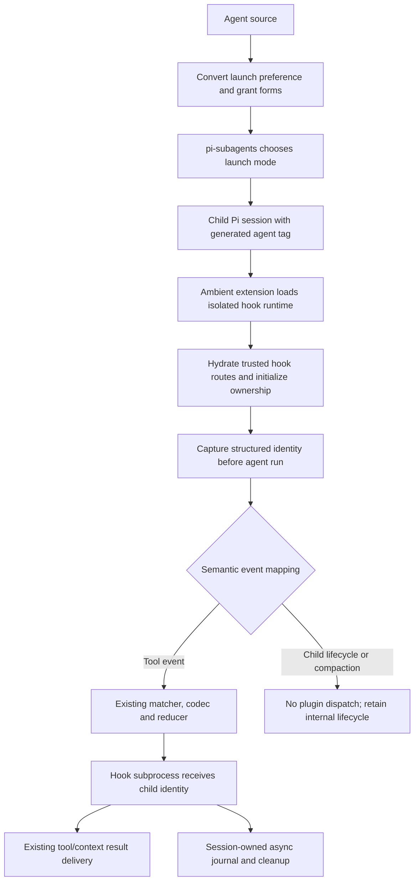

# Phase 3: Background Subagents - Research

**Researched:** 2026-11-13
**Domain:** agent conversion, Pi child sessions, hook routing and process ownership
**Confidence:** MEDIUM overall; identity mechanism has source and live-runtime evidence

<user_constraints>
## User Constraints (from CONTEXT.md)

The following decisions, discretion and deferred scope are copied verbatim from the phase context. [VERIFIED: .planning/phases/03-background-subagents/03-CONTEXT.md]

<!-- DATA_H7X4K9Q2_START -->
### Launch mode and existing installations

- **D-PG3-01:** Omit generated `async` for an ordinary agent. Delegate the default
  to pi-subagents and its user configuration; do not introduce another setting.
  This carries PRD decision 1 and the user's standing acceptance of recommendations.
- **D-PG3-02:** Emit `async: true` for explicit `background: true` or MCP tool
  grants. MCP requirements win over `background: false`. Preserve existing
  background-value parsing semantics and the current optional-dependency floor.
- **D-PG3-03:** Existing generated `async: false` changes through update or
  reinstall. Do not silently rewrite all agent files at load. Replace the warning
  that incorrectly says Claude Code defaults to foreground execution. Recognize
  exact legacy warning strings as well as the new strings in MCP grant rewriting,
  including legacy records without an implementation field.

### Child event mapping

- **D-PG3-04:** Model main-session versus child hook routing explicitly. Child
  sessions dispatch PreToolUse, PostToolUse and PostToolUseFailure. Do not dispatch
  main-session SessionStart, UserPromptSubmit, Stop, StopFailure or SessionEnd in
  children. Represent lifecycle counterparts as unsupported subagent events where
  appropriate, leaving their future implementation to PG-HOOK-07b. Inspect and
  explicitly classify compaction events too; the phase's contract is child tool
  hooks only, not a growing ad hoc skip-list.
- **D-PG3-05:** Preserve the initialization, project trust checks, hydration,
  generation guards and tool-hook context delivery needed by child tool hooks.
  Suppressing a hook must not accidentally skip required internal setup. Audit
  orphan reaping and shared PID tables so a child cannot terminate another live
  session's hook processes. Keep child load-time state/grant protections.

### Identity and compatibility

- **D-PG3-06:** Child tool payloads carry the actual agent type and, when knowable,
  a stable child identifier. Main-session tool payloads carry neither. Establish
  the identity source and lifecycle timing from the installed companion and Pi
  APIs before planning implementation. Do not infer an agent name from arbitrary
  task text, confuse a parent identifier with a child identifier, or store one
  child's identity in process-global state shared by concurrent child sessions.
  Missing metadata behavior must be documented and tested; inability to provide
  the required agent type is a research blocker, not permission to fabricate it.
- **D-PG3-07:** Preserve Phase 2 input/result translation, batch semantics,
  matcher behavior and main-session Stop protection. Cover success and failure
  tool hooks, not only PreToolUse.

### Automated evidence

- **D-PG3-08:** Replace the foreground-default behavioral expectation and add
  child/main lifecycle and identity scenarios. Use recording hooks to prove
  suppressed hooks did not run, including a Stop hook that would request another
  turn. Prove both explicit background cases and the delegated default.
- **D-PG3-09:** Automate a real installed pi-subagents child check in addition to
  the existing stand-in. Reuse the isolated stub-provider approach from the
  0.88.1 adoption task. Exercise concurrent children or an equivalent identity
  isolation probe, and migration/grant switching for both MCP implementations.
  Keep normal commit hooks and full `npm run check` combined-tree gates.

### the agent's Discretion

Choose small internal types and test seams, exact warning prose, and plan splits
within the above boundaries. The user's instruction to accept recommendations
and automate validation remains in force. No exception to plan size, security,
coverage or verification gates is granted for this phase.

### Deferred Ideas

PG-HOOK-07b (SubagentStart/SubagentStop support), complete tool-result wrappers
(HOOKRESULT-01), long MCP names, and later phase lifecycle/environment changes
remain outside this phase. No new dependency bump or release is requested.
<!-- DATA_H7X4K9Q2_END -->
</user_constraints>

## Summary

**Primary recommendation:** capture the companion-generated agent tag from Pi's structured system-prompt options before each agent run, store it on the hook runtime for the current session, and attach it to all three tool payloads. Use Pi's current session ID for the child identifier. Route child events through an exhaustive mapping, while retaining hydration and internal lifecycle work. Isolate child hook PID persistence before enabling background defaults. These are implementation recommendations within D-PG3-01..09, grounded in the source and probes below.

This phase touches the upstream contract: agent launch defaults and plugin hooks inside subagents. Current Claude Code documentation says default launches are background; child tool calls run the configured plugin hooks with child identity, and Stop is a main-agent event. The accepted scope follows that contract. [CITED: https://code.claude.com/docs/en/sub-agents] [CITED: https://code.claude.com/docs/en/hooks]

The required identity is available without a new dependency or fabricated API. The installed companion prefixes the actual agent name into a structured prompt section, and the existing minimum companion version does the same. A real detached child and a concurrent two-session probe verified extension visibility on the installed Pi minimum version. Identity is therefore **not blocked**. The main implementation risk is PID ownership: current scope-wide persistence cannot distinguish another live runtime from an orphan. [VERIFIED: companion evidence E1-E5 below; probe evidence P1-P2 below; extensions/pi-claude-marketplace/bridges/hooks/async-rewake/registry.ts:603-625,714-722]

## Architectural Responsibility Map

This is a local extension/process design, not a browser/backend application. Recommended ownership follows the existing converter, runtime and persistence boundaries. [VERIFIED: extensions/pi-claude-marketplace/bridges/agents/convert.ts:1020-1050; extensions/pi-claude-marketplace/bridges/hooks/runtime.ts:55-64; extensions/pi-claude-marketplace/bridges/hooks/async-rewake/pid-table.ts:136-167]

| Capability | Primary tier | Secondary tier | Rationale / planning direction |
|---|---|---|---|
| Generated launch preference and warning | Pure agent conversion | Existing install/update staging | Change generated bytes only when conversion runs. |
| Child detection | Platform boundary | Hook runtime | Read exact companion process marker; it identifies child processes, not individual agents. |
| Agent identity | Session-local hook runtime | Pi before-run event | Derive from structured companion tag; bind to current session ID. |
| Main/child event dispatch | Hook bridge | Existing translators and reducers | Decide which semantic event is supported before hook dispatch. |
| Trust and hydration | Existing hook hydration | Pi context | Keep internal setup independent of visible event suppression. |
| Async process ownership | Runtime registry and disk persistence | OS PID/marker probes | One session must not overwrite or reap another session's journal. |
| Behavioral evidence | Cucumber and real-child integration | Local fake provider/MCP | Prove user-visible behavior and actual companion handoff. |

<phase_requirements>
## Phase Requirements

| ID | Description | Research support |
|---|---|---|
| PG-AGENT-01 | A bridged agent runs in the launch mode that pi-subagents chooses, unless the source sets `background: true` or the agent has plugin MCP tools; those two run in the background. The warning for agents with MCP tools no longer says that Claude Code runs them in the foreground. Lands with PG-HOOK-07a. | Converter conditional emission; exact old warning recognition; update/reinstall and both grant forms. |
| PG-HOOK-07a | In a pi-subagents child, the plugin's `SessionStart`, `UserPromptSubmit`, `Stop`, and `SessionEnd` hooks do not run, and tool hook payloads carry `agent_type`, and `agent_id` when the child can know it. Lands with PG-AGENT-01. | Exhaustive event mapping; structured identity capture proven on real child; isolated PID persistence; lifecycle-negative and tool-positive tests. |

Requirement text is quoted from the authoritative requirement rows. [VERIFIED: .planning/REQUIREMENTS.md:27-38]
</phase_requirements>

## Project Constraints (from AGENTS.md)

Apply all of these directives to planning and execution. [VERIFIED: AGENTS.md:5-66; AGENTS.md sections GSD Workflow Enforcement, CodeGraph and Fallow task map, read this session]

- Read files before editing and trace callers before changing functions; use CodeGraph first for indexed source. Keep changes surgical and remove only newly orphaned code.
- Remain in the active GSD workflow. Work on a permitted feature/agent branch; never commit or push main, rebase, rewrite history, or bypass hooks. Follow the committing skill and its message format. Audit with Fallow before committing; use the task-map commands for impact, architecture guards, security and review where applicable.
- Preserve strict TypeScript, resolver discrimination, atomic writes, containment, retry safety, and recovery through apply/reload without restarting Pi. No new telemetry, localization, scope, or network behavior.
- Preserve the two scopes and independent marketplace/install scope records. Keep project-trust checks. Keep the exact mode-selected output channel; no direct stdout/stderr in bridges.
- Visible command behavior needs a failing-before-change Cucumber scenario. Each production source has its own owner test and 100% direct coverage. Use existing node:test, assertions and strict mocks; do not add a test framework. [VERIFIED: .agents/skills/typescript-unit-tests/SKILL.md; .agents/skills/typescript-unit-tests/rules/pairing-and-design.md]
- Every wave, phase, merge and final handoff uses the full combined-tree check with normal hooks. A commit hook or selected test run is not a gate. Retain exact-input evidence when reusing a passing result. [VERIFIED: .agents/skills/local-verification/rules/gates.md]
- Prefix window descriptions with the milestone, not phase identifiers; use the tool rather than editing WINDOWS. Each plan summary includes Threat Flags. Before a milestone PR merge, audit and close the milestone, resolve every new SonarCloud issue, and use squash merge. Offer the version bump before PR creation and record the reader-facing changelog. Use the specified prose skills for PR descriptions. These are handoff constraints, not additional work for this researcher.
- Upstream parity is default; only a recorded project decision or Pi capability gap licenses divergence. This phase follows its nine accepted decisions. [VERIFIED: AGENTS.md:53-65; .agents/skills/claude-code-compat-research/SKILL.md]

## Standard Stack

Use the installed stack. No package installation or version change is recommended; registry queries only confirmed the named pinned versions. Do not upgrade to latest as part of this phase. [VERIFIED: package.json:8-40,62-79; 2026-11-13 npm view probes]

| Component | Baseline, quoted verbatim | Purpose / provenance |
|---|---|---|
| Node | `"node": "^22.22.2 || ^24.15.0 || >=26.0.0"` | Existing runtime range; actual probes ran `v26.13.1`. [VERIFIED: package.json:39-40; node --version probe] |
| Pi | `"version": "1.5.0"`; peer `">=1.5.0"` | Existing extension API, structured prompt options and session ID. [VERIFIED: node_modules/@earendil-works/pi-coding-agent/package.json:2-3; package.json:62-63] |
| Companion | `"version": "0.88.1"`; peer `"pi-subagents": ">=0.87.0"` | Actual detached-child runner; minimum-version tag also read from registry archive. [VERIFIED: node_modules/.cache/optional-peers/node_modules/pi-subagents/package.json:3-4; package.json:67; E4] |
| Cucumber | `"version": "13.3.0"` | Existing adapter and builtin behavior profiles. [VERIFIED: node_modules/@cucumber/cucumber/package.json:11; .agents/skills/local-verification/rules/commands.md:9] |
| TypeScript / existing Node tests | `"typescript": "^6.0.3"`; `node:test`, `node:assert/strict` | Existing strict compiler and owner tests. [VERIFIED: package.json:36; .agents/skills/typescript-unit-tests/SKILL.md] |

Registry confirmation returned `"0.88.1"`, `"1.5.0"`, and `"13.3.0"` for the explicit versions. The attempted dotted time-field query returned no publish-date observation; no date is inferred. Existing dependency names above are repository declarations, not newly recommended packages. Package legitimacy gate is not applicable because no external package is installed by this phase. [VERIFIED: npm view probes, 2026-11-13]

## Architecture Patterns

### System data flow

Recommended flow, grounded in E1-E5 and existing router/translator owners below:



### Identity evidence and implementation contract

Use source prefixes below only as citation abbreviations: **PS** means the installed companion package under node_modules; **PI** means the installed Pi package. Source files are existing artifacts, not proposed output paths. Package locations and versions were opened this session as recorded in Standard Stack.

**E1 — authoritative tag producer.** In PS `src/runs/shared/child-launch.js:214-240`, the exact producer is:

<!-- DATA_N4V8R6W1_START -->
```javascript
const taggedPrompt = input.systemPrompt !== undefined && input.systemPrompt !== null
    ? `<active_agent name="${escapeXmlAttr(input.childAgentName)}"/>\n\n${input.systemPrompt}`
    : undefined;
```
<!-- DATA_N4V8R6W1_END -->

It selects `systemPrompt` when `input.systemPromptMode === "replace"`, otherwise `appendSystemPrompt`. `escapeXmlAttr` encodes `&`, `"`, `<`, `>` as `&amp;`, `&quot;`, `&lt;`, `&gt;`. Those are the exact producer values; decode once, without recursively decoding an encoded entity in the original agent name. [VERIFIED: node_modules/.cache/optional-peers/node_modules/pi-subagents/src/runs/shared/child-launch.js:38-43,214-240]

**E2 — background path always supplies a prompt.** The runner supplies `systemPrompt: acceptancePrompt ? \`${step.systemPrompt ?? ""}\n${acceptancePrompt}\` : step.systemPrompt ?? ""` and `childAgentName: step.agent`. Empty agent bodies therefore still receive the generated tag. [VERIFIED: node_modules/.cache/optional-peers/node_modules/pi-subagents/src/runs/background/runner-child-launch.js:36-49]

**E3 — supported Pi observation point and ordering.** The event type exposes `type: "before_agent_start"` and `systemPromptOptions: NormalizedBuildSystemPromptOptions`; options include `customPrompt?: string` and `appendSystemPrompt?: string`. The companion resource loader places its tagged prompt in those sections and orders its prompt runtime before ambient extensions. Observe the structured sections, not the rendered full prompt, task, conversation history or display name. [VERIFIED: node_modules/@earendil-works/pi-coding-agent/dist/core/extensions/types.d.ts:739-744; node_modules/@earendil-works/pi-coding-agent/dist/core/system-prompt.d.ts:1-24; node_modules/.cache/optional-peers/node_modules/pi-subagents/src/runs/shared/child-session.js:84-91,456-475]

**E4 — minimum companion compatibility.** The published 0.87.0 archive was downloaded to `/tmp/pg3-pi-subagents-0.87.0.tgz` and its named source members read without installation or execution. `package/src/runs/shared/child-launch.js:211-237` has the same exact `<active_agent name="${escapeXmlAttr(input.childAgentName)}"/>\n\n${input.systemPrompt}` producer and mode selection. `package/src/runs/background/runner-child-launch.js:36` has the same non-null prompt fallback. Registry query explicitly returned `"version": "0.87.0"`. No dependency-floor change is needed for this observation path. This is source compatibility evidence, not a full runtime test of 0.87.0. [VERIFIED: https://registry.npmjs.org/pi-subagents/-/pi-subagents-0.87.0.tgz, named source members and line ranges above; npm view probe]

**E5 — safe child detection and ID.** Existing detection compares `env[SUBAGENT_CHILD_VARIABLE] === "1"`, where the variable is `"PI_SUBAGENT_CHILD"`. Keep it exact. The actual child ID is `ctx.sessionManager.getSessionId()`, already the bridge's source for `sessionId`. Do not use the parent's ID, companion run ID, PID or display name as the child ID. [VERIFIED: extensions/pi-claude-marketplace/platform/subagent-child.ts:19-29; extensions/pi-claude-marketplace/bridges/hooks/translation-context.ts:58-63; P1-P2]

**Rejected candidates.** The launch config fields `agent`, `runId` and `childIndex` exist, but the reviewed ExtensionContext exposes no direct launch-config getter; no such API is assumed. The intercom request answers with `routingName`, not an agent identity record. Its handler also sets `intercomIdClaimed`, so querying it changes display behavior. The session-name helper explicitly says `The name is display-only metadata.` Use neither mechanism. [VERIFIED: node_modules/.cache/optional-peers/node_modules/pi-subagents/src/runs/shared/subagent-prompt-runtime.js:760-779; node_modules/.cache/optional-peers/node_modules/pi-subagents/src/shared/child-session-name.js:3-18; node_modules/@earendil-works/pi-coding-agent/dist/core/extensions/types.d.ts:232-272]

**Recommended capture rules:**

1. Only a process with the exact child marker enters child classification. Main-session payloads omit both identity properties, even if prompt text contains a tag.
2. At the existing before-run callback, examine the start of the structured custom or appended prompt section. Require the exact companion-generated prefix and delimiter; never search arbitrary text for a tag. Accept the producer's first tag, not later tags in the agent body.
3. Store the decoded nonempty agent type beside the current session ID in the existing factory-owned runtime. Clear on registration/session transition and refuse to reuse a value for a different session ID. No module-level variable, environment agent name, or process-global map.
4. Refresh at each before-run event, including fork/resume/reload. Carry an immutable snapshot into both sync and async hook translation. Retain the existing context-drain callback rather than replacing it with identity capture.
5. Model unavailable or malformed metadata explicitly. Never fabricate an agent type or fall back to display/task text. Keep child lifecycle suppression and trust protections even in this state. Surface a bounded diagnostic and keep this as a failed compatibility acceptance if a supported real launch reaches tool dispatch without identity. The positive supported launch route is proven; the implementation must document and test defensive behavior rather than claim missing identity meets PG-HOOK-07a.

These are proposed implementation rules under D-PG3-06, not claims that the code already implements them.

### Live identity probes

**P1 — actual detached child.** `node /tmp/pg3-run-identity.mjs` exited 0. It adapted the earlier real-child driver, used a fresh temporary HOME and agent directory, a loopback fake provider with dummy key, real installed companion and real MCP fixture. The sandboxed first attempt failed with `openai-stub: listen EPERM: operation not permitted 127.0.0.1`; an approved unsandboxed retry succeeded. Fixture: `/tmp/pg3-identity-Mq4eaA`; driver output and extension observations remain there. [VERIFIED: probe invocation and output, 2026-11-13]

Observed child records, excerpted without the agent-body text:

<!-- DATA_B5T3A8F7_START -->
```text
child_status: agent=demo:runner pid=962231 state=complete
session_start: id=01a1d550-461a-75d3-921d-10da9b476790
before_agent_start.custom: <active_agent name="demo:runner"/>\n\n...
tool_call: id=01a1d550-461a-75d3-921d-10da9b476790
tool=mcp__plugin_demo_stub__echo; output=echo:pg1-live-short
```
<!-- DATA_B5T3A8F7_END -->

**P2 — concurrent identity isolation and prompt variants.** `node /tmp/pg3-concurrent.mjs` exited 0. It created two real companion SDK child sessions concurrently in the same process, called both prompts concurrently through the fake provider and disposed both. Fixture: `/tmp/pg3-concurrent-EI5Zno`. [VERIFIED: probe invocation and output, 2026-11-13]

<!-- DATA_C6M2P9L4_START -->
```text
pid=962489, session=01a1d550-fbc4-77a3-aa50-2d762684dec0
append=<active_agent name="demo:alpha"/>\n\n
pid=962489, session=01a1d550-fbd8-77a3-aa50-2d796aeade0e
custom=<active_agent name="demo:beta"/>\n\n<active_agent name="spoof"/>
```
<!-- DATA_C6M2P9L4_END -->

The first session used append mode and an empty body; the second used replace mode with a fork cache key and a second tag in its body. Both retained their proper generated first tag and distinct IDs. P2 proves the metadata seam under concurrent session execution; it does not yet prove the new bridge's identity isolation or tool-payload output, since production has not changed. P1 verifies real detached tool execution, not the new lifecycle suppression. Execution plans must turn both into permanent assertions. [VERIFIED: /tmp/pg3-concurrent.mjs and P1-P2 outputs]

### Explicit hook-event mapping

The current admitted event values are quoted verbatim: `"SessionStart", "UserPromptSubmit", "PreToolUse", "PostToolUse", "PostToolUseFailure", "PreCompact", "PostCompact", "SessionEnd", "Stop", "StopFailure"`. [VERIFIED: extensions/pi-claude-marketplace/domain/components/hook-events.ts:49-60]

Use an exhaustive mapping over that existing event vocabulary. The following is the recommended mapping under D-PG3-04, not an expansion of the admitted set:

| Existing semantic event | Main session | Child session | Internal work retained |
|---|---|---|---|
| SessionStart | Existing dispatch | Unsupported subagent-start counterpart, no dispatch | Trust, lazy project hydration, route rebuilding, data-dir preparation, identity reset |
| UserPromptSubmit | Existing dispatch | Main-only, no dispatch | Input/reset bookkeeping where needed |
| PreToolUse | Existing dispatch | Same event plus child identity | Matchers, codecs, block/ask/update decisions |
| PostToolUse | Existing dispatch | Same event plus child identity | Success result translation and context delivery |
| PostToolUseFailure | Existing dispatch | Same event plus child identity | Failure translation and context delivery |
| Stop | Existing dispatch | Unsupported subagent-stop counterpart, no dispatch | Cleanup; no child Stop-driven re-entry |
| StopFailure | Existing dispatch | Child terminal outcome unsupported, no dispatch | Cleanup; no main error-hook dispatch |
| SessionEnd | Existing dispatch | Child teardown, no dispatch | Own async-child cleanup and identity reset |
| PreCompact | Existing dispatch | Outside child-tool-only contract, no dispatch | Do not cancel native compaction |
| PostCompact | Existing dispatch | Outside child-tool-only contract, no dispatch | Needed internal state preparation only; suppress synthesized SessionStart too |

Use explicit tagged outcomes for dispatch, unsupported subagent counterpart, and non-dispatched child event. Keep future subagent-start/stop labels separate from the admitted hook-event union, so PG-HOOK-07b gains a deliberate extension point without accidentally enabling unsupported events now. The current exact tool subset is `"PreToolUse", "PostToolUse", "PostToolUseFailure"`. [VERIFIED: extensions/pi-claude-marketplace/domain/components/hook-events.ts:111-115]

### Initialization and payload seams

| Existing owner | Current behavior and required change |
|---|---|
| `event-router.ts` registration | Generation advance/binding, hydration and reaping precede event registration. Keep those internal operations and gate only semantic dispatch. [VERIFIED: extensions/pi-claude-marketplace/bridges/hooks/event-router.ts:1027-1092] |
| session-start closure | Trust/hydration and data-directory preparation happen before the reload/event-dispatch branches; do not add a child early return above them. [VERIFIED: extensions/pi-claude-marketplace/bridges/hooks/event-router.ts:1133-1171] |
| compaction callbacks | A compaction synthesizes a SessionStart before PostCompact. Suppress both child dispatches, not just the direct session-start subscription. [VERIFIED: extensions/pi-claude-marketplace/bridges/hooks/event-router.ts:935-986,1195-1205] |
| before-run and turn-end callbacks | Existing callbacks drain hook context and queued follow-up context. Compose identity capture with them. [VERIFIED: extensions/pi-claude-marketplace/bridges/hooks/event-router.ts:1230-1244] |
| settle handlers | Existing main Stop/StopFailure routes are downstream of agent-end caching and settle. Put child mapping before those dispatches; preserve main reset/cap behavior. [VERIFIED: extensions/pi-claude-marketplace/bridges/hooks/event-router.ts:1246-1265] |
| `translation-context.ts` | Add an optional immutable child identity snapshot to this internal translation input. Current factory gets session ID, transcript and cwd. [VERIFIED: extensions/pi-claude-marketplace/bridges/hooks/translation-context.ts:34-63] |
| Three tool payload owners | Add optional identity properties only to the three tool payloads. Preserve the existing Phase 2 input and success/failure result transforms. [VERIFIED: extensions/pi-claude-marketplace/bridges/hooks/payloads/pre-tool-use.ts:31-42; post-tool-use.ts:50-65; post-tool-use-failure.ts:49-62] |
| `dispatch-exec.ts` and async registry | Both create translation context independently. Thread identity into both; testing only sync command hooks misses plain async and async-rewake payloads. [VERIFIED: extensions/pi-claude-marketplace/bridges/hooks/dispatch-exec.ts:185-208; async-rewake/registry.ts:58-70,115-128] |

### Async PID ownership: required design work

The existing table is created at `path.join(loc.dataRoot, "_shared", ASYNC_REWAKE_PIDS_FILENAME)`, where `ASYNC_REWAKE_PIDS_FILENAME = "async-rewake-pids.json"`, and written by `await atomicWriteJson(filePath, payload)`. Its envelope is version `1`, with rows carrying only `pid`, `dispatchId`, `scope`, `marketplace`, `plugin`, `spawnedAt`. It records no owner session or owner process. [VERIFIED: extensions/pi-claude-marketplace/bridges/hooks/async-rewake/pid-table.ts:53-86,98-100,142-153]

The current reaper kills matching marked processes absent its own in-memory registry, then rewrites only its own rows or unlinks the table. Its marker check proves a process is a hook, **not that the owning session is dead**. The current writer also replaces the table with only its own runtime snapshot. Serialization is runtime-local, so a child and parent do not share a queue. [VERIFIED: extensions/pi-claude-marketplace/bridges/hooks/async-rewake/registry.ts:603-650,714-722; extensions/pi-claude-marketplace/bridges/hooks/runtime.ts:342-354]

**Recommended bounded implementation:** retain the existing parent-table format and route child hook persistence through separate session-owned journals. Child startup must never read/reap/write/unlink the parent table. Child journal naming must use trusted internal identifiers or a fixed-length encoding, never the agent name or task. Record owner PID and child session ID, and retain the existing per-hook dispatch marker verification. Reap a foreign child journal only after positively establishing its owner is dead; an alive, permission-denied or unprobeable owner is not an orphan. Cleanup this runtime's in-memory hook processes unconditionally on shutdown/reload, independently of suppressed SessionEnd. Reopen the same session's journal safely on reload. Have an eligible parent startup also recover dead-child journals, so a runner crash does not leave child-hook processes indefinitely. This is a proposed design, not an existing schema.

Do not solve this by merely skipping child reaping: writes and exit-handler cleanup would still clobber the parent table. Do not disable all child persistence: that removes crash recovery. Never have a child claim a legacy ownerless table. Preserve the parent legacy recovery behavior and its existing tests while isolating the newly exercised child path. A broader multi-main-session journal migration can be separate work; this phase must prove parent/child and sibling-child isolation. The need for each safeguard follows directly from the current table and reaper behavior above.

### Conversion and existing-install migration

Current conversion emits `async: backgroundForMcp || isTrueBackground(raw.background)` unconditionally. Replace that field with a conditional property that exists only when the expression is true. Preserve the existing background parser and MCP precedence. No source `background: false` should produce an explicit false override under the accepted decision. [VERIFIED: extensions/pi-claude-marketplace/bridges/agents/convert.ts:970-973,1025-1035; D-PG3-01..03]

The exact old warning lead is the concatenation below. It must remain recognized byte-for-byte, with each implementation's exact suffix. [VERIFIED: extensions/pi-claude-marketplace/bridges/agents/mcp-async-warning.ts:11-22]

<!-- DATA_Z3D6S1R8_START -->
```typescript
"tools include MCP tools, which pi-subagents serves only to background children -- " +
"the agent runs in the background (`async: true`), where Claude Code runs it in the " +
"foreground; "
// adapter suffix:
"a launch before pi-mcp-adapter has cached the server's tools still fails"
// builtin suffix:
"a launch before Pi's built-in MCP has listed the server's tools still fails"
```
<!-- DATA_Z3D6S1R8_END -->

Keep one exact-warning recognizer beside the warning producer. It should recognize old and new strings for the requested implementation, without substring matching. Wire it into both legacy candidate discovery and legacy warning translation: `row.warnings.includes(mcpAsyncWarning("adapter"))` currently decides whether an implementation-less row is eligible, and `warning === mcpAsyncWarning("adapter")` decides translation. Updating only the emitter would strand legacy files. Preserve stored-block byte comparison, containment, lock assertions, staged rename and index-last save. [VERIFIED: extensions/pi-claude-marketplace/bridges/agents/grant-rewrite.ts:13-47,127-136; extensions/pi-claude-marketplace/bridges/agents/legacy-grant-form.ts:84-88,141-166]

### Suggested plan slices

These are proposed ownership slices, not preapproved plans. Count each source, paired test, fixture, feature, step and doc file before finalizing. Keep every plan under 15 files and 100k estimated tokens; split rather than request an exception.

1. **Identity capture foundation:** small paired platform/bridge helper, runtime state, router capture, focused owner tests. Permanent integration evidence for structured marker, escaped names, absent marker, session transition and two concurrent sessions. Keep production capture consumers in the same plan so Fallow sees no unused scaffold.
2. **Child-safe async persistence:** journal ownership boundary, registry integration and unconditional shutdown cleanup, unit/process isolation tests. Land before changing launch defaults.
3. **Payload propagation:** translation context, three tool payloads and both sync/async dispatch builders with their owner tests. This is close to the file cap; split translators from orchestration if the final count exceeds it, without shipping an unused API between waves.
4. **Semantic event mapping:** paired policy module and router integration, hydration/trust/generation/context-preservation tests. Freeze and test the full ten-event table.
5. **Launch defaults and warning migration:** converter, warning recognizer, grant rewrite and legacy translator with paired tests; keep both implementation forms and implementation-less legacy records covered.
6. **Behavioral fixtures foundation:** reusable child identity injection in the stand-in, lifecycle recorder, PID waiting-process fixture and real-child driver support. Keep feature-library ownership single and clean up every resource.
7. **Acceptance scenarios and real-child regression:** user-visible cases below and permanent no-credential real companion tests. Split by vertical if file count requires it. Add corrected compatibility documentation and parent lines for the obsolete recorded decision.

Dependencies should ensure the safer child runtime lands before the converter delegates ordinary agents to background. The accepted decision makes launch defaults and hook isolation one delivered phase; do not accept one without the other. [VERIFIED: .planning/ROADMAP.md:262-271; D-PG3-01..09]

## Don't Hand-Roll

| Problem | Do not build | Use instead |
|---|---|---|
| Child type discovery | Display-name/task parser, environment identity, invented runtime getter | Anchored producer tag in structured Pi prompt options; E1-E5 |
| Stable child identifier | A PID, parent/run ID or generated replacement for an available ID | Current Pi session ID; E5 |
| Agent launch preference | Another setting or local default resolver | Omitted preference and existing companion behavior; D-PG3-01 |
| Hook payload handling | Parallel child-only codecs or matcher implementation | Existing three translators, matcher and reducer; source map above |
| Disk ownership | In-place shared-file overwrite or global queue | Existing atomic write and containment primitives with session-owned journal design |
| External test services | Real credentials/model calls | Existing isolated scripted/loopback provider and MCP fixtures; P1-P2 |

## Runtime State Inventory

This phase changes generated artifacts and persistence behavior, so migration inventory is required. Findings refer to product formats and isolated fixtures; no user's live plugin state was inspected or modified.

| Category | Items found / evidence | Required action |
|---|---|---|
| Stored data | Generated frontmatter and stored MCP grant forms; exact warnings select legacy translation. Scope PID table has no session owner. [VERIFIED: grant-rewrite.ts:13-47,127-136; legacy-grant-form.ts:141-166; async-rewake/pid-table.ts:53-86] | Update/reinstall regenerates ordinary agents; retain old-warning recognition. Isolate child journals and explicitly preserve legacy parent-table behavior. |
| Live service config | Companion user settings choose default launch behavior. [VERIFIED: installed pi-subagents/docs/configuration.md:258-264, literal `asyncByDefault`] | No rewrite or new setting. Test delegated default and configured foreground behavior. No external-service configuration is required by this design. |
| OS-registered state | Live detached hook process groups are the runtime state under change; registry currently signals matching marked groups. [VERIFIED: async-rewake/registry.ts:629-654] | Prove parent hooks survive child load, sibling hooks survive cleanup, and orphan cleanup kills only positively owned processes. No scheduler/daemon registration change is proposed. |
| Secrets/env vars | Child marker `"PI_SUBAGENT_CHILD"`, hook marker `"PI_CLAUDE_MARKETPLACE_REWAKE_DISPATCH"`. [VERIFIED: platform/subagent-child.ts:19-29; async-rewake/registry.ts:92-97] | Preserve markers; no agent identity env variable or secret migration. Tests use a dummy provider key. |
| Build artifacts / installed packages | Existing generated agent bytes and cached companion baseline. [VERIFIED: convert.ts:1025-1050; installed package metadata above] | Regenerate on normal lifecycle only; no bulk load-time agent migration, dependency upgrade or installed package mutation. |

## Common Pitfalls

- **Using a visible name as identity:** the companion explicitly labels it display-only and may substitute an intercom route. Use E1-E5. [VERIFIED: PS shared/child-session-name.js:3-18; PS runs/shared/subagent-prompt-runtime.js:760-779]
- **Reading a rendered prompt with a loose search:** it mixes generated material with arbitrary agent content. The producer always prepends its tag inside one structured section; capture only that prefix, decode once, test a second tag in the body. [VERIFIED: E1-E3; P2]
- **Suppressing setup:** returning at the start of session_start drops trust hydration and data preparation. Suppress the semantic event after setup. [VERIFIED: event-router.ts:1133-1171]
- **Missing compaction's synthetic event:** child compaction otherwise still fires SessionStart. Classify both compaction events explicitly. [VERIFIED: event-router.ts:935-986]
- **Preserving identity only for synchronous hooks:** registry and dispatch-exec build payload contexts separately. Test all execution lanes. [VERIFIED: dispatch-exec.ts:185-208; async-rewake/registry.ts:58-70,115-128]
- **Treating a matching hook marker as proof of orphanhood:** it identifies the hook process, not dead ownership. Test live parent/sibling survival and journal byte preservation. [VERIFIED: async-rewake/registry.ts:603-650]
- **Dropping old warning bytes:** legacy candidate detection and textual translation are separate consumers. Test both, including rows without implementation metadata. [VERIFIED: grant-rewrite.ts:127-136; legacy-grant-form.ts:84-88]
- **Accepting stand-in-only evidence:** it cannot by itself prove the installed companion emits identity. Keep P1-style detached checks in automated acceptance. [VERIFIED: P1 contrasted with existing marker-only feature usage, features/plugin/subagent-child.feature:62-74]

## Code Examples

The executable producer snippet in E1 is the authoritative identity format. Recommended consumer pseudocode follows; names introduced here are design proposals, not existing APIs:

```text
before each agent run:
  read exact process child marker through injected platform boundary
  clear identity for the current session
  if child:
    parse the generated prefix of structured customPrompt or appendSystemPrompt
    if valid: record decoded actual type and current Pi session ID
    otherwise: record explicitly unavailable metadata; never invent a type
  run the existing hook-context drain

tool-hook dispatch:
  snapshot identity only when its session ID equals the dispatch context's ID
  pass that snapshot through sync and async translation context
  retain existing tool input/result translation and decision reduction
```

The exact observed section names are `customPrompt` and `appendSystemPrompt`; the existing snapshot source is `ctx.sessionManager.getSessionId()`. [VERIFIED: PI dist/core/system-prompt.d.ts:1-24; extensions/pi-claude-marketplace/bridges/hooks/translation-context.ts:58-63; P1-P2]

## State of the Art

| Previous project statement | Current evidence | Planning impact |
|---|---|---|
| Ordinary agents must force foreground because Claude Code defaults that way | Current official documentation defaults background. [CITED: https://code.claude.com/docs/en/sub-agents] | Amend the obsolete recorded decision and warning; omit ordinary preference. |
| A real detached child cannot be automated by the harness | Adoption fixture and P1 actually execute detached children against loopback stubs. [VERIFIED: P1; adoption summary read this session] | Promote the fixture into a maintained automated regression. |
| One process implies one hook-session owner | Companion can host concurrent real sessions; P2 has one PID and distinct session IDs. [VERIFIED: P2] | Store identity and PID ownership by session/runtime. |

## Assumptions Log

| # | Claim | Section | Risk if wrong |
|---|---|---|---|
| A1 | [ASSUMED] Every third-party ambient extension will leave the companion tag prefix intact before this extension's before-run handler. This was not exhaustively tested and is not a locked compatibility guarantee. | Identity capture | Missing/altered tag must remain an explicit unavailable-metadata state; add a mutation negative test. Do not silently substitute a task/display name. |

The selected solution does not require A1 to be locked: explicit missing-metadata handling and the real supported-launch acceptance tests are mandatory. All proposed journal layouts and plan slices are recommendations for the planner, not claims that those structures already exist.

## Open Questions — RESOLVED

1. **Child journal representation — RESOLVED.** Tasks 03-01-01 and 03-01-02 select bounded per-child-session journals under `loc.dataRoot/_shared/async-rewake-children/`, keyed by a hash of owner PID, current session ID and runtime owner token. The versioned owner envelope, captured persistence target, atomic writes, path/marker checks, ESRCH-only owner recovery and own shutdown/reload cleanup leave the parent legacy table unchanged. Task 03-05-02 adds real parent/sibling survival, dead-owner and race acceptance. These are selected implementation contracts, not claims that the journals already exist.
2. **Permanent fixture placement — RESOLVED.** Task 03-06-02 places the maintained driver in `features/lib/real-subagent-child.ts`, with detached and concurrent cases in `test/integration/pi-subagents-child-identity.test.ts` and consumers in the existing child feature/new hook step owner. It ports P1/P2 mechanics, uses loopback fixtures and dummy credentials, and requires explicit timeouts, cleanup and no network fallback. CI does not depend on temporary research files surviving.
3. **Defensive missing-tag behavior — RESOLVED.** Task 03-01-03 selects a factory-local, session-bound unavailable state for missing, malformed or conflicting structured metadata. It clears stale identity and emits the bounded diagnostic `Child hook identity unavailable: companion launch metadata is missing or malformed` without prompt or identity text. Defensive manually marked children retain tool-only routing and omit identity fields; tasks 03-03-01/02 and 03-06-01 test that behavior. Task 03-06-02 still requires the actual type on every supported real-child launch. Research A1 remains an assumption, and the separate PG-HOOK-07a unclassified edge remains flagged in the plans and validation record.

No unresolved API blocker remains for the required agent type. [VERIFIED: E1-E5; P1-P2]

## Environment Availability

| Dependency | Available | Evidence / fallback |
|---|---|---|
| Node and npm | Yes | `v26.13.1`, `11.20.0` observed. |
| Pi and companion | Yes | Installed versions quoted in Standard Stack; P1-P2 executed them. |
| Loopback fake provider | Yes outside restricted sandbox | Initial bind failed EPERM; approved retry succeeded. Plan runtime checks with the same local-service capability. |
| Context7 MCP / CLI | Not available in this session | Tool inventory had no Context7 and command lookup found no ctx7; official docs fetched with built-in browser fallback. |
| Credentials or paid model access | Not required | P1-P2 used local scripted responses and dummy key. |

These are observed environment facts, not inferred deployment requirements. [VERIFIED: tool discovery, version probes, P1-P2]

## Validation Architecture

Validation is enabled: config quotes `"nyquist_validation": true` and `"test_command": "npm run check"`. [VERIFIED: .planning/config.json:28-31]

### Test framework

| Property | Value |
|---|---|
| Framework | Existing Node runner plus Cucumber `13.3.0`; no framework install |
| Quick owner command | `node --import "$PWD/test/platform/isolated-pi-home.ts" --test test/bridges/hooks/event-router.test.ts` |
| Pair coverage | `npm run test:coverage:direct -- extensions/pi-claude-marketplace/bridges/hooks/event-router.ts` |
| Full combined-tree gate | `npm run check` |

Command form is required by the local-verification skill; select the owner module of each changed source. [VERIFIED: .agents/skills/local-verification/rules/commands.md:9-15; package.json:92-95]

### Requirement to test map

| Requirement / risk | Automated behavior | Command / location | Existing infrastructure |
|---|---|---|---|
| PG-AGENT-01 ordinary/forced modes | Omitted preference; explicit true; MCP wins; existing false changes only on update/reinstall | Owner test `test/bridges/agents/convert.test.ts`; direct coverage command with that path | Existing owner; extend |
| PG-AGENT-01 legacy warning | Exact old/new warning forms, both implementations, implementation-less legacy records and edited-file preservation | Owner tests for warning, grant rewrite and legacy translator | Existing owners; extend |
| PG-HOOK-07a event mapping | All ten events classified; zero child lifecycle/compaction dispatch, positive three tool hooks; parent controls | Router owner plus new policy owner if extracted | Existing router; new paired policy test if needed |
| PG-HOOK-07a payload identity | Actual type and child ID on pre/success/failure; no properties in main; sync and async lanes | Translator, runtime, dispatch and registry owner tests | Existing owners; extend |
| PG-HOOK-07a isolation | Concurrent sessions retain own type; reload/new session clears stale identity; malformed tag does not borrow another identity | New identity owner and permanent integration probe | Add permanent probe in Wave 0/foundation |
| PG-HOOK-07a process safety | Parent/sibling live hook survives child startup, async write, exit and teardown; own stale hooks cleaned | Registry/persistence owners plus real process fixture | Extend; new fixtures required |
| Visible behavior | Child recording hooks and forced Stop block never run; successful and failed tool payloads contain identity | `npm run test:cucumber:profile -- --profile adapter features/plugin/subagent-child.feature features/agent/frontmatter.feature features/mcp-server/agent-grants.feature` | Existing features; extend and rerun builtin profile |
| Real child | Actual detached launch, explicit background/MCP/delegated default, correct identity and bounded completion | Permanent integration test using P1 mechanics; run via isolated Node owner command | New maintained integration case needed |

Focused owner commands are intended for short feedback; no unsupported promise is made that every process fixture finishes in under 30 seconds. Keep deterministic unit checks under that target; give real-child integration a bounded, explicit timeout and fail on no observation. [VERIFIED: P1 timing behavior; local-verification command policy]

### Named behavioral scenarios to plan

Place scenarios by the existing vertical naming rules. These are proposed titles and discriminating assertions:

- `features/agent/frontmatter.feature`: **An ordinary bridged agent leaves its launch mode to pi-subagents**; prove absence of generated false and configured/default launch behavior. **An explicit background agent and an MCP agent run in the background**; include source background false with MCP.
- `features/plugin/subagent-child.feature`: **A child runs tool hooks without main-session hooks**; exact recording set, including success/failure. **A child ignores a Stop hook that would continue the main session**; bounded completion and no Stop marker. **Child compaction runs no main-session hooks**; no synthetic SessionStart. Keep a positive main control.
- Same child feature or a correctly named hook vertical: **A child tool hook identifies its own agent and session**; compare full payload with captured dynamic-ID placeholders; parent payload omits identity. **A second child cannot replace the first child's identity**; two distinct names and IDs.
- `features/mcp-server/agent-grants.feature`: **An old MCP warning still permits a grant implementation switch**; old adapter/builtin stored forms and implementation-less legacy row, with both profiles.
- Hook async-process feature: **Loading and stopping a child leaves a parent's waiting hook running**; assert process liveness, later end marker and parent journal bytes. Include two sibling child owners and a dead-owner cleanup control.

### Sampling and gates

- Per edit/task: relevant owner tests and direct pair coverage; specific scenarios for changed visible behavior.
- Per commit: normal repository hooks, including incremental check when build inputs are staged; never bypass.
- Per wave merge, phase completion, merge and handoff: full `npm run check` on the combined tree, with its configured timeout. Record command, exit, commit, Node version and scope; no timeout or partial suite counts as a pass.
- Both Cucumber implementation profiles must pass. The full check includes static checks, Fallow, unpaired tests, integration, behavioral tests and direct coverage. [VERIFIED: package.json:92-95; .agents/skills/local-verification/rules/commands.md:5-15; rules/gates.md]

### Wave 0 gaps

- Permanent real-child fake-provider driver and identity observer/assertions, derived from P1/P2 but without dumping full agent prompts into logs.
- Stand-in child metadata fixture using the same structured producer prefix; existing marker-only setup must not masquerade as real identity evidence.
- Runtime/persistence tests for parent-child and sibling ownership and malformed owner metadata.
- Recording-hook fixture assertions for all three tool outcomes, complete lifecycle-negative set and bounded Stop-loop control.
- No framework install is needed; all new production modules receive mirrored owner tests and direct coverage.

## Security Domain

Security enforcement is not explicitly disabled in the config read this session, so this section is required. This is a local extension; do not claim web-application certification. OWASP identifies ASVS as a web application/service verification framework and recommends version-qualified requirement references. The current published standard shown by the official site is 5.0.0. The older generic template's V2/V3/V4/V5/V6 numbering is not used as if it were current. [VERIFIED: .planning/config.json read this session] [CITED: https://asvs.owasp.org/]

### Applicable control categories

| Control category | Applies here | Phase control |
|---|---|---|
| Authentication / network sessions | No new authentication surface proposed | Keep existing credentials and network policy; tests use local dummy provider. |
| Session isolation and authorization | Yes, local session ownership | Session-bound identity, exact marker, project trust; no cross-session PID authority. |
| Input validation and encoding | Yes | Strict generated-prefix parsing, one-pass decoding, validate untrusted persisted owner rows before any signal. |
| File handling / containment | Yes | Existing containment and atomic writes; journal segments from trusted internal values, no agent-name path interpolation. |
| Cryptography | No new cryptography proposed | Reuse Node-generated identifiers; no cryptographic identity or signature claim. |
| Logging and data protection | Yes | Log bounded metadata failures, not prompts, tokens, task text or secrets. |

The table is a phase applicability assessment, grounded in the reviewed data flows; it is not an unverified claim about ASVS chapter numbers or compliance.

### Concrete threats and required verification

| Threat | STRIDE | Required mitigation / evidence |
|---|---|---|
| Task/body text impersonates a different agent | Spoofing | Parse only the first generated prefix of structured options; exact child marker; negative body/task/display spoof cases. E1-E5 and P2 establish the source boundary. |
| A concurrent child supplies another child's type | Information disclosure / spoofing | Factory-local session binding, immutable dispatch snapshot, two-session same-process test and session-transition reset. P2 establishes this concurrency is real. |
| Child startup kills the parent's async hook | Denial of service | Never read/reap parent table from child; separate journals; positive owner-death proof and dispatch marker verification before signal. Current defect is at registry 603-650. |
| Child persistence loses parent/sibling records | Tampering | Disjoint session journals or an equivalently serialized ownership design; test write/exit/reload races, not just startup. Current overwrite is at registry 714-722. |
| Suppression bypasses trust or context delivery | Elevation of privilege / tampering | Keep hydration/trust and context callbacks; deny untrusted project hooks while user hooks remain eligible. |
| Crafted stale PID journal targets unrelated process | Denial of service | Validate row shape and owner IDs; fail closed on liveness/proc uncertainty; preserve marker mismatch protection and containment. |
| Warning correction rewrites user edits or strands legacy grants | Tampering / availability | Exact finite warning recognition, existing byte prefix/provenance checks, locked atomic replacement and index-last recovery. |

These controls are implementation recommendations derived from the verified source behavior above; every plan touching them should name its threats and tests explicitly.

## Sources

### Primary source and runtime evidence

- Current repository source opened through CodeGraph and targeted source reads, with line citations throughout.
- Installed official companion source, version 0.88.1; declared-floor source archive 0.87.0, read without installation or execution.
- Installed Pi API/type definitions and extension documentation, version 1.5.0.
- P1 real detached child and P2 concurrent SDK sessions, observed 2026-11-13 on Node v26.13.1. Their temporary scripts are research evidence, not committed regression tests.
- Context, ROADMAP Phase 3, REQUIREMENTS, PRD sections 7.2/7.5, current STATE, PROJECT, and parity-gap subagent/hook reports. Old statements that real detached testing is unavailable are superseded by the adoption fixture and P1.

### Official web documentation — MEDIUM from provider seam

- [Claude Code documentation index](https://code.claude.com/docs/llms.txt), [subagents](https://code.claude.com/docs/en/sub-agents), [hooks](https://code.claude.com/docs/en/hooks): launch defaults, child tool hooks, identity and Stop scope, fetched 2026-11-13.
- [OWASP ASVS](https://asvs.owasp.org/): scope, current standard and version-qualified reference guidance, fetched 2026-11-13.

Research-plan seam selected Context7 for the two documentation questions. Neither its MCP tools nor CLI were available, so official documents were fetched with the browser fallback. `query classify-confidence --provider websearch --verified` returned `MEDIUM`; digests were cached using that tier. Unknown provider IDs returned LOW and were not used to inflate web-source confidence. Graphify reported disabled; CodeGraph supplied current code. [VERIFIED: init/research-plan/classify-confidence/research-store/graphify outputs]

## Metadata

- **Standard stack confidence:** MEDIUM; explicit existing versions confirmed, no new packages or latest-version claim.
- **Identity confidence:** HIGH in the tested combination; actual detached tool call and concurrent session observations agree with both installed and floor source. Minimum companion runtime execution remains a future conformance check, not a claimed test result.
- **Architecture confidence:** MEDIUM; source paths and lifecycle ordering verified; journal shape and defensive missing-metadata behavior still need concrete plan design.
- **Pitfalls confidence:** HIGH for the demonstrated metadata distinctions and shared-table defect; migration assertions remain required during implementation.
- **Research date:** 2026-11-13. Recheck if companion/Pi versions or upstream hook contract change; otherwise use for immediate Phase 3 planning.
- **Research-only scope:** only this research file was changed in the repository; no production files, plans, state or context were edited, and no commit or full gate was run by this researcher.
