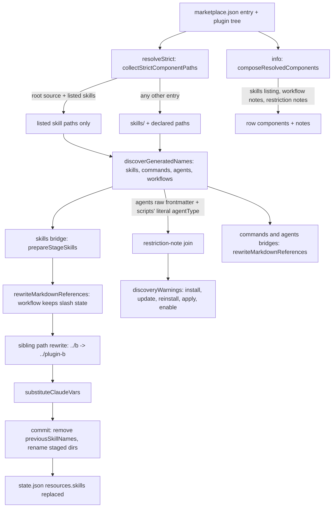

# Phase 4: Skill and Workflow Install Defects - Research

**Researched:** 2026-11-13
**Domain:** plugin resolver (component paths), skills bridge staging, reference rewriting, workflow script analysis, install and info notes
**Confidence:** HIGH for the code sites, the upstream rules, and the open research item (source read, binary read, and live hermetic probes); MEDIUM for the exact shape of the new cucumber steps

<user_constraints>

## User Constraints (from CONTEXT.md)

The decisions, the discretion areas, and the deferred ideas below are copied verbatim from `04-CONTEXT.md` (lines 39-216, 220-224, and 337-348). [VERIFIED: .planning/phases/04-skill-and-workflow-install-defects/04-CONTEXT.md]

**Locked Decisions (verbatim).** D-PG4-01, D-PG4-02, and D-PG4-12 are pending maintainer review and are locked for planning.

<!-- DATA_Q7M2X9KD_START -->

### Root-source skill selection (PG-CORE-01)

- **D-PG4-01 (pending maintainer review; hard to reverse: it amends D-CF1-06
  and changes the installed skill set of existing plugins):** Copy the 2.1.323
  rule exactly. The rule applies when the entry's `source` is a **string**
  whose segments, split on `/` or `\`, are all `""` or `"."` (`"./"`, `"."`),
  and the entry's `skills` is present and non-empty (a string or an array).
  An object-form path source does not trigger it. Then:
  - The validated listed paths replace both the conventional `skills/` folder
    and the manifest's `skills` paths.
  - `skills/` stays only when a listed path is `skills/` itself or the plugin
    root. Such a path then does not count twice.
  - If no listed path survives validation and at least one was refused as
    path traversal, the plugin installs no skills.
  - If no listed path survives and none was a traversal, the normal rule
    applies (`skills/` plus the manifest paths). This is how upstream behaves.
    The existing refusal notes still print. The maintainer should confirm that
    this fallback, which looks odd, is wanted. Parity is the default, so this
    record keeps it.
  Build the rule once in the strict arm (`collectStrictComponentKind` in
  `domain/component-paths.ts`) and in the lenient mirror in
  `orchestrators/plugin/info.ts` (around `:2100-2140`). D-CF1-06 is amended
  with this exception (see Parent lines). D-CF1-06's shadowed-folder warning
  does not cover `skills/` here: upstream drops the folder silently.
- **D-PG4-02 (pending maintainer review; product: what existing users have to
  do):** No migration at load (APL-D1). An installed plugin loses the extra
  skills at its next `update` that re-materializes it, or at `reinstall`, or
  at an `apply` convergence move. Each of these uses the skills bridge's
  existing `previousSkillNames` unstage path. Do not add new detection for
  drift in the resolved set. The CHANGELOG entry tells users of
  `anthropics/skills` plugins to run `reinstall` once. The plan must prove
  that after such an update or reinstall none of these stays: the skill's
  target folder, its `resources.skills` entry in `state.json`, its name claims
  and aliases, and its completion-cache rows. Research before planning:
  whether `update` sees a change when only the entry's `skills` list in
  `marketplace.json` changes. For a root-source path plugin, the hash version
  covers the marketplace root, which likely includes `.claude-plugin/`.
  Success criterion 1 depends on this.
- **D-PG4-03:** When several plugins share one `skills/` folder, as the five
  `anthropics/skills` entries do, each plugin installs only its own listed
  skills under its own prefix. There is no de-duplication across plugins,
  because upstream loads each plugin on its own.

### Sibling skill links (PG-SKILL-04)

- **D-PG4-04:** Resolve by source path, not by matching folder names. A
  relative path token that starts with one or more `../` segments is resolved
  against the source location of the file it appears in, inside the plugin
  tree. If it lands at or inside a discovered skill folder of the same plugin,
  and that folder is not the file's own skill, the token is rewritten. The new
  path runs from the staged file to the sibling's staged folder
  (`../<generated name>/<rest>`), and a trailing `/` is kept. This covers
  supporting Markdown in subfolders (`references/x.md` linking
  `../../b/ref.md`). It also covers the bare folder form that `plugin-dev`
  uses (`` `../hook-development/` ``).
- **D-PG4-05:** Rewrite wherever the token appears in a staged `SKILL.md` or
  its supporting `.md` files: link targets, code spans, plain text, and fenced
  code. This matches the existing all-lines `rewriteMarkdownReferences` pass.
  A rewrite happens only when the path resolves to a real sibling skill, which
  limits the risk of changing prose that only looks like a path. The pass
  runs before `${CLAUDE_*}` substitution. `${CLAUDE_SKILL_DIR}/../b/...` is
  rewritten the same way, because after substitution it would also point at a
  missing folder.
- **D-PG4-06:** Leave a path untouched when it resolves outside every sibling
  skill (`../../docs/x.md`, climbing to the plugin root; the requirement
  excludes this), or when the sibling did not stage (skipped, collided, or
  refused). Such a path stays dead, as it is today. `${CLAUDE_PLUGIN_ROOT}/...`
  paths already work and are not touched.
- **D-PG4-07:** The skills staging context needs the sibling map (source skill
  folder to generated name) next to `InstalledReferenceNames`. The install,
  update, reinstall, and marketplace paths that build that context
  (`install-outcome.ts`, `update-swap.ts`, `marketplace/shared.ts`) pass the
  map. The record-only fallback in `stageSkill` cannot rebuild it and leaves
  sibling paths alone.

### Workflow references (PG-WF-01)

- **D-PG4-08:** In `rewriteMarkdownReferences`, a token that resolves to a
  workflow keeps the source's leading-slash state. Without a slash in the
  source, the output is the bare installed name (`demo:scan`). With a slash,
  it is `/demo:scan`. Name elision is still applied (`acme:acme-audit`
  becomes `acme:audit`). Resolution of commands and skills does not change
  (they keep `/<command>` and `/skill:<name>`), and neither does the
  command > skill > workflow precedence. The rule applies to every caller of
  the rewriter: skills and their supporting Markdown, commands, and agent
  bodies. A skill's `allowed-tools` entry `Workflow(claude-security:scan)`
  therefore stays bare.
- **D-PG4-09 (closes the ROADMAP open question):** No cucumber fixture relies
  on a bare `plugin:workflow` mention becoming a slash command. `features/`
  only runs typed `/demo:hello` commands. Two unit tests in
  `test/domain/skill-tokens.test.ts` expect `/acme:audit` from a bare source:
  "converges an elidable reference onto a generated workflow name" and "keeps
  the colon workflow name on win32". Change them to expect the bare name, and
  add a case for a source that already has a slash.
- **D-PG4-10:** Correct `docs/workflows-compatibility.md:174` in the same
  change. Retargeting keeps the source's leading slash, so a name inside a tool
  call matches the saved workflow name the engine's `workflow` tool loads, and
  a slash reference matches the command. Name the residuals from PRD §8.4: the
  engine's tool text tells the model to call `workflow` only when the user
  opted in, and `parallel()` rejects.

### Workflow agent tool restriction (PG-SEC-01)

- **D-PG4-11:** The trigger is an admitted (`named`) workflow script with a
  string-literal `agentType` property value equal to the name of an agent the
  same plugin ships, where that agent's source frontmatter declares a
  non-empty `tools` or `disallowedTools` field. Match against the upstream
  name `<plugin>:<agent source name>` and the generated agent name. The note
  appears whether or not pi-subagents is present and whether or not the agent
  was staged, because the engine runs either way without the restriction.
  Accepted residuals: an `agentType` that is not a literal gives no note (a
  missing note, never a false one), and so does an agent of another plugin.
  The divergence is licensed by a Pi capability gap: the engine, which this
  project does not own, creates the child session (spike S4).
- **D-PG4-12 (pending maintainer review; product: user-visible wording and
  granularity):** Give one note per distinct (script, agent type) pair, in the
  existing workflow-script note family. The note never refuses and never
  changes the install's outcome. Proposed install wording: `workflow script
  "scan.js" in "workflows" runs agent type "demo:reader", which restricts its
  tools; the workflow engine does not keep that restriction, so the agent can
  use read, bash, edit, and write`. `info` uses the same text in the
  info-tense form that the existing notes use.
- **D-PG4-13:** Placement. A pure domain helper in `domain/workflow-script.ts`
  pulls the literal `agentType` values out of the AST the module already
  parses. An orchestrator-level join with the agents discovery output builds
  the notes. The workflows bridge must not import the agents bridge (fallow
  boundary zones). The notes travel in `discoveryWarnings`, as D-CF1-06's
  shadowed-folder warnings do, so install, update, reinstall, apply, and
  `info` share one path. Recompute the notes. Never persist them, so there is
  no `state.json` schema change.
- **D-PG4-14:** The compatibility page gets a row for an agent type's tool
  restriction (upstream ✓, Pi ✗), with spike S4 as evidence (engine 3.15.1,
  Pi 1.5.2). The row says that only the engine's codemode path removes denied
  built-ins, and that the install note exists.
- **D-PG4-15:** Draft the engine request as
  `.planning/upstream/pi-dynamic-workflows-agent-tool-restriction.md`. Follow
  the shape of the existing drafts there: a Patch line, the repository, the
  measured package version, the problem with evidence, and a draft issue with
  title and body. The request: apply the agent type's tool policy to Pi's
  built-in tools in every mode. The codemode branch already pushes
  policy-filtered names into `excludeTools`
  (`src/agent.ts:1208-1262` at 3.15.0; recheck the lines at 3.15.1). A patch
  is optional. The maintainer files the request (REQUIREMENTS out of scope:
  changes inside companion packages). The other §8.4 requests are not part of
  this draft.

### Behavioral evidence

- **D-PG4-16:** Each requirement ships a cucumber scenario that fails without
  its change (AGENTS.md "Behavioral tests"), shaped like its success
  criterion. The cases: a root-source entry where `info` lists `a` only and
  only `a` installs, then an update that drops a listed skill and leaves
  nothing behind; a sibling link that names an existing staged file in the
  text the model receives; a scripted-model run that copies `demo:scan` from
  the prompt and completes; and a restricted-agent workflow whose note
  appears at install and in `info`. Owner unit tests cover each rule's edge
  arms: the traversal and no-valid-path fallbacks, the slash-preserving case,
  `../../` climbing, and a non-literal `agentType`. All tests run in a
  hermetic home and never touch the real `~/.pi/agent`.

### Decided autonomously

Reversible technical choices, each cheap to undo before planning: D-PG4-03,
D-PG4-04, D-PG4-05, D-PG4-06, D-PG4-07, D-PG4-08, D-PG4-09, D-PG4-11,
D-PG4-13, D-PG4-14, D-PG4-15, D-PG4-16. Undo touches one pure function or one
module, or a doc or draft file, with no persisted data.

### Pending maintainer review

Recommended answers taken without asking, because the run is non-interactive:

- D-PG4-01: hard to reverse. It amends D-CF1-06, changes the installed set,
  and keeps upstream's odd no-valid-path fallback.
- D-PG4-02: product. Existing installs keep the extra skills until the user
  runs `update` or `reinstall`, and there is no load-time warning.
- D-PG4-12: product. The note's wording and its one-note-per-pair
  granularity.

<!-- DATA_Q7M2X9KD_END -->

**Claude's Discretion (verbatim)**

<!-- DATA_R3V8T1LP_START -->

The exact token grammar for relative paths. The names of internal types and
fields. Whether the sibling map extends `InstalledReferenceNames` or sits
beside it. The final wording of the documentation (D-PG4-10, D-PG4-14) inside
the stated content. Whether the upstream draft carries a patch. Plan splits.
No exception to plan size, security, coverage, or verification gates.

<!-- DATA_R3V8T1LP_END -->

**Deferred Ideas (OUT OF SCOPE, verbatim)**

<!-- DATA_K5W2N8ZC_START -->

- Paths that climb to the plugin root (`../../docs/x.md`). PG-SKILL-04 leaves
  them out. A later option is to stage a plugin's skills under one folder that
  keeps the original names.
- Version-gating or removing the PG-SEC-01 note once an engine release keeps
  the restriction. Add a BACKLOG item when the request is filed.
- Bare-name preservation for command and skill references in tool-call
  positions (for example `Skill({ skill: "plugin:x" })`). Pi has no matching
  tool. Not part of PG-WF-01.
- PG-WF-02 (binding scenario, unknown-`agentType` note, the `:126` doc fix),
  WF-03 option notes, WF-05 `Workflow` grants: Phase 8 and later.
- The other §8.4 engine requests (`parallel()` nulls, the tool text that
  invites plugin instructions, listing saved names).

<!-- DATA_K5W2N8ZC_END -->

CONTEXT.md also carries "Parent lines for the orchestrator": three PROJECT.md amendments (the D-CF1-06 exception text, the replaced "Supplemental component paths" bullet at `.planning/PROJECT.md:1750`, and the new decision rows). They are the orchestrator's work, not a plan task of this research.

</user_constraints>

## Summary

All four requirements are small changes to code that exists. No package is installed, no state schema changes, and nothing runs at load. Three live probes against the cucumber harness reproduced the three defects on today's tree: a root-source entry that lists `./skills/a` installs `root-a` and `root-b`; the staged `SKILL.md` keeps `See ../b/ref.md` beside a sibling staged as `root-b`; and a command body `Workflow({ name: "demo:scan" })` reaches the model as `Workflow({ name: "/demo:scan" })`. [VERIFIED: probes P1-P4 below]

**Answer to the open research item (D-PG4-02).** `update` and `apply` detect a change by revision only: the version, the commit, or the plugin root (`isRecordedCandidate`). Neither compares the resolved component set. For a root-source path plugin that declares no version, the version is `computeHashVersion(pluginRoot)`, and the plugin root is the marketplace root, so the hash covers `.claude-plugin/marketplace.json`. A change to only the entry's `skills` list changes the hash, so `update` re-materializes and `pending`/`apply` plan a move. Probe P5 measured `hash-68e0813ee921` before and `hash-bd8b6716fc3c` after. Two cases stay unchanged, and both are what D-PG4-02 already accepts: (1) this phase's code change alone moves no revision, so an installed `anthropics/skills` plugin keeps its extra skills until `reinstall` (which sets `skipSameRevision: false`) or until the marketplace source changes; (2) an entry or `plugin.json` that declares a `version` hides an entry-only `skills` change until the version changes, as Claude Code's own version pin does. **The plan needs no new detection.** Once a plugin re-materializes, the existing path removes everything: `commitPreparedSkills` deletes every `previousSkillNames` folder before it renames the new ones, `finalizeUpdateRecord` replaces `resources.skills`, the names and aliases live only in the removed `SKILL.md` record line, and the completion cache holds no per-skill row. [VERIFIED: code sites in "Open research item" below]

**Three findings the CONTEXT does not have, each of which changes a plan:**

1. **`info` cannot list a skill that a declared path names directly.** `discoverComponentNames` lists the subdirectories of each `componentPaths.skills` element and never checks for `SKILL.md`. Probe P3 shows today's `info` printing `a, b, references` for `skills: ["./skills/a"]`, where `references` is a folder inside skill `a`. After PG-CORE-01 the same code would print `references` and not `a`, so success criterion 1 ("`info` lists `a` only") fails unless the plan also fixes this listing. [VERIFIED: info.ts:331-341, 385-405; probe P3]
2. **A refused listed path already makes the plugin `unavailable`.** Any refusal note from component-path collection sets the structural flag, and `decideResolution` returns `unavailable`. So D-PG4-01's two "no listed path survives" arms cannot be reached by an install through a traversal. They are reachable through a listed path that does not exist or is a file (which the project does not refuse), and through the lenient `info` mirror. Upstream's "survives validation" also means "exists and is a directory", which the project's validator does not check. [VERIFIED: plugin-resolver.ts:825-880; binary 2.1.323 `sD`]
3. **The skills bridge already holds the sibling map.** `prepareStageSkills` runs `discoverPluginSkills` itself and gets each skill's source folder (`skillDir`) and `generatedName`. The orchestrators have nothing more to pass, and `orchestrators/marketplace/shared.ts` builds no staging context at all (it only unstages). D-PG4-07's intent is met inside the bridge with no orchestrator change. [VERIFIED: bridges/skills/stage.ts:431-434, types.ts:19-26; marketplace/shared.ts:577]

**Primary recommendation:** Build each rule as one pure, owner-tested function (`domain/`), wire it at the existing single site for its concern, and prove each requirement with one cucumber scenario built from existing steps plus at most one new step per requirement. Fix the `info` self-skill listing in the PG-CORE-01 plan, and derive the sibling map inside `prepareStageSkills`.

## Architectural Responsibility Map

This is a local Pi extension, not a browser or server application. The tiers are the project's own layers. [VERIFIED: .planning/codebase/ARCHITECTURE.md, loaded with AGENTS.md]

| Capability | Primary tier | Secondary tier | Rationale |
| --- | --- | --- | --- |
| Root-source skill selection | `domain/component-paths.ts` (strict resolver) | `orchestrators/plugin/info.ts` (lenient mirror, skill listing) | The resolver owns `componentPaths`; `info` re-derives them only for the `unavailable` arm. |
| Removal of dropped skills | `bridges/skills/stage.ts` commit, `update-swap.ts` finalize | none | Existing `previousSkillNames` path; no new code. |
| Sibling skill path rewrite | `domain/` pure function | `bridges/skills/stage.ts` (wiring) | The bridge knows each file's source location and the discovered siblings. |
| Workflow reference slash state | `domain/skill-tokens.ts` | none | One arm of one pure function; four callers inherit it. |
| `agentType` literal extraction | `domain/workflow-script.ts` | none | The module already holds the acorn AST and never evaluates. |
| Restriction note (join) | `orchestrators/plugin/` (new small module, called from `discover-names.ts` and `info.ts`) | `bridges/agents` and `bridges/workflows` discovery output | Cross-kind joins live in orchestrators; a bridge may not import a sibling bridge (fallow zones). |
| Note delivery | `discoveryWarnings` (install, update, reinstall, apply, enable) and row `notes` (`info`) | `shared/notification-*` rendering | Existing channels; no new output path. |
| Documentation and upstream draft | `docs/workflows-compatibility.md`, `.planning/upstream/` | `CHANGELOG.md` | Records only. |

<phase_requirements>

## Phase Requirements

| ID | Description | Research Support |
| --- | --- | --- |
| PG-CORE-01 | For a marketplace entry whose source is the marketplace root and which lists `skills`, only the listed skill folders are installed. No file or record of a skill that an update removes stays behind. (P0) | Upstream rule read from the 2.1.323 binary; strict site `collectStrictComponentKind`; lenient mirror and the `info` self-skill listing defect; the update/apply/reinstall trace; existing steps that assert staged files. |
| PG-SKILL-04 | In a staged `SKILL.md` and its supporting Markdown, a relative link to a sibling skill of the same plugin resolves to that sibling's staged folder. (P0) | Staging order in `stageSkill`; `rewriteSupportingMarkdown`; sibling map already in `prepareStageSkills`; official examples (45 sibling links in 3 plugins); token grammar proposal. |
| PG-WF-01 | A reference to a plugin workflow that the source wrote with no leading slash names the installed workflow with no leading slash, so `Workflow({ name: "plugin:wf" })` in a command body starts the workflow. A reference written with a leading slash keeps it. (P0) | The workflow arm at `skill-tokens.ts:114-115`; four callers; the two unit tests that change; probes P1-P2 of a model-started run. |
| PG-SEC-01 | The install of a plugin whose workflow script names an agent with a `tools` or `disallowedTools` field prints a note that the workflow does not keep the restriction, `info` shows it, and the workflow compatibility page says so. The request to pi-dynamic-workflows of the PRD's section 8.4 is drafted under `.planning/upstream/` for the maintainer to file. (P0) | AST access in `workflow-script.ts`; `DiscoveredAgent.raw`; `declaredAgentName`; the two `discoveryWarnings` composition sites; `composeResolvedComponents` notes; engine source at 3.15.0, 3.15.1, and 3.15.2. |

Requirement text is quoted from `.planning/REQUIREMENTS.md:48,65,73,80`. [VERIFIED: file read this session]

</phase_requirements>

## Project Constraints (from AGENTS.md)

These directives bind the plans. [VERIFIED: AGENTS.md, loaded this session; skills read this session]

- Read a file before editing it, and trace a function's callers before changing it. Use CodeGraph (`npx --no codegraph explore "<symbols>"`) before grep. Keep changes surgical.
- Work inside the GSD workflow on `features/gaps`. Never commit to `main`, never rebase, never use `--no-verify`. Follow `.agents/skills/committing/SKILL.md`.
- Upstream parity is the default. A divergence needs a recorded decision ID or a Pi capability gap. PG-SEC-01's note is licensed by the engine capability gap (spike S4).
- NFR-1 atomic writes, NFR-10 containment, NFR-2 no restart, NFR-3 idempotent or fail-clean, NFR-5 no new network use. A load changes no installation state (APL-D1), so no migration runs at load.
- One output channel: `notify()` through `shared/notification-dispatch.ts`. No `console.*` or stdio in the extension.
- A user-visible change ships with a cucumber scenario that fails without it. Unit tests and direct coverage do not replace it.
- Every production source has its own owner test at the mirrored path, with 100% direct coverage (`npm run test:coverage:direct -- <path>`). Use `node:test`, `node:assert/strict`, and `strong-mock` only.
- Two complexity gates apply to every function: ESLint `sonarjs/cognitive-complexity` 15 and fallow `maxCognitive` 15 / `maxCyclomatic` 20. `fallow dupes` fails on every clone group. `no-await-in-loop` needs a reasoned disable comment.
- Comments cite decision and requirement IDs (D-PG4-NN, PG-CORE-01), never phase, plan, or wave numbers. No comment on trivial code.
- Gates: the commit hook runs `npm run check:commit`; each wave merge, the phase gate, and the handoff run `npm run check` on the combined tree. A passing hook is not a gate.
- Each plan `SUMMARY.md` includes `## Threat Flags`. Prefix each `gsd-tools windows append --description` with `[parity-gaps]`.
- Before the PR: offer the version bump (`package.json` 0.23.0, `sonar-project.properties`, `package-lock.json`) and record one reader-facing `CHANGELOG.md` bullet (changelog skill).
- Tests use a hermetic home only. Never touch the real `~/.pi/agent`.

## Standard Stack

No package is added, removed, or upgraded. [VERIFIED: package.json read this session]

| Component | Declared, quoted verbatim | Use in this phase |
| --- | --- | --- |
| acorn | `"acorn": "^8.16.0"` (package.json:9) | The AST that `domain/workflow-script.ts` already parses; the `agentType` walk reads it. |
| Cucumber | `"@cucumber/cucumber": "^13.3.0"` (package.json:19) | Behavioral scenarios, adapter profile. |
| Pi | `"@earendil-works/pi-coding-agent": "^1.5.0"` (dev), `">=1.5.0"` (peer) | Harness host. |
| pi-dynamic-workflows | `"@quintinshaw/pi-dynamic-workflows": ">=3.15.0 <4"` (package.json:65); 3.15.0 installed under `node_modules/.cache/optional-peers` | The `workflow` tool of the PG-WF-01 scenario; the source of the PG-SEC-01 draft. |
| Node | `v26.13.1` observed; engines `^22.22.2 \|\| ^24.15.0 \|\| >=26.0.0` | Runs `.ts` natively. |

**Alternatives considered:** `acorn-walk` for the AST walk. Not recommended: the module header states that no AST-walker package is needed, a new dependency would need the legitimacy gate, and a contained recursive walk is about 15 lines.

**Installation:** none.

## Package Legitimacy Audit

Not applicable. This phase installs no external package. The two engine tarballs read for the upstream draft (3.15.1, 3.15.2) were downloaded with `npm pack` into the scratchpad and read without installing or executing them.

## Architecture Patterns

### System data flow



### Open research item: how `update`, `reinstall`, and `apply` see an entry-only `skills` change

| Step | Code site | What it does |
| --- | --- | --- |
| Version of an unversioned path plugin | `orchestrators/plugin/shared.ts:1333-1358` (`resolvePluginVersion`) | Declared version (plugin.json, then entry), else the sha of a git source, else `computeHashVersion(installable.pluginRoot)`. |
| Hash walk | `domain/version.ts:27,43-47,203-229` | Walks the plugin root and skips only the names quoted below. `.claude-plugin/` is walked. |
| `update` no-op test | `orchestrators/plugin/update-preflight.ts:1299-1322` | Returns `unchanged` when `policy.skipSameRevision` and `isRecordedCandidate(...)`. |
| Revision test | `orchestrators/plugin/shared.ts:1399-1425` (`isSameRevision`), `:1432-1448` (`isRecordedCandidate`) | Same sha, same version (`isSameVersion`), and `candidate.pluginRoot === record.resolvedSource`. |
| `reinstall` policy | `orchestrators/plugin/reinstall-flow.ts:212-216` | `skipSameRevision: false`, so it always re-materializes. |
| `apply`/`pending` planner | `orchestrators/reconcile/convergence.ts:327-349` (`pathOffer`), `:457-513` (`recordMove`) | A move needs `offer.revisionChanged` or `supportedSetGrew`. No comparison of resolved skill names. |
| Removal at re-materialization | `orchestrators/plugin/update-swap.ts:398-410`; `bridges/skills/stage.ts:553-567` | `previousSkillNames: record.resources.skills`; commit removes every previous folder, then renames the staged ones. |
| Record | `update-swap.ts:1065` (`finalizeUpdateRecord`, called at `:1627`) | Writes the per-bridge resources of every bridge whose commit succeeded. |
| Names and aliases | `bridges/skills/skill-names.ts` (record line), `orchestrators/skill-alias-state.ts:1-20` | The aliases are stored in the staged `SKILL.md` and read back from it at session time; they go with the folder. |
| Completion cache | `shared/completion-cache.ts:123-136`; `update-swap.ts:1706` | `PluginIndexRow` holds `name`, `status`, and `version` only; `dropPluginCompletionCache` runs on a successful update. |

Verbatim: `const HASH_WALK_SKIP = Object.freeze([".git", "node_modules", ".DS_Store"] as const);` [VERIFIED: extensions/pi-claude-marketplace/domain/version.ts:27]

Verbatim (`UPDATE_MATERIALIZATION`, one member per line in the source): `refreshSource: true,` `skipSameRevision: true,` `overwrite: false,` `searchReleaseTags: true,` [VERIFIED: extensions/pi-claude-marketplace/orchestrators/plugin/update-preflight.ts:192-197]

**Consequences for the plan:**

- No new drift detection (D-PG4-02 holds as written).
- The cucumber "update drops a listed skill" scenario must change the revision. Rewrite the manifest with a new entry `version` (for example `1.0.0` to `1.1.0`): result cells stay stable. An unversioned fixture also works, but its `hash-…` versions have no run token and would be pinned as literal bytes.
- The hash route (unversioned entry, entry-only change) deserves one owner test, because success criterion 1 rests on it for `anthropics/skills`: `computeHashVersion` changes when only `.claude-plugin/marketplace.json` changes. Check first whether `test/domain/version.test.ts` already pins it.
- The CHANGELOG bullet tells users of root-source plugins such as `anthropics/skills` to run `reinstall` once. The same holds for PG-SKILL-04 and PG-WF-01: staged text changes only when the plugin re-materializes.

### PG-CORE-01: the upstream rule and the code sites

Upstream, Claude Code 2.1.323 (`/home/linuxbrew/.linuxbrew/Caskroom/claude-code@latest/2.1.323/claude`), read 2026-11-13: [VERIFIED: binary grep this session]

<!-- DATA_H4J9B6YF_START -->

```javascript
if(typeof e.source==="string"&&e.source.split(/[\\/]/).every((nt)=>nt===""||nt===".")&&e.skills!==void 0){let nt=Array.isArray(e.skills)?e.skills:[e.skills];if(nt.length>0){let it=[],rt=await sD(nt,y,e.name,n,"skills","Skill","declared in marketplace entry but",it,ve,!0,k),gt=it.some((St)=>St.type==="path-traversal");if(rt.length===0&&gt)Ae.skillsPath=void 0,Ae.skillsPaths=void 0;else if(rt.length>0){let St=ff(y,"skills"),wt=qp(St),Tt=qp(y),At=rt.some((Ht)=>{let ln=qp(Ht);return ln===wt||ln===Tt});Ae.skillsPath=At?Ae.skillsPath:void 0;let Dt=rt.filter((Ht)=>{let ln=qp(Ht);return ln!==wt&&ln!==Tt});Ae.skillsPaths=Dt.length>0?Dt:void 0}}}
```

<!-- DATA_H4J9B6YF_END -->

The validator `sD` (same binary) drops a path in three cases and records a different error for each: it escapes the plugin directory (`type:"path-traversal"`), it does not exist (`type:"path-not-found"`), or, for skills, it is a file (`type:"component-load-failed"`, "skills entries must be directories containing SKILL.md"). Only the first counts as a traversal. After this block, the entry merge `_Ao` runs and appends the entry's validated `skills` again, minus `<root>/skills`, so a listed root (`.`) stays in the path list. [VERIFIED: binary grep this session]

Documentation: "When a marketplace entry whose `source` is the marketplace root lists specific `skills` subdirectories, only those subdirectories load, and the plugin's default `skills/` directory isn't scanned. A `skills` key in the manifest instead adds to the default." It also says "`skills` entries must be directories". [CITED: https://code.claude.com/docs/en/plugins-reference.md, fetched 2026-11-13]

Artifact: the `anthropics/skills` manifest has five entries, each with `"source": "./"`, `"strict": false`, no `version`, and a `skills` list of `./skills/<name>` paths (4, 12, 1, 1, and 1 paths). [VERIFIED: https://raw.githubusercontent.com/anthropics/skills/main/.claude-plugin/marketplace.json, fetched 2026-11-13]

**The rule in the project's terms** (equivalent to the two upstream blocks together):

| Case | `componentPaths.skills` |
| --- | --- |
| Source is not a root string, or the entry lists no skills | Today's rule, unchanged. |
| At least one listed path survives | The surviving listed paths, de-duplicated, in listed order. Add `skills` only when `.` is listed and `skills/` exists. The manifest's `skills` paths are not read. No shadowed-folder warning. |
| No path survives and at least one was refused as absolute or escaping | Empty. |
| No path survives and none was refused | Today's rule (`skills/` plus the entry and manifest paths). |

"Survives" must mean: `validateComponentPath` accepts it **and** `statKind(<root>/<relative>) === "dir"`. `statKind` is already a parameter of `collectStrictComponentKind`. Never stat a refused path.

**Strict site.** `collectStrictComponentKind` (`domain/component-paths.ts:493-526`) calls `addValidatedComponentPaths` for the entry and manifest paths, then `conventionalFolderApplies` (`:475-481`), whose body is `return kind === "skills" || (!entryRaw && !manifestRaw);`. Add the root-source branch for `kind === "skills"` as its own function, because the two complexity gates leave little room in the existing one. `validateComponentPath` (`:93-132`) returns only `{ ok: false; reason }`; give it a refusal cause so the rule can tell an absolute or escaping path from a non-string. `resolveContainedComponentPath` already returns `cause: "absolute" | "escape"` (`:14-39`). [VERIFIED: file read this session]

**Unreachable-by-install arms.** `runStructuralStages` folds the refusal flag (`plugin-resolver.ts:825-856`), and `decideResolution` returns `unavailable(name, partial.notes)` when it is set (`:864-880`). So an entry with one good path and one escaping path is `unavailable` today and stays so; upstream loads the good path. That is existing behavior outside this phase. The owner test of `collectStrictComponentPaths` still observes every arm, because it reads `resolution.componentPaths` directly (see `test/domain/component-paths.test.ts:129-170`).

**`info`, three sites.**

1. Installable and partially-available rows take `resolved.componentPaths` from the resolver, so the strict change reaches them.
2. `discoverComponentNames` (`info.ts:385-405`) with `nameFromEntry` (`:331-341`) lists directory entries of each path. Change the skills arm: when the entries of a path hold a regular file `SKILL.md`, the path is one skill named by its basename, and its subfolders are not skills. This mirrors `isSelfSkillDir` in `bridges/skills/discover.ts:90-95`. The entries are already read, so no extra read is needed.
3. `deriveLenientComponentPaths` (`info.ts:2111-2129`) serves only the `unavailable` arm. It is synchronous and has no `stat`. Apply the rule lexically there: listed strings replace `skills`; keep `skills` when a listed path normalizes to `skills` or `.`; when every listed path is absolute or escapes lexically, list nothing.

Share the root-source predicate (and, where it fits, the selection) between the strict and lenient sites through one exported `domain/` function, or `fallow dupes` will report a clone group.

**Tests that pin today's behavior:** none changes. Every case in `test/domain/component-paths.test.ts` uses `source: "./alpha"`; the root-source fixtures in `test/orchestrators/plugin/{list-flow,update-preflight,info}.test.ts` and `test/orchestrators/reconcile/convergence.test.ts` list no entry `skills`; `features/plugin/component-directories.feature:50-77` and `features/skill/collisions.feature:102-128` use `./plugins/demo`. [VERIFIED: grep this session]

### PG-SKILL-04: sibling link rewrite

**Staging order today** (`bridges/skills/stage.ts`): `cp` the skill folder (`:311-317`); parse; rewrite the frontmatter name and description; `rewriteMarkdownReferences` (`:361`); `substituteClaudeVars` (`:362`); write the record and the file (`:366-371`); `rewriteSupportingMarkdown` (`:372`, defined `:165-196`), which walks the staged tree, skips symlinks and the skill's own `SKILL.md`, and rewrites each `.md` file. [VERIFIED: file read this session]

**Where the map comes from.** `prepareStageSkills` (`:418-532`) calls `discoverPluginSkills` (`:431-434`). Each `DiscoveredSkill` is `{ sourceName, generatedName, skillDir }` with `skillDir` "Absolute path to the source skill directory" (`types.ts:19-26`). `discovered` is exactly the set that stages: collision losers and command-shadowed skills are already gone (`discover.ts:136-174`). Build `Map<path.resolve(skillDir), generatedName>` there and put it on `SkillStagingContext`. No `StageSkillsInput` field and no orchestrator edit is needed.

**D-PG4-07 note for the planner.** D-PG4-07 says the install, update, reinstall, and marketplace paths pass the map. The bridge-local map satisfies D-PG4-04 to D-PG4-06 with fewer files and no new optional input that a caller could forget. `marketplace/shared.ts` has no staging context to extend. Record this in the plan as the chosen reading of D-PG4-07 (the context holds the map; the bridge builds it).

**Rewrite rule (pure function, recommended in `domain/skill-tokens.ts` or a sibling domain module with its own test):**

- Input: the text, the source directory of the file, the file's own skill source directory, and the sibling list (`sourceDir` to `generatedName`).
- Token, per line: optional `${CLAUDE_SKILL_DIR}/`, then one or more `../`, then path segments. The token must not follow a path character (`/`, `.`, a word character), so `${CLAUDE_PLUGIN_ROOT}/skills/a/../b/x.md` and `<this skill's folder>/../../shared/x.py` are not tokens.
- Resolve lexically with `path.resolve`: the base is the file's source directory, or the skill's source directory for a `${CLAUDE_SKILL_DIR}/` token. Walk the segments and stop at the first prefix that equals a sibling's `sourceDir`. If that sibling is the file's own skill, or no prefix matches, return the token unchanged.
- Replace only the prefix up to and including the sibling folder with `"../".repeat(depth + 1) + generatedName`, where `depth` is the depth of the file's directory inside its skill (0 for `SKILL.md` and for a `${CLAUDE_SKILL_DIR}/` token). Keep the rest of the token byte for byte, so a trailing `/`, a file path, or sentence punctuation after the sibling folder survives.
- No filesystem access. The output always uses `/`.

Staged layout that makes the arithmetic right: every skill of a plugin in one scope stages at `<skillsTargetDir>/<generatedName>/` (`stage.ts:293`), a flat sibling set.

**Official examples that shape the fixtures** (local `claude-plugins-official` copy, read 2026-11-13): [VERIFIED: files read and classified by script this session]

| Plugin | Example | Shape |
| --- | --- | --- |
| `mcp-server-dev` | `skills/build-mcp-app/SKILL.md:59`: `` See `../build-mcp-server/references/elicitation.md`. `` | File inside a sibling, in a code span, followed by a period. |
| `plugin-dev` | `skills/skill-development/SKILL.md:609-614`: `` - `../hook-development/` - Progressive disclosure, utilities `` (six lines) | Bare sibling folder with a trailing `/`. |
| `claude-for-manufacturing` | `skills/breakdown-to-next-report/SKILL.md:206`: `` `../breakdown-diagnosis/SKILL.md` `` (38 links) | Table cells; the same plugin also holds 303 paths that resolve outside every skill folder (mostly `../../shared/...`) and stay untouched. |

The local copy now holds 45 sibling links in 3 plugins, more than the PRD's count of 2 skills, because `claude-for-manufacturing` arrived after the census. Another 15 `../` tokens across four plugins resolve inside the file's own skill; those must stay unchanged.

**Fixture rule:** the scenario's two skills must both stage. Do not reuse a root-source entry that lists only `a`: after PG-CORE-01 `b` would not install, and the link would stay dead by D-PG4-06.

### PG-WF-01: workflow reference slash state

The single arm, verbatim: [VERIFIED: extensions/pi-claude-marketplace/domain/skill-tokens.ts:114-115]

```typescript
      const workflowName = resolveWorkflowReference(pluginName, source, workflows);
      return workflowName === undefined ? token : `/${workflowName}`;
```

The token pattern starts with an optional slash: `` `(?<![A-Za-z0-9_.:/-])/?(?:(${escapeRegExp(pluginName)}):|skill:)([A-Za-z0-9_-]+(?:[:.][A-Za-z0-9_-]+)*)` `` (`:90-93`). The `replaceAll` callback receives the whole match as `token`, so `token.startsWith("/")` is the source's slash state. No other change is needed.

**Callers of `rewriteMarkdownReferences`** (CodeGraph and grep agree): [VERIFIED: this session]

| Caller | Text it rewrites |
| --- | --- |
| `bridges/skills/stage.ts:361` | The whole staged `SKILL.md`, frontmatter included, so `allowed-tools: Workflow(claude-security:scan)` passes through this arm. |
| `bridges/skills/stage.ts:189` | Each supporting `.md` (for example `claude-security/skills/claude-security/jobs/scan-*.md`). |
| `bridges/commands/staged-command.ts:270` | The whole command file after variable substitution (`code-modernization/commands/modernize-*.md`). |
| `bridges/agents/convert.ts:1014` | The agent body only. An agent's `tools:` frontmatter (`Workflow(claude-security:scan)`) is not rewritten here; that is PG-WF-05. |
| `bridges/agents/skill-preload.ts:89` | A skill body preloaded into an agent. |

**Tests that change:** exactly the two in `test/domain/skill-tokens.test.ts` that D-PG4-09 names, at lines 271-285 and 287-301. Both feed a bare `acme:acme-audit` and expect `/acme:audit`; change them to expect `acme:audit` and add a slash-preserving case. `test/bridges/skills/stage.test.ts:430-453` already feeds slash forms and stays green. No feature file mentions a bare `plugin:workflow` in a body. [VERIFIED: grep this session]

**Residual to record (not a change):** the command arm runs first and reads `names.commands`, which comes from `discoverGeneratedNames` and still lists a command that staging drops because a workflow of the plugin has its name (`bridges/commands/stage.ts:103,150-154`, `dropWorkflowNamedCommands`). For such a plugin a bare `demo:scan` still becomes `/demo:scan`. D-PG4-08 locks the precedence, and no official plugin has the collision (`modernize-harden` and `modernize-harden-scan` differ). See Open Questions.

**Documentation:** `docs/workflows-compatibility.md:174` says a reference "has that reference retargeted onto the installed name when it is staged, so the prose the model reads matches the command the session has". Replace with D-PG4-10's content. Line 180's note ("skill prose is retargeted, script bytes are not") stays true. Line 126 belongs to PG-WF-02.

### PG-SEC-01: the restriction note

**Extraction (domain).** `admitWorkflowScript` (`workflow-script.ts:177-228`) parses once (`parseScript`, `:541-568`) and today reads only the top-level `meta`. Add a contained walk over the whole AST that collects the value of every non-computed property whose key reads as `agentType` and whose value is a string literal or a template with no substitution. `metaPropertyKey` (`:654-666`) already reads identifier and string keys, and `literalString` (`:753-763`) already reads the two literal forms. Carry the result on the `named` verdict as an optional field that is absent when empty, so every existing `deepStrictEqual` on a verdict keeps passing (the project's NREG-01 habit). Contain the walk in its own `try`, as `readEngineGate` does (`:800-808`): an unforeseen node shape or a `RangeError` on deep nesting costs a note and never an install.

Verbatim values the sketch below uses: `readonly outcome: "named";` (`workflow-script.ts:83`); `if (p.key.type === "Identifier") {` (`:655`); `p.key.type === "Literal" &&` (`:660`); `if (node.type === "Literal") {` (`:754`); `if (node.type === "TemplateLiteral" && node.expressions.length === 0) {` (`:758`). [VERIFIED: file read this session]

**Join (orchestrator).** Inputs that already exist:

- Agents: `discoverPluginAgents` returns `DiscoveredAgent` with `sourceName`, `generatedName`, optional `namespace`, and `raw: RawAgentFrontmatter`, whose fields include `readonly tools?: string;` and `readonly disallowedTools?: string;` (`bridges/agents/types.ts:24-55`). A YAML list under an empty key is folded into a comma-joined string (`bridges/agents/frontmatter.ts:20-24`), so "non-empty" is a trimmed-string test.
- Upstream agent name: `declaredAgentName(plugin, source, namespace)` returns `[plugin, ...namespace, source].join(":")` (`domain/name.ts:594-608`). It is the name the engine's registry resolves. Match the literal against it and against `generatedName` (D-PG4-11).
- Scripts: `DiscoveredWorkflow` is `{ verdict, scriptFile, source }` (`bridges/workflows/types.ts:28-40`). The script's folder is `path.dirname(scriptFile)`.

`discoverGeneratedNames` (`orchestrators/plugin/discover-names.ts:65-93`) already runs both discoveries before the ledger opens, for install (`install-outcome.ts:1173`) and for update, reinstall, and convergence (`update-swap.ts:1502`, reached from `:1557`). Compute the notes there with a pure function over the two discovery results and return them beside the names. That adds no file read. Update the function's header: it says "Name preview only" and that it drops warnings on purpose, so the restriction notes must be added in exactly one place per verb.

**Delivery.**

| Verb | Site | Change |
| --- | --- | --- |
| install, enable, apply's installs, import | `install-outcome.ts:1240` | `discoveryWarnings: [...shadowedFolderDiscoveryWarnings(...), ...<notes as discovery warnings>]` |
| update, reinstall, apply's moves, dependency moves | `update-swap.ts:1702-1705` | Add the notes to `stagingWarnings` beside the shadowed-folder warnings. |
| info | `info.ts:1020-1116` (`composeResolvedComponents`, the one function all four row builders call at `:2062`, `:2485`, `:2908`, `:3143`) | `notes: [...workflows.warnings, ...<notes>]`. `previewWorkflows` (`:1166-1187`) must hand back the admitted records or their literal agent types; agents need a frontmatter read through `discoverPluginAgents`. |

`info` renders each note as a `    note: <text>` line (`shared/notification-grammar.ts:1006`) and the JSON row carries `notes`, which the features read as the field `plugin notes`. `info` resolves components only where it resolves them today (path sources; a git source only with a cached or fetched tree), so the note appears on those rows only. Both official workflow plugins are path-source entries of the official marketplace.

Keep `info` robust: read agent files only when some admitted script has a literal `agentType`, and treat a failed agent read as "no note" unless the planner decides the existing row-level `narrowProbeError` fallback is acceptable. Today `info` names agents from file names alone and never parses their frontmatter.

**Wording.** D-PG4-12's sentence has no tensed verb about the install ("runs", "does not keep", "can use"), so one text serves both surfaces. Build it in the shape of the existing family: `softFailWarning` (`bridges/workflows/discover.ts:142-149`) writes `` `workflow script "${forMessage(fileName)}" in "${forMessage(workflowsDir)}" ${outcome}: ${forMessage(reason)}` `` with the absolute folder, which `redactAbsolutePaths` later reduces to its basename (`"workflows"`). The new note needs the same absolute folder and `forMessage` on the file name and the agent type. `forMessage` is exported from `domain/workflow-script.ts:1064`.

**Expected notes for the official plugins** (derived by reading the scripts and agents, not run): `code-modernization` gives 7 notes (7 distinct script and agent-type pairs across 6 scripts; every agent it names declares `tools`). `claude-security` gives 2 notes (`scan.js` names `"claude-security:scan-inventory"` and `"claude-security:scan-verifier"` as literals). Its six other `agentType` uses are the minified identifiers `Ut` and `zt`, bound elsewhere in the script to `"claude-security:scan-loader"` (`tools: Read`) and `"claude-security:scan-researcher"`. Those two agents get no note: the accepted residual of D-PG4-11. [VERIFIED: local official marketplace copy, read this session]

**Upstream evidence.** Claude Code 2.1.323 keeps the agent definition's lists when a workflow uses an agent type: [VERIFIED: binary grep this session]

<!-- DATA_P8C3M5VA_START -->

```javascript
agent type '${y}' not found. Available agents: ${X.map((St)=>St.agentType).join(", ")}`)}let B=[...q.disallowedTools??[],...rn.disallowedTools??[]],Ye=fe.schema?Mi:Ci,ze=fe.schema&&!NCe(q.tools)?[...q.tools??[],Ka]:q.tools;ie={...is(q,Ye),disallowedTools:B,tools:ze}}
```

<!-- DATA_P8C3M5VA_END -->

**Engine evidence for the draft (D-PG4-15).** In 3.15.0 `src/agent.ts:1208-1214`, `applyToolPolicy` filters `customTools` only. Policy-filtered names reach `excludedTools` only inside `if (childCodemode) {` (`:1247-1263`), where the engine's own comment says "Pi creates core tools independently of customTools. Deny policy-filtered names at its registry boundary so codemode cannot rediscover them." `excludeTools: excludedTools` is passed at `:1448`. [VERIFIED: node_modules/.cache/optional-peers/node_modules/@quintinshaw/pi-dynamic-workflows/src/agent.ts, 3.15.0]

| Engine version | Published | `applyToolPolicy(` | `if (childCodemode) {` | Policy pushes |
| --- | --- | --- | --- | --- |
| 3.15.0 | 2026-10-27 | 1210 | 1247 | 1260, 1262 |
| 3.15.1 | 2026-11-10 | 1210 | 1247 | 1260, 1262 |
| 3.15.2 | 2026-11-13 | 1211 | 1248 | 1261, 1263 |

The gap is present in the source of all three. 3.15.1 and 3.15.2 were read from `npm pack` tarballs and not run; spike S4 is the only run, on 3.15.1. The draft should name 3.15.2 as the newest version read and keep S4 as the measured evidence. [VERIFIED: npm pack tarballs and `npm view ... time`, this session]

**Draft shape.** The existing drafts under `.planning/upstream/` open with a title, then `Patch:`, `Repository:`, and a version or base-commit line, then `## Problem` (or `## The problem`) with file and line evidence, then `## Draft issue` with `**Title:**` and a fenced `**Body:**`. `pi-subagents-long-tool-names.md` is the no-patch model (`Patch: no patch exists; this report is not filed.`). [VERIFIED: files read this session]

### Suggested plan slices

These are proposals. Count files before finalizing; keep each plan under the size limits.

1. **PG-CORE-01 resolver and info:** `domain/component-paths.ts`, `orchestrators/plugin/info.ts` (lenient mirror and the self-skill listing), their tests, the version-hash owner test if missing, the fixture helper and step for a file at the marketplace root, and the two scenarios (install/info, update removes).
2. **PG-SKILL-04:** the pure rewrite function and its test, `bridges/skills/stage.ts` and its test, one scenario.
3. **PG-WF-01:** `domain/skill-tokens.ts` and its test, the model-started-run step support, one scenario, the `:174` correction.
4. **PG-SEC-01 code:** `domain/workflow-script.ts`, the join module, `discover-names.ts`, `install-outcome.ts`, `update-swap.ts`, `info.ts`, and their tests, one or two scenarios.
5. **PG-SEC-01 records:** the compatibility row (D-PG4-14), the upstream draft (D-PG4-15), the `skills` clause at `docs/workflows-compatibility.md:39`, and the CHANGELOG bullet.

Shared files force an order: `info.ts` and `info.test.ts` are in slices 1 and 4; `docs/workflows-compatibility.md` is in slices 3 and 5; `features/lib/**` and the topic step modules are shared by slices 1 to 4 (the cucumber layout rules give each shared file one owner). `install-outcome.ts`, `update-swap.ts`, and `info.ts` are large and close to the complexity ceilings, so put new logic in new small functions.

### Anti-Patterns to Avoid

- **A second copy of the root-source rule.** Strict and lenient sites share one predicate; `fallow dupes` fails on a clone group.
- **Regex over the script text for `agentType`.** A comment or a string would match. Use the AST the module already has.
- **Matching sibling folders by name.** D-PG4-04 resolves by source path; a folder-name match rewrites prose that only looks like a path and misses declared skill paths outside `skills/`.
- **A new optional staging input for the sibling map.** A caller that forgets it compiles and silently ships dead links; the bridge already has the data.
- **A load-time migration or a new drift class.** APL-D1 and D-PG4-02 forbid both.
- **Persisting the notes.** D-PG4-13: recompute, never store; no `state.json` change.
- **Syntax detection for `Workflow(...)`.** D-PG4-08 keeps the slash state of every workflow reference; no tool-call parsing.

## Don't Hand-Roll

| Problem | Don't build | Use instead | Why |
| --- | --- | --- | --- |
| Path containment of a listed skill path | A new `..` check | `validateComponentPath` and `resolveContainedComponentPath` (`component-paths.ts:14-39,93-132`) | They refuse absolute, escaping, and link-crossing paths through `assertPathInside`. |
| Existence of a listed path | `fs.stat` in the domain | The injected `statKind` reader | Keeps the resolver testable and network-free. |
| Removing a dropped skill | A cleanup pass | `previousSkillNames` in `prepareStageSkills` and `commitPreparedSkills` | Already removes folders and feeds the record. |
| Detecting an entry change | A component-set diff | The existing version and revision test | Verified to see the change (probe P5). |
| JavaScript parsing | A tokenizer or regex | The acorn AST in `domain/workflow-script.ts` | One parse, never evaluated. |
| Upstream agent name | String concatenation at the join | `declaredAgentName` (`domain/name.ts:594-608`) | Handles namespaces and asserts safe names. |
| Agent frontmatter | A new reader | `discoverPluginAgents` and `DiscoveredAgent.raw` | Folds list items; already tested. |
| Escaping plugin text in a note | Ad hoc replace | `forMessage` (`workflow-script.ts:1064`) | Escapes control and format characters, including bidi overrides. |
| Hiding absolute paths | Basename logic in the note | `redactAbsolutePaths` at the existing surfacing sites | The family already relies on it; the features pin `in "workflows"`. |

**Key insight:** every rule of this phase is a decision over data that an existing pass already collects. New passes over the plugin tree are the main way to add cost and drift.

## Runtime State Inventory

The phase changes what an install writes, so existing installs matter. No user state was read or changed by this research.

| Category | Items found | Action required |
| --- | --- | --- |
| Stored data | `state.json` `resources.skills` of installed root-source plugins that list `skills` (extra names); staged folders `<scopeRoot>/pi-claude-marketplace/resources/skills/<generated>/`; staged skill, command, and agent text holding `/plugin:workflow` inside tool calls or dead `../sibling` paths | None at load. Each is rewritten when the plugin re-materializes: `update` with a changed revision, `reinstall`, or an `apply` move. CHANGELOG tells users to run `reinstall` once. No data migration and no schema change. |
| Live service config | None. Verified: the phase touches no external service and no companion setting. | None. |
| OS-registered state | None. Verified: no process, scheduler, or registration is involved. | None. |
| Secrets and env vars | None. `${CLAUDE_SKILL_DIR}` is a substitution token in Markdown, not an environment variable. | None. |
| Build artifacts and installed packages | Saved workflow envelopes are unchanged (script bytes are never rewritten). The completion cache has no per-skill row (`PluginIndexRow`: `name`, `status`, `version`). The engine in the test cache stays 3.15.0. | None. |

## Common Pitfalls

### Pitfall 1: `info` lists the folders inside a listed skill

**What goes wrong:** After the resolver change, `info` prints `references` (or nothing) for `skills: ["./skills/a"]`, and success criterion 1 fails.
**Why it happens:** `nameFromEntry` returns every directory entry of a skills path and never looks for `SKILL.md` (`info.ts:331-341`).
**How to avoid:** Fix the skills arm of `discoverComponentNames` in the PG-CORE-01 plan and pin it in `info.test.ts` and in the scenario (`plugin components skills | a`).
**Warning signs:** Probe P3's output `a, b, references` on today's tree.

### Pitfall 2: "survives validation" without an existence check

**What goes wrong:** A listed path that does not exist counts as valid, so the plugin installs no skills where Claude Code falls back to `skills/`.
**Why it happens:** The project's validator checks type and containment only; upstream's `sD` also requires an existing directory.
**How to avoid:** `statKind(...) === "dir"` for each accepted listed path, in the root-source branch only.
**Warning signs:** An owner test for "listed path missing, `skills/` present" that expects an empty list.

### Pitfall 3: expecting the traversal arms at install

**What goes wrong:** A scenario installs a root-source plugin with an escaping listed path and expects "no skills"; the install is refused as `unavailable` instead.
**Why it happens:** Any refused component path is a structural defect (`plugin-resolver.ts:864-880`).
**How to avoid:** Cover the two fallback arms in the owner tests of `collectStrictComponentPaths` and of the lenient mirror. Do not write an install scenario for them.

### Pitfall 4: an `update` scenario that changes nothing

**What goes wrong:** The scenario edits only the entry's `skills` list under a declared `version`, runs `update`, and gets `unchanged`.
**Why it happens:** A declared version is the revision (`resolvePluginVersion`), as in Claude Code.
**How to avoid:** Bump the entry version in the rewritten manifest, or leave the entry unversioned.

### Pitfall 5: the sibling does not stage in the SKILL-04 fixture

**What goes wrong:** The link stays `../b/ref.md` and the scenario fails for the wrong reason.
**Why it happens:** A root-source fixture that lists only `a` no longer installs `b`; a collision or a command-shadowed skill also removes a sibling.
**How to avoid:** Use an ordinary `./plugins/demo` plugin with two skills, or list both.

### Pitfall 6: the wrong base for a supporting file

**What goes wrong:** `references/x.md` linking `../../b/ref.md` is rewritten as if it sat at the skill root, or `../SKILL.md` (its own skill) is rewritten.
**Why it happens:** The base is the file's own directory, and the staged depth differs from the source depth by the flat layout.
**How to avoid:** Pass the file's source directory and its depth; unit-test depth 0, depth 1, `${CLAUDE_SKILL_DIR}/`, own-skill links, `../../docs` (outside every skill), and a path preceded by `/`.

### Pitfall 7: the model-started run in the harness

**What goes wrong:** The scenario calls `workflow` with `background: false`, or pins the tool result bytes.
**Why it happens:** The synchronous tool path fails an agent-less script with `workflow failed: workflow scripts must call agent() at least once; ...` (probe P2), and the background result text carries a random run ID such as `scan-mwfq5idg-sqbmun` (probe P1).
**How to avoid:** Use the default background call. Reduce or tokenize the tool result (precedents: `the model receives these calls, with an empty tool result:` in `hook/tool-use.steps.ts:219`, and the tool-search variant in `mcp-server/builtin-tool-search.steps.ts:19`). Wait for the run-ending progress record (`endsRun`, `WORKFLOW_RUN_TIMEOUT_MS` in `workflow/runs.steps.ts:34-36`), never for a fixed time.
**Warning signs:** A scenario that passes on today's tree. The discriminating assertion is the prompt text the model receives, not the scripted call.

### Pitfall 8: notes reported twice or never

**What goes wrong:** The restriction note appears twice at install, or is missing at update.
**Why it happens:** `discoverGeneratedNames` runs before staging and the bridges run the same discoveries again; install and update compose `discoveryWarnings` at two different sites.
**How to avoid:** Add the notes exactly at `install-outcome.ts:1240` and `update-swap.ts:1702-1705`, the shadowed-folder sites. Pin both verbs in owner tests.

### Pitfall 9: complexity and clone gates

**What goes wrong:** `npm run check` fails in fallow or ESLint after a small edit.
**Why it happens:** `collectStrictComponentKind`, `stageSkill`, `prepareUpdateHandles`, and the `info.ts` composers sit near the ceilings; the commands and skills bridges carry reviewed clone markers that a moved line can invalidate.
**How to avoid:** Put each rule in its own function; after touching a marked span, run `npx fallow dupes` and check `$?` (a red glyph with exit 0 is a known trap).

### Pitfall 10: profile coverage

**What goes wrong:** A scenario is expected under the builtin profile and never runs there.
**Why it happens:** `cucumber.json` runs the builtin profile with `"tags": "(@mcp or @builtin-only) and not @adapter-only"`.
**How to avoid:** None of the four requirements names an MCP implementation, so the scenarios stay untagged and run under the adapter profile. `.agents/skills/cucumber/rules/features.md` decides tags.

## Code Examples

Sketches only. Names are proposals; the values they use are quoted verbatim above.

### Root-source predicate (PG-CORE-01)

```typescript
// Source: Claude Code 2.1.323 binary, quoted in "PG-CORE-01" above.
function isMarketplaceRootSource(source: unknown): boolean {
  return (
    typeof source === "string" &&
    source.split(/[\\/]/).every((segment) => segment === "" || segment === ".")
  );
}
```

### Workflow arm (PG-WF-01)

```typescript
// Source: domain/skill-tokens.ts:114-115, with the D-PG4-08 change.
const workflowName = resolveWorkflowReference(pluginName, source, workflows);
if (workflowName === undefined) {
  return token;
}

return token.startsWith("/") ? `/${workflowName}` : workflowName;
```

### Literal `agentType` values (PG-SEC-01)

```text
collect(node):
  if node is an array: collect each element
  if node is not an object with a string `type`: return
  if node.type is Property, not computed, metaPropertyKey(node) === "agentType":
    value = literalString(node.value); if defined, add it
  collect every own value of node
agentTypesOf(ast): try collect(ast) and return the distinct values in first-seen order;
                   on any throw return none (a missing note, never a failed install)
```

### Sibling rewrite (PG-SKILL-04)

```text
for each token `[${CLAUDE_SKILL_DIR}/](../)+seg[/seg...]` on a line, not preceded by a path character:
  base = skill source dir if the token starts with ${CLAUDE_SKILL_DIR}/ else the file's source dir
  dir = resolve(base, the ../ run)
  for j in 1..segments: if resolve(dir, seg1..segj) is a sibling's source dir and not the own skill:
     return prefix-kept + "../" * (depth + 1) + generatedName + rest-of-token-after-segj
  return token
```

### Scenario seeds measured on today's tree

Probe P4 printed the rows that `the staged skills directory of the project scope holds these files:` compares (columns `file | text`, folders with a trailing `/`). After PG-SKILL-04 the same fixture must show `See ../root-b/ref.md and \`../root-b/\` too.` in `root-a/SKILL.md` and `Deep link ../../root-b/ref.md here.` in `root-a/references/deep.md` (when both skills are listed). After PG-CORE-01 with `skills: ["./skills/a"]` the table holds only the `root-a/` rows.

## State of the Art

| Old statement | Current evidence | Impact |
| --- | --- | --- |
| D-CF1-06: "Claude Code always reads `skills/`" (2.1.316) | 2.1.323 skips `skills/` for a root-source entry that lists skills | Amend D-CF1-06 with the D-PG4-01 exception; correct `docs/workflows-compatibility.md:39` ("a declared `skills` path still adds to `skills/`"). |
| PRD: sibling links in 2 of 40 official skills | 45 links in 3 plugins in today's local copy | PG-SKILL-04 matters for `claude-for-manufacturing` too; fixtures should include the `../x/SKILL.md` table-cell shape. |
| S4 measured engine 3.15.1 | 3.15.2 published 2026-11-13 with the same code path | The draft names 3.15.2 as read, S4 as measured. |
| `docs/workflows-compatibility.md:174`: retargeting matches "the command the session has" | Inside a tool call the slash breaks the engine's name lookup (probe P1 shows the slash today) | The D-PG4-10 correction lands with the code change. |

## Assumptions Log

| # | Claim | Section | Risk if wrong |
| --- | --- | --- | --- |
| A1 | [ASSUMED] An entry `skills` of `""` or `null` should declare nothing under the root-source rule, as `readPathOrArray` already treats it. Upstream would take `""` as the plugin root. No real manifest was found with either value. | PG-CORE-01 | A manifest with `skills: ""` on a root-source entry would keep its manifest `skills` paths here and lose them upstream. |
| A2 | [ASSUMED] Upstream's `path-traversal` error covers both absolute and escaping paths. The `sD` code shows the type is set when the resolver returns no path; the resolver `WQ` itself was not read. | PG-CORE-01 | The "no skills" arm could apply to one of the two causes only. Since both make the plugin `unavailable` here, the effect is limited to the lenient `info` listing. |
| A3 | [ASSUMED] The background `workflow` call settles inside the model turn in every run. It did in the one probe (P2), with an agent-less script. | PG-WF-01 scenario | A flaky scenario; the plan's step should wait on the run-ending record. |
| A4 | [ASSUMED] The install diagnostic prints the new notes in a stable order next to other workflow notes. Existing features show file-name order; the sort rule was not traced. | PG-SEC-01 scenario | A table that pins the wrong order; the executor reads the actual output once. |

## Open Questions (RESOLVED)

Each question below is settled by the plan and task its RESOLVED line names. Assumptions A1 to A4 and the unclassified PG-SKILL-04 edge are not resolved by this; they stay flagged in the plans and in `04-COVERAGE.md`.

1. **Does D-PG4-07 require orchestrator threading?**
   - What we know: the bridge holds every input of the map; the named `marketplace/shared.ts` path stages nothing.
   - What's unclear: whether the maintainer wants the map on the public staging input for another reason.
   - Recommendation: build it in `prepareStageSkills` and record that reading in the plan. It is a reversible, autonomously decided item.
   - RESOLVED: no. Task 04-03-01 puts a required `siblingSkills` member on the staging context and builds it in `prepareStageSkills`; `StageSkillsInput` gains no field and no orchestrator is edited. Plan 04-03 records this reading of D-PG4-07, and the summary of 04-06 repeats it for the orchestrator.

2. **A workflow that shares its name with a command of the plugin still gets a slash.**
   - What we know: `names.commands` includes a command that staging drops for the workflow (`features/workflow/collisions.feature` covers that drop), and the command arm wins.
   - What's unclear: whether to exclude workflow-named commands from the reference inventory.
   - Recommendation: keep D-PG4-08's precedence, record the residual in the compatibility page or as a BACKLOG line, and do not change the inventory in this phase (it also feeds the cross-plugin conflict guard).
   - RESOLVED: the precedence stays and the inventory is not changed. Task 04-04-01 states the residual in the "Naming" section of `docs/workflows-compatibility.md`, and task 04-06-02 lists a BACKLOG line for the orchestrator.

3. **Agent-preloaded skill bodies.**
   - What we know: `bridges/agents/skill-preload.ts:89` inlines a skill's source body into an agent under "Base directory for this skill: <target>", so a `../b/` path there is also dead. The requirement names staged `SKILL.md` and supporting Markdown only.
   - Recommendation: leave it out; note it as a residual. A pure domain function would make a later fix cheap, because `skillSources` rows already hold `sourcePath`, `targetPath`, and `generatedName`.
   - RESOLVED: left out. Plan 04-03 builds the rewrite as a pure domain function and names the agent-preload case as a residual, and task 04-06-02 lists a BACKLOG line for the orchestrator.

4. **Where each scenario lives.**
   - What we know: `features/plugin/component-directories.feature` holds the D-CF1-06 scenarios; `features/skill/model-reads.feature` shows the model reading a staged file; `features/workflow/run.feature` holds runs; `features/workflow/refusals.feature` holds install notes on scripts but is titled for refusals.
   - Recommendation: the planner reads `.agents/skills/cucumber/rules/layout.md` and `features.md`, and names the files and scenario titles in the plan. A new `features/workflow/` feature for the restriction note is likely cleaner than extending "Workflow refusals".
   - RESOLVED: four new feature files, each named by its title under the layout rule: `features/skill/root-source-entries.feature` (plans 04-01 and 04-02), `features/skill/sibling-links.feature` (plan 04-03), `features/workflow/references.feature` (plan 04-04), and `features/workflow/agent-restrictions.feature` (plans 04-05 and 04-06). Each task names its scenarios by title. No existing feature file is edited.

5. **A constant-bound `agentType` gives no note.**
   - What we know: the official `claude-security` script binds two agent types to top-level constants and passes the identifiers, so its read-only `scan-loader` agent gets no note. D-PG4-11 accepts this ("a missing note, never a false one").
   - What's unclear: whether the maintainer wants the walk to follow a `const` whose initializer is a string literal. It would cover the one official script that needs it, at the cost of a small scope rule.
   - Recommendation: implement D-PG4-11 as written (literal property values only), state the residual in the compatibility row, and leave the extension as a BACKLOG line.
   - RESOLVED: literal property values only, in task 04-05-01. Task 04-06-02 states the residual in the compatibility row and lists a BACKLOG line for the orchestrator.

6. **A file at the marketplace root.**
   - What we know: `writePublishedPluginFile` writes under `plugins/<plugin>/`. Passing `../../skills/a/SKILL.md` works (probes P3, P4), because the guard is the publication root, but it hides the fixture's meaning.
   - Recommendation: add a small `features/lib/published-marketplace.ts` writer and a step in the marketplace publishing topic module for a file at the marketplace root.
   - RESOLVED: task 04-01-01 adds `writePublishedMarketplaceFiles` and one Given in `features/step_definitions/marketplace/publishing.steps.ts`; plan 04-03 reuses the step.

## Environment Availability

| Dependency | Required by | Available | Version | Fallback |
| --- | --- | --- | --- | --- |
| Node, npm | Everything | Yes | v26.13.1, 11.20.0 | None needed |
| Cucumber harness with scripted model | All four scenarios | Yes | Probes P1-P4 ran; P1 took 17.6 s | None needed |
| pi-dynamic-workflows in the test cache | PG-WF-01 scenario | Yes | 3.15.0 | None needed |
| Claude Code binary | Upstream re-check | Yes | 2.1.323 | Documentation |
| Local official marketplace copy | Fixture shapes | Yes | `~/.claude/plugins/marketplaces/claude-plugins-official` (not a git checkout; no commit to cite) | PRD counts |
| Context7 MCP or `ctx7` CLI | Documentation lookup | No | — | Official pages fetched directly |
| Network (npm registry, GitHub raw) | Engine tarballs, `anthropics/skills` manifest | Yes | — | Evidence is recorded here; no plan task needs the network |

**Missing dependencies with no fallback:** none.

## Validation Architecture

`workflow.nyquist_validation` is `true` and `workflow.test_command` is `npm run check`. [VERIFIED: .planning/config.json]

### Test Framework

| Property | Value |
| --- | --- |
| Framework | `node:test` owner tests, Cucumber 13.3.0 scenarios (adapter profile for this phase) |
| Config file | `cucumber.json`; no runner config for `node:test` |
| Owner test | `node --import "$PWD/test/platform/isolated-pi-home.ts" --test <test-path>` |
| Pair coverage | `npm run test:coverage:direct -- <source-or-test-path>` |
| One scenario | `npx cucumber-js --profile adapter --name '<scenario title>'` |
| Feature paths | `npm run test:cucumber:profile -- --profile adapter <feature paths>` |
| Static gate | `npm run check:static` (includes `check:features`, fallow, ESLint, pairing) |
| Full gate | `npm run check` |

### Phase Requirements → Test Map

"Fails without the change" is the failure direction each check must have. Probes P1-P4 already show the failing output for the scenarios.

| Req ID | Behavior | Type | Owner (file) | Automated command | Fails without the change because | File exists? |
| --- | --- | --- | --- | --- | --- | --- |
| PG-CORE-01 | Root-source + listed skills selects only the listed paths; the four arms; a non-root or object source is unaffected | unit | `test/domain/component-paths.test.ts` | owner test command | `componentPaths.skills` holds `skills` as well | Yes, extend |
| PG-CORE-01 | A listed path that is a skill folder lists as one skill in `info`; the lenient mirror follows the rule | unit | `test/orchestrators/plugin/info.test.ts` | owner test command | The row lists the skill's subfolders and `b` | Yes, extend |
| PG-CORE-01 | `info` lists `a` only, and only `a` installs | cucumber | `features/plugin/component-directories.feature` or a new skill feature | one-scenario command | Today: `plugin components skills` is `a, b, references`; staged rows include `root-b/` (P3, P4) | Feature exists; scenario new |
| PG-CORE-01 | After an update that drops a listed skill, the staged folder, the record entry, and the session's skill and alias are gone | cucumber | same feature | one-scenario command | Today the dropped skill was never selective; with the rule but a broken removal, `root-b/` rows remain | New; needs a record-skills `Then` or the existing staged-files and session-offers steps |
| PG-CORE-01 | The hash version changes when only `.claude-plugin/marketplace.json` changes | unit | `test/domain/version.test.ts` | owner test command | A future skip of `.claude-plugin` would make `update` blind | Yes, extend if not pinned |
| PG-SKILL-04 | Pure rewrite: depth 0 and 1, `${CLAUDE_SKILL_DIR}/`, trailing `/`, own skill, outside every skill, unstaged sibling, `/`-preceded path | unit | test of the new domain function | owner test command | Tokens are returned unchanged | New (Wave 0) |
| PG-SKILL-04 | `SKILL.md` and supporting `.md` are rewritten at staging, before variable substitution | unit | `test/bridges/skills/stage.test.ts` | owner test command | Staged bytes keep `../b/` | Yes, extend |
| PG-SKILL-04 | The text the model receives names a path that exists and holds `b`'s file | cucumber | `features/skill/` | one-scenario command | Staged text says `../b/ref.md` and the only sibling folder is `root-b/` (P4) | Scenario new; steps exist (`the scripted model plays these steps:`, `the model receives these calls:`) |
| PG-WF-01 | A bare workflow reference stays bare with elision; a slash reference keeps the slash; command and skill arms unchanged | unit | `test/domain/skill-tokens.test.ts` | owner test command | Output is `/acme:audit` for a bare source | Yes; two cases change, one added |
| PG-WF-01 | The model receives `Workflow({ name: "demo:scan" })`, calls `workflow` with that name, and the run completes; `/demo:scan` in the same body keeps its slash | cucumber | `features/workflow/run.feature` | one-scenario command | The prompt holds `Workflow({ name: "/demo:scan" })` (P1) | Scenario new; needs a step for the reduced tool result and a run-end wait |
| PG-SEC-01 | Literal `agentType` extraction: identifier and string keys, template literal, non-literal, computed key, nested call sites, a throwing walk | unit | `test/domain/workflow-script.test.ts` | owner test command | The verdict carries no agent types | Yes, extend |
| PG-SEC-01 | Join: upstream name and generated name match; `tools` or `disallowedTools` non-empty; an unrestricted agent, another plugin's agent, and a non-`named` script give no note; one note per pair | unit | test of the new orchestrator module | owner test command | No note is produced | New (Wave 0) |
| PG-SEC-01 | The note reaches install and update outcomes once, and `info` rows | unit | `test/orchestrators/plugin/{discover-names,install-outcome,update-swap,info}.test.ts` | owner test command | `discoveryWarnings`, `stagingWarnings`, and `notes` lack the line | Yes, extend |
| PG-SEC-01 | Install prints the note and still installs; `info` shows it | cucumber | `features/workflow/` | one-scenario command | The install reports no diagnostic; `plugin notes` is absent | Scenario new; steps exist (`the command reports these results:`, `the workflow install diagnostic reports these lines:`, `the result has these fields:`) |
| PG-SEC-01 | Compatibility row, `:174` text, upstream draft | docs | `docs/workflows-compatibility.md`, `.planning/upstream/` | `pre-commit run --files <files>` (mdformat, markdownlint) | Review only; no behavior | Draft new |

### Sampling Rate

- **Per task commit:** the owner tests and pair coverage of the files the task changes, and the task's scenario where it has one. The commit hook adds `npm run check:commit`.
- **Per wave merge:** `npm run check` on the combined tree.
- **Phase gate:** `npm run check` green before `/gsd-verify-work`; record command, exit status, commit, Node version, and scenario counts.

### Wave 0 Gaps

- [ ] Owner test for the new sibling-rewrite function (or the extended `skill-tokens` test if the function lives there).
- [ ] Owner test for the new restriction-note join module.
- [ ] Fixture writer and step for a file at the marketplace root (PG-CORE-01).
- [ ] Step support for a model-started workflow run: wait for the run-ending record, and compare model calls with the `workflow` start message reduced (PG-WF-01; reusable by PG-WF-07 in Phase 8).
- [ ] A `Then` for the installation record's skill names, unless the staged-files and session-offers steps are judged enough for "no record stays behind".
- [ ] No framework install.

## Security Domain

`security_enforcement` is not set in `.planning/config.json`, so it is enabled. The planner's level is ASVS L1 with a block on high. This is a local extension that processes untrusted plugin content; it has no authentication or session surface.

### Applicable ASVS Categories

The numbering follows the GSD template; it was not checked against a specific ASVS release. [ASSUMED]

| ASVS Category | Applies | Standard Control |
| --- | --- | --- |
| V2 Authentication | no | No credential or sign-in path is touched. |
| V3 Session Management | no | None. |
| V4 Access Control | yes, as tool restriction | The engine, not this project, enforces an agent's tool list. The control here is disclosure: the install note, the `info` note, and the compatibility row (PG-SEC-01). |
| V5 Input Validation and output encoding | yes | `validateComponentPath`, `assertPathInside`, `assertSafeName`, `forMessage`, `redactAbsolutePaths`; the AST is parsed and never evaluated. |
| V6 Cryptography | no | None. |
| File and resource handling (path traversal) | yes | Containment before any `stat`; lexical resolution only in the sibling rewrite; writes stay inside the bridge's staging folder and commit by atomic rename. |

### Known Threat Patterns for this phase

| Pattern | STRIDE | Standard Mitigation |
| --- | --- | --- |
| A root-source entry lists `../..` or an absolute path to make the resolver read or list outside the plugin | Information disclosure, Tampering | Validate before `statKind`; a refused path keeps the plugin `unavailable`; the lenient mirror drops lexically escaping listed paths. Do not add a `stat` on a refused path. |
| The lenient `info` listing joins raw declared strings to the plugin root, and uses an absolute string as it is (`info.ts:393`, existing behavior for the `unavailable` arm) | Information disclosure (directory names) | Out of this phase's scope to redesign, but the new root-source branch must not widen it. Flag it in the plan's threat model; severity low (names only, shown to the local user). |
| A skill's Markdown holds crafted `../` tokens to make the rewrite point outside the skills folder | Tampering | The replacement is always `../`-run plus a discovered sibling's generated name (already `assertSafeName`-checked); no token is rewritten unless it resolves to a discovered sibling; no filesystem access in the function. |
| A token pattern with nested quantifiers on plugin-controlled text | Denial of service | Keep the pattern linear (single separators between segments), apply it per line, and cover a long adversarial line in the owner test. |
| A hostile workflow script (deep nesting, odd node shapes, 512 KB) makes the `agentType` walk throw or hang | Denial of service | The existing size cap (`WORKFLOW_SCRIPT_MAX_BYTES = 524_288`), one parse, a contained walk that returns no agent types on any throw; the note never refuses an install. |
| A file name or `agentType` literal with newlines or bidi overrides forges note lines | Spoofing | `forMessage` at the point each plugin-controlled span enters the string; the agent type is echoed only when it equals a discovered agent's name. |
| PG-WF-01 lets a plugin command start its workflow by name; the workflow's agents hold `read`, `bash`, `edit`, and `write` whatever the agent declares | Elevation of privilege | Not fixable here (the engine creates the child). Disposition: accept with disclosure. PG-SEC-01's note ships in the same phase, the page states it, and the engine request is drafted. The engine's own opt-in guidance for the `workflow` tool remains. |
| A note that is wrong (false positive) trains users to ignore notes | Repudiation of the warning's value | Literal-only matching against agents of the same plugin with a non-empty restriction; residuals give a missing note, never a false one (D-PG4-11). |

No finding is high severity for this project's own code. The elevation-of-privilege item is high in effect and is the reason PG-SEC-01 is P0; its mitigation is owned by the engine and its disclosure by this phase.

## Probes run in this research

All probes used the cucumber harness's sandbox home or the session scratchpad. None touched `~/.pi/agent`, and none changed the repository (`git status --short` was empty afterwards). Scratch feature files and outputs are under `/tmp/claude-1000/-home-acolomba-src-pi-claude-marketplace-gaps/46275468-1855-49b4-a234-f937cd40117e/scratchpad/probe/`.

| Probe | What ran | Deciding output |
| --- | --- | --- |
| P1 | A command body `Call Workflow({ name: "demo:scan" }) now. Slash form: /demo:scan.`; scripted model calls `workflow {"name":"demo:scan"}` | Model received `Call Workflow({ name: "/demo:scan" }) now. Slash form: /demo:scan.`; tool result `workflow returned: Workflow "scan" started in the background.\nRun ID: scan-mwfq5idg-sqbmun ...` |
| P2 | Same fixture with `Then the workflow run ends with the status "completed" and the result "Scan done."`; second scenario with `"background":false` | The run-end step passed for the background call (that scenario's only failure was the harness's unused-script-step check, caused by a third scripted reply the turn never asked for); the foreground call returned `workflow failed: workflow scripts must call agent() at least once; this workflow declared phases but did not run any subagents` |
| P3 | `info root@fixtures` for `{"name":"root","source":"./","version":"1.0.0","skills":["./skills/a"]}` with `skills/a` (holding `references/`) and `skills/b` | `plugin components skills` = `a, b, references`; `plugin status` = `available` |
| P4 | `install root@fixtures --scope project`, then the staged-files step | Rows for `root-a/`, `root-a/references/deep.md` (`Deep link ../../b/ref.md here.`), `root-a/SKILL.md` (`See ../b/ref.md and \`../b/\` too.`), `root-b/`, `root-b/ref.md`, `root-b/SKILL.md` |
| P5 | `computeHashVersion` on a scratch root before and after changing only the entry's `skills` list | `{"before":"hash-68e0813ee921","after":"hash-bd8b6716fc3c","changed":true,"node":"v26.13.1"}` |

## Sources

### Primary (HIGH confidence)

- Repository source, read this session with line citations: `domain/component-paths.ts`, `domain/plugin-resolver.ts`, `domain/skill-tokens.ts`, `domain/workflow-script.ts`, `domain/version.ts`, `domain/name.ts`, `bridges/skills/{stage,discover,unstage,types,skill-names}.ts`, `bridges/workflows/{discover,types}.ts`, `bridges/agents/{discover,types,frontmatter,skill-preload,convert}.ts`, `bridges/commands/{stage,staged-command}.ts`, `orchestrators/plugin/{info,install-outcome,update-swap,update-preflight,shared,discover-names,reinstall-flow}.ts`, `orchestrators/reconcile/convergence.ts`, `orchestrators/skill-alias-state.ts`, `shared/{completion-cache,staging-warnings,redact-absolute-paths}.ts`, and the features, steps, and fixture libraries named above.
- Claude Code 2.1.323 binary: the root-source block, `sD`, `_Ao`, and the workflow agent-type spawn options.
- pi-dynamic-workflows 3.15.0 (installed), 3.15.1 and 3.15.2 (`npm pack` tarballs): `src/agent.ts`, `src/workflow-tool.ts`, `src/workflow-saved.ts`, `src/pi-extension.ts`.
- Probes P1-P5.
- `anthropics/skills` `marketplace.json`, fetched 2026-11-13.
- Local `claude-plugins-official` copy: skills, commands, agents, and workflows of `mcp-server-dev`, `plugin-dev`, `claude-for-manufacturing`, `code-modernization`, and `claude-security`.

### Secondary (documentation, fetched directly)

- <https://code.claude.com/docs/en/plugins-reference.md>: the root-source `skills` sentence, "`skills` entries must be directories", and the entry and `plugin.json` combination rules. Fetched 2026-11-13.
- <https://code.claude.com/docs/en/workflows.md>: "Plugin workflows are namespaced by the plugin name"; the `Workflow(<name>)` permission rule. Fetched 2026-11-13.

The research-plan seam named `jina` for both documentation questions. No such tool was available, so the pages were fetched with the built-in fetch. `classify-confidence --provider webfetch` returns `LOW` with and without `--verified`; the two documentation claims this research relies on are each confirmed by the binary and are tagged from that evidence. Graphify is disabled; CodeGraph supplied call paths.

### Tertiary (LOW confidence)

- None relied on.

## Metadata

**Confidence breakdown:**

- Standard stack: HIGH. No change; versions read from `package.json` and the installed tree.
- Open research item: HIGH. Traced in source and measured (P5).
- PG-CORE-01 rule and sites: HIGH for the rule and the `info` listing defect (binary plus P3); MEDIUM for the two edge readings in A1 and A2.
- PG-SKILL-04: HIGH for the sites and the data available in the bridge; MEDIUM for the exact token grammar (discretion).
- PG-WF-01: HIGH for the code change; MEDIUM for the scenario's step shape (one probe run each).
- PG-SEC-01: HIGH for the sites and the engine source; MEDIUM for note ordering and the `info` agent-read failure policy.
- Pitfalls: HIGH; each is tied to a read line or a probe.

**Research date:** 2026-11-13
**Valid until:** 2026-12-13 for the code sites; re-check the engine source and the Claude Code binary when either version moves (3.15.2 and 2.1.323 today).
**Scope of this research:** only this file was written in the repository. No source, test, feature, plan, or state file was changed, and nothing was committed.
