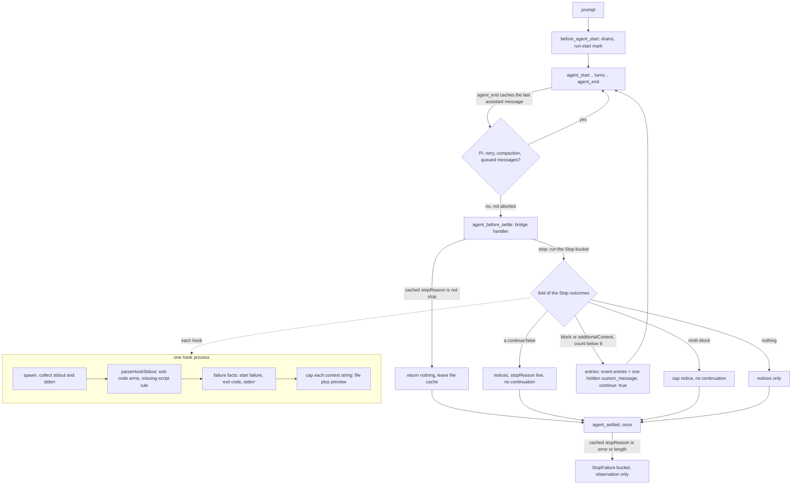

# Phase 5: Stop Continuation and Hook Failures - Research

**Researched:** 2026-11-14
**Domain:** hooks bridge (Stop dispatch on Pi's `agent_before_settle` boundary, wire protocol, failure notices, context size limit, background hook timers), Pi 1.5.0 run loop, Claude Code 2.1.323 hook runner
**Confidence:** HIGH for the per-mode behavior of `agent_before_settle` (measured on Pi 1.5.0 and 1.5.2 in all four modes), for the upstream rules (binary read at 2.1.323 plus the docs page), and for the code sites; MEDIUM for three source-read predictions that were not run (assumptions A1 to A3) and for the exact shape of the new cucumber steps

<user_constraints>

## User Constraints (from CONTEXT.md)

The decisions, the discretion areas, and the deferred ideas below are copied verbatim from `05-CONTEXT.md` (lines 41-312, 316-322, and 553-572). [VERIFIED: .planning/phases/05-stop-continuation-and-hook-failures/05-CONTEXT.md]

**Locked Decisions (verbatim).** D-PG5-10, D-PG5-11, D-PG5-13, D-PG5-15, and D-PG5-18 are pending maintainer review and are locked for planning.

<!-- DATA_DECISIONS_START -->

### Stop continuation (PG-HOOK-02)

- **D-PG5-01:** `Stop` runs on `agent_before_settle` in every mode (`tui`,
  `print`, `json`, `rpc`). The handler runs the `Stop` bucket only when the
  run's last assistant message ended with `stop`, as today (STOP-01). It
  cannot use `event.outcome` alone for that: Pi 1.5.0 maps both `stop` and
  `length` to `completed` (`dist/core/agent-session.js:500-502`). When a hook
  blocks or adds context, the handler returns `continue: true` and one hidden
  `custom_message` draft, appended after `event.entries`. The draft is the
  message that the follow-up carries today: type `claude-hook-stop-block`,
  one `Stop hook feedback:\n<text>` part per value in routing order
  (D-CF5-25), `display: false`, `details.pluginId`. The handler never returns
  `continue: false` and never drops an entry another extension's handler
  proposed. Pi merges each handler's result into one proposal, and a returned
  field replaces that field. The `Stop` path no longer calls
  `pi.sendMessage(..., { deliverAs: "followUp", triggerTurn: true })`.
  — **Reversibility:** costly — every `Stop` scenario, the compatibility
  page, and the PROJECT.md fire-point decision pin the event.
- **D-PG5-02:** No second path ships by default. Research measures the cases
  that spike S1 did not run, before the plan fixes the event: the `rpc` mode
  and Pi 1.5.0 (the cucumber harness drives Pi 1.5.0 over RPC, so the phase's
  own scenarios measure both), the terminal mode (the pty harness,
  `features/lib/pi-tui.ts`), the `json` mode, and one handler that runs past
  two minutes (a one-time measurement, not a committed scenario). If a mode
  does not behave as print mode did, that mode alone keeps today's
  `agent_settled` re-entry, chosen by `ctx.mode`, and the compatibility page
  names it. A source read of Pi 1.5.0 predicts no such mode: every mode runs
  the same `_startRun` loop (see Specific Ideas, record 1).
- **D-PG5-03:** `StopFailure` stays on `agent_settled`, with the last
  assistant message cached from `agent_end`. Only the `Stop` arm moves. One
  ending must run `Stop` at most once (never again at `agent_settled`), and a
  `length` or `error` ending must still reach `StopFailure` once. The planner
  chooses where the last assistant message comes from: the existing
  `agent_end` cache, or `event.context.contextMessages`.
- **D-PG5-04:** The loop protection moves unchanged (D-PG2-11, D-88-08).
  Eight continuations in a row are granted. The ninth block is overridden and
  shows the one cap notice. A tool call, a user input, a `Stop` run that asks
  for no continuation, and a reload start the count again. A continuation for
  `additionalContext` alone counts as a block does. `stop_hook_active` is
  true on a `Stop` run that follows a continuation.
  `CLAUDE_CODE_STOP_HOOK_BLOCK_CAP` is not read: REQUIREMENTS lists it as out
  of scope, which settles the "Phase 5 owns ... the cap environment variable"
  note of D-PG2-11.
- **D-PG5-05:** A `Stop` hook's `continue: false` still wins inside the
  bucket (STOP-06): the bridge asks for no continuation. It does not veto a
  continuation that another extension's handler asked for, because upstream
  has no rule for other extensions.
- **D-PG5-06:** The wake of an `asyncRewake` hook stays a follow-up message
  that starts a run when Pi is idle (D-BG-202, D-BG-203, D-BG-210).
  PG-HOOK-02 covers the synchronous `Stop` block only.
- **D-PG5-07:** The continuation is not a run start, and the bridge does not
  imitate one. `before_agent_start` does not fire again. Research before
  planning: list what today relies on the extra run start between a block and
  the next model call, and confirm that none of it needs the event. Known
  candidates: the `before_agent_start` context drains (D-CF5-13), an `async`
  hook's answer sent with `deliverAs: "nextTurn"` (D-BG-205; Pi adds such
  messages only when a run starts), the rewake mark that `recordRunStart`
  clears (D-BG-210), and the child identity capture. Also measure what
  happens when the user types, or presses Escape, while a `Stop` hook runs
  inside the boundary. Pi's documentation says that an abort there still
  commits the returned entries and drops the continuation. A behavior that
  changes for the user goes into the compatibility page.

### Missing script (PG-HOOK-23)

- **D-PG5-08:** Copy the Claude Code 2.1.323 rule. A synchronous hook on
  `Stop` or `UserPromptSubmit` that exits with code 2, prints nothing on
  stdout (after trimming), and whose stderr matches
  `/no such file|can't open/i` is a non-blocking error. Upstream applies the
  rule to `UserPromptSubmit` only for plugin hooks; every hook this bridge
  runs is a plugin hook. No other event gets the rule. A hook that prints any
  stdout keeps its exit-2 block.
- **D-PG5-09:** Such a run decides nothing. On `Stop` it asks for no
  continuation, and the other `Stop` hooks still decide. On
  `UserPromptSubmit` the prompt goes on with the other hooks' results. The
  run is a failure like an exit 1: on `UserPromptSubmit`, `onFailure: "block"`
  blocks it with the existing `onFailure` reason. `Stop` ignores `onFailure`,
  as today. The `asyncRewake` lane does not change (see Specific Ideas,
  record 2, for what is unverified). The run shows the notice of D-PG5-11.

### Failure notices and `stopReason` (PG-HOOK-14)

- **D-PG5-10 (pending maintainer review; product: which failures become
  visible, and how much noise that adds):** A synchronous hook that ends as a
  non-blocking error shows one notice. These ends count:
  - an exit code other than 0 and 2, or an end by a signal that was not the
    hook's own timeout, when stdout is not a JSON object. A JSON object still
    decides alone (D-CF5-11) and is not a failure;
  - the missing-script exit 2 of D-PG5-08;
  - a hook that cannot start.
  The events are `PreToolUse`, `PostToolUse`, `PostToolUseFailure`,
  `UserPromptSubmit`, `Stop`, `SessionStart`, and `PreCompact`. No notice
  shows in these cases: `SessionEnd` (D-BG-603 stays); `PostCompact` (its
  line after `/compact` already reports the failure, D-BG-501);
  `StopFailure` (its output is discarded); an `async` or `asyncRewake` hook
  (its exit decides nothing, and upstream shows the user nothing, D-BG-205);
  a failure that `onFailure: "block"` turns into a block (the block has its
  own message); a timeout; and JSON that does not parse or fails the schema
  (HOOKSCHEMAFAIL-01). Upstream reports a timeout and a schema failure with
  other texts, and neither has a first stderr line to show.
- **D-PG5-11 (pending maintainer review; product: user-visible wording):**
  The notice texts, each one `hook-notice` at its existing severity
  (D-CF5-24; HOOKSEV-01 stays open) and cleaned by the existing notice
  filter:
  - a failed exit: `<label> hook error: Failed with non-blocking status code:
    <line>`. `<line>` is the first line of the trimmed stderr that is not
    blank, cut to 200 characters and then `…`, as upstream's renderer cuts
    it. With no stderr it is `No stderr output`;
  - a hook that cannot start: `<label> hook error: Failed to run: <error>`;
  - a missing script: `<label> hook error: Hook script appears to be missing
    — "<command>" exited 2 with: <trimmed stderr>. Treating as non-blocking.`
    and then a sentence that names the `/claude:plugin reinstall` command for
    that plugin. Upstream's sentence names `/plugin`, which Pi does not have.
  `<label>` is the existing label (`PreToolUse:Bash`, `UserPromptSubmit`,
  `Stop`, `SessionStart:startup`). The one-line `<label> hook error: <text>`
  form is the form `hookErrorText` already writes. Upstream draws two rows on
  most events and one `Stop hook error: <text>` row on `Stop`.
- **D-PG5-12:** One notice for each failed hook, in routing order, with the
  event's other notices. When a multi-pair edit runs one hook once per pair
  (D-PG2-01) and each run fails with the same text, the event shows that
  notice once. A hook that cannot start shows its notice once per hook and
  bridge load, because upstream shows a start failure once (the key of its
  once-only set was not read; see record 3).
- **D-PG5-13 (pending maintainer review; product: the `Stop` wording is an
  adaptation):** A `continue: false` shows its `stopReason` where the bridge
  honors the stop:
  - `UserPromptSubmit`: `Operation stopped by hook: <stopReason>`, or
    `Operation stopped by hook` with no reason. These are upstream's texts.
    The prompt still does not reach the model.
  - `PreToolUse`: `PreToolUse:<Tool> hook stopped continuation: <stopReason>`.
    With no reason it uses the default reason the block already carries.
  - `Stop`: `Stop hook stopped continuation: <stopReason>`. With no reason it
    shows nothing. Upstream prints the bare reason under its `Ran N stop
    hooks` row, which Pi does not have.
  `PostToolUse`, `PostToolUseFailure`, and `PreCompact` show nothing, because
  the bridge cannot stop there (HOOKPOSTSTOP-01), and a notice would claim a
  stop that did not happen. The reason is not added to the conversation in
  this phase (see Deferred Ideas).

### The 10,000-character limit (PG-HOOK-14)

- **D-PG5-14:** The limit applies to each string a hook sends to the model as
  context, measured alone and before any join: a hook's `additionalContext`
  on every event and in both lanes, plain stdout that counts as context
  (`SessionStart`, `UserPromptSubmit`), and the `systemMessage` of a plain
  `async` hook's answer, which goes to the model (D-BG-205). A string of
  10,000 characters or fewer passes unchanged. Length is the JavaScript
  string length, as upstream measures it. The limit does not apply to a block
  reason, an exit-2 stderr, a rewake text, or a replaced tool output. A
  synchronous hook's `systemMessage` goes only to the user and already ends
  at the notice bound of 2,000 characters.
- **D-PG5-15 (pending maintainer review; product: the bridge starts to keep
  hook output in files):** A string over the limit is written whole to a
  file, and the model receives the file path and the first 2,000 characters,
  in upstream's wrapper:

  ```text
  <persisted-output>
  Output too large (<size>). Full output saved to: <path>

  Preview (first 2KB):
  <the first 2,000 characters>
  ...
  </persisted-output>
  ```

  The file lives under the data root of the hook's plugin scope, in
  `_shared/hook-output/`, written atomically (NFR-1) and inside
  `<scopeRoot>/pi-claude-marketplace/` (NFR-10). Upstream writes to its
  session directory. Pi's session directory is outside the paths this
  extension may write, so this location is the adaptation. When the bridge
  loads, it removes the files in that folder that are older than 30 days.
  This retention is a project choice: upstream ties the file to the session.
  When the write fails, the model receives the head of the string and the
  line `[Hook <source> truncated at 10000 chars — persist-to-disk failed:
  <error>]`, cut so that the whole text stays within 10,000 characters. The
  failure never fails the event.
- **D-PG5-16:** The cap is one pure function with an injected writer, called
  where a hook result becomes model context, so both lanes share it. No text
  that replaces a capped string exceeds 10,000 characters (success
  criterion 4).

### Plain `async` hooks (PG-HOOK-21)

- **D-PG5-17:** A plain `async` hook (`async: true` without
  `asyncRewake: true`) gets no timer. Its declared `timeout` is ignored, with
  one debug line. An `asyncRewake` hook keeps its declared `timeout`, or
  600 s, and the SIGTERM and SIGKILL ladder. A hook with both flags is an
  `asyncRewake` hook, as today.
- **D-PG5-18 (pending maintainer review; product: outside Linux nothing
  stops a plain `async` hook that never ends):** What stops a hook does not
  change. A hook ends when its process ends. A `/reload` or the next start
  stops what an earlier load left (D-BG-207). A pi-subagents child stops its
  own hooks when it ends or reloads. A main session that quits leaves its
  hooks running, as Claude Code does (`0b49ad9e`). The reap stops a live
  process only where it can prove that the process is the hook, which is
  Linux only. So on macOS and Windows a plain `async` hook that never ends is
  no longer stopped by its timer, and a reload does not stop it either. The
  compatibility page says so. ASYNCRELOADTABLE-01 and ASYNCLIFECYCLE-01 are
  not folded into this phase. The change must not widen ASYNCRELOADTABLE-01:
  an old load's late exit must not write more than it writes today.

### Records and evidence

- **D-PG5-19:** Correct `docs/hooks-compatibility.md` in the same change.
  The ROADMAP names lines 76 to 80 and 259; the file has grown since, so find
  each passage by its heading or row:
  - "Turn-boundary timing shift" (now `:144-148`): a blocked `Stop` continues
    the same run; one `agent_settled`; no second run start. Name what stays
    different (D-PG5-07) and any fallback mode (D-PG5-02).
  - the `Stop` row of the Events table and the `decision: "block"` row
    ("re-enters via `followUp` + `triggerTurn`");
  - "Other exit -> non-blocking, stderr to user" (now `:328`), and the
    missing-script rule;
  - "Large stdout or stderr" (now `:329`): the bridge still reads all output,
    and a context string over 10,000 characters is saved to a file;
  - the `continue: false` row (`:330`) and the "Messages to the user" list:
    the new notices of D-PG5-11 and D-PG5-13;
  - the `timeout` and `async` rows (`:279-280`): a plain `async` hook has no
    timeout, and the residual of D-PG5-18.
  Also update `docs/output-catalog.md` where its `hook-notice` text lists the
  notices, and add the CHANGELOG lines with the `changelog` skill.
- **D-PG5-20:** Each success criterion ships a cucumber scenario that fails
  without its change (AGENTS.md "Behavioral tests"):
  1. a run that a `Stop` hook blocks twice: one `agent_settled`, one run
     start, three model calls; and the always-blocking hook: eight
     continuations, then the cap notice, on the same path;
  2. a `Stop` hook that names a missing script: the run ends, one notice,
     one model call; a prompt hook that names a missing script: the prompt
     reaches the model, one notice;
  3. a hook that exits 1 with `boom` on stderr: one notice that holds `boom`;
     a `UserPromptSubmit` hook with `continue: false` and a `stopReason`: the
     notice holds the reason and the model receives no call;
  4. a hook that prints 12,000 characters of context: the model receives at
     most 10,000 for it, and the saved file holds all 12,000;
  5. a plain `async` hook with `timeout: 1` that sleeps 3 seconds writes its
     end marker; a reload stops a plain `async` hook that is running.
  Existing scenarios change with the behavior: the `Stop` scenarios that
  wait "through N agent settlements" in `features/hook/prompt-and-stop.feature`
  now see one settlement, and `features/hook/failures.feature:33` ("A failing
  prompt hook without onFailure lets the prompt through") now expects the
  notice. Owner unit tests cover the edge arms: stdout present with a missing
  script, no stderr, a 200-character line, exactly 10,000 characters, a write
  failure, a hook with both `async` flags. The scenarios have no MCP surface,
  so they run under one profile (D-BG-208 is the precedent). All tests run in
  a hermetic home and never touch the real `~/.pi/agent`.

### Decided autonomously

Reversible technical choices, each cheap to undo before planning: D-PG5-02,
D-PG5-03, D-PG5-04, D-PG5-05, D-PG5-06, D-PG5-07, D-PG5-08, D-PG5-09,
D-PG5-12, D-PG5-14, D-PG5-16, D-PG5-17, D-PG5-19, D-PG5-20. Undo touches one
handler, one pure function, or a doc. D-PG5-01 is the requirement itself
(PG-HOOK-02 names the event, and the PRD rejected `agent_settled` as the main
path), so it is not held for review, but it is costly to undo.

### Pending maintainer review

Recommended answers taken without asking, because the run is non-interactive:

- D-PG5-10: product. Which failed hooks show a notice. A hook that exits 1 on
  purpose becomes visible on every run; upstream has the same.
- D-PG5-11: product. The notice wording, the one-line form, and the Pi
  command in the missing-script sentence.
- D-PG5-13: product. Where a `stopReason` shows, and the `Stop` line, which
  adapts upstream's summary row.
- D-PG5-15: product. Hook output over the limit goes to a file under the
  scope's data root, with a 30-day sweep. The simpler choice, cutting at
  10,000 characters with a marker and writing no file, would also meet
  success criterion 4, but it is not what Claude Code does.
- D-PG5-18: product. Outside Linux a plain `async` hook that never ends has
  no bound any more.

<!-- DATA_DECISIONS_END -->

**Claude's Discretion (verbatim)**

<!-- DATA_DISCRETION_START -->

The module and type names. Whether the `Stop` handler reads the `agent_end`
cache or the boundary's context. The file name pattern under
`_shared/hook-output/`. The exact reinstall sentence, as long as it names a
command that works for the hook's plugin and scope and adds no unrelated
flag. The harness seam that counts `agent_settled` and run starts. Plan
splits. No exception to plan size, security, coverage, or verification
gates.

<!-- DATA_DISCRETION_END -->

**Deferred Ideas (OUT OF SCOPE, verbatim)**

<!-- DATA_DEFERRED_START -->

- Keeping a `stopReason` in the conversation, so the model sees it later, as
  upstream does. This phase shows it to the user only.
- The `Original prompt:` line of a blocked prompt (HOOKORIGPROMPT-01), a
  notice for a blocking `Stop` hook (HOOKSTOPNOTE-01), and a severity per
  notice (HOOKSEV-01).
- A notice for a `SessionEnd` failure (the open half of HOOKERRNOTE-01), for
  a timeout, and for JSON that fails to parse or fails the schema
  (HOOKSCHEMAFAIL-01).
- Reading `CLAUDE_CODE_STOP_HOOK_BLOCK_CAP` (REQUIREMENTS, Out of Scope).
- Stopping `async` hooks when a print or json run ends, as Claude Code does
  at `-p` teardown. The bridge leaves them running.
- A bound for a plain `async` hook outside Linux (D-PG5-18), with
  ASYNCRELOADTABLE-01 and ASYNCLIFECYCLE-01.
- `Stop` between a reply and a queued follow-up. Pi drains its queue before
  the boundary.
- The per-entry and per-dispatch context limits of Claude Code 2.1.323, and a
  cap for `PreCompact` stdout, which the bridge does not use.
- The missing-script rule in the `asyncRewake` lane.
- `PostToolBatch` on `turn_end` (the PRD's HOOK-08) and `SubagentStop`
  (PG-HOOK-07b).

<!-- DATA_DEFERRED_END -->

CONTEXT.md also carries "Parent lines for the orchestrator" (eight PROJECT.md, BACKLOG.md, and ROADMAP.md amendments). They are the orchestrator's work, not a plan task of this research.

</user_constraints>

## Summary

The phase can ship on Pi 1.5.0 with no second path. `agent_before_settle` was measured with a probe extension and the faux model on Pi 1.5.0 (the version in `node_modules`, the declared floor) and on Pi 1.5.2 (the Homebrew install), in `rpc`, `json`, `print`, and terminal mode. All eight cells gave the same result: a handler that asks for two continuations gets three model calls, three boundary events, one `before_agent_start`, and one `agent_settled`. Pi waited 130 seconds for a handler in `rpc` mode and in the terminal, with no timer. **No mode needs the `agent_settled` fallback of D-PG5-02.** [VERIFIED: probes M1 to M12 below]

The upstream claims that CONTEXT lists as unverified are now read in the 2.1.323 binary. `onFailure: "block"` turns a missing-script run into a block on `UserPromptSubmit` and is ignored on `Stop`. The `asyncRewake` lane does not use the synchronous missing-script rule; it has a rule of its own. A start failure is shown once for each `<event>:<command>` in a session. A plain `async` hook loses its timer because the runner moves its process to the background, and that call clears the timer. The per-entry and per-dispatch limits belong to the hooks module chain, which this project does not bridge. [VERIFIED: binary 2.1.323, records U1 to U9 below]

All four requirements are changes to code that exists. No package is added, no state schema changes, and nothing new runs at load except one sweep of a new folder. The largest plan risk is not the event move. It is the set of things that today get an extra run start between a `Stop` block and the next model call. One of them does need a substitute (finding F3).

**Primary recommendation:** Keep the `agent_end` cache as the source of the stop reason, move only the `Stop` arm to a new `agent_before_settle` handler in `bridges/hooks/settle.ts`, return the feedback as one hidden `custom_message` draft after `event.entries`, set the D-BG-210 mark when a rewake is sent while that handler runs, and count run starts in scenarios with `before_agent_start`, never with the `agent_start` record.

### Findings that change or qualify a CONTEXT decision

Each finding names the decision it touches. F1 to F3 change a plan. F4 to F12 qualify wording or evidence. The orchestrator reports F1, F2, F3, F6, F8, and F9 to the maintainer.

| # | Decision | Finding | Confidence | Effect on the plan |
| --- | --- | --- | --- | --- |
| F1 | D-PG5-20 item 1, success criterion 1 | **`agent_start` fires for every continuation.** A run that the handler continued twice printed three `agent_start` records in the `rpc` and `json` streams and raised three `agent_start` extension events. `before_agent_start` fired once. So "no second run start" can only mean `before_agent_start`, and the RPC stream has no record for it. | HIGH, measured (M1 to M8) | The scenario counts `agent_settled` records (one) and needs a harness seam for `before_agent_start` (a harness Pi extension that appends to a harness log). It must not count `agent_start` records. |
| F2 | D-PG5-03 (planner's choice of source) | **Use the `agent_end` cache, not `event.context.contextMessages`.** After a `stop` reply and then a `length` reply, the boundary's `contextMessages` were `system, user, assistant:stop, custom`: the `length` reply is not in them, and `outcome` is `completed`. A handler that reads the last assistant message from the context would run `Stop` on a `length` ending. The `agent_end` event carried `length`. | HIGH, measured (M13, M14) | The discretion item is settled: the handler reads the cached message of the last `agent_end`. |
| F3 | D-PG5-07, D-PG5-06 | **The rewake mark (D-BG-210) needs a substitute for the run start.** A message sent with `triggerTurn: true, deliverAs: "steer"` while the boundary handler runs continues the same run: one `before_agent_start`, one `agent_settled`. The same message sent from an `agent_settled` handler, where `Stop` hooks run today, starts a new run whose `before_agent_start` carries the custom message. So after the move, a wake that lands while `Stop` hooks run never reaches `recordRunStart`, the next `Stop` run sees `stop_hook_active: false`, and an `asyncRewake` `Stop` hook that exits 2 each time can wake the model without bound (the limit of eight counts only bridge continuations). | HIGH, measured (M19, M20) | D-PG5-07's "none of it needs the event" does not hold for this item. The plan sets the mark when a wake is sent while the `Stop` boundary handler is open, with an owner test and one scenario (see Pitfall 3). |
| F4 | D-PG5-07 | An `async` hook's answer sent with `deliverAs: "nextTurn"` is not read by a continuation. It reached the model with the next user prompt. Today the re-entry run reads it. Nothing is lost; it arrives later. | HIGH, measured (M18) | No code. The compatibility page says so. |
| F5 | D-PG5-07 | **Escape or an RPC `abort` while a `Stop` hook runs:** Pi lets the handler finish (5 seconds in the probe; `ctx.signal` is `undefined` at the boundary, so the bridge cannot see the abort), commits the returned entry, drops the continuation, and reports `agent_settled` with `aborted: true`. The hidden feedback reached the model with the next prompt. | HIGH, measured (M15, M16) | The `agent_settled` handler must not run `Stop` again. The compatibility page states the behavior. |
| F6 | D-PG5-09 | Confirmed: upstream turns a missing-script run into a block under `onFailure: "block"` on `UserPromptSubmit`, and ignores `onFailure` on `Stop`. The detail line of that block is the missing-script sentence without `Treating as non-blocking. `, not the raw stderr. The bridge's `isFailure` does not count an exit 2 today. | HIGH, binary (U1) | `isFailure` must count the missing-script exit 2. The plan chooses the detail text (upstream's, or the raw stderr the bridge appends today). |
| F7 | D-PG5-09, Deferred Ideas | The `asyncRewake` lane does not apply the synchronous rule. It has its own: an exit 2 whose output shows a script that cannot be opened still wakes the model once, with a "broken hook installation" text, and identical repeats are dropped. | HIGH, binary (U2) | The decision stands (the lane does not change). The deferred item describes a different rule than the one CONTEXT names. |
| F8 | D-PG5-12 | The once-only key is `` `${event}:${command}` `` with `${CLAUDE_PLUGIN_ROOT}` filled in, in a per-session set. It is not per hook: two hooks of one event with the same command share one notice. It covers a spawn failure and an exception in the runner. | HIGH, binary (U3) | Key the bridge's set on event and resolved command. "Per bridge load" stays as the scope (upstream: per session). |
| F9 | D-PG5-11 (pending review) | For a command that cannot be spawned, upstream's text is `Failed with non-blocking status code: Error occurred while executing hook command: <error>`. `Failed to run: <error>` is the text of an exception thrown inside the runner. The 200-character cut applies to the whole first line, prefix included. | HIGH, binary (U3, U4) | Two start-failure texts, one per bridge site (the child `error` event, and the outer `catch`). The owner test for "a 200-character line" needs this boundary. |
| F10 | D-PG5-13 (pending review) | Upstream's default message with no `stopReason` is `Execution stopped by hook` on `PreToolUse` (row text) and `Stop hook prevented continuation` on `Stop` (row hidden). The bridge's existing default block reason is `Operation stopped by hook`. | HIGH, binary (U5) | "The default reason the block already carries" gives a text upstream does not show. Use `Execution stopped by hook` in the notice. |
| F11 | D-PG5-15 (pending review) | The preview is cut at the last line break inside the first 2,000 characters when that break lies past character 1,000, else at 2,000. The size label is `11.7KB` for 12,000 characters. The size is the string length. | HIGH, binary (U6) | Copy the cut rule and the label in the pure function; pin both in its owner test. |
| F12 | D-PG5-08 | The upstream predicate also returns false when the hook's output streams did not end cleanly (`stdioIncomplete`, `stdioClosedWithoutEnd`). The bridge has no such state. | HIGH, binary (U1) | None. Recorded so a later reader does not look for the arm. |

## Architectural Responsibility Map

This is a local Pi extension, not a browser or server application. The tiers are the project's own layers. [VERIFIED: .planning/codebase/ARCHITECTURE.md, loaded with AGENTS.md]

| Capability | Primary tier | Secondary tier | Rationale |
| --- | --- | --- | --- |
| `Stop` on the boundary, continuation draft, loop limit | `bridges/hooks/settle.ts` | `bridges/hooks/event-router.ts` (registration), `bridges/hooks/runtime.ts` (counters, mark) | The Stop bucket logic and the cap bookkeeping already live in `settle.ts`. |
| Pi boundary types | `platform/pi-api.ts` | none | The only file that may import the Pi peer (`pi-peer-chokepoint`). |
| Missing-script rule | `bridges/hooks/wire-protocol.ts` | `bridges/hooks/on-failure.ts` | The wire protocol owns the exit-code arms; `on-failure.ts` owns what counts as a failure. |
| Failure and stop notices (text) | `bridges/hooks/hook-labels.ts` | `bridges/hooks/dispatch.ts`, `settle.ts`, `event-adapters.ts` (where each is shown) | Labels are pure; each event's carrier shows its own notices. |
| Failure facts | `bridges/hooks/dispatch-exec.ts` | `bridges/hooks/exec-result.ts` (carrier field) | Only the exec layer knows the exit code, stderr, and start failure. |
| Notice output | `shared/notification-dispatch.ts` `notifyHookNotice` | none | Sole `ctx.ui.notify` path (IL-2). No change. |
| 10,000-character limit | new pure leaf in `bridges/hooks/` | `dispatch-exec.ts` and `async-rewake/registry.ts` (call sites) | One function, both lanes (D-PG5-16). |
| Overflow file | new writer in `bridges/hooks/` | `shared/atomic-json.ts` (atomic write), `shared/path-safety.ts`, `persistence/locations.ts` | `bridges-hooks` may import `domain`, `persistence`, `shared`, `platform`. |
| Plain `async` timer | `bridges/hooks/async-rewake/registry.ts` | `bridges/hooks/exec-timer.ts` (ladder type) | The ladder is installed at one call site. |
| Records | `docs/hooks-compatibility.md`, `docs/output-catalog.md` | `CHANGELOG.md` | D-PG5-19. |

<phase_requirements>

## Phase Requirements

| ID | Description | Research Support |
| --- | --- | --- |
| PG-HOOK-02 | A `Stop` hook that blocks continues the same run, on Pi's `agent_before_settle` event. Listeners of `agent_settled` see one event for a run, however many times a `Stop` hook blocked. (P1; spike S1 ran in print mode only) | Probes M1 to M20; Pi 1.5.0 source of `_startRun`, `_runBeforeSettleBoundary`, `emitBoundary`; the dependency list of D-PG5-07; the seams in `settle.ts`, `event-router.ts`, `runtime.ts`; the registration gate. |
| PG-HOOK-23 | A hook that exits with code 2 because its script file is missing does not block. (P1) | Upstream predicate `wvr` and its place in the runner (U1); the `onFailure` wrapper `Jrn`; the seams in `wire-protocol.ts` and `on-failure.ts`; the interpreter exit codes measured on this machine. |
| PG-HOOK-14 | Each hook that fails without blocking shows one notice with the first line of its stderr; a hook's `stopReason` is shown to the user; context beyond 10,000 characters does not reach the model. (P1) | Upstream texts and renderer (U3 to U6); the missing carrier between `dispatch-exec.ts` and `dispatch.ts`; the cap call sites; the atomic-write and zone constraints. |
| PG-HOOK-21 | A plain `async` hook runs until it ends, or until a reload or the session end, with no timeout. (P1) | Upstream code path (U7); `registry.ts:274-281` and `:328-332`; the fixture columns `timeout` and `sleep` that already exist. |

Requirement text is quoted from `.planning/REQUIREMENTS.md:28,31,32,33`. [VERIFIED: file read this session]

</phase_requirements>

## Project Constraints (from AGENTS.md)

These directives bind the plans. [VERIFIED: AGENTS.md and the three `.planning/codebase/` files, loaded this session; skill files read this session]

- Read a file before editing it, and trace a function's callers before changing it. Use CodeGraph (`npx --no codegraph explore "<symbols>"`) before grep. Keep changes surgical.
- Work inside the GSD workflow on `features/gaps`. Never commit to `main`, never rebase, never use `--no-verify`. Follow `.agents/skills/committing/SKILL.md`.
- Upstream parity is the default. A divergence needs a recorded decision ID or a Pi capability gap. Research upstream with `.agents/skills/claude-code-compat-research` (binary first, then the docs).
- NFR-1 atomic writes, NFR-10 containment (writes only under `<scopeRoot>/pi-claude-marketplace/` and the three other named paths), NFR-2 a Pi event handler never throws and no fix needs a restart, NFR-3 idempotent or fail-clean, NFR-5 no new network use.
- One output channel: `notifyHookNotice` through `shared/notification-dispatch.ts`. No `console.*` and no stdio in the extension (IL-2).
- A user-visible change ships with a cucumber scenario that fails without it. Unit tests and direct coverage do not replace it.
- Every production source has its own owner test at the mirrored path, with 100% direct coverage (`npm run test:coverage:direct -- <path>`). Use `node:test`, `node:assert/strict`, and `strong-mock` only. A dependency is a parameter, not a module global.
- Two complexity gates apply to every function: ESLint `sonarjs/cognitive-complexity` 15 and fallow `maxCognitive` 15 / `maxCyclomatic` 20. `fallow dupes` fails on every clone group. `no-await-in-loop` needs a reasoned disable comment.
- Comments and test titles cite decision and requirement IDs (D-PG5-NN, PG-HOOK-NN), never phase, plan, or wave numbers. No comment on trivial code.
- Gates: the commit hook runs `npm run check:commit` (no cucumber). Each wave merge, the phase gate, and the handoff run `npm run check` on the combined tree.
- Each plan `SUMMARY.md` includes `## Threat Flags`. Prefix each `gsd-tools windows append --description` with `[parity-gaps]`.
- Before the PR: offer the version bump (`package.json` is `0.23.0`, `sonar-project.properties`, `package-lock.json`) and record the CHANGELOG lines with the `changelog` skill (one reader-facing bullet, 40 words or fewer, `simple-english` and `humanizer` applied).
- Tests and scenarios use a hermetic home only. Never touch the real `~/.pi/agent`.
- Cucumber: a step never sleeps for a fixed time; it waits on a record or a file until a named deadline. Each shared file under `features/lib/`, `features/support/`, and each topic step module has one owner across plans. A scenario that is not an MCP scenario carries no implementation tag and runs under the adapter profile.

## Standard Stack

No package is added, removed, or upgraded. [VERIFIED: package.json and the installed tree, read this session]

| Component | Version found | Use in this phase |
| --- | --- | --- |
| `@earendil-works/pi-coding-agent` | `1.5.0` in `node_modules` (dev `^1.5.0`, peer `>=1.5.0`); `1.5.2` at `/home/linuxbrew/.linuxbrew/Cellar/pi-coding-agent/1.5.2` | Host. `agent_before_settle` is in the package since 0.87.0 (`CHANGELOG.md:647,666`). The root index exports `AgentBeforeSettleEvent` and `AgentBeforeSettleEventResult` (`dist/index.d.ts:8`). |
| `@earendil-works/pi-ai` | `1.5.0` | The faux provider of the scripted model and of the probe. |
| `write-file-atomic` | `^8.0.0` | Behind `shared/atomic-json.ts`; the overflow file needs a text form of it. |
| `@cucumber/cucumber` | `^13.3.0` | Behavioral scenarios, adapter profile. |
| Node | `v26.13.1` observed; engines `^22.22.2 \|\| ^24.15.0 \|\| >=26.0.0` | Runs `.ts` natively. CI runs Node 24. |
| Claude Code | `2.1.323` at `/home/linuxbrew/.linuxbrew/Caskroom/claude-code@latest/2.1.323/claude` (`claude --version` printed `2.1.323 (Claude Code)`) | Upstream evidence. The same version CONTEXT read. |

**Alternatives considered:** none. Every need is met by a module the project has.

**Installation:** none.

## Package Legitimacy Audit

Not applicable. This phase installs no external package. The probes ran the two installed Pi CLIs and the repository's own pty bridge.

## Architecture Patterns

### System data flow



### Measurements for D-PG5-02 (the event, per mode)

A probe extension registered the faux provider, logged every lifecycle event to a file, and returned `{ entries: [...event.entries, draft], continue: true }` from `agent_before_settle` a set number of times. The draft was a hidden `custom_message` with one text part `Stop hook feedback:\nblock N`. Each run used a fresh `HOME` and `PI_CODING_AGENT_DIR` under the session scratchpad, `--offline --no-session`, and `PI_OFFLINE=1`. Pi 1.5.0 is `node_modules/@earendil-works/pi-coding-agent/dist/bundle/cli.js`; Pi 1.5.2 is the Homebrew install. The terminal runs used the repository's pty bridge (`features/lib/pi-tui-pty.py`). [VERIFIED: probe logs under the scratchpad, see "Probes run in this research"]

| Probe | Mode, Pi | Case | `before_agent_start` | `agent_start` | `agent_before_settle` | model calls | `agent_settled` | Notes |
| --- | --- | --- | --- | --- | --- | --- | --- | --- |
| M1 | rpc, 1.5.0 | two continuations | 1 | 3 | 3 | 3 | 1 | Stream: 3 `agent_start`, 1 `agent_settled`, no `extension_error`. Each boundary: `outcome: "completed"`, last assistant `stopReason: "stop"`, `canContinue: false` before the draft. |
| M2 | json, 1.5.0 | two continuations | 1 | 3 | 3 | 3 | 1 | Same stream counts. Exit 0. |
| M3 | print, 1.5.0 | two continuations (control) | 1 | 3 | 3 | 3 | 1 | Printed `Reply 3`. Exit 0. |
| M4 | terminal, 1.5.0 | two continuations | 1 | 3 | 3 | 3 | 1 | `ctx.mode` is `tui`. The hidden draft is not shown. |
| M5 to M8 | rpc, json, print, terminal, 1.5.2 | two continuations | 1 | 3 | 3 | 3 | 1 | Identical to M1 to M4. |
| M9 | rpc, 1.5.0 | nine continuations | 1 | 10 | 10 | 10 | 1 | The boundary fires again after each continuation. |
| M10 | rpc, 1.5.0 | handler waits 130 s, then continues | 1 | 2 | 2 | 2 | 1 | Pi waited 130,101 ms. No timer, no error. |
| M11 | terminal, 1.5.0 | handler waits 130 s, then continues | 1 | 2 | 2 | 2 | 1 | Pi waited 130,058 ms. The screen 125 s into the wait showed the prompt, the reply, and the status line: no working indicator. |
| M12 | rpc, 1.5.0 | `continue: true` with no draft | 1 | 1 | 1 | 1 | 1 | `extension_error`: `agent_before_settle requested continuation without runnable model context`. No continuation. |
| M13 | rpc, 1.5.0 | first reply ends with `length` | 1 | 2 | 2 | 2 | 1 | First boundary: `outcome: "completed"`, no assistant message in `contextMessages`. `agent_end` carried `length`. |
| M14 | rpc, 1.5.0 | `stop`, continuation, then `length` | 1 | 2 | 2 | 2 | 1 | Second boundary: context roles `system, user, assistant:stop, custom`; `outcome: "completed"`. An `error` reply gave `outcome: "error"` at the boundary. |

**Per-mode verdict for the D-PG5-02 fallback** (keep `agent_settled` re-entry for a mode via `ctx.mode`):

| Mode | Fallback needed? | Basis |
| --- | --- | --- |
| `tui` | **No** | M4, M8, M11 |
| `print` | **No** | M3, M7 |
| `json` | **No** | M2, M6 |
| `rpc` | **No** | M1, M5, M9, M10 |

Readability of the ending at the boundary: `event.outcome` is `completed` for `stop` and for `length`, and `error` for an error reply. The last assistant stop reason is readable from `event.context.contextMessages` only for a `stop` reply; a `length` reply is absent there (F2). The `agent_end` event before the boundary carries the true stop reason in every case measured. [VERIFIED: M13, M14]

### Measurements for D-PG5-07 (input, Escape, and messages inside the boundary)

| Probe | Mode, Pi | Case | Result |
| --- | --- | --- | --- |
| M15 | rpc, 1.5.0 | `abort` sent 1 s into a 5 s handler that then returns a draft and `continue: true` | The handler ran its 5,000 ms. No continuation. `agent_settled` with `aborted: true`. The draft was committed: the model call of the next prompt held `go`, `Reply 1`, `Stop hook feedback:\nblock 1`, `second prompt`. |
| M16 | terminal, 1.5.0 | Escape typed 1.5 s into a 5 s handler | Same as M15. |
| M17a | rpc, 1.5.0 | a prompt with `streamingBehavior: "steer"` sent 1 s into a 4 s handler | Pi answered `queued`. The `input` event fired at once, inside the handler's wait. One continuation call carried the feedback and then the typed text. One `before_agent_start`, one `agent_settled`. |
| M17b | rpc, 1.5.0 | the same with `streamingBehavior: "followUp"` | The continuation call carried the feedback. The follow-up arrived in the next turn of the same run. One `agent_settled`. |
| M17c | terminal, 1.5.0 | a line typed and entered 1.5 s into a 5 s handler | As M17a: the text was queued and read by the continuation call. |
| M18 | rpc, 1.5.0 | `pi.sendMessage(..., { deliverAs: "nextTurn" })` sent during the first boundary; two continuations; then a second prompt | Calls 2 and 3 (the continuations) did not hold the message. Call 4 (the second prompt) held `second prompt` and then the message. |
| M19 | rpc, 1.5.0 | `pi.sendMessage(..., { triggerTurn: true, deliverAs: "steer" })` sent during the boundary; the handler asks for nothing | The message continued the same run: one `before_agent_start`, one `agent_settled`, two model calls. |
| M20 | rpc, 1.5.0 | the same message sent from an `agent_settled` handler | A new run: a second `before_agent_start` with `messageType: "custom"` and the message's custom type, and a second `agent_settled`. |

What Pi does during a long handler, from M10, M11, M15 to M17, and the source: it sets no timer (`dist/core/extensions/runner.js:759-804` awaits each handler); the session stays busy (`isStreaming` is `_isAgentRunActive`, `dist/core/agent-session.js:1082`), so typed input is queued and Escape is an abort; the terminal clears its working indicator at `agent_end` (`dist/modes/interactive/interactive-mode.js:3007-3011`), so the screen looks idle while a `Stop` hook runs; an abort sets `_abortDuringBeforeSettle`, and Pi then commits the entries and returns no continuation (`dist/core/agent-session.js:1591-1595`, `:1989-1999`). [VERIFIED: source lines read this session; behavior measured]

### The D-PG5-07 dependency list

Everything in the bridge that today gets a run start between a `Stop` block and the next model call. "Needs it" means the behavior breaks without a substitute.

| # | Item | Where | Needs the run start? | Evidence |
| --- | --- | --- | --- | --- |
| 1 | The rewake mark that `recordRunStart` sets and clears (D-BG-210) | `event-router.ts:283-285`, `runtime.ts:339-341,364-366`, `async-rewake/registry.ts:636-661` | **Yes, for a wake that lands while `Stop` hooks run.** Today that wake starts a new run (it is deferred out of `agent_settled`) and sets the mark. After the move it steers the same run and the mark stays unset. | M19, M20. See F3 and Pitfall 3. |
| 2 | An `async` hook's answer sent with `deliverAs: "nextTurn"` (D-BG-205) | `async-rewake/registry.ts:602-623`; Pi reads such messages only in `_prepareRun` (`agent-session.js:1529-1531`) | No. It waits for the next run start (the next user prompt, or a run a rewake starts). Today the re-entry run reads it. | M18 |
| 3 | The `before_agent_start` drain of the `SessionStart` context (D-CF5-13) | `event-router.ts:286-288`; filled mid-run only by a compaction's `SessionStart` (`event-router.ts:969-986`) | No. A context that an automatic compaction added just before a `Stop` block reaches the model at the next user prompt, where today the re-entry run drains it. Nothing is lost. | Source read; not run (A2) |
| 4 | The `before_agent_start` drain of the prompt context | `event-router.ts:288`; filled only for a prompt that starts its own run (`event-adapters.ts:619-621`) | No. A prompt typed during the boundary is queued (M17a to M17c) and uses the steer or follow-up carrier. | M17 |
| 5 | The context of a steer typed while `Stop` hooks run | `event-adapters.ts:623-625`, `:538-555` (`triggerTurn: false`) | No. Pi appends such messages inside the boundary, before it continues (`agent-session.js:1592`). | Source read; the same flush served M17a |
| 6 | The context of a follow-up typed while `Stop` hooks run | `event-adapters.ts:627-632`, `:598-612` (sent at a `turn_end` whose next pending message is that follow-up) | **Edge.** When the `Stop` bucket continues, a `turn_end` fires before Pi reads the follow-up (M17b), so the context goes out. When the bucket does not continue, Pi reads the follow-up straight after the boundary with no `turn_end` between, and the context stays in the buffer until the next prompt drops it. | Source read: `agent-session.js:1596-1602`, `pi-agent-core/dist/agent.js:262-273`; not run (A1) |
| 7 | The child identity capture | `event-router.ts:277-281`, `runtime.ts:373-404` | No. It is taken at the run's start, kept across continuations, and reset only at a bridge load (`event-router.ts:1112`). `Stop` does not dispatch in a child (`CHILD_EVENT_POLICY.Stop` is `"SubagentStop"`). | Source read |
| 8 | `stop_hook_active` | `runtime.ts:339-341,343-353,359-362` | No. `recordStopReentry` sets it; `recordUserInput` (the second `input` subscription, `event-router.ts:1331-1334`) clears it. Neither reads a run start. | Source read; `input` fired inside the boundary in M17a |
| 9 | The block count and its resets | `runtime.ts:253-256,343-362`; `recordToolCall` at `dispatch.ts:842-844` | No. Tool calls, user input, a `Stop` run with no continuation, and a bridge load reset it. | Source read |
| 10 | The `agent_end` cache ("each re-entry produces a fresh `agent_end`") | `settle.ts:110-121,156-163` | No. `agent_end` fires for every continuation (M1: three). | M1 |
| 11 | Tool hook context (`triggerTurn: false`) and the `turn_end` follow-up carrier | `dispatch.ts:699-720`, `event-router.ts:1297-1303` | No. Both act inside a run. | Source read |
| 12 | The `run_plugin_command` tool registration | `edge/command-tool.ts:153-158` | No. It registers once per session (`listed ??=`). | Source read |
| 13 | Steps and tests that wait for one `agent_settled` per block | `features/step_definitions/hook/prompt-and-stop.steps.ts:192-218`, `features/step_definitions/plugin/subagent-hooks.steps.ts:187-209,340-346`, `test/live-uat/stop-canary.mjs` | They change with the behavior (not product code). | Files read |

**Verdict:** one item needs a substitute (row 1). One narrow edge loses a context string (row 6, not run). Two items arrive later than today and are not lost (rows 2 and 3). The rest work without the run start.

### Upstream evidence records (Claude Code 2.1.323)

The binary is `/home/linuxbrew/.linuxbrew/Caskroom/claude-code@latest/2.1.323/claude`, read on 2026-11-14 by byte offset (`grep -boaF` for a fixed string, then `dd` around the offset). The docs page is <https://code.claude.com/docs/en/hooks.md>, fetched the same day. No Claude Code session ran. Minified names are quoted as they appear; they change with each release.

**U1. How the missing-script rule meets `onFailure: "block"`.** Verdict: **the run is a non-blocking error, and `onFailure: "block"` turns it into a block except on `Stop`.** D-PG5-09 matches.

- The predicate (offset 312884772): `function wvr({hookEvent:e,stdout:n,stderr:r,pluginId:s,stdioIncomplete:h,stdioClosedWithoutEnd:y}){if(h===!0||y===!0)return!1;return(e==="Stop"||e==="SubagentStop"||e==="TaskCompleted"||e==="TeammateIdle"||Boolean(s)&&e==="UserPromptSubmit")&&!n.trim()&&/no such file|can't open/i.test(r)}`.
- Its place in the runner (offset 312954186): the JSON object arm returns first; then `if(Ps.status===0)`; then `if(Ps.status===2&&cs.type!=="script"&&wvr({...}))` yields `outcome:"non_blocking_error"` with the text `` `Hook script appears to be missing — ${...`"${ou}" exited 2 with: ${vp.trim()}`...}. `+R7e+(Ji?`Run \`/plugin\` to reinstall '${Ji}' or remove it from settings.`:...) ``; then the plain `if(Ps.status===2)` block arm. `R7e` is `"Treating as non-blocking. "`.
- The wrapper that applies `onFailure` to each outcome (offset 310063505): `function Jrn(e,n,r,s,h){let y=Hrn(e.hook,n,h);if(y===void 0)return e;let k=...e.outcome==="non_blocking_error"?"failed":void 0;if(k===void 0)return e;if(ese.has(n))return t(`Hooks: ${n} ${e.hook.type} hook ${k}; not blocking (onFailure: "block" is ignored on ${n})`,{level:"warn"}),e;...Ee=(ne.startsWith(tCe)?ne.slice(tCe.length):ne).replace(R7e,"")...xe=`[${q}]: ${k}; ${Slr(y,s,v,Ae)}${Ce===""?"":`\n${Ce}`}`...`, with `var ese=new Set(["Stop","SubagentStop","TaskCompleted","TeammateIdle"])` and `Slr` returning `'blocking because onFailure is "block"'`.
- The `.replace(R7e,"")` shows that upstream expects the missing-script text here: the block's detail is that sentence without `Treating as non-blocking. `.
- Docs, "Exit code output": "when your hook exits 2 with nothing on stdout and its stderr says a file is missing, such as `No such file or directory`, Claude Code treats the run as a non-blocking error."
- Confidence: high (binary and docs agree). Bridge constraint: `isFailure` (`on-failure.ts:73-83`) returns false for an exit 2, so `onFailureBlock` does not see this run today.

**U2. Whether the `asyncRewake` lane applies the rule.** Verdict: **no; it has a different rule.**

- The background registration (offset 312851343), `function lwt({...asyncRewake:H,...scriptPaths:ne,...missingScriptThere:Ae,...}){if(H){let Fe=r.result.then(async(Ye)=>{...let gt=Ye.code===2&&!Ce?Ae?.():void 0,St=gt!==void 0?{...gt,output:it.trim()?it:nt}:Ye.code===2?await sdo({stdout:nt,stderr:it,scriptPaths:(ne??[]).map((wt)=>wt.path)}):void 0;if(gt?.isRepeat??TMn(ido.of(F().host),`${y}\n${k}`,St?.output)){t(`Hooks: asyncRewake hook "${y}" (${k}) exited 2 again because ${St?.scriptPath} cannot be opened; already reported, not waking the model`,...);return}if(Ye.code===2){...if(St!==void 0){...wt=`${y} hook could not run: ${St.scriptPath} cannot be opened${Ht}, so its command exited with code 2 without doing any work. This is a broken hook installation, not feedback on your work; it is reported this once and identical repeats are dropped. Interpreter output:`...}...AMn({summary:...,body:...,priority:"next",stopHookActive:!0,...})}})`.
- So a missing script in this lane still wakes the model, once, with its own text, and `wvr` is not called. Confidence: high. The lane stays out of this phase (D-PG5-09); the deferred item is a separate small feature.

**U3. The key of the once-only set for a start failure.** Verdict: **`<event>:<command with the plugin root filled in>`, in a per-session set.**

- `function H9n(e,n){let r=z4t(),s=`${e}:${n}`;if(r.has(s))return!1;return r.add(s),!0}` (offset 312921529) and `function z4t(){return p()?.surfacedHookSpawnFailures??n().sessionScratch.surfacedHookSpawnFailures()}` (offset 298548488).
- The second argument: `Ud=QM(cs),Tu=Zd&&(cs.type==="command"||...)?Ud.replace(.../\$\{CLAUDE_PLUGIN_ROOT\}|\$CLAUDE_PLUGIN_ROOT\b/g...,()=>Zd):Ud` (the hook's command text with the plugin root substituted).
- The two uses: `Ps.spawnFailed&&!H9n(wt,Tu)){yield{outcome:"non_blocking_error",hook:cs};return}` and, in the runner's `catch`, `if(!H9n(wt,Tu)){yield{outcome:"non_blocking_error",hook:cs};return}yield{message:rn({type:"hook_non_blocking_error",...stderr:`Failed to run: ${xp}`...`.
- A spawn failure is built as `{stdout:"",stderr:Fi,output:Fi,status:1,spawnFailed:!0}` with ``Fi=`Error occurred while executing hook command: ${gr}` `` (offset 312881285) and then shown through the general arm, so its text starts with `Failed with non-blocking status code: `.
- Confidence: high.

**U4. The failure notice.** Verdict: confirmed, with one detail.

- `var tCe="Failed with non-blocking status code: "` (offset 310060486); the general arm yields `stderr:`${tCe}${Ps.stderr.trim()||"No stderr output"}``.
- The renderer (offset 336450417): `function AC(m,d){let c=m?.trim()?m:d?.trim()?d:"";if(!c)return"";let g=et(c,`  Expected schema:`).trim(),f=0,h=g.indexOf("\n");while(h!==-1){let b=g.slice(f,h).trim();if(b)return b.length>200?b.slice(0,200)+"…":b;f=h+1,h=g.indexOf("\n",f)}let T=g.slice(f).trim();return T.length>200?T.slice(0,200)+"…":T}`. Its input is the whole text above, so the 200 characters include the 38-character prefix.
- The row is hidden for `Stop` and `SubagentStop` (`case"hook_non_blocking_error"` ... `d.hookEvent==="Stop"||d.hookEvent==="SubagentStop"){return null}`), else two rows, `<hookName> hook error` and the cut line. A timeout is `hook_cancelled`, shown only for `UserPromptSubmit`.
- Docs, "Other exit codes": "A `<hook name> hook error` notice with `Failed with non-blocking status code:` means your hook's exit code wasn't 0 or 2 and its stdout was plain text or empty."
- Confidence: high.

**U5. The `PreToolUse` default text for a `continue: false` with no `stopReason`.** Verdict: **the row reads `PreToolUse:<Tool> hook stopped continuation: Execution stopped by hook`; the tool result reads `Execution stopped by PreToolUse hook`.**

- `function DH(e,{toolName:n,toolUseID:r,message:s}){e.push({message:rn({type:"hook_stopped_continuation",message:s,hookName:`PreToolUse:${n}`,toolUseID:r,hookEvent:"PreToolUse"})})}` (offset 313407662), called as `DH(Zt,{toolName:e.name,toolUseID:n,message:qo||"Execution stopped by hook"})`.
- `if(ko&&!Fa)Fa=`Execution stopped by PreToolUse hook${qo?`: ${qo}`:""}`` (offset 313423438).
- `Stop`: `zo=Ie.stopReason||"Stop hook prevented continuation"` (offset 318853290); the UI returns `null` for a `hook_stopped_continuation` on `Stop`. `PostToolUse`: `var yUe="Execution stopped by PostToolUse hook"`.
- `UserPromptSubmit`: `let X=J.stopReason?`Operation stopped by hook: ${J.stopReason}`:"Operation stopped by hook"` (offset 335193828). The UI row for the other events: `[d.hookName," hook stopped continuation: ",d.message]`.
- Confidence: high. Bridge constraint: `DEFAULT_STOP_REASON = "Operation stopped by hook"` (`event-adapters.ts:279`) is the bridge's default block reason on `PreToolUse`, which is not upstream's text (F10).

**U6. The 10,000-character limit.** Verdict: confirmed; three details for the pure function.

- `PBe=1e4`; `async function pxe(e,n,r,{threshold:o=PBe,storageV5:a}={}){if(e.length<=o)return e;let s=await Q8(e,`hook-${n}-${r}`,xBt(),a);if(Z8(s)){...let d=Z(e,o);return`${dy(qm(e),d)}${d}\n\n[Hook ${r} truncated at ${o} chars — persist-to-disk failed: ${s.error}]`}let u=Mae(s);...return u}` (offset 307092099). The sources passed are `"stdout"`, `"additionalContext"`, and `"systemMessage"`.
- The wrapper (offset 307081053): `function Mae(e){return`${rJ}\n${PRs(e)}${mFe}`}` with `rJ="<persisted-output>"`, `mFe="</persisted-output>"`, and `PRs` building `` `Output too large (${Jt(e.originalSize)}). Full output saved to: ${e.filepath}\n\n` `` then `` `Preview (first ${Jt(a0)}):\n` ``, the preview, and `"\n...\n"` when more follows; `a0=2000`.
- The preview cut: `function fxe(e,n,r=0.5){if(e.length<=n)return{preview:e,hasMore:!1};let a=e.slice(0,n).lastIndexOf("\n"),s=a>n*r?a:n;return{preview:Z(e,s),hasMore:!0}}`.
- The size label: `function Jt(r){let e=r/1024;if(e<1)return`${r} bytes`;if(e<1024)return`${e.toFixed(1).replace(/\.0$/,"")}KB`;...}`. `originalSize` is the string's `length`.
- Docs, "JSON output": "A hook's `additionalContext`, `systemMessage`, and `initialUserMessage` strings, and its plain stdout, are capped at 10,000 characters" and "Claude Code saves the output to a file in the session directory. It replaces the output with the file path and a preview of up to the first 2,000 characters."
- Confidence: high.

**U7. The code path that skips `timeout` for a plain `async` hook.** Verdict: **found. Moving the process to the background clears its timer; the `asyncRewake` branch does not make that call.**

- In `lwt` (U2), after the `if(H){...return!0}` branch for `asyncRewake`: `if(!r.background(e,{skipSpill:!0,atExit:"leave"}))return!1;return Hsn({...}),!0`.
- The shell command class (offset 309272289): `background(e,n){if(this.#e==="running"){if(this.#t=e,this.#e="backgrounded",n.atExit==="leave")this.#m.liveShellCommands.delete(this);if(this.#x(),...` and `#x(){this.#P();let e=this.#i;if(e)clearTimeout(e),this.#i=null;let n=this.#w;if(n)this.#p.removeEventListener("abort",n),this.#w=null}`.
- `atExit:"leave"` also removes the process from the set that Claude Code stops at exit, which matches D-PG5-18's "a main session that quits leaves its hooks running".
- Docs, "Run hooks in the background": "Once an async hook is running in the background, Claude Code doesn't enforce `timeout` on it. Claude Code still enforces `timeout` on a hook you run with `asyncRewake`."
- Confidence: high (was "docs only" in CONTEXT).

**U8. The per-entry and per-dispatch limits (`BNt`).** Verdict: **this phase can leave them out.**

- `async function BNt(e,n,r){let s=[],h=0,y=0;while(y<e.length){let k=e[y]??"",R=BUr-h,v=k.length<=Math.min(rKn,R)...` (offset 307890589) with `var BUr=JEt;var rKn=rVs*iEe;`, `JEt=200000`, `iEe=4`, `rVs=25000`: 100,000 characters for one entry and 200,000 for one dispatch.
- Its callers pass the event names `"tool.call"`, `"prompt.submit"`, and `"prompt.mention"`, which are events of the hooks module chain (a `hooks chain failed` log line sits beside the constants). The project does not bridge that component kind (`mod`).
- Confidence: medium-high. The command-hook path calls `pxe` only.

**U9. When an `async` hook's answer is delivered.** Docs, "Limitations": "Hook output is delivered on the next conversation turn. If the session is idle, the response waits until the next user interaction." The binary collects the answers in `getAsyncHookResponseAttachments` (`async function _ls(e,n){let r=await Wsn();...`). Whether a continuation after a `Stop` block collects them was not read. Unknown; carried as A3.

**Evidence that agrees with CONTEXT and needs no new record:** the `Stop` contract (a block "Prevents Claude from stopping, continues the conversation"; "Does not run if the stoppage occurred due to a user interrupt"), the cap of eight and its reset on a tool call, and `stop_hook_active` (docs, "Stop" and "Stop input", fetched 2026-11-14).

### Code map

Paths are relative to `extensions/pi-claude-marketplace/` unless they start with `features/`, `test/`, or `docs/`. Every source file below has an owner test at the mirrored path under `test/`. [VERIFIED: files read this session; callers checked with CodeGraph and grep]

#### PG-HOOK-02: `Stop` on the boundary

| Seam | Lines | Change | Callers and notes |
| --- | --- | --- | --- |
| `bridges/hooks/settle.ts` `settleHandlerFor` | `:138-204` | The `case "stop"` arm stops running the Stop bucket. `error` and `length` still run `runStopFailure`. | Registered once, `event-router.ts:1311-1324`. |
| `bridges/hooks/settle.ts` `runStopBucket` | `:309-374` | Returns the decision (the draft parts and plugin, or none) to the new boundary handler. | One caller today (`:168`). |
| `bridges/hooks/settle.ts` `reenterBounded` | `:456-478` | Keeps `recordStopReentry` and the cap notice; returns whether to continue. It serves both the block and the context continuation through `stopFeedback` (`:241-254`), so one change covers both. | One caller (`:367`). |
| `bridges/hooks/settle.ts` `reenter` | `:486-500` | Removed: the `pi.sendMessage(..., { deliverAs: "followUp", triggerTurn: true })` call. `STOP_BLOCK_CUSTOM_TYPE` (`:54`) becomes the draft's `customType`. | One caller (`:477`). |
| new boundary handler | in `settle.ts` | `(event, ctx) => Promise<AgentBeforeSettleEventResult \| undefined>`: generation guard, mode check, read the cached message, run the bucket only on `stop`, return `{ entries: [...event.entries, draft], continue: true }` or nothing. Never returns `continue: false`. | See the code example. |
| `bridges/hooks/event-router.ts` registrations | `:1304-1324`; header `:1045-1058` | One more `pi.on("agent_before_settle", ...)`, guarded by `dispatchesInCurrentSession("Stop")` (`:154-156`). The header's "exactly 12 pi.on call sites" becomes 13. | `test/architecture/hooks-lifecycle.test.ts:385-399` pins 12 registrations and their order. |
| `bridges/hooks/runtime.ts` | `:143-144,329-337` (cache), `:343-366` (counters, mark) | The cache needs a read that the boundary can use without taking a `length` or `error` message away from `agent_settled`. One new operation for the rewake mark (F3). The counters do not change. | `takeLastAssistant` callers: `settle.ts:160`, `event-router.ts:1317`. |
| `bridges/hooks/async-rewake/registry.ts` `wakeOnExitTwo` | `:636-661` | Tells the runtime that a wake was sent, so the mark is set when the Stop boundary is open (F3). | Called from `EXIT_HANDLERS.rewake` (`:503-520`). |
| `platform/pi-api.ts` | `:55-75` | Re-export `AgentBeforeSettleEvent` and `AgentBeforeSettleEventResult`. | Both are in the peer's root index at 1.5.0. |

Tests that change: `test/bridges/hooks/settle.test.ts` (46 cases; four name `followUp` and `triggerTurn`), `test/bridges/hooks/event-router.test.ts` (`:355`, `:409`, `:635`, `:1053-1062`, `:1875-1887`, `:3235`, `:4555` name `agent_settled`), `test/bridges/hooks/runtime.test.ts`, `test/bridges/hooks/async-rewake/registry.test.ts`, and the gate `test/architecture/hooks-lifecycle.test.ts`.

Features and steps that change: `features/hook/prompt-and-stop.feature` (the two "and the stop hooks send the turn back" scenarios, "through 9 agent settlements", "through 11 agent settlements"); `features/step_definitions/hook/prompt-and-stop.steps.ts:192-218` and its header `:6-11`; `features/plugin/subagent-child.feature:326` with `features/step_definitions/plugin/subagent-hooks.steps.ts:187-209,340-346` (waits for two settlements). `features/hook/async.feature:261` keeps its text but is timing-sensitive after the move (Pitfall 3). The reload scenario of `prompt-and-stop.feature` runs in the terminal with the real bridge, so it proves the terminal mode on every run. `test/live-uat/stop-canary.mjs` asserts one `agent_settled` per block and a second run; it is an operator-run file outside `npm run check` and goes stale.

The harness seam: `features/lib/pi-process.ts:348-354` tracks `agent_start` and `agent_settled` only to know when Pi is idle. A scenario reads `agent_settled` records from the turn's records. For run starts it needs a harness Pi extension that logs `before_agent_start` (F1); every profile Pi already loads two harness extensions (`features/support/world.ts:1093-1097`).

#### PG-HOOK-23: missing script

| Seam | Lines | Change |
| --- | --- | --- |
| `bridges/hooks/wire-protocol.ts` `parseHookStdout` | `:56-68` | Passes `claudeEvent` to the exit-2 arm. |
| `bridges/hooks/wire-protocol.ts` `exitTwoBlock` | `:122-134` | On `Stop` and `UserPromptSubmit`, with trimmed stdout empty and stderr matching `/no such file\|can't open/i`: no block; a `noop` that carries the failure. |
| `bridges/hooks/on-failure.ts` `isFailure` | `:73-83` | Counts that run as a failure, so `onFailureBlock` (`:104-136`) blocks it on `UserPromptSubmit` and still ignores `Stop` (`ignoredLane`, `:86-93`). |
| `bridges/hooks/dispatch-exec.ts` close handler | `:394-413` | Builds the facts and the result; no new arm if the two modules above carry the rule. |

`parseHookStdout` has two callers: `dispatch-exec.ts:402` (the synchronous lane) and `async-rewake/async-answer.ts:52`, which always passes exit code `0` and an empty stderr. So the rule cannot reach the background lane. Tests: `test/bridges/hooks/wire-protocol.test.ts`, `on-failure.test.ts`, `dispatch-exec.test.ts`.

#### PG-HOOK-14: notices and `stopReason`

| Seam | Lines | Change |
| --- | --- | --- |
| `bridges/hooks/exec-result.ts` | `:62-95` | A carrier for a non-blocking failure on every arm, set only by the exec layer. `postCompactRun` (`:52-55`) is the precedent. |
| `bridges/hooks/dispatch-exec.ts` | outer `catch` `:219-232` (exception: `Failed to run`), child `error` `:375-392` (spawn failure), close `:394-413` (exit code, signal, stderr), `endedResult` `:241-253` | Attach the failure. The comment at `:396` ("stderr sole-sink through hookDebugLog. NO ctx.ui.notify") goes stale. |
| `bridges/hooks/hook-labels.ts` | `:20-23`, `:130-137` | New pure text functions for the three failure texts and the three stop texts. |
| `bridges/hooks/dispatch.ts` | `NoticeEvent` `:484`, `hookNotices` `:640-645`, `showHookNotices` `:654-675` | Failure notices join the event's notices in routing order for `PreToolUse`, `PostToolUse`, `PostToolUseFailure`, `UserPromptSubmit`, `SessionStart`, and `PreCompact`. The multi-pair edit paths (`runEditPreflight`, `runEditResultPairs`, `bridges/hooks/tool-batch.ts`) show an equal notice of one hook once (D-PG5-12). |
| `bridges/hooks/settle.ts` `showStopNotices` | `:262-279` | Also shows a `Stop` hook's failure notice and the `Stop hook stopped continuation: <stopReason>` line (`:351-359` only debug-logs the reason today). |
| `bridges/hooks/event-adapters.ts` | `adaptInputResult` `case "stop"` `:665-667`; `adaptToolCallResult` `case "stop"` `:388-389`; `DEFAULT_STOP_REASON` `:279` | The two stop notices of D-PG5-13. The adapter context holds `ctx` and `pi`; `notifyIgnoredToolInputRewrite` (`:338-357`) is the precedent for a notice from an adapter. |
| `bridges/hooks/runtime.ts` | new | The once-only set for start failures, emptied at a bridge load. |
| `shared/notification-dispatch.ts` `notifyHookNotice` | `:491-502` | None. The 2,000-character bound of `terminalSafeHookNotice` (`shared/notification-resolve.ts:670-694`) applies to every new notice. |

Existing scenarios that change: only `features/hook/failures.feature:33-55` ("A failing prompt hook without onFailure lets the prompt through" ends with `the hooks show the user no messages`). Every other scenario with a hook that exits with a code other than 0 and 2 is a background hook, a `PostCompact` or `StopFailure` hook, a hook with `onFailure: "block"`, or a hook that prints a JSON object, and D-PG5-10 excludes each. [VERIFIED: scan of every hooks table under `features/`]

Gates: `test/architecture/hooks-notice-notify.test.ts` compares one call of `notifyHookNotice` with the fenced `hook-notice` block of `docs/output-catalog.md:5417-5421` (`UserPromptSubmit says: remember the tests`). The prose at `:5423` is free to change. A new `<!-- catalog-state: ... -->` block would move `EXPECTED_STATE_COUNT` (324) and `EXPECTED_UTF8_BYTES` (54,553) in `test/architecture/catalog-uat/catalog-contract.test.ts:21-22`, so do not add one.

#### PG-HOOK-14: the 10,000-character limit

| Seam | Lines | Change |
| --- | --- | --- |
| new pure function | `bridges/hooks/` | `(text, source, write) => Promise<string>`: the text when `length <= 10000`; else the `<persisted-output>` wrapper around the path and the preview; else, when `write` rejects, the head and the marker line, the whole within 10,000 characters. |
| new writer | `bridges/hooks/` | Builds the path under `<loc.dataRoot>/_shared/hook-output/`, checks it with `assertPathInside`, writes atomically, and returns the path. A sweep removes files older than 30 days. |
| `shared/atomic-json.ts` | `:27-33` | A text form of the atomic write. This file is already exempt in the `write-file-atomic-chokepoint` rule, so no rule-pack edit is needed. |
| `bridges/hooks/dispatch-exec.ts` | close handler `:394-413`; `loc` is at `:215` | Cap the parsed result's `additionalContext` here, before any fold. This one site serves every synchronous consumer: `joinedContext` (`dispatch.ts:323-331`), `feedbackTexts` (`settle.ts:228-232`), the `SessionStart` and prompt buffers, and `sendToolContext`. |
| `bridges/hooks/async-rewake/registry.ts` `sendAsyncAnswer` | `:602-623` | Cap each text of `asyncAnswerTexts` (`async-answer.ts:43-56`) before the send; `entry.loc` is on the child entry. The function is synchronous today and is called from `finalizeChild`. |
| `bridges/hooks/event-router.ts` | after the reap at `:1127-1137` (the scopes hydrated at load) and after `reapProjectOrphans` at `:1193` (project scope) | The 30-day sweep, once per scope per load, never throwing. |

`_shared/` already holds `claude-env-<session>.env` (`hook-env.ts:98`), `async-rewake-pids.json` (`async-rewake/pid-table.ts:99`), and `async-rewake-children/` (`registry.ts:868,1071`). `ensureSharedDataDir` (`event-router.ts:876-887`) creates `_shared/` only for scopes with `SessionStart` hooks, so the writer creates its own folder.

#### PG-HOOK-21: no timer for a plain `async` hook

| Seam | Lines | Change |
| --- | --- | --- |
| `bridges/hooks/async-rewake/registry.ts` | `:274-281` (`resolveTimeoutSeconds`), `:328-332` (`installTimerLadder`) | For `laneOf(entry) === "plain"` (`:169-171`): no timer, and one debug line when a `timeout` is declared. |
| `bridges/hooks/runtime.ts` | `HooksRuntimeChildEntry.ladder` `:82`; `shutdownChildren` `:464-477` calls `entry.ladder.cancel()` | A ladder that does nothing keeps the entry's type and both `cancel()` call sites (`registry.ts:479-490` is the other). |
| `bridges/hooks/timeout.ts` | header `:103-116` | The comment says a background hook keeps 600 s; correct it for the plain lane. `resolveTimeoutSeconds` itself needs no change. |

`finalizeChild` (`registry.ts:523-574`) and the PID-table writes do not change, so an old load's late exit writes what it writes today (ASYNCRELOADTABLE-01). Tests: `test/bridges/hooks/async-rewake/registry.test.ts` (70 cases, 11 name the ladder or SIGTERM), `test/bridges/hooks/timeout.test.ts`.

#### Records (D-PG5-19)

`docs/hooks-compatibility.md`: the `Stop` row `:89`; "Turn-boundary timing shift" `:144-150`; the `timeout`, `async`, and `asyncRewake` rows `:279-281`; "Other exit" `:328`, "Large stdout or stderr" `:329`, `continue: false` `:330`, `decision: "block"` `:331`; the `Stop` row of "Additional context" `:356`; "Messages to the user" `:363`; "Async and lifecycle" `:426`. `docs/output-catalog.md:5423` (prose only). `docs/research/issue-103-stop-stopfailure-promotion.md:11` calls the divergence irreducible; add a dated note. `CHANGELOG.md` `## [Unreleased]` is at `:3`.

### Suggested plan slices

These are proposals. Count files before finalizing; keep each plan inside the size limits.

1. **Stop on the boundary (PG-HOOK-02).** `settle.ts`, `event-router.ts`, `runtime.ts`, `platform/pi-api.ts`, `registry.ts` (the mark), their tests, the registration gate, the harness run-start probe, `prompt-and-stop.feature` and its steps, the `subagent-child` step, and one new scenario each for criterion 1 and for F3. The handler move and the step changes must land together: the old steps wait for a second `agent_settled` that never comes.
2. **Missing script and failure notices (PG-HOOK-23, PG-HOOK-14 notices).** `wire-protocol.ts`, `on-failure.ts`, `exec-result.ts`, `dispatch-exec.ts`, `hook-labels.ts`, `dispatch.ts`, `settle.ts` (`showStopNotices`), `event-adapters.ts`, their tests, `failures.feature`, `messages.feature`. These share the failure carrier, so they are one slice or two ordered ones.
3. **The limit (PG-HOOK-14).** The pure function, the writer, `shared/atomic-json.ts`, the two call sites, the sweep, tests, one scenario in `additional-context.feature`.
4. **Plain `async` (PG-HOOK-21).** `registry.ts`, `runtime.ts` or `exec-timer.ts` (the inert ladder), `timeout.ts` comment, tests, two scenarios in `async.feature`.
5. **Records.** The compatibility page, the catalog prose, the issue-103 note, the CHANGELOG lines, and the parent lines for the orchestrator.

Shared files force an order: `settle.ts` (slices 1 and 2), `dispatch-exec.ts` (2 and 3), `registry.ts` (1, 3, and 4), `runtime.ts` (1, 2, and 4), `event-router.ts` (1 and 3), and `features/lib/**` and the hook topic step modules (one owner each). Run the waves that share a file in sequence.

### Anti-Patterns to Avoid

- **Reading the stop reason from `event.outcome` or `event.context.contextMessages`.** Both read `completed` or a stale `stop` on a `length` ending (F2).
- **Returning `continue: true` without the draft, or with a `custom` draft.** With no draft, Pi reports an extension error and does not continue (M12). A `custom` entry adds no model message, so the context still ends with the assistant and the same check fails (`agent-session.js:628-646`, read, not run). Only a `custom_message` draft gives the model a context it can continue from.
- **Replacing `event.entries`.** A returned `entries` replaces the whole proposal (`runner.js:775-778`), so the handler returns `[...event.entries, draft]`.
- **Returning `continue: false`.** It would cancel a continuation that another extension asked for (D-PG5-05).
- **Counting `agent_start` records as run starts** (F1).
- **A second copy of the cap or of a notice text.** `fallow dupes` fails on a clone group; both lanes call one function.
- **A module-global once-only set.** State lives in the runtime, which a bridge load resets.
- **Changing `finalizeChild` or the PID-table code for PG-HOOK-21** (ASYNCRELOADTABLE-01).
- **A fixture that runs `sh <missing file>`.** It exits 127 where `sh` is bash and 2 where it is dash (Pitfall 7).

## Don't Hand-Roll

| Problem | Don't build | Use instead | Why |
| --- | --- | --- | --- |
| Continuing a run after a `Stop` block | A follow-up message, a queue, or a second prompt | Pi's `agent_before_settle` result `{ entries, continue: true }` | Measured in every mode; one `agent_settled`. |
| The loop limit | A new counter on the new event | `recordStopReentry`, `recordStopNonReentry`, `recordToolCall`, `recordUserInput`, `STOP_OVERRIDE_CAP` (`runtime.ts:20,343-362`) | D-PG5-04: the counters move unchanged. |
| The feedback message | A new text builder | `stopFeedback` (`settle.ts:241-254`) | It already yields the parts and the plugin in routing order. |
| The stop reason of the run | A read of the boundary context | The `agent_end` cache (`settle.ts:110-121`) | F2. |
| What counts as a failed hook | A second predicate in the notice code | `HookExitFacts` and `isFailure` (`on-failure.ts:31-40,73-83`) | One definition for `onFailure` and for the notice. |
| Notice labels | String concatenation at each site | `hookEventLabel`, `hookMatchLabel`, `noticeLabel` (`hook-labels.ts:30-45`, `dispatch.ts:1378-1387`) | The labels are pinned by existing scenarios. |
| Showing a notice | `ctx.ui.notify` | `notifyHookNotice` (`shared/notification-dispatch.ts:491-502`) | IL-2 chokepoint; strips escapes and bounds the length. |
| Path containment of the saved file | A string prefix check | `assertPathInside` (`shared/path-safety.ts`) | NFR-10; the PID table and `_shared/` use it the same way. |
| Atomic write | `writeFile` to the final path | `write-file-atomic` behind `shared/atomic-json.ts` | NFR-1 and the `write-file-atomic-chokepoint` rule. |
| A scope's data root | A path built from `cwd` | `locationsFor(scope, cwd).dataRoot` (`persistence/locations.ts:80,242`) | Branded locations. |
| A timer that never fires | A flag checked at each `cancel()` | An inert `TimerLadder` (`cancel` does nothing, `fired` is false) | Keeps `HooksRuntimeChildEntry` and `shutdownChildren` unchanged. |
| Hook fixtures | New shell scripts | The hooks table columns `exit code`, `stderr`, `output`, `output bytes`, `trailing output`, `sleep`, `timeout`, `async`, `waits`, `on reentry` (`features/lib/hook-files.ts:24-60`) | Every case of D-PG5-20 can be written with them. |
| Waiting for a hook to end | A fixed delay | `waitForHookLifecycle(harness, hook, "end", lengths, timeoutMs)` (`features/lib/hook-recorder.ts:176-198`) | Polls the lifecycle log until a named deadline. |

**Key insight:** the phase replaces one delivery call and adds three leaf functions. Every other behavior (counters, labels, folds, fixtures) exists and is pinned by tests; new parallel mechanisms are the main way to add drift.

## Runtime State Inventory

The phase changes what the bridge writes and when processes stop, so existing state matters. No user state was read or changed by this research.

| Category | Items found | Action required |
| --- | --- | --- |
| Stored data | New files under `<scopeRoot>/pi-claude-marketplace/data/_shared/hook-output/` (none exist today). Session files: the `Stop` feedback stays a custom message entry of type `claude-hook-stop-block` with `display: false`; a boundary draft of type `custom_message` goes through the same `appendCustomMessageEntry` as `pi.sendMessage` (`agent-session.js:599-600`, `:773`), so old and new sessions read the same. No `state.json` change. | None. The 30-day sweep is the only cleanup. |
| Live service config | None. Verified: no companion setting and no external service is touched. | None. |
| OS-registered state | Background hook processes. A plain `async` hook that an old load started keeps that load's timer until it ends or a reload reaps it (Linux). | None. |
| Secrets and env vars | None. `CLAUDE_CODE_STOP_HOOK_BLOCK_CAP` is not read (out of scope). | None. |
| Build artifacts and installed packages | None. No dependency or lockfile change. | None. |

## Common Pitfalls

### Pitfall 1: counting `agent_start` as a run start

**What goes wrong:** The new scenario asserts one `agent_start` record and fails with three, or a step is written to "prove" one run start with a count that a continuation also raises.
**Why it happens:** Pi emits `agent_start` and `agent_end` for each low-level run. A continuation is a low-level run inside one `_startRun` (M1).
**How to avoid:** Count `agent_settled` records for the settle claim and `before_agent_start` (through a harness extension) for the run-start claim.
**Warning signs:** A step that filters records by `type === "agent_start"` to count runs. `features/step_definitions/hook/async.steps.ts:207,280` do this to prove that no turn started, which stays valid.

### Pitfall 2: `Stop` runs on the wrong ending, or twice

**What goes wrong:** `Stop` runs on a `length` ending, or runs again at `agent_settled` after an aborted boundary, or `StopFailure` no longer runs because the boundary consumed the cached message.
**Why it happens:** `event.outcome` is `completed` for `length`; the boundary context drops the `length` reply (F2); an abort during the boundary still reaches `agent_settled` with the cache holding a `stop` message unless the boundary took it (F5).
**How to avoid:** The boundary handler takes the cached message only when its `stopReason` is `stop` and leaves every other message for `agent_settled`. The `agent_settled` handler treats a cached `stop` message as "nothing to do". Owner tests: `stop` then settle; `length` at the boundary then `StopFailure` once; abort between `agent_end` and the boundary (Pi skips the boundary); a second `agent_settled` with no `agent_end`.
**Warning signs:** `features/hook/stop-failure.feature:256` ("A reply cut off at the output limit runs the StopFailure hook") fails, or `:80` records two `Stop` runs.

### Pitfall 3: a rewake that lands while `Stop` hooks run

**What goes wrong:** An `asyncRewake` hook exits 2 while another `Stop` hook is still running. The wake steers the same run (M19), `stop_hook_active` is false at the next `Stop` run, and a hook that relies on it wakes the model again and again. The limit of eight does not count wakes.
**Why it happens:** D-BG-210's mark is set only in `before_agent_start`. Today the wake is deferred out of `agent_settled` and starts a run (M20).
**How to avoid:** Set the mark when `wakeOnExitTwo` sends a wake while the `Stop` boundary handler is open. Prove it with a scenario that fixes the order without timing: one `asyncRewake` `Stop` hook that exits 2 at once with `on reentry: allow`, and one synchronous `Stop` hook with `sleep 1`. The expected second `Stop` run has `stop hook active` true and the model is woken once. On today's tree the same scenario passes (the wake starts a new run), so it is a regression guard for the move, written before the move.
**Warning signs:** `features/hook/async.feature:261` turns flaky: with one hook, the wake normally arrives after the boundary, but the handler awaits the PID-table write (`registry.ts:418`), so a slow disk can put the wake inside the boundary.

### Pitfall 4: steps that wait for a settlement that never comes

**What goes wrong:** After the handler moves, "and the stop hooks send the turn back" and "through N agent settlements" wait for a second `agent_settled` until their deadline.
**Why it happens:** They encode today's one-settle-per-block behavior (`prompt-and-stop.steps.ts:197,212-214`, `subagent-hooks.steps.ts:201-209,345`).
**How to avoid:** Change the steps and the features in the same plan as the handler. The commit hook does not run cucumber, so only `npm run test:cucumber:profile` on the touched features shows this before the wave gate.

### Pitfall 5: the failure carrier is dropped on the way to the notice

**What goes wrong:** A failed hook shows no notice on one event, with no type error.
**Why it happens:** The carrier is an optional field. Several sites build a new result from an old one: `endedResult` (`dispatch-exec.ts:241-253`), `withContext` and the fold (`dispatch.ts:332-334`), the multi-pair edit folds, and `onFailureBlock`, whose block replaces the answer.
**How to avoid:** Read failures from `folded.outcomes` (each hook's own result), never from the folded result. Add one owner case per event of D-PG5-10 and one for each excluded case (`SessionEnd`, `PostCompact`, `StopFailure`, background lanes, an `onFailure` block, a timeout, a JSON object with exit 1).
**Warning signs:** `test/bridges/hooks/dispatch.test.ts` passes while the `failures.feature` scenario shows no notice.

### Pitfall 6: a start-failure text that differs between machines

**What goes wrong:** A scenario or test pins `spawn ... ENOENT` text and fails in CI.
**Why it happens:** Node's errno messages differ by version (Node 26 adds the path; CI runs Node 24). The facts already pass `redactAbsolutePaths(errorMessage(err))` (`dispatch-exec.ts:229,390`).
**How to avoid:** In scenarios, assert the notice's fixed head and read the tail back from the runtime, or build the expected text from the same error in the owner test.

### Pitfall 7: a missing-script fixture that depends on the shell

**What goes wrong:** The `Stop` scenario for PG-HOOK-23 passes on one machine and fails on another, or passes without the change.
**Why it happens:** Measured here (`/bin/sh` is bash): `sh /nonexistent/gone.sh` exits 127; `python3 /nonexistent/gone.py` exits 2 with `can't open file ... No such file or directory`. On dash, `sh` exits 2. The fixture form `missing` is an exec-form command with no script: the spawn fails with `ENOENT`, which is a start failure, not an exit 2.
**How to avoid:** Use a script hook with the columns `exit code` = 2 and `stderr` = an interpreter's line (for example `python3: can't open file '/x/gone.py': [Errno 2] No such file or directory`), and no `output`. It exercises the rule's three inputs exactly and runs the same everywhere. Cover "stdout present keeps the block" in the owner test.
**Warning signs:** A hooks table row whose command is `sh` or `bash` with a path.

### Pitfall 8: the cap applied after a join, or to the wrong strings

**What goes wrong:** Two hooks with 6,000 characters each are cut, or a block reason is cut, or the saved wrapper plus the bridge's label exceeds what the scenario allows.
**Why it happens:** `joinedContext` (`dispatch.ts:323-331`) and `stopFeedback` join strings from several hooks; the limit is per string and before any join (D-PG5-14).
**How to avoid:** Cap in the exec layer, on the one hook's `additionalContext`, and in `sendAsyncAnswer`, on each text. State in the scenario what "at most 10,000" measures: the hook's string as the model receives it (the wrapper), which is about 2,200 characters for a 12,000-character context. Hooks of one event run at once (D-CF5-09), so the file name needs a unique part (`randomUUID`), never a plugin-controlled string.
**Warning signs:** An owner test that feeds the cap a joined string.

### Pitfall 9: the plain `async` scenarios depend on timing

**What goes wrong:** The scenario sleeps in a step, or passes on today's tree.
**Why it happens:** ASYNCLIFECYCLE-01 is an open flaky area; fixed waits make it worse.
**How to avoid:** Let the hook own the time: `async` = true, `timeout` = 1, `sleep` = 3, no `waits`. The step sends the prompt, waits for `agent_settled`, then waits for the hook's `end` lifecycle line with a named deadline (`waitForHookLifecycle`), and the scenario expects `end` with exit code 0. Without the change the ladder sends SIGTERM at 1 s, so the `end` line is missing or carries a signal's exit code, never 0 (which of the two depends on the shell's EXIT trap; not measured). The reload half reuses `async.feature:342` with `async` in place of `async rewake`; it passes before and after the change, so it guards a regression and is not the failing-first scenario. It proves the Linux reap only.
**Warning signs:** `delay(` in a new step. Note that `.agents/skills/cucumber/rules/world-and-stand-ins.md:143` still says a plain `async` hook with `waits` blocks the prompt; `features/hook/async.feature:206` shows that it does not since D-BG-205. The skill file is parent-owned.

### Pitfall 10: gates that pin the old shape

**What goes wrong:** `npm run check` fails in a gate the plan did not list.
**Why it happens:** `test/architecture/hooks-lifecycle.test.ts:385-399` slices 12 registrations and names their order. `test/bridges/hooks/event-router.test.ts:635,3235` list `{ event: "agent_settled", handlerType: "function" }` among the registrations. `fallow dupes` fails on any new clone group; `registry.ts:400` carries a reviewed `fallow-ignore-next-line code-duplication` marker that a moved line can invalidate. `spawnAndCollect` (`dispatch-exec.ts:324-426`), `spawnAndRegister` (`registry.ts:238-425`), and `runStopBucket` sit near the complexity ceilings.
**How to avoid:** List the gate in the plan that adds the registration. Put each new rule in its own small function. After touching a marked span, run `npx fallow dupes` and check `$?` (a red glyph with exit 0 is a known trap).

### Pitfall 11: other extensions at the boundary

**What goes wrong:** The continuation does not happen though the bridge returned it.
**Why it happens:** Handlers run in load and registration order, and a returned field replaces that field. A later handler that returns its own `entries` without the bridge's draft, or `continue: false`, wins (`runner.js:775-778`). Without the draft, Pi reports the M12 error.
**How to avoid:** Nothing in code (D-PG5-05 gives no rule for other extensions). Say so in the compatibility page.

## Code Examples

Sketches only. Names are proposals. Every literal below is quoted from a file read this session.

### The boundary handler (PG-HOOK-02)

```typescript
// Sources: Pi 1.5.0 dist/core/extensions/types.d.ts:777-818 (CustomMessageEntryDraft,
// BoundaryResult, AgentBeforeSettleEvent); settle.ts:54 ("claude-hook-stop-block"),
// settle.ts:241-254 (stopFeedback), settle.ts:486-500 (the message this replaces).
export function beforeSettleHandlerFor(
  runtime: HooksRuntime,
  capturedGeneration: number,
  pi: ExtensionAPI,
  executor?: HookExecutor,
): (
  event: AgentBeforeSettleEvent,
  ctx: ExtensionContext,
) => Promise<AgentBeforeSettleEventResult | undefined> {
  return async (event, ctx) => {
    // guards: generation, requireNotificationMode(ctx.mode), cached stopReason === "stop"
    const feedback = await stopContinuation(runtime, capturedGeneration, ctx, pi, executor);
    if (feedback === undefined) {
      return undefined; // never { continue: false }
    }

    return {
      entries: [
        ...event.entries,
        {
          type: "custom_message",
          customType: STOP_BLOCK_CUSTOM_TYPE,
          content: feedback.parts,
          display: false,
          details: { pluginId: feedback.pluginId },
        },
      ],
      continue: true,
    };
  };
}
```

The handler must catch every error and return `undefined` (NFR-2). Pi also catches a throw and reports it (`runner.js:780-787`), but the scenarios fail on an extension error.

### The missing-script predicate (PG-HOOK-23)

```typescript
// Source: Claude Code 2.1.323 `wvr`, quoted in record U1.
const MISSING_SCRIPT = /no such file|can't open/i;

function isMissingScriptExit(event: BucketAEvent, stdout: string, stderr: string): boolean {
  return (
    (event === "Stop" || event === "UserPromptSubmit") &&
    stdout.trim() === "" &&
    MISSING_SCRIPT.test(stderr)
  );
}
```

### The cap (PG-HOOK-14)

```text
capHookContext(text, source, write):
  if text.length <= 10000: return text
  try:
    path = await write(text)                       # whole text, atomic, inside _shared/hook-output/
    cut  = last "\n" in text[0:2000]; if cut <= 1000: cut = 2000     # upstream fxe
    return "<persisted-output>\n"
         + "Output too large (" + size(text.length) + "). Full output saved to: " + path + "\n\n"
         + "Preview (first 2KB):\n" + text[0:cut] + "\n...\n"
         + "</persisted-output>"
  catch error:
    marker = "\n\n[Hook " + source + " truncated at 10000 chars — persist-to-disk failed: " + message(error) + "]"
    return text[0 : 10000 - marker.length] + marker                 # D-PG5-15: the whole stays within 10,000
size(n): n < 1024 -> n + " bytes"; else (n/1024).toFixed(1) without ".0" + "KB"   # 12000 -> "11.7KB"
```

`source` is `additionalContext`, `systemMessage`, or `stdout`, the three names upstream passes.

### No timer for the plain lane (PG-HOOK-21)

```typescript
// Source: registry.ts:169-171 (laneOf), :328-332 (the one installTimerLadder call),
// exec-timer.ts (TimerLadder: cancel(), fired()).
const NO_TIMER: TimerLadder = { cancel: () => undefined, fired: () => false };

const ladder =
  exit.lane === "plain"
    ? NO_TIMER
    : installTimerLadder(hookProcess, timeoutSeconds, `${entry.pluginId}/${entry.claudeEvent}`);
```

### Scenario seeds

Rows for the existing hooks table (`the published plugin ... has these hooks, each recording its runs:`), all with columns that exist:

| Criterion | Row |
| --- | --- |
| 1 | `stop-a \| Stop \| \| script \| on reentry: allow \| output: {"decision":"block","reason":"again"}` with a script of three replies; a second scenario without `on reentry` and ten replies for the cap |
| 2 | `gone \| Stop \| \| script \| exit code: 2 \| stderr: python3: can't open file '/x/gone.py': [Errno 2] No such file or directory`; the same row on `UserPromptSubmit` |
| 3 | `guard \| UserPromptSubmit \| \| script \| exit code: 1 \| stderr: boom`; `halt \| UserPromptSubmit \| \| script \| output: {"continue":false,"stopReason":"not now"}` |
| 4 | `big \| UserPromptSubmit \| \| script \| output: {"hookSpecificOutput":{"hookEventName":"UserPromptSubmit","additionalContext":" \| output bytes: 12000 \| trailing output: "}}` |
| 5 | `slow \| UserPromptSubmit \| * \| script \| async: true \| timeout: 1 \| sleep: 3`; `wake \| SessionStart \| startup \| script \| async: true \| waits: true` for the reload |

Today's tree passes `features/hook/prompt-and-stop.feature` whole (6 scenarios, 84 steps, 28 s, seed 683849), so the changed scenarios start from a green baseline.

## State of the Art

| Old statement | Current evidence | Impact |
| --- | --- | --- |
| `docs/hooks-compatibility.md:146`: the `Stop` timing shift is "one irreducible divergence" | Pi's `agent_before_settle` continues the run in every mode (M1 to M11) | Rewrite the section (D-PG5-19); add a dated note to `docs/research/issue-103-stop-stopfailure-promotion.md:11`. |
| PRD spike S1: print mode on Pi 1.5.2 only | `rpc`, `json`, `print`, and terminal on 1.5.0 and 1.5.2; a 130 s handler | The ROADMAP note about a fallback mode is closed: none is needed. |
| `docs/hooks-compatibility.md:329`: "no size limit, as upstream" | Upstream caps each context string at 10,000 characters (U6) | Correct the row. |
| CONTEXT record 6: the `async` timeout path "was not found in the binary" | `background()` clears the timer; the `asyncRewake` branch does not call it (U7) | Confidence for PG-HOOK-21 rises from Medium to High. |
| CONTEXT record 3: "the key was not read" | `<event>:<command>` (U3) | D-PG5-12's key. |
| CONTEXT Deferred: "The missing-script rule in the `asyncRewake` lane" | The lane has a different rule (U2) | Reword the BACKLOG item when it is added. |
| `.planning/codebase/ARCHITECTURE.md` and `CONVENTIONS.md` name `bridges/agents/stage.ts` as a `write-file-atomic` exemption | `rule-packs/architecture.json:137-141` exempts `shared/atomic-json.ts`, `bridges/mcp/stage.ts`, and `orchestrators/plugin/prune-rollback.ts` | Trust the rule pack. |

## Assumptions Log

| # | Claim | Section | Risk if wrong | What would settle it |
| --- | --- | --- | --- | --- |
| A1 | [ASSUMED] A follow-up typed while a `Stop` hook runs loses its `UserPromptSubmit` context when the `Stop` bucket does not continue. Read from `agent-session.js:1596-1602`, `pi-agent-core/dist/agent.js:262-273`, and `event-adapters.ts:598-612`; not run. | Dependency list, row 6 | If the context does arrive, a compatibility note would be wrong. If the edge is wider than read, a context is lost more often. | A scenario with a `UserPromptSubmit` context hook, a slow `Stop` hook, and a follow-up sent while it runs. |
| A2 | [ASSUMED] A `SessionStart` context that a compaction adds just before a `Stop` block reaches the model at the next user prompt after the move. Source read only. | Dependency list, row 3 | A note would be wrong; no behavior breaks. | A scripted reply with `context tokens` above the threshold, a `SessionStart` hook with `matcher: compact`, and a blocking `Stop` hook. |
| A3 | [ASSUMED] Unknown whether Claude Code delivers an `async` hook's answer to the model call that follows a `Stop` block. The docs say "next conversation turn". | U9, F4 | If upstream does deliver it there, F4 is a small parity gap, not only a timing note. | Read the query loop around `getAsyncHookResponseAttachments` in the binary, or a sandboxed probe. |
| A4 | [ASSUMED] dash exits 2 for a script file that does not exist. dash is not installed here. | Pitfall 7 | None for the recommended fixture, which does not use a shell interpreter. | `dash /nonexistent; echo $?` on the CI image. |
| A5 | [ASSUMED] The terminal shows no working indicator while a `Stop` hook runs. Seen in two screen snapshots and in `interactive-mode.js:3007-3011`; the faux model answers at once, so the probe never showed an indicator during a model call either. | D-PG5-07 measurements | A sentence of the compatibility page would be wrong. | One terminal run with a slow scripted reply for comparison. |
| A6 | [ASSUMED] The probes ran on Linux only. Process and pty behavior on macOS and Windows was not measured; the run loop is the same code. | Per-mode verdict | A platform-specific mode difference would be missed. | The same probe on macOS. |
| A7 | [ASSUMED] How upstream cuts the head in the write-failure fallback (`dy`, `qm`, `Z`) was not read. D-PG5-15 sets the project's own bound. | U6 | None for the decision. | Read the three helpers. |
| A8 | [ASSUMED] The ASVS numbering in the Security Domain follows the GSD template and was not checked against a release. | Security Domain | Labels only. | Compare with the ASVS release the project names. |

## Open Questions

1. **Which harness seam counts run starts?**
   - What we know: the RPC stream has no `before_agent_start` record; `agent_start` counts low-level runs (F1); every profile Pi already loads harness extensions.
   - Recommendation: a small harness Pi extension that appends one line per `before_agent_start` to a harness log, read through the turn's logs like `hook-runs.jsonl`. Appending a session entry instead would add records to every turn of every scenario.

2. **How does the boundary read the cache without taking a `length` or `error` message?**
   - Recommendation: a runtime operation that takes the message only when its stop reason is `stop`. It keeps `takeLastAssistant` for `agent_settled` and for the child path (`event-router.ts:1316-1318`).

3. **Which detail does an `onFailure: "block"` reason carry for a missing script?**
   - What we know: upstream appends the missing-script sentence without `Treating as non-blocking. ` (U1); the bridge appends the trimmed stderr (`on-failure.ts:132-135`).
   - Recommendation: keep the bridge's existing form (the raw stderr already names the missing file) and record the difference, or copy upstream's sentence with the Pi command. A maintainer wording call, low stakes.

4. **Does the plan fix the A1 edge?**
   - Recommendation: no. Record it in the compatibility page and as a BACKLOG line. A fix would need the boundary handler to send a queued follow-up's context when it does not continue, which is new behavior with its own tests.

5. **Does the model-facing `PreToolUse` stop reason change?**
   - What we know: the bridge sends `Operation stopped by hook`; upstream's tool result reads `Execution stopped by PreToolUse hook` (U5).
   - Recommendation: out of this phase (the requirement is the user-visible notice). Use upstream's `Execution stopped by hook` in the notice and add a BACKLOG line for the block reason.

6. **What happens to `test/live-uat/stop-canary.mjs`?**
   - What we know: it asserts a second `agent_settled` per block. It is operator-run and outside every gate.
   - Recommendation: update its expectations in the records slice, or delete it and name the cucumber scenario as its replacement. Do not leave it asserting the old behavior.

7. **Should an `async` answer stop using `deliverAs: "nextTurn"`?**
   - What we know: with `nextTurn` an answer waits for the next run start (M18). A plain `sendMessage` with `triggerTurn: false` would reach the next model call of a running run and would be appended at once when Pi is idle.
   - Recommendation: not in this phase (D-BG-205 is a recorded decision). Add it to the deferred ideas with A3.

## Environment Availability

| Dependency | Required by | Available | Version | Fallback |
| --- | --- | --- | --- | --- |
| Node, npm | Everything | Yes | v26.13.1, 11.20.0 | None needed |
| Pi (repository) | Scenarios, probes | Yes | 1.5.0 (`node_modules`) | None needed |
| Pi (Homebrew) | Cross-check of the probes | Yes | 1.5.2 | Not needed by any plan task |
| python3 | The pty bridge of terminal scenarios | Yes | present (ran `features/lib/pi-tui-pty.py`) | None needed |
| Cucumber harness with the scripted model | All scenarios | Yes | `features/hook/prompt-and-stop.feature` ran green in 28 s | None needed |
| Claude Code binary | Upstream re-check | Yes | 2.1.323 | Documentation |
| dash | Nothing (see A4) | No | — | Not needed |
| Context7 MCP, jina | Documentation lookup named by the research-plan seam | No | — | The docs page was fetched directly |
| Network | The docs fetch only | Yes | — | Evidence is recorded here; no plan task needs the network |

**Missing dependencies with no fallback:** none.

## Validation Architecture

`workflow.nyquist_validation` is `true` and `workflow.test_command` is `npm run check`. [VERIFIED: .planning/config.json]

### Test Framework

| Property | Value |
| --- | --- |
| Framework | `node:test` owner tests; Cucumber 13.3.0 scenarios (adapter profile for this phase: none of the scenarios is an MCP scenario) |
| Config file | `cucumber.json`; no runner config for `node:test` |
| Owner test | `node --import "$PWD/test/platform/isolated-pi-home.ts" --test <test-path>` |
| One named case | `node --import "$PWD/test/platform/isolated-pi-home.ts" --test --test-name-pattern '<title>' <test-path>` |
| Pair coverage | `npm run test:coverage:direct -- <source-or-test-path>` |
| Feature paths | `npm run test:cucumber:profile -- --profile adapter <feature paths>` |
| Feature-file check | `npm run check:features` |
| Static gate | `npm run check:static` |
| Full gate | `npm run check` |

### Phase Requirements → Test Map

"Fails without the change" is the direction each check must have (D-PG5-20).

| Req ID | Behavior | Type | Owner (file) | Command | Fails without the change because | File exists? |
| --- | --- | --- | --- | --- | --- | --- |
| PG-HOOK-02 | The boundary handler returns the draft after `event.entries` with `continue: true` on a block and on context alone; nothing on a `continue: false`, on no feedback, on a stale generation, on a non-`stop` ending; never `continue: false` | unit | `test/bridges/hooks/settle.test.ts` | owner test | No handler exists; `pi.sendMessage` is called instead | Yes, extend |
| PG-HOOK-02 | Eight continuations are granted, the ninth shows the cap notice once; tool call, user input, a quiet `Stop` run, and a bridge load reset the count on the new path | unit | `test/bridges/hooks/settle.test.ts`, `runtime.test.ts` | owner test | The count is driven from the `agent_settled` path | Yes, extend |
| PG-HOOK-02 | `agent_settled` runs `StopFailure` once for `error` and `length` and never runs `Stop`; an aborted boundary leaves nothing to run | unit | `test/bridges/hooks/settle.test.ts` | owner test | The `stop` arm still dispatches at settle | Yes, extend |
| PG-HOOK-02 | Thirteen registrations in the stated order; a stale generation is inert; a child registers but does not dispatch `Stop` | unit, gate | `test/bridges/hooks/event-router.test.ts`, `test/architecture/hooks-lifecycle.test.ts` | owner test, `npm run test:unpaired` | The list holds twelve | Yes, extend |
| PG-HOOK-02 | A wake sent while the boundary is open sets the D-BG-210 mark | unit | `test/bridges/hooks/runtime.test.ts`, `async-rewake/registry.test.ts` | owner test | No such operation | Yes, extend |
| PG-HOOK-02 (criterion 1) | A run that a `Stop` hook blocks twice: one `agent_settled`, one `before_agent_start`, three model calls; the `Stop` runs show `stop hook active` false, true, true | cucumber | `features/hook/prompt-and-stop.feature` | feature command | Today: three `agent_settled` and three run starts | Feature exists; scenario and one step new; harness probe new |
| PG-HOOK-02 (criterion 1) | An always-blocking hook: eight continuations, then the cap notice, in one run | cucumber | same | feature command | The existing scenario waits "through 9 agent settlements"; on the new path there is one | Scenario exists; step changes |
| PG-HOOK-02 (F3) | An `asyncRewake` `Stop` hook that exits 2 while a slow `Stop` hook runs wakes the model once, and the next `Stop` run sees `stop_hook_active` true | cucumber | `features/hook/async.feature` | feature command | Passes today; fails after the move without the mark (regression guard) | New |
| PG-HOOK-02 | A main-session `Stop` block beside a child still settles once | cucumber | `features/plugin/subagent-child.feature:326` | feature command | The step waits for two settlements | Scenario exists; step changes |
| PG-HOOK-23 | The predicate: `Stop` and `UserPromptSubmit` only; stdout present keeps the block; both regex arms; no stderr keeps the block; other events keep the block | unit | `test/bridges/hooks/wire-protocol.test.ts` | owner test | Exit 2 always blocks | Yes, extend |
| PG-HOOK-23 | A missing-script exit 2 is a failure: `onFailure: "block"` blocks on `UserPromptSubmit`, is ignored on `Stop` | unit | `test/bridges/hooks/on-failure.test.ts`, `dispatch-exec.test.ts` | owner test | `isFailure` is false for exit 2 | Yes, extend |
| PG-HOOK-23 (criterion 2) | A `Stop` hook that names a missing script: the run ends, one model call, one notice | cucumber | `features/hook/failures.feature` | feature command | Today the `Stop` hook blocks: two model calls and no notice | New scenario; existing steps |
| PG-HOOK-23 (criterion 2) | A prompt hook that names a missing script: the model receives the prompt, one notice | cucumber | same | feature command | Today the prompt is blocked | New scenario; existing steps |
| PG-HOOK-14 | The three failure texts; first line that is not blank; the 200-character cut; `No stderr output`; the three stop texts | unit | `test/bridges/hooks/hook-labels.test.ts` | owner test | The functions do not exist | Yes, extend |
| PG-HOOK-14 | A failure is attached for an exit other than 0 and 2, a signal that is not the hook's timeout, a missing script, and a start failure; not for a JSON object, a timeout, or an `onFailure` block | unit | `test/bridges/hooks/dispatch-exec.test.ts` | owner test | Results carry no failure | Yes, extend |
| PG-HOOK-14 | One notice per failed hook in routing order on the six composite events; none on `SessionEnd` and `PostCompact`; equal notices of one hook across edit pairs show once; a start failure shows once per event and command | unit | `test/bridges/hooks/dispatch.test.ts`, `tool-batch.test.ts`, `runtime.test.ts` | owner test | No notice | Yes, extend |
| PG-HOOK-14 | `Stop`: failure notice and the `Stop hook stopped continuation:` line; `UserPromptSubmit` and `PreToolUse` stop notices | unit | `test/bridges/hooks/settle.test.ts`, `event-adapters.test.ts` | owner test | Only a debug line today | Yes, extend |
| PG-HOOK-14 (criterion 3) | A hook that exits 1 with `boom` on stderr: one notice that holds `boom`; the prompt reaches the model | cucumber | `features/hook/failures.feature:33` | feature command | The scenario ends with `the hooks show the user no messages` | Scenario exists; expectation changes |
| PG-HOOK-14 (criterion 3) | A `UserPromptSubmit` hook with `continue: false` and a `stopReason`: the notice holds the reason; the model receives no call | cucumber | `features/hook/messages.feature` | feature command | Today: no notice | New scenario; existing steps |
| PG-HOOK-14 | The cap: 10,000 passes unchanged; 10,001 is saved; the preview cut rule; the size label; a write failure gives the head and the marker within 10,000; the writer's path is inside `_shared/hook-output/`; the sweep removes only old regular files | unit | tests of the new function and writer; `test/shared/atomic-json.test.ts` | owner test | The modules do not exist | New (Wave 0) |
| PG-HOOK-14 | Both lanes call the cap: the synchronous result's `additionalContext`, and each text of an `async` answer | unit | `test/bridges/hooks/dispatch-exec.test.ts`, `async-rewake/registry.test.ts` | owner test | Strings pass whole | Yes, extend |
| PG-HOOK-14 (criterion 4) | A hook that prints 12,000 characters of context: the model receives at most 10,000 for it, and the saved file holds all 12,000 | cucumber | `features/hook/additional-context.feature` | feature command | Today the model receives 12,000 | New scenario; one step new (reads the path from the model's message and the file's length) |
| PG-HOOK-21 | The plain lane installs no timer and logs a declared `timeout` once; the rewake lane and a hook with both flags keep the ladder; shutdown and reap still stop a plain child | unit | `test/bridges/hooks/async-rewake/registry.test.ts`, `runtime.test.ts` | owner test | A ladder is installed for every child | Yes, extend |
| PG-HOOK-21 (criterion 5) | A plain `async` hook with `timeout: 1` that sleeps 3 seconds logs `end` with exit code 0 | cucumber | `features/hook/async.feature` | feature command | SIGTERM at 1 s: no `end` line with exit code 0 | New scenario; one step new (waits for the `end` line) |
| PG-HOOK-21 (criterion 5) | A reload stops a plain `async` hook that is running | cucumber | `features/hook/async.feature` | feature command | Passes today (regression guard) | New scenario; existing steps |
| D-PG5-19 | The compatibility page, the catalog prose, the CHANGELOG | docs | the three files | `pre-commit run --files <files>` (mdformat, markdownlint) | Review only | Exist |

### Sampling Rate

- **Per task commit:** the owner tests and pair coverage of the files the task changes, and `npm run test:cucumber:profile -- --profile adapter <the task's features>` where the task has a scenario. The commit hook adds `npm run check:commit`, which does not run cucumber.
- **Per wave merge:** `npm run check` on the combined tree.
- **Phase gate:** `npm run check` green before `/gsd-verify-work`; record the command, exit status, commit, Node version, and scenario counts.

### Wave 0 Gaps

- [ ] A harness Pi extension that logs `before_agent_start`, and its wiring in `features/support/world.ts` (one owner).
- [ ] A `When` for a prompt whose `Stop` hooks continue the run, replacing the settle-count waits in `prompt-and-stop.steps.ts`; a `Then` for the settle and run-start counts.
- [ ] A step that waits for a background hook's `end` lifecycle line (PG-HOOK-21).
- [ ] A step that checks a saved hook output: the path the model received, the file's length, and the length of the model's text (PG-HOOK-14).
- [ ] Owner tests for the new cap function and for the new writer; a text case in `test/shared/atomic-json.test.ts` if the atomic text write lands there.
- [ ] The F3 scenario, written and green before the handler moves.
- [ ] No framework install.

## Security Domain

`security_enforcement` is not set in `.planning/config.json`, so it is enabled. This is a local extension that runs plugin hook commands and shows or forwards their output; it has no authentication or session surface.

### Applicable ASVS Categories

| ASVS Category | Applies | Standard Control |
| --- | --- | --- |
| V2 Authentication | no | No credential path is touched. |
| V3 Session Management | no | None. |
| V4 Access Control | no | A hook's decisions are the plugin's; the phase adds no new authority. |
| V5 Input Validation and output encoding | yes | `terminalSafeHookNotice` (escape stripping, control characters, 2,000-character bound) for every new notice; the wire protocol never throws on hook output; the saved file's name holds no plugin-controlled text. |
| V6 Cryptography | no | None. |
| File and resource handling | yes | `assertPathInside` before each write and each sweep removal; atomic write; writes only under `<scopeRoot>/pi-claude-marketplace/` (NFR-10). |

### Known Threat Patterns for this phase

| Pattern | STRIDE | Standard Mitigation |
| --- | --- | --- |
| A project or plugin puts a symbolic link at `data/_shared/hook-output/` (or at a file name in it) so that the saved output lands outside the scope root | Tampering | Resolve and check with `assertPathInside` against `loc.dataRoot` before the write, as the PID table does; write with an exclusive, unique name; never follow a link in the sweep (`lstat`, regular files only). |
| A hook's stderr or `stopReason` carries terminal escape sequences or a long text to forge or flood the user's screen | Spoofing, Denial of service | Every notice goes through `notifyHookNotice`; the first-line rule and the 200-character cut bound the failure text; the label prefix names the event. |
| A hook's context holds `</persisted-output>` to close the wrapper early and pass text as if it were outside the preview | Spoofing | Upstream neutralizes the tag in the preview (`oe(e.preview)`). Do the same, or state the residual; the hook can already add any context below the limit. |
| A hook prints a very large context on every event and fills the disk | Denial of service | One file per over-limit string, the 30-day sweep, and the fact that an installed plugin's hook can already write files itself. Accept; say so in the page. |
| The saved file holds data the hook read (a prompt, a file, a secret) | Information disclosure | The file sits under the user's or the project's own data root, beside `CLAUDE_PLUGIN_DATA`; create it with the user's default permissions or tighter (upstream: `438 & ~umask`). A project-scope file is inside `<cwd>/.pi/`; the page names the folder so a user can ignore it in version control. |
| An `asyncRewake` `Stop` hook wakes the model without bound (F3) | Denial of service | The mark of Pitfall 3; the existing limit still bounds bridge continuations. |
| A plain `async` hook never ends and nothing stops it outside Linux (D-PG5-18) | Denial of service | Accepted by decision; documented residual; a reload or a new start reaps on Linux. |
| A `Stop` hook holds the boundary for up to its 600-second default while the session looks idle | Denial of service | Same bound as today's settle handler; Escape aborts the run (M16) though the hook process runs to its end. Document. |
| A failure notice shows an absolute path from a start error | Information disclosure | The facts already pass `redactAbsolutePaths` (`dispatch-exec.ts:229,390`); keep it for the new texts. The missing-script notice quotes the declared command, placeholders unfilled, as the `onFailure` reason does. |
| Another extension's boundary handler drops the bridge's draft | Tampering | Out of the bridge's control (Pitfall 11); no secret or decision depends on the draft. |

No finding is high severity for the project's own code. The two denial-of-service items with a code mitigation (the symbolic link check and the F3 mark) belong in the plans' threat models.

## Probes run in this research

All probes used a fresh `HOME` and `PI_CODING_AGENT_DIR` inside the session scratchpad, the faux model, `--offline --no-session`, and `PI_OFFLINE=1`. None touched `~/.pi/agent`, and none changed the repository (`git status --short` was empty afterwards). The probe extension (`probe.ts`), the driver (`measure.mjs`), each run's event log (`run-<label>-*/probe.jsonl`), and the raw output are under `/tmp/claude-1000/-home-acolomba-src-pi-claude-marketplace-gaps/46275468-1855-49b4-a234-f937cd40117e/scratchpad/research-05/`.

| Probe | Command (arguments of `node measure.mjs`) | Deciding output |
| --- | --- | --- |
| M1 to M4 | `mode=rpc\|json\|print\|tui pi=1.5.0 blocks=2` | `before_agent_start` 1, `agent_start` 3, `agent_before_settle` 3, model calls 3, `agent_settled` 1; exit 0; print stdout `Reply 3` |
| M5 to M8 | the same with `pi=1.5.2` | identical counts |
| M9 | `mode=rpc pi=1.5.0 blocks=9` | 10 model calls, 10 boundaries, 1 `agent_settled` |
| M10, M11 | `mode=rpc\|tui pi=1.5.0 blocks=1 delay=130000` | `waitedMs` 130101 and 130058; continuation after the wait |
| M12 | `mode=rpc pi=1.5.0 blocks=1 noDraft=1` | `"error":"agent_before_settle requested continuation without runnable model context"` |
| M13, M14 | `mode=rpc pi=1.5.0 blocks=1 stopReasons=length` and `stopReasons=stop,length`; also `stopReasons=error` | boundary `outcome` `completed`, context roles `["system","user","assistant:stop","custom"]`; `agent_end` `lastStopReason` `length`; `outcome` `error` for the error reply |
| M15, M16 | `mode=rpc\|tui pi=1.5.0 blocks=1 delay=5000 keysAfterMs=1000 keys=esc second=1` | `waitedMs` 5000; `agent_settled` `aborted: true`; next call holds the feedback before `second prompt` |
| M17a to M17c | `mode=rpc ... keys=text behavior=steer\|followUp`; `mode=tui ... keys=text` | `input` inside the wait; response `queued`; steer: 2 model calls; follow-up: 3; 1 `agent_settled` |
| M18 | `mode=rpc pi=1.5.0 blocks=2 nextTurn=1 second=1` | the message appears only in call 4, after `second prompt` |
| M19, M20 | `mode=rpc pi=1.5.0 blocks=0 wake=boundary` and `wake=settled` | boundary: 1 `before_agent_start`, 1 `agent_settled`; settled: 2 and 2, the second run start with `messageType: "custom"` |
| P21 | `npm run --silent test:cucumber:profile -- --profile adapter features/hook/prompt-and-stop.feature` | 6 scenarios and 84 steps passed, 28 s, seed 683849 |
| P22 | `sh`, `bash`, `python3`, and `node` on a path that does not exist | exit 127, 127, 2, 1; `/bin/sh` is bash |

## Sources

### Primary (HIGH confidence)

- Repository source, read this session with line citations: `bridges/hooks/{settle,runtime,event-router,wire-protocol,on-failure,hook-labels,exec-result,dispatch-exec,dispatch,event-adapters,timeout,exec-timer}.ts`, `bridges/hooks/async-rewake/{registry,async-answer,pid-table}.ts`, `shared/{notification-dispatch,notification-resolve,atomic-json}.ts`, `platform/pi-api.ts`, `edge/command-tool.ts`, `rule-packs/architecture.json`, `.fallowrc.json`, the hook features and step modules, `features/lib/{pi-process,pi-tui,pi-json-mode,hook-files,hook-recorder}.ts`, `features/support/world.ts`, and the gates under `test/architecture/`.
- Pi 1.5.0 (`node_modules/@earendil-works/pi-coding-agent`): `dist/core/agent-session.js` (`_startRun` `:1441-1491`, `_prepareRun` `:1529-1531`, `_handlePostAgentRun` `:1549-1583`, `_runBeforeSettleBoundary` `:1584-1607`, `_buildBoundaryContext` `:628-646`, `sendCustomMessage` `:1862-1900`, `abort` `:1989-2000`, `_emitAgentSettled` `:696-719`), `dist/core/extensions/runner.js:759-804`, `dist/core/extensions/types.d.ts:771-822`, `dist/modes/interactive/interactive-mode.js:3007-3022`, `docs/extensions.md`, `CHANGELOG.md:647,666`; `pi-agent-core/dist/agent.js:254-276`.
- Claude Code 2.1.323 binary: the functions quoted in records U1 to U9.
- Probes M1 to M20, P21, P22.

### Secondary (documentation, fetched directly)

- <https://code.claude.com/docs/en/hooks.md>, fetched 2026-11-14: "Exit code output", "Other exit codes", "JSON output", "Stop", "Stop input", "Stop decision control", "Run hooks in the background", "How async hooks execute", "Limitations".

The research-plan seam named `jina` and `context7` for the two questions. Neither tool was available, so the docs page was fetched with the built-in fetch and Pi's contract was read from the installed package. `classify-confidence --provider webfetch` gives no high tier; each documentation claim this research relies on is also confirmed in the binary and is tagged from that evidence. Graphify is disabled; CodeGraph supplied the caller lists.

### Tertiary (LOW confidence)

- None relied on.

## Metadata

**Confidence breakdown:**

- The event and the per-mode verdict: HIGH. Measured in eight mode and version cells, plus a 130 s handler in two modes.
- The D-PG5-07 list: HIGH for rows 1, 2, 4, 8, and 10 (measured); MEDIUM for rows 3 and 6 (source read, A1 and A2).
- Upstream claims: HIGH for U1 to U7 (binary and docs); MEDIUM-HIGH for U8; unknown for U9 (A3).
- Code map: HIGH. Lines were read this session; callers checked with CodeGraph and grep.
- Pitfalls: HIGH where tied to a probe or a read line; the F3 scenario design is a proposal that was not run against the real bridge.
- Scenario step shapes: MEDIUM. The fixture columns exist; the new steps are proposals.

**Research date:** 2026-11-14
**Valid until:** 2026-12-14 for the code sites; re-check the probes when the Pi peer moves above 1.5.2 and the binary records when Claude Code moves above 2.1.323.
**Scope of this research:** only this file was written in the repository. No source, test, feature, doc, plan, or state file was changed, and nothing was committed.
