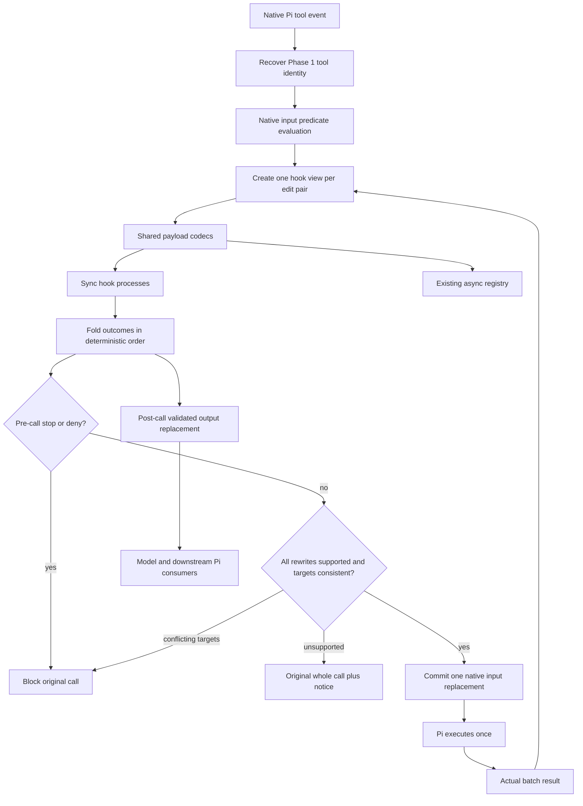

# Phase 02: Hook Payloads, Matchers, and Stop Limit - Research

**Researched:** 2026-11-12
**Domain:** Claude hook protocol over Pi extension events
**Confidence:** MEDIUM overall; direct source/binary observations are identified individually.
**Scope:** PG-HOOK-01, PG-HOOK-03, PG-HOOK-13. Research only; no product changes or commits.

<user_constraints>
## User Constraints (from CONTEXT.md)

The following decisions and discretion are copied verbatim from the accepted context. [VERIFIED: .planning/phases/02-hook-payloads-matchers-and-stop-limit/02-CONTEXT.md:25-103]

<!-- DATA_A7F39C10_START -->
## Implementation Decisions

### Multi-pair edits — explicitly accepted as a group

- **D-PG2-01:** Present a Pi multi-pair edit as one Claude-shaped hook invocation
  per replacement pair. Use `file_path`, `old_string` and `new_string`; do not
  invent a custom batch payload or show only the first pair. This applies to the
  pre-call and successful/failed result hooks.
- **D-PG2-02:** Complete the pre-hook checks before allowing the original Pi edit
  to execute. Any explicit denial blocks the whole call. Keep Pi's single tool
  execution and batch semantics; do not execute each pair as a separate tool.
- **D-PG2-03:** Apply an accepted rewrite to its corresponding pair. All resulting
  pairs must target the same file. Conflicting file redirects block the batch.
  A pair without a rewrite retains its original target and participates in that
  consistency check. Hook side effects may occur once per pair; this is an
  accepted consequence and must be documented.
- **D-PG2-04:** Result hooks run per pair using the actual batch result. Do not
  invent per-pair execution outcomes. The shared result can therefore appear
  in multiple hook invocations.

### Result translation — explicitly required by the user

- **D-PG2-05:** Include per-tool `tool_response` translation now, using available
  Pi event input, content, details and `structuredContent`. Research the upstream
  schemas for every mapped built-in tool. Produce the known Claude-shaped fields
  and document unavailable fields; do not leave every built-in result as the
  existing raw Pi content array.
- **D-PG2-06:** Translate Claude-shaped `updatedToolOutput` back into the Pi result
  delivered to the model. Preserve image/text content where applicable and ensure
  a replacement cannot leave stale structured content visible to another consumer.
  Honor `updatedMCPToolOutput` for MCP tools as required by PG-HOOK-01. Preserve
  D-BG-405: failed-result hooks do not replace the failed tool result.
- **D-PG2-07:** Translate only facts Pi supplies. Omit and document missing facts;
  do not fabricate zero durations/counts, original file contents, create/update
  status or separated shell streams. The user requested BACKLOG HOOKRESULT-01 to
  investigate and implement execution wrappers for full results later. No such
  wrappers or replacement built-in tool implementations belong in this phase.

### Input mappings and unsupported rewrites

- **D-PG2-08:** Map semantically equivalent input fields in both directions.
  Read/Edit/Write paths are absolute; Edit uses Claude's pair fields; shell
  timeout units must be converted. Research and explicitly specify the supported
  Glob/Grep option mapping rather than equating fields with different meanings.
  Preserve the locked tool-name mapping, including `find`/`Glob` and `ls`/`LS`.
  MCP/custom tool parameters retain their own schema. Keep the existing `if`
  evaluator working with native Pi inputs, separate from the hook-facing view.
- **D-PG2-09:** When a hook returns an input rewrite Pi cannot perform, run the
  original call and emit a notice. This is the user's choice over the recommended
  block behavior. Do not partially apply an untranslatable rewrite. For a batch,
  retain the original call as a whole. Explicit hook denial/stop decisions still
  take precedence. Conflicting file redirects remain blocked under D-PG2-03;
  that earlier accepted rule is distinct from an unsupported option mapping.
  Notices use the repository's mode-selected transport and identify the ignored
  rewrite without exposing sensitive argument values. The planner must document
  this intentional divergence and test it through an actual hook.

### Already-settled matcher and Stop requirements

- **D-PG2-10:** Follow the PRD's matcher decisions 6 and 24: exact lists accept
  spaces and comma/pipe separators; other patterns are unanchored JavaScript
  regular expressions; invalid patterns drop their group. Test the Claude-form
  tool name and report valid regex groups as supported. UserPromptSubmit and
  Stop ignore their matcher. Do not reopen those accepted choices.
- **D-PG2-11:** Eight consecutive Stop blocks continue; the ninth is overridden.
  A model tool call resets the count. Implement on the existing agent_settled
  path; Phase 5 moves continuation to another event. Reading the cap environment
  variable is outside this phase.

### Verification and the agent's discretion

- **D-PG2-12:** Each visible behavior change ships with a cucumber scenario that
  fails without it. Exercise real command hooks, inspect the exact received JSON,
  verify resulting file contents and model-visible replacements, and assert the
  original call plus notice for unsupported rewrites. Automate before requesting
  human testing. All commit hooks and combined-tree `npm run check` gates remain.
- Module boundaries, helper names, plan decomposition and equivalent-field mapping
  details are implementation discretion within these contracts. Do not infer a
  size/budget exception from Phase 1's narrow exceptions for 01-01 and 01-06.
<!-- DATA_A7F39C10_END -->

### Deferred Ideas (OUT OF SCOPE)

<!-- DATA_94C2DA31_START -->
## Deferred Ideas

- HOOKRESULT-01 in BACKLOG.md: investigate and implement execution wrappers or
  an upstream Pi seam for complete Claude-shaped results; user explicitly asked
  for this follow-up. The backlog entry was committed as e92c2bde.
- AGTAMBIENT-01 / SEED-261112-81c: adopt the published pi-subagents ambient MCP
  fix when available; Phase 1 closed with that acceptance deferred.
- Phase 5's Stop continuation event migration and environment-variable cap
  support remain outside this phase.
<!-- DATA_94C2DA31_END -->
</user_constraints>

## Summary

Implement a pure per-tool translation layer and a dispatch-owned transaction for edit batches. Translate a native event into a hook-facing view without changing the native input used by predicates. Run all pair checks, fold explicit stop/deny decisions first, validate all proposed rewrites, and mutate the single original Pi call only after acceptance. These are implementations of D-PG2-01..09, not new policy. The current bridge forwards `tool_input: event.input` and `tool_response: event.content`; the current mutation adapter writes input immediately. [VERIFIED: extensions/pi-claude-marketplace/bridges/hooks/payloads/pre-tool-use.ts:28-39; extensions/pi-claude-marketplace/bridges/hooks/payloads/post-tool-use.ts:32-44; extensions/pi-claude-marketplace/bridges/hooks/event-adapters.ts:222-236]

Result translation is feasible at the supported Pi floor, but is deliberately partial. Pi supplies `input`, `content`, `details`, and `structuredContent`; it does not retain every Claude result fact. The detailed tables below distinguish observed facts, deterministic conversions, and fields to omit. Never fill an absent field merely to satisfy Claude's complete output schema. A replacement affects model-visible output, not completed filesystem or shell effects. [VERIFIED: node_modules/@earendil-works/pi-coding-agent/dist/core/extensions/types.d.ts:1004-1058, quote: `input: Record<string, unknown>;`, `content: (TextContent | ImageContent)[];`, `structuredContent?: JsonValue;`, `isError: boolean;`] [CITED: https://code.claude.com/docs/en/hooks.md#posttooluse-decision-control]

**Primary recommendation:** deliver explicit codecs, transactional pair dispatch, matcher admission/runtime agreement, and the Stop counter correction as separate bounded plans. Retain the current execution machinery and installed dependency set; defer complete execution capture to HOOKRESULT-01. [VERIFIED: .planning/phases/02-hook-payloads-matchers-and-stop-limit/02-CONTEXT.md:47-61,89-103]

## Architectural Responsibility Map

The following assignments are design recommendations within D-PG2-12.

| Capability | Primary tier | Secondary tier | Rationale |
|---|---|---|---|
| Input/result codecs | Bridge domain logic | Pi adapter boundary | Transform values without I/O or tool execution |
| Per-pair event expansion and commit | Hook dispatcher | Mutation adapter | Dispatcher owns the whole original call and all outcomes |
| Matcher syntax and support reporting | Component domain | Runtime routing | Admission and execution must interpret the same parsed form |
| Hook process lifecycle | Existing process bridge | Async registry | Share translated views across synchronous and background delivery |
| Stop continuation budget | Runtime state owner | Event router / settle adapter | Reset once for a native model tool call, not for synthetic pair events |
| Notices | Existing notification boundary | Mode strategy | Keep user-only diagnostics out of model messages |
| Tool side effects | Pi built-in implementation | — | No wrappers or replacement tools in this phase |

<phase_requirements>
## Phase Requirements

| ID | Description | Research support |
|---|---|---|
| PG-HOOK-01 | Claude-shaped tool input and accepted rewrites; no edit pair bypass; honor MCP replacement alias; accepted context also includes available-field results and reverse results | Input/output tables, pair transaction, alias preservation, actual-hook tests |
| PG-HOOK-03 | Comma/pipe exact lists with surrounding spaces; unanchored regex on Claude names; invalid regex dropped; ignored matchers on prompt/Stop | Whole-pattern classification; shared Phase 1 identity; parser/partition/runtime/report agreement |
| PG-HOOK-13 | Eight consecutive Stop continuations; reset when the model calls a tool | Counter boundary and unconditional native tool-call reset |

Source requirement text and accepted extension: [VERIFIED: .planning/REQUIREMENTS.md:23-29, quotes: `PG-HOOK-01`, `PG-HOOK-03`, `PG-HOOK-13`; .planning/phases/02-hook-payloads-matchers-and-stop-limit/02-CONTEXT.md:29-100]. The table paraphrases the behaviors; IDs above are verbatim.
</phase_requirements>

## Project Constraints (from AGENTS.md)

These actionable directives remain planning constraints. [VERIFIED: AGENTS.md, read this session; accompanying user instructions]

- Read before editing; trace callers before changing functions; use CodeGraph first for indexed code. Use the Fallow task map for impact, architecture guards, security candidates, review, and pre-commit audit as applicable.
- Stay inside the active GSD workflow. Make surgical changes; do not clean up adjacent code or add speculative abstractions. Remove only newly orphaned code.
- Never commit to main; use the repository branch naming and committing skill; never bypass hooks, rebase, or rewrite history. PR titles use the commit format. PR descriptions use simple-english Plain mode and humanizer. PR merges use squash, zero new SonarCloud issues, and milestone audit/closure before a milestone ships. Offer the required version/changelog update before PR creation. This research delegation explicitly forbids a commit.
- Prefix Windows log append descriptions with the milestone; do not hand-edit that log. Every execution SUMMARY includes a Threat Flags section.
- Follow upstream behavior unless a recorded decision or Pi capability gap licenses a divergence. D-PG2-09 licenses the unsupported-input original-call fallback.
- Keep strict TypeScript and the existing discriminated resolver contract. Keep the declared runtime and Pi floor. No dependency upgrade is needed for this phase.
- Disk mutations remain atomic, retries fail cleanly or are idempotent, and recovery remains apply then reload without restarting Pi. Do not introduce filesystem mutations into pure translators.
- Preserve network restrictions: no new network activity for hook translation or matching, and no network in the commands/load paths that prohibit it.
- Preserve the existing extension write-containment roots and owning-clone checks. Those constrain extension-managed artifacts; they are not a license to block ordinary Pi tool edits of the user's project.
- Full combined-tree `npm run check` gates are mandatory after each wave, at phase/merge gates, and final handoff. Commit checks are incremental only. Reuse only same-session evidence for unchanged inputs.
- Every changed visible hook behavior needs a failing-before cucumber scenario. Unit/direct coverage does not replace it.
- Each production module has one mirrored owner test and reaches 100% direct line/function/branch coverage in isolation; use node:test, node:assert/strict, context mocks/strong-mock. Do not export test-only APIs or add coverage exclusions.
- Use exactly the mode-selected notification transport. No direct stdout/stderr writes, new telemetry, localization infrastructure, or third scope.
- Phase 2 plans stay at or below 15 changed files and 100,000 estimated tokens each. Phase 1 exceptions do not apply. [VERIFIED: accepted delegation; .planning/phases/02-hook-payloads-matchers-and-stop-limit/02-CONTEXT.md:101-103]

## Standard Stack

Retain the installed stack. The following are repository declarations, not recommendations to install latest registry versions. No installation step belongs in this phase. [VERIFIED: package.json:17-40,62-68]

| Component | Retained version/evidence | Use |
|---|---|---|
| Pi extension API | Installed `"version": "1.5.0"`; declared peer `">=1.5.0"` [VERIFIED: node_modules/@earendil-works/pi-coding-agent/package.json:1-4; package.json:63] | Native events, mutable call inputs, returned result patches |
| TypeScript | `"typescript": "^6.0.3"` [VERIFIED: package.json:36] | Strict codecs and discriminated rewrite outcomes |
| Node runtime/test runner | Runtime observed v26.13.0; declared `"node": "^22.22.2 || ^24.15.0 || >=26.0.0"` [VERIFIED: node --version, 2026-11-12; package.json:39-40] | Native tests, JSON, RegExp, path handling |
| Behavioral runner | `"@cucumber/cucumber": "^13.3.0"` [VERIFIED: package.json:19] | Real Pi + local scripted model + command hook fixtures |
| Strict mocks | `"strong-mock": "^9.2.2"` [VERIFIED: package.json:34] | Existing test interaction contracts |

### Package Legitimacy Audit

Not applicable: this recommendation installs no external package. Do not import a transitive package merely because Pi happens to install it. In particular, Pi's unified patch generator imports `"diff"`, but that does not make it a declared project dependency. [VERIFIED: node_modules/@earendil-works/pi-coding-agent/dist/core/tools/edit-diff.js:4,264-268, quotes: `import * as Diff from "diff";`, `Diff.createTwoFilesPatch`] If planning chooses a new parser dependency, run the full official-source/legitimacy/registry/postinstall gate before adding it.

## Evidence Ledger and Source Conventions

For compactness, `PI` below denotes the installed package's `dist/core/` directory, and `HOOKS` denotes the repository's hook bridge. These are citation abbreviations, not proposed runtime paths. Their expanded references appear in tables where needed. Binary references mean read-only mmap of Claude Code 2.1.322 on 2026-11-12, never launching Claude or using credentials.

The research-plan seam selected jina for the two supplied URLs; jina was unavailable, so official pages were opened with the web fallback. The confidence seam returned MEDIUM for `websearch --verified` and for jina, and LOW for unrecognized local/webfetch provider labels. The stored web digests therefore use MEDIUM. Local source facts below have explicit verified provenance rather than pretending the web-provider classifier measures code inspection. Overall confidence remains MEDIUM because LS's current upstream schema is unresolved. [VERIFIED: research-plan / classify-confidence tool outputs, 2026-11-12]

## Input Translation Contract

### Field-by-field map

The table is the recommended implementation contract under D-PG2-08. Source columns quote the actual field names. Every mapped optional field must be type/range checked before mutation: Pi explicitly performs no re-validation after input mutation. [VERIFIED: node_modules/@earendil-works/pi-coding-agent/dist/core/extensions/types.d.ts:997-1002]

| Native tool | Forward hook input | Reverse accepted input | Unsupported rewrite behavior / evidence |
|---|---|---|---|
| read → Read | `path` → absolute `file_path`; `offset`, `limit` retain 1-based line semantics | Required string file_path → path; optional valid line offset/limit → same native fields | Nonempty PDF `pages` or unsupported read-cap override cannot be executed; original + notice. [VERIFIED: PI/tools/read.js:10-14,113-128; Claude binary 296665200-296667000, quotes: `file_path`, `offset`, `limit`, `pages`] |
| edit → Edit | One `edits[]` member per invocation: `oldText` → `old_string`, `newText` → `new_string`, shared absolute file_path | Required strings become that pair; absent/false `replace_all` is expressible; true is not | Keep original batch on untranslatable fields; separate accepted target conflicts block. [VERIFIED: PI/tools/edit.js:10-22,72-76,90-135; CONTEXT D-PG2-01..03] |
| write → Write | `path` → absolute file_path; `content` unchanged | Required file_path/content strings rebuild native path/content | Unknown execution-affecting fields are not silently dropped. [VERIFIED: PI/tools/write.js:8-11,30-50; Claude binary 294763700-294764700, quotes: `file_path`, `content`] |
| bash → Bash | `command` unchanged; supplied `timeout` seconds ×1000 → milliseconds | command unchanged; finite positive timeout milliseconds ÷1000 → seconds; reject overflow beyond native timer maximum | True `run_in_background` / `dangerouslyDisableSandbox` have no implementation here. A description is display-only and may be ignored without changing execution; absent/false unsupported flags are no-ops. [VERIFIED: PI/tools/bash.js:12-31; Claude binary 298449891-298451100, quotes: `command`, `timeout`, `description`, `run_in_background`, `dangerouslyDisableSandbox`] |
| powershell → PowerShell | Same command/timeout conversion as Bash | Same supported command/timeout conversion | Do not assume all Bash result fields exist for PowerShell. [VERIFIED: PI/tools/powershell.js:1-3,24-28; Claude binary 310730000-310731900, same input field quotes as above] |
| find → Glob | `pattern` and optional `path` map directly; no Claude counterpart for native `limit` | Required pattern string; optional directory path; retain native-only result cap separately | Never call Pi find Unix-find-style: installed implementation uses `"--glob"`. [VERIFIED: PI/tools/find.js:17-23,118-160, quotes: `pattern`, `path`, `limit`, `"--glob"`; Claude binary 294793300-294793961: `pattern`, `path`] |
| grep → Grep | See detailed rules below | Only content mode and equivalent options | No silent mode/limit approximation. [VERIFIED: PI/tools/grep.js:11-19,67-68,95-102,155-175; Claude binary 294798500-294801900] |
| ls → LS | Retain native `path`, `limit` pending the unresolved current Claude schema; do not invent file_path | Preserve existing native-shaped contract; validate supplied path/limit | Current schema lookup was inconclusive, not evidence LS is unsupported. [VERIFIED: PI/tools/ls.js:8-11] [ASSUMED] Retaining this historical mapped tool's native shape is the lowest-risk compatibility boundary until authoritative schema evidence is found. |
| MCP/custom | Keep their own parameter schema unchanged | Whole-object replacement with safe property copying | Never feed custom fields through a built-in codec based on superficial shape. [VERIFIED: CONTEXT D-PG2-08; PI/extensions/types.d.ts:993-1003] |

The closed tool mapping remains verbatim: `bash: "Bash", powershell: "PowerShell", read: "Read", edit: "Edit", write: "Write", grep: "Grep", find: "Glob", ls: "LS"`. [VERIFIED: extensions/pi-claude-marketplace/domain/components/hook-tool-names.ts:81-93]

**Absolute paths:** resolve against the event context's cwd, not process.cwd or the plugin root. Pi also expands home/at-prefix/unicode spaces and has read-specific filename fallback variants. Plain node:path.resolve alone does not reproduce those rules. Keep the original native path when no rewrite occurs, and describe hook paths as normalized requested paths, not a guarantee of realpath identity or a post-read observed path. Use an existing project path utility if it has equivalent semantics; otherwise write a narrow pure resolver with injected home/cwd, not extra filesystem reads. [VERIFIED: PI/tools/path-utils.js:35-43,45-97, quotes: `normalizeUnicodeSpaces: true, stripAtPrefix: true`; PI/tools/read.js:77; PI/tools/edit.js:92; PI/tools/write.js:31]

**Replacement semantics:** rebuild supported fields from the replacement rather than merging stale mapped fields. Omitted optional mapped fields are removed. Preserve native-only execution settings in an internal sidecar only where no hook-facing equivalent exists (find's result cap; grep cap with context); document that constraint. Do not expose the sidecar as invented Claude parameters. A hook that echoes its unchanged translated view must leave the native call unchanged. This sidecar recommendation is implementation discretion under D-PG2-08; required whole-input replacement follows the official hook contract. [CITED: https://code.claude.com/docs/en/hooks.md#pretooluse-decision-control]

### Grep: precise supported subset

Observed native schema: `pattern`, `path`, `glob`, `ignoreCase`, `literal`, `context`, `limit`. Native execution always formats matching lines with paths and line numbers; limit caps match rows before expanding surrounding lines. [VERIFIED: PI/tools/grep.js:11-19,67-68,130-151,155-175,197-238]

Observed Claude schema: `pattern`, `path`, `glob`, `output_mode`, `"-B"`, `"-A"`, `"-C"`, `context`, `"-n"`, `"-i"`, `"-o"`, `type`, `head_limit`, `offset`, `multiline`. Modes are `"content"`, `"files_with_matches"`, `"count"`; head_limit limits rendered output, with zero meaning unlimited. [VERIFIED: Claude binary 294798500-294801723, read-only schema excerpts]

Recommended mapping:

1. Pass pattern/path/glob. Emit `output_mode: "content"`, `"-n": true`, `"-i": ignoreCase` when supplied; symmetric context maps to `context`. On reverse require content mode, or an explicitly equivalent unchanged view; an omitted mode in a genuinely new Claude replacement defaults to files_with_matches upstream and is unsupported here.
2. Native literal matching can be represented by escaping regex metacharacters in the forwarded pattern. If the hook returns that same escaped pattern, retain native literal and original pattern; if it changes the pattern, use regex mode for that new Claude regex. Do not add an invented `literal` Claude parameter.
3. Reverse `context` or `"-C"` to symmetric native context. Accept `"-A"` and `"-B"` only when their effective values are identical. Reject conflicting aliases rather than silently selecting a different behavior.
4. With zero context, a positive integer head_limit corresponds to native limit on matched lines; preserve the native default by emitting its effective limit when useful. With context, no head_limit equivalent exists: retain the native match cap internally and omit a false head_limit statement. A hook that requests a new head_limit with context is unsupported.
5. Unsupported: files/count mode; `"-n": false`; `"-o": true`; positive offset; multiline true; a type filter not represented by an exact available glob; head_limit zero/unlimited. Do not pretend a language type is a filename glob. False/zero no-op flags may be accepted only when semantically equivalent.
6. Any unsupported request invalidates the complete candidate rewrite, even when another changed field is supported. Emit the original-call notice without argument values. Explicit stop/deny still wins.

These are proposed codec rules grounded in the two schemas, not claims that the different tools have identical defaults, search ordering, hidden-file policy, or context formatting. The exact unmapped differences must remain documented under HOOKRESULT-01 / compatibility notes. [VERIFIED: PI/tools/grep.js:24,93-102,130-151,155-175; Claude binary 294798500-294801723]

## Result Translation: Available Facts and Omissions

Successful hooks receive a per-tool object using known Claude fields. Failed hooks retain the existing `error` text / `is_interrupt: false` contract and no tool_response; only their input expands per pair. [VERIFIED: extensions/pi-claude-marketplace/bridges/hooks/payloads/post-tool-use-failure.ts:23-59, quotes: `readonly error: string;`, `readonly is_interrupt: false;`]

### Claude output schema inventory

This is a field inventory, not an instruction to populate absent facts. Each row is from a read-only binary schema inspection on 2026-11-12. [VERIFIED: Claude Code 2.1.322, offsets below]

| Tool | Verified fields (verbatim identifiers) | Binary evidence |
|---|---|---|
| Read text | `type: "text"`; `file.filePath`, `file.content`, `file.numLines`, `file.startLine`, `file.totalLines`, optional `file.truncatedByTokenCap` | 296667386 |
| Read image | `type: "image"`; `file.base64`, `file.type`, `file.originalSize`, optional `file.dimensions` with `originalWidth`, `originalHeight`, `displayWidth`, `displayHeight` | 296667386-296669786 |
| Read other arms | `type: "notebook"`, `"pdf"`, `"parts"`; notebook `cells`; PDF `base64`; parts `count`, `outputDir`, `firstPage`, `totalPages`, `pages` | 296667386-296669786 |
| Edit | `filePath`, `oldString`, `newString`, `originalFile`, `structuredPatch`, `userModified`, `replaceAll`, optional `gitDiff`, `staged`, `stagedWording` | 294761509-294762300 |
| Write | `type: "create" \| "update"`, `filePath`, `content`, `structuredPatch`, `originalFile`, optional `gitDiff`, `userModified`, `staged`, `stagedWording` | 294763700-294764900 |
| Glob | `durationMs`, `numFiles`, `filenames`, `truncated`, optional `totalMatches`, `countIsComplete`, `timedOut` | 294793300-294795000 |
| Grep | optional `mode`; `numFiles`, `filenames`, optional `content`, `numLines`, `numMatches`, `totalFiles`, `totalLines`, `appliedLimit`, `appliedOffset`, `timedOut` | 294801600-294801980 |
| Bash | `stdout`, `stderr`, `interrupted`; optional `isImage`, `rawOutputPath`, `structuredContent`, `persistedOutputPath`, `persistedOutputSize`, plus background/sandbox/git metadata | 298451600-298456300 |
| PowerShell | `stdout`, `stderr`, `interrupted`; optional `returnCodeInterpretation`, `isImage`, `persistedOutputPath`, `persistedOutputSize`, background/git metadata | 310730650-310732900 |
| LS | No current output schema located in the inspected sources | Unresolved; do not invent entries/counts schema |

### Recommended forward results

| Tool | Produce from actual event facts | Omit / limitations |
|---|---|---|
| Read text | `type: "text"`; normalized requested filePath; file.content from actual returned text (prefer known raw `details.truncation.content` when present); startLine from actual offset; numLines only for the recovered content slice | Pi structuredContent repeats the displayed text and can include continuation notices. Strip only a provable Pi-added trailer; if ambiguous retain it as displayed text and document that limitation, or omit raw-content-derived counts. totalLines only when derivable from an unambiguously complete slice; never equate the truncator's selected-slice total to whole-file total. |
| Read image | `type: "image"`; file.base64 from image block data; file.type from mimeType | No originalSize from resized base64 length; no dimensions inferred by guessing; note text remains Pi content for reverse/no-op preservation. No synthetic PDF/notebook arm for a Pi text read. |
| Edit | filePath; oldString/newString for the corresponding invocation; replaceAll false from native unique-match semantics; structuredPatch only after decoding the actual unified patch into hunks | originalFile and userModified unknown; do not reread after execution and call it original. Every pair shares the actual batch patch, not an invented per-pair diff. |
| Write | filePath and content from actual successful event.input | Omit type, originalFile, structuredPatch, userModified, gitDiff. Success text does not establish create vs update. |
| Glob | filenames and numFiles for the emitted complete path records; truncated from native truncation/resultLimitReached evidence | No durationMs, global totalMatches, countIsComplete, or timedOut guess. Results are relative to search root in Pi; normalize to absolute if matching Claude's path presentation. A byte-truncated partial final path is not a complete filename. |
| Grep | mode content; actual rendered result text as content; numLines only for matching/context lines after known notice removal | Do not derive numMatches by counting formatted lines when context duplicates lines. Omit filenames/numFiles when parsing is ambiguous (filenames may contain colons/newlines). Do not equate matchLimitReached to appliedLimit on rendered lines. |
| Bash | interrupted false on a successful completed native result; optional persistedOutputPath from actual full-output path; actual text/image content may occupy Claude's optional structuredContent content-block slot | Omit stdout/stderr: native output merges streams. Do not rename combined output to stdout or fabricate empty stderr. Do not copy Pi structuredContent object into Claude's array-typed field. wall_time_seconds/exit_code have no same-name Claude result slot in the inspected schema. |
| PowerShell | interrupted false on successful completion; actual persistedOutputPath when present | Its schema has no Bash structuredContent array slot. Omit stdout/stderr rather than lying about merged streams; until capture work it may expose only known metadata. |
| MCP/custom | Keep the tool's own schema/content, including actual images; normalize MCP envelope only from the implementation's real returned fields | Do not reinterpret custom content as a built-in file/shell result. |
| LS | Preserve existing native result content until the unresolved schema has authoritative evidence | Document this single passthrough exception; do not postpone all other per-tool translation. |

Forward table evidence: [VERIFIED: PI/tools/read.js:35-39,88-178; PI/tools/edit.js:113-135; PI/tools/write.js:30-51; PI/tools/find.js:17-23,86-115,197-230; PI/tools/grep.js:130-151,193-238; PI/tools/bash.js:89-95,279-303; PI/tools/powershell.js:24-28]. Exact native result keys read here: `diff`, `patch`, `firstChangedLine`, `truncation`, `resultLimitReached`, `matchLimitReached`, `linesTruncated`, `fullOutputPath`, `output`, `truncated`, `full_output_path`, `exit_code`, `wall_time_seconds`, `data`, `mimeType`, `note`.

**Patch conversion:** Pi supplies a unified patch string, not Claude hunks. A Claude hunk contains `oldStart`, `oldLines`, `newStart`, `newLines`, `lines`. Decode only actual validated unified patch headers/body; reject malformed/unrepresentable patches and omit structuredPatch rather than invent an empty change. Do not apply the patch, reconstruct the original file, or add a dependency on an undeclared transitive module. [VERIFIED: PI/tools/edit-diff.js:264-268; Claude binary 294761509, quote: `u({oldStart:v(),oldLines:v(),newStart:v(),newLines:v(),lines:C(o())})`]

**Display-text ambiguity:** testing must include a real file whose final lines look like Pi's notices, a trailing newline, empty text, offsets/limits, and byte truncation. Pi's read structuredContent is derived from the first displayed text block; it is not a second raw read channel. [VERIFIED: PI/tools/read.js:35-39,133-178, quote: `structuredContent: toReadOutput(result.content)`]

## Reverse updatedToolOutput Contract

Use the actual tool identity to choose a decoder. Validate present built-in fields before rendering a replacement; malformed shapes keep the original result. The available-field partial shape emitted by this bridge must also round-trip: requiring missing originalFile/totalLines/stdout would make an echo-and-redact hook unusable. Document this Pi capability gap rather than claiming full Claude schema conformance. [VERIFIED: CONTEXT D-PG2-05..07; PI result sources above] [CITED: https://code.claude.com/docs/en/hooks.md#posttooluse-decision-control]

| Replacement | Pi result patch recommendation | Preservation rule |
|---|---|---|
| Read text | file.content → text content; use the replacement's present metadata for display only | Replace the stale text. Rebuild native structuredContent as the new text or omit it so Pi clears it. |
| Read image | file.base64/file.type → native image block | Preserve unchanged companion text notes when they still describe this same image; never append the original image after a replacement. For a changed type/content, rebuild from replacement rather than carrying original blocks blindly. |
| Edit | Render supplied newString / filePath and actual supplied structuredPatch as model-readable result; rebuild safe diff details if needed | Do not write files; do not carry the old diff/patch as if it describes the replacement. |
| Write | Render supplied filePath/content, with create/update wording only when the replacement supplies type | Ensure replaced content is visible to the model, not just a success sentence that discards it. Clear stale details. |
| Glob | filenames → text path list; use supplied truncation metadata if valid | Empty list means no filenames, not original output; drop old truncation/path data. |
| Grep | content mode → supplied content; files mode → supplied filenames; count mode → supplied content/count information | Post-result rendering can support modes the native pre-call tool cannot execute. No original text survives as fallback inside an accepted replacement. |
| Bash/PowerShell | supplied stdout and stderr → text blocks; Bash structuredContent content-block array → native text/image blocks after validation | Treat an empty stream as an intentional empty replacement. Keep image blocks supplied by the replacement. Never read a replacement-provided output path to fetch extra data. |
| MCP/custom | content arrays preserve text/images; valid MCP envelope supplies content plus structuredContent; scalar/object native-schema values render as text/JSON | Treat this as replacement of output, not an arbitrary Pi event patch. Keep routing metadata only; replace all old payload copies. |
| LS | Existing native content form pending schema evidence | No new invented Claude schema. |

### Pi patch invariants

- Pi's returned patch slots are verbatim `content?`, `details?`, `structuredContent?`, `isError?`, `usage?`. No call id/name/input mutation belongs in a result replacement. [VERIFIED: PI/extensions/types.d.ts:1128-1138]
- Returning content without structuredContent makes Pi delete the old structured value. Returning details undefined does **not** delete old details: it leaves them intact. Use an explicit safe replacement (such as null for discarded details, or a validated reconstructed object). [VERIFIED: PI/extensions/runner.js:900-954, quotes: `if (handlerResult.structuredContent === undefined) delete currentEvent.structuredContent;`, `if (handlerResult.details !== undefined) { currentEvent.details = handlerResult.details;`]
- Preserve only metadata needed to identify/route an MCP result; remove old output-bearing fields and stale full-output paths. Do not spread original details wholesale. Source identity recovery reads `details.server` and `details.tool` before folding, and the failed-result detector reads `details.error`. [VERIFIED: extensions/pi-claude-marketplace/bridges/hooks/dispatch.ts:853-869,1068-1080, quote: `typeof details.server !== "string"`, `typeof details.tool !== "string"`]
- A no-op returns no patch and preserves every original block and metadata field. A feedback-only PostToolUse block appends feedback to original content; explicitly return the original structuredContent if preserving it is intended, because content-only append otherwise clears it. [VERIFIED: HOOKS/event-adapters.ts:282-300,329-349; PI/extensions/runner.js:910-923]
- Failed-result mutations remain ignored; denial/block feedback must remain appended without changing failure classification. [VERIFIED: HOOKS/event-adapters.ts:303-313,329-349, quote: `return event.isError ? failedResultPatch(result) : toolResultPatch(result.updatedToolOutput);`]
- Apply one final accepted replacement after folding. All result hooks for all edit pairs see the same actual native batch result, not a prior hook's rewrite. Use deterministic pair order then existing routing order; last accepted output wins. This is the recommended extension of the existing last-write fold to D-PG2-04. [VERIFIED: HOOKS/dispatch.ts:341-350,382-390; CONTEXT D-PG2-04]

### MCP alias precedence

Retain both `updatedToolOutput` and `updatedMCPToolOutput` through parsing until dispatch knows whether the tool is MCP. Select the modern field when supplied, otherwise the alias for MCP only; ignore the alias on built-ins/custom non-MCP tools. Do not let the legacy alias make a generic builtin mutation. The binary's selector reads `return n.updatedToolOutput!==void 0||!ym(e)?n.updatedToolOutput:n.updatedMCPToolOutput`. [VERIFIED: Claude binary 297311197]

The inspected binary also has a legacy generator that yields both fields, and legacy falsy-value suppression. Preserve an explicit tested modern-first rule matching the selector; do not claim byte-for-byte equivalence of every legacy path without a probe. Tests must include both fields, alias-only MCP, alias-only built-in, empty/false/null values, and failed MCP results. [VERIFIED: Claude binary 296971444-296971750,297454582-297455100] This ambiguity is recorded below rather than hidden.

## Architecture Patterns

### Data flow



The diagram is a design proposal; the result branch must terminate at Q rather than re-enter pre-call validation.

### Component responsibilities and proposed boundaries

Existing component references are ownership pointers, not declarations of runtime-created filesystem locations. New codec names are proposals, so the planner may choose simpler boundaries.

| Concern | Existing owners / proposed module | Integration work |
|---|---|---|
| Built-in input mapping | Proposed coherent input codec with paired test | Forward/reverse validation, sidecar, path/timeout conversions |
| Output facts | Proposed result codec(s), split file vs search/shell if needed | Source-specific projection and omission policy |
| Reverse result rendering | Existing event-adapters plus proposed output decoder | Safe content/images/details/structuredContent |
| Batch transaction | dispatch and a proposed focused batch helper | One dispatch plan, all preflight checks, single commit |
| Wire fields | wire-protocol, exec-result, dispatch fold | Preserve MCP alias through routing-aware selection |
| Payload envelopes | pre-tool-use, post-tool-use, post-tool-use-failure | Shared codecs; no fields belonging to Phase 6 |
| Background input delivery | dispatch-exec and async-rewake registry | Both consume identical translated pair views |
| Matcher admission | matcher, partition, hook support/reporting consumers | Whole-pattern syntax; valid/invalid regex distinction |
| Runtime matching | dispatch, event-router | Test canonical Claude names; don't regress MCP recovery |
| Stop | runtime, event-router, settle | Eight accepted blocks; reset counter on native call |

Evidence for present seams: [VERIFIED: HOOKS/dispatch.ts:792-835,893-935,1097-1120; HOOKS/dispatch-exec.ts:277-311; HOOKS/async-rewake/registry.ts:115-127,230-255; HOOKS/runtime.ts:275-295; HOOKS/event-router.ts:1212-1253].

### Transactional batch algorithm

1. Capture generation, native input, native tool identity, and actual result once. Build immutable pair views. Do not mutate event.input while launching hooks.
2. Evaluate matchers using the canonical Claude identity and `if` using the original native input. Existing hook deduplication remains per logical pair; never dedupe distinct pairs away.
3. Dispatch every matching pair/hook. Preserve existing parallelism within a pair and deterministic outcome ordering across pairs. Waiting for all pre-hooks does not mean waiting for completion of hooks explicitly declared asynchronous.
4. Fold stop first, then explicit deny/block, then ask resolution. A rejected ask blocks. Keep context/notices independent of rewrite acceptance.
5. Decode every candidate without touching the original. Track unsupported candidates and accepted final target paths. Accepted conflicting redirects block, including an unchanged pair's original target; this remains true even if another pair proposed an unsupported field.
6. If no hard block but any unsupported rewrite exists, discard **all** rewrites and retain the original whole input. Emit only the necessary user notice, with field names/reason categories rather than argument values.
7. If all supported targets agree, commit once through the existing safe input replacement boundary.
8. After execution, expand result hook inputs per pair but share the actual result. Fold outputs once and return one final Pi patch. Generation changes invalidate the operation's pending fold.

The existing generation guard, hook parallelism, strongest-decision fold, and safe property-copy boundary are reusable. [VERIFIED: HOOKS/dispatch.ts:258-267,341-420; HOOKS/event-adapters.ts:140-156,203-236,248-274] The exact algorithm above implements D-PG2-01..09 rather than changing Pi batch semantics.

**Native-vs-hook identity hazard:** Phase 1 already changes the event view's toolName to Claude form while sharing its native input. A codec switching only on lowercase `edit` will miss live dispatched events named `Edit`. Carry native tool identity explicitly or normalize against the closed table at one boundary; never infer the input schema from fields alone. [VERIFIED: HOOKS/dispatch.ts:1097-1109, quote: `return { event: toolName === event.toolName ? event : { ...event, toolName }, tool };`]

### Synchronous and asynchronous paths

Both execution paths currently call the same three payload translators. Expand pairs above the execution-lane split, and pass the same translated view to both paths. Synchronous results participate in immediate mutation/denial; plain async answers only deliver context on a later call, and rewake exit 2 wakes a turn. Do not add retroactive mutation to background hooks. [VERIFIED: HOOKS/dispatch-exec.ts:124-129,277-311; HOOKS/async-rewake/registry.ts:115-127,230-255,439-456,510-565, quotes: `lane: "background"`, `deliverAs: "nextTurn"`, `triggerTurn: true, deliverAs: "steer"`]

## Matcher Implementation

Classify the **whole** raw matcher before splitting alternatives:

- Omitted/empty/`"*"` means match-all.
- The exact-list syntax accepts letters, digits, underscore, hyphen, ASCII space, comma, pipe. Split on comma or pipe and trim surrounding whitespace. `"Read Write"` is one literal, not two tools; `"Read, Write"` is two. Preserve the existing degradation of unmapped literal alternatives.
- Anything outside that syntax compiles as one unanchored JavaScript RegExp, without added flags or anchors. Catch compile errors and drop that group. Keep a distinct invalid condition so valid regex is reported supported.
- Test regex against the already recovered Claude-form identity. Do not discard Phase 1's exact-literal recovery/proxy rules.
- Ignore matchers on UserPromptSubmit and Stop **before** parsing or rejecting them, including syntactically invalid regex text there.
- Update support partitioning and runtime together; changing only parser return values would still skip valid regex at dispatch.

These implement locked decisions 6/24 and D-PG2-10. The old parser's closed set is `"match-all" | "tool-set" | "regex" | "unmapped"`, with regex represented only as a rejection marker; partition returns `"regex"` for that arm and runtime returns false. [VERIFIED: extensions/pi-claude-marketplace/domain/components/hooks/matcher.ts:4-19,93-133; extensions/pi-claude-marketplace/domain/components/hooks/partition.ts:35-60; HOOKS/dispatch.ts:158-169]. The precise upstream list grammar and split are recorded in the binary-backed report and PRD. [VERIFIED: docs/prd/parity-gaps-prd.md:429-438; docs/research/parity-gaps/hooks.md, U9-U10, quotes: `/^[a-zA-Z0-9_|, -]+$/`, `/[|,]/`]

The historical special-case `mcp__<server>__.*` must not cause arbitrary regex alternatives to be split as exact lists. An optimization is acceptable only if it preserves the same whole-regex unanchored semantics. [VERIFIED: matcher.ts:27-39,65-80; CONTEXT D-PG2-10]

## Stop Counter Implementation

The current `STOP_OVERRIDE_CAP = 8` increments then tests `consecutiveBlockCount >= STOP_OVERRIDE_CAP`, causing the eighth denial to be overridden. Allow counts 1–8 and override count 9. Add a narrowly named native-tool-call operation that resets consecutiveBlockCount and cap-notification state; do not reuse recordUserInput because that also clears stopHookActive. Keep the async-rewake active marker independent. [VERIFIED: HOOKS/runtime.ts:18,179-194,271-295, quotes: `let stopHookActive = false;`, `let runStartedByRewake = false;`, `let consecutiveBlockCount = 0;`, `consecutiveBlockCount >= STOP_OVERRIDE_CAP`]

Reset before bucket-empty/proxy-skip exits, once for the original native model tool call. A Stop-only plugin must reset even if it has no PreToolUse hooks. Synthetic edit-pair events must not increment/reset the budget individually. Preserve registration generation guards and reload cleanup. Keep the continuation on agent_settled in this phase. [VERIFIED: HOOKS/dispatch.ts:800-816; HOOKS/event-router.ts:1212-1253; CONTEXT D-PG2-11] The official contract confirms eight continuations and reset on a tool call. [CITED: https://code.claude.com/docs/en/hooks.md#stop]

## Don't Hand-Roll

| Problem | Use instead | Why |
|---|---|---|
| Running edited batches | Pi's existing edit execution | Preserves its original-file matching and mutation queue |
| Capturing missing original file/stream metadata | Omit and document; HOOKRESULT-01 | A post-read cannot reconstruct past execution facts |
| Notification transport | Existing hook notification run | Preserves selected mode and user/model separation |
| Hook process management | Existing dispatch-exec / async registry | Keeps cancellation, generation, environment, and cleanup |
| Regex engine | Native JavaScript RegExp | Locked upstream behavior; alternate regex dialect changes semantics |
| A second test harness | Existing scripted-model + hook recorder | Exercises real commands with no credentials/network |

Evidence: [VERIFIED: CONTEXT D-PG2-02,07,09,10,12; HOOKS/dispatch.ts:617-638; HOOKS/async-rewake/registry.ts:230-425; PI/tools/edit.js:90-135].

## Runtime State Inventory

This phase adapts event handling rather than renaming installed artifacts. The inventory still records refactor-sensitive state.

| Category | Observed scope | Required action |
|---|---|---|
| Stored data | Parsed hook cache/routing state and async PID table are owned by the existing runtime/registry [VERIFIED: HOOKS/runtime.ts:163-178; async-rewake/registry.ts:417-421,603-625] | No new persistent schema; ensure reload parses newly admitted groups. Verify an already-installed hook group becomes usable after reload/update. |
| Live service config | No new external service configuration is proposed | None for this plan; no external account inspection performed |
| OS-registered state | Existing child process groups and marker-checked reap remain [VERIFIED: async-rewake/registry.ts:268-276,628-668] | Keep lifecycle code intact; do not inherit old archived-phase orphan fixes as scope |
| Secrets/env vars | Existing environment preparation is reused; cap env-var support expressly deferred [VERIFIED: async-rewake/registry.ts:692-700; CONTEXT D-PG2-11] | No secret reads/renames; no new env var |
| Built/installed artifacts | Current Pi package is 1.5.0; no artifact relocation/package installation proposed [VERIFIED: installed package.json:1-4] | No migration; tests must use retained supported floor |

The absence of proposed migrations is a design statement, not an assertion that every external runtime was inspected.

## Common Pitfalls

1. **Partial edits escape a later denial.** The current adapter mutates immediately; collect and validate all pair proposals before a single commit. Test a later denied pair after an earlier valid rewrite. [VERIFIED: HOOKS/event-adapters.ts:232-234; CONTEXT D-PG2-02,09]
2. **A rewrite silently changes search semantics.** head_limit and native limit diverge with context; omitted Claude output_mode is not native content mode. Test nonzero context, unsupported count mode, asymmetric context and literal regex escaping. [VERIFIED: PI/tools/grep.js:67-68,130-175; Claude binary 294798500-294801723]
3. **Redaction leaves a second copy.** Pi clears structuredContent on content replacement but preserves details unless explicitly changed. Test a later extension handler observing the final event, not only the model's text log. [VERIFIED: PI/extensions/runner.js:910-923]
4. **Support reporting disagrees with execution.** Existing regex arms are rejection markers in three layers. Test install without partial, info supported rows, and actual execution. [VERIFIED: matcher.ts:15-19; partition.ts:35-60; HOOKS/dispatch.ts:158-169]
5. **Stop reset depends on hook matches.** A plugin with only Stop must still reset after tools. Reset before the empty-bucket return and preserve active flags. [VERIFIED: HOOKS/dispatch.ts:809-811; HOOKS/runtime.ts:271-295]
6. **Async hooks receive old shape.** The registry has its own translator table. Add at least one asynchronous real recording-hook case covering an edited pair input. [VERIFIED: HOOKS/async-rewake/registry.ts:115-127,246-254]
7. **A filename/notice parser invents metadata.** Paths can include separators and tool text may resemble a trailer. Do not claim exact file counts or full text from an ambiguous display string. [VERIFIED: PI/tools/grep.js:130-151,219-238; PI/tools/read.js:133-165]
8. **Archived decisions enter the active phase.** Active scope is parity-gaps Phase 02 with PG-HOOK IDs; old Phase 02 records in STATE are not new obligations. [VERIFIED: .planning/STATE.md:3-11; active CONTEXT phase boundary]

## Code Examples

These are implementation sketches (not existing exported APIs); fixture strings are synthetic test data. Property names follow the verbatim source/schema quotes above.

### Atomic decision ordering (pseudocode)

```text
collect every pair outcome against the original input
if any explicit stop: block/terminate original call
else if any explicit deny or rejected ask: block original call
else if accepted pair targets conflict: block original batch
else if any rewrite is unsupported: original whole call + notice
else: commit the fully validated native candidate once
```

The ordering implements D-PG2-02,03,09 and preserves the existing stop-before-block fold. [VERIFIED: CONTEXT:33-43,72-80; HOOKS/dispatch.ts:407-420]

### Redaction patch versus feedback patch

```typescript
// Example replacement: omit structuredContent so Pi deletes the stale value.
// Explicit null replaces old details; undefined would retain them.
return {
  content: [{ type: "text", text: replacementText }],
  details: null,
};
```

The exact patch fields `content`, `details`, `structuredContent` and text-block discriminator `"text"` are grounded in the inspected Pi types and tool results. [VERIFIED: PI/extensions/types.d.ts:1128-1138; PI/extensions/runner.js:910-923; PI/tools/write.js:49-51]

### Per-pair acceptance fixture

Native fixture: `{"path":"a.txt","edits":[{"oldText":"x","newText":"y"},{"oldText":"p","newText":"q"}]}`. Expect two hook inputs containing absolute file_path and the corresponding old_string/new_string, one Pi tool execution, and one actual result shared by both post hooks. Denying the second pair must leave the file's original bytes intact. [VERIFIED: CONTEXT D-PG2-01..04; PI/tools/edit.js:10-22,90-135]

## State of the Art

| Earlier project behavior | Required behavior now | Evidence |
|---|---|---|
| Raw Pi input/result under a Claude name | Available-field codecs and reverse codecs | Current payload sources + D-PG2-05..09 |
| Regex means unsupported | Valid regex is executable and supported | D-PG2-10; PRD decisions 6/24 |
| The eighth block is overridden | Eight continuations, ninth overridden | Current counter + official Stop contract |
| find described as Unix-find-style | Pi find uses fd glob matching | PI/tools/find.js:17-23,118-160 |
| Generic content/isError output patch only | Tool-specific rendering and stale structured/details cleanup | HOOKS/event-adapters.ts:171-186; PI/extensions/runner.js:910-923 |

[VERIFIED: sources cited in the corresponding detailed sections.] Do not update unrelated parity claims or deferred Phase 5 event timing.

## Environment Availability

| Dependency | Observed availability | Required use / fallback |
|---|---|---|
| Node | v26.13.0 | Available for tests and read-only probes |
| npm | 11.20.0 | Available; no install planned |
| Bash | /usr/bin/bash | Real command-hook cucumber scenarios |
| rg | Present on PATH | Search fixtures / source research |
| fd | /usr/bin/fd | Real Pi find scenarios |
| PowerShell | command lookup found no executable | Test codecs with pure events; do not claim an executed PowerShell integration probe |
| Pi | installed 1.5.0 | Supported-floor behavioral harness |
| Claude binary | 2.1.322 schema inspected read-only | Never launch ambient credentialed CLI |
| Graphify | Query reports disabled | CodeGraph used for source discovery |

[VERIFIED: environment commands and graphify status, 2026-11-12; installed package.json:1-4]. Paths above report observed executable locations, not application artifact paths. PowerShell integration needs a suitable CI environment if required; translation itself has an offline unit-test fallback.

## Validation Architecture

Enabled: config explicitly contains `"nyquist_validation": true` and `"test_command": "npm run check"`. [VERIFIED: .planning/config.json, workflow object, read this session]

### Test Framework

| Property | Value |
|---|---|
| Unit runner | node:test with isolated Pi home; existing owner tests |
| Assertions/mocks | node:assert/strict; strong-mock/context mock per skill |
| Behavioral runner | Existing cucumber adapter and builtin profiles |
| Quick owner command | `node --import "$PWD/test/platform/isolated-pi-home.ts" --test test/bridges/hooks/event-adapters.test.ts` |
| Direct pair coverage | `npm run test:coverage:direct -- extensions/pi-claude-marketplace/bridges/hooks/event-adapters.ts` |
| Focused behavior command | `npm run test:cucumber:profile -- --profile adapter features/hook/tool-use.feature` (repeat builtin) |
| Full gate | `npm run check` |

Commands and pairing rules are prescribed by the repository skills, not claims of tests run during this research. [VERIFIED: .agents/skills/local-verification/rules/commands.md; .agents/skills/local-verification/rules/gates.md:5-7; .agents/skills/typescript-unit-tests/rules/pairing-and-design.md]

### Existing seams

The hook recorder captures JSON stdin and lifecycle events. The scripted-model harness accepts tool argument objects, records subsequent model calls, and runs real Pi tools. The tool-use behavior fixture already proves whole-input replacement; its expected timeout and raw result array must change with the new protocol. Reuse the hook MCP stub for adapter/builtin alias tests. [VERIFIED: features/lib/hook-recorder.ts:31-41,60 onward; features/lib/scripted-model/script.ts:218-238,280-295; features/step_definitions/hook/tool-use.steps.ts:103-143; features/hook/tool-use.feature:471-498]

### Phase Requirements → Test Map

| Requirement | Concrete behaviors | Type / command | Existing owner / new gap |
|---|---|---|---|
| PG-HOOK-01 | Every input mapping; timeout conversion; absolute path; known option equivalence; unsupported whole-call fallback | Unit: isolated owner test; direct coverage per pair | New codec owner tests; existing payload/event-adapters owners |
| PG-HOOK-01 | Second-pair deny; successful pair rewrite; unchanged-pair redirect conflict; unsupported later pair restores entire call; stop precedence | Unit dispatcher + real hook cucumber in tool-use | Existing dispatch owner and feature; new cases needed |
| PG-HOOK-01 | Available results/omissions for all eight mapped tools; malformed result shapes; image/text preservation | Unit per codec owner; real Read/Write/Edit/Bash/search hooks | New result codec owners; extend real hook fixture assertions |
| PG-HOOK-01 | Replacement clears original structuredContent AND output-derived details; later observer sees only accepted replacement | Pi boundary integration + event-adapters owner | Add observer boundary; model text alone cannot prove this |
| PG-HOOK-01 | MCP modern/legacy fields and mixed-field precedence under both MCP implementations; failed output unchanged | Wire/fold units + real MCP hooks | Existing hook MCP stub, tool-failure feature |
| PG-HOOK-01 | Native `if` sees native path/command after hook view creation; Phase 1 identity unchanged | dispatch/if-field regression tests; real conditional hook | Existing owners; new regression cases |
| PG-HOOK-01 | Async recording hooks receive per-pair translated input and actual shared result | Async registry owner + one real async fixture | Existing registry and architecture tests |
| PG-HOOK-03 | Lists with spaces/comma/pipe; whole regex alternation; unanchored match; invalid drop; ignored prompt/Stop matchers | Matcher/partition/dispatch units + install/info/actual hook cucumber | Existing owners; new visible scenarios |
| PG-HOOK-13 | Exactly eight re-entries, then one limit notice; ten blocking iterations with tools never hit cap; no PreToolUse bucket; reload reset | runtime/router/settle units + prompt-and-stop behavior | Existing owners; new cap/reset scenarios |

Each quick unit command is intended for fast feedback; measure actual duration rather than promising the entire feature suite completes under 30 seconds. All visible cases must fail under a plausible wrong implementation, compare full payload/result records, and use only local fixtures. [VERIFIED: local-verification and cucumber skills]

Suggested scenario titles (plan each explicitly with its destination):
- Tool-use: “A hook sees each edit pair before the batch runs.”
- Tool-use: “A denial of the second edit pair leaves the whole file unchanged.”
- Tool-use: “Conflicting accepted edit targets block the whole batch.”
- Tool-use: “An unsupported rewrite runs the original whole call and shows a notice.”
- Tool-use: “A Write rewrite changes the content written to disk.”
- Tool-use: “A result replacement reaches the model without the original structured result.”
- Tool-use: “An MCP result alias replaces the result under each MCP implementation.”
- Tool-failure: “Failed edit hooks receive each pair and the same actual error.”
- Matcher feature: “A valid regex group installs and reports supported while selecting Claude tool names.”
- Prompt-and-stop: “Ignored matchers do not stop prompt and Stop hooks from loading.”
- Prompt-and-stop: “Eight consecutive Stop blocks continue before the ninth is overridden.”
- Prompt-and-stop: “Tool calls reset a Stop-only plugin's continuation count.”

These are proposed tests under D-PG2-12, not assertions that they already exist.

### Sampling Rate

- Per task: owner tests and direct coverage for changed pairs, plus focused scenarios for that behavior.
- Per build-input commit: required commit hook.
- Every wave combined tree, phase gate, merge gate, and final handoff: `npm run check`.
- Reuse a full pass only for exactly unchanged build inputs and runtime with same-session evidence. [VERIFIED: local-verification/rules/gates.md:5-7]

### Wave 0 Gaps

- Add coherent codec modules with exactly one mirrored owner test each; avoid a generic codec framework.
- Extend hook fixture scripting to vary output by the received pair if existing fixed-output fixtures cannot express second-pair denial.
- Add downstream-result observation for structuredContent/details and image verification; avoid test-only product exports.
- Add or extend matcher feature files following cucumber vertical layout.
- No framework installation needed. [VERIFIED: applicable unit/cucumber skills and existing harness source]

## Security Domain

Security enforcement is not disabled in the read project config, so include the threat model. This is an extension/process boundary, not a web authentication system. The template's V2–V6 labels use ASVS **4.0.3** numbering; current ASVS is 5.0.0, so do not silently present the old labels as current numbering. [CITED: https://raw.githubusercontent.com/OWASP/ASVS/v4.0.3/4.0/en/0x03-Using-ASVS.md] [CITED: https://asvs.owasp.org/]

| ASVS 4.0.3 category | Applicability to this phase | Control recommendation |
|---|---|---|
| V2 Authentication | No new authentication surface | Preserve existing hook environment/credential boundaries |
| V3 Session Management | Lifecycle isolation analogue only | Existing generation checks; no stale async injection |
| V4 Access Control | Yes, hook deny/ask/stop decisions | Explicit deny wins over unsupported fallback; one whole-call commit |
| V5 Validation, Sanitization and Encoding | Yes | Validate native rewrite types/ranges, reject prototype keys, JSON-only payload construction |
| V6 Stored Cryptography | No cryptographic operation added | No custom crypto |

Category applicability is a design assessment of the verified architecture above, not an ASVS certification claim. The applicable access-control and validation categories and the non-applicable cryptography category were checked against the versioned standard. [CITED: https://raw.githubusercontent.com/OWASP/ASVS/v4.0.3/4.0/en/0x12-V4-Access-Control.md] [CITED: https://raw.githubusercontent.com/OWASP/ASVS/v4.0.3/4.0/en/0x13-V5-Validation-Sanitization-Encoding.md] [CITED: https://raw.githubusercontent.com/OWASP/ASVS/v4.0.3/4.0/en/0x14-V6-Cryptography.md]

| Threat | STRIDE | Mitigation / required test |
|---|---|---|
| Unsupported rewrite bypasses an explicit denial | Tampering / elevation | Fold stop/deny before fallback; actual hook emits both cases |
| Prototype pollution through updatedInput | Tampering | Preserve safe own-key copying and explicit built-in key validation; test dangerous own keys |
| Redacted content retained in structured/details | Information disclosure | Explicit replacement of all output carriers; later-handler observation |
| Hook argument secrets printed in fallback notice | Information disclosure | Notice tool/field categories only, no supplied values |
| Synthetic pair identity corrupts MCP routing | Spoofing | Recover identity once and retain canonical Phase 1 view |
| Expensive plugin regex stalls main event loop | Denial of service | Compile once, no flags, test short tool-name inputs; record residual risk of JS regex rather than replacing its required dialect |
| Reload while hooks run commits stale mutation | Tampering | Capture generation for whole transaction; test stale completion |
| Result-provided path causes new file/network reads | Tampering / information disclosure | Render data only; do not fetch paths from output replacements |

These threats follow the present mutation, execution, routing, and patch boundaries. [VERIFIED: HOOKS/event-adapters.ts:140-156; HOOKS/dispatch.ts:258-267,407-420,1097-1109; PI/extensions/runner.js:910-923]. D-PG2-09 intentionally retains the original operation on an unsupported rewrite; document this limitation clearly for hook authors rather than implying it is fail-closed.

## Suggested Plan Decomposition

All rows are proposals, bounded by at most 15 files and 100k estimated tokens; count paired tests, fixtures, and docs in the limit. Prefer 6–12 files and split further when implementation reveals more consumers. Do not copy Phase 1 exceptions.

| Plan slice | Intended ownership | Suggested dependencies |
|---|---|---|
| A. Input codecs | 2–3 coherent codec modules + paired tests; path and option contracts | None |
| B. Output projection | File-result and search/shell-result modules + paired tests | A's identity/field contract |
| C. Reverse output | Decoder/rendering modules + paired tests; patch-preservation boundary | B |
| D. Shared payload integration | Three payloads + owner tests; sync/async lane integration + owners | A, B |
| E. Batch preflight | Focused batch helper + owner; dispatch/adapters + owners; per-pair behavioral coverage | A, D |
| F. Result application / MCP alias | wire/exec-result/fold/adapters and owners; MCP and stale-data cases | C, E |
| G. Matcher syntax/admission | matcher/partition/support consumers and owners; install/info fixtures | Independent of codecs |
| H. Matcher runtime / identity | dispatch/router and owners; actual regex/prompt/Stop hook cases | G; serialize against E/F because shared files |
| I. Stop cap/reset | runtime/router/settle and owners; prompt-and-stop feature/steps | Serialize shared router/dispatch owners |
| J. Compatibility records and final acceptance | docs/hooks-compatibility, narrow related records; behavior cleanup only if necessary | All implementation slices |

Split E/F if behavioral fixture growth exceeds 15 files. Establish shared fixture support before parallel feature work. Each implementation plan owns its visible cucumber scenarios; J is not a substitute for those scenarios or an excuse to defer them. The planner may combine genuinely small slices but must recount files. [VERIFIED: CONTEXT D-PG2-12; cucumber/rules/layout.md; accepted delegation constraints]

## Assumptions Log

| ID | Assumption | Section | Risk / disposition |
|---|---|---|---|
| A1 | Retain LS native input/result until a current authoritative Claude LS schema is found | Input/results | Historical parity may be incomplete. Do a targeted official/binary lookup in planning; explicitly document unresolved LS passthrough rather than invent a schema. |

All other recommendations are implementation choices under the locked context; observed facts carry source provenance. An unavailable fact stays omitted rather than becoming an assumption.

## Open Questions

1. **Current LS schema:** no authoritative current schema located. Keep the locked name mapping; targeted follow-up should either establish fields or explicitly record passthrough as an unresolved compatibility limitation. Do not assert upstream removed LS merely because a search did not find it.
2. **Legacy MCP precedence:** inspected selector prefers modern output while a legacy generator yields both; the recommended modern-first selection is source-grounded but not an isolated runtime probe. Pin expected behavior in tests and note this evidence conflict in the implementation record.
3. **Ambiguous display-derived facts:** read/search text can contain strings identical to display notices. Prefer conservative omission of counts/original metadata. If a stronger reconstruction is proposed, require a counterexample test before claiming exactness.
4. **PowerShell integration execution:** executable unavailable locally. Pure codec tests are available; do not report a real PowerShell execution that was not run.

No question reopens the user's accepted batch policy, result-translation scope, unsupported fallback, regex support, or Stop cap.

## Sources

### Direct primary evidence

- Current repository source inspected with CodeGraph (read-equivalent), including payloads, wire parsing, dispatch fold, input/output adapters, runtime state, event router, async registry, matcher and partition.
- Installed Pi 1.5.0 package: extension types/runner and built-in tools, with line references above.
- Claude Code 2.1.322 binary read-only schema excerpts at the listed offsets, including PowerShell and modern-vs-legacy output selector.
- Active phase context, requirements, roadmap, current STATE header, AGENTS, and applicable project skills.

### Official documentation (MEDIUM from confidence seam)

- [Claude documentation index](https://code.claude.com/docs/llms.txt), retrieved 2026-11-12.
- [Hooks reference](https://code.claude.com/docs/en/hooks.md), retrieved 2026-11-12: input/output replacement and Stop cap/reset.
- [OWASP ASVS](https://asvs.owasp.org/) and [versioned reference guidance](https://raw.githubusercontent.com/OWASP/ASVS/v4.0.3/4.0/en/0x03-Using-ASVS.md), retrieved 2026-11-12.

### Project evidence records

- [Hook parity analysis](../../../docs/research/parity-gaps/hooks.md), binary-backed baseline, reread for this phase.
- [Parity PRD](../../../docs/prd/parity-gaps-prd.md), HOOK-01/03/13 and decisions 6/24.
- Active CONTEXT is authoritative over the PRD's older unresolved result/batch questions.

## Metadata

- **Standard stack confidence:** MEDIUM overall; installed versions and declared constraints verified, no upgrade recommendation or latest-version claim.
- **Architecture confidence:** MEDIUM; actual dispatch/adapter sources inspected, new decomposition is a design proposal.
- **Pitfalls confidence:** MEDIUM; source-grounded mismatches, with explicit unresolved LS and legacy selector boundaries.
- **Research date:** 2026-11-12.
- **Recheck window:** before execution if Pi/Claude versions or hook sources change; seven days for fresh upstream protocol claims.
- **Validation performed:** source/type/binary inspection and environment availability probes. No product tests or full gate run for this research-only output.
- **Artifact ownership:** only this RESEARCH file; no product edits, no commit, per delegation.
